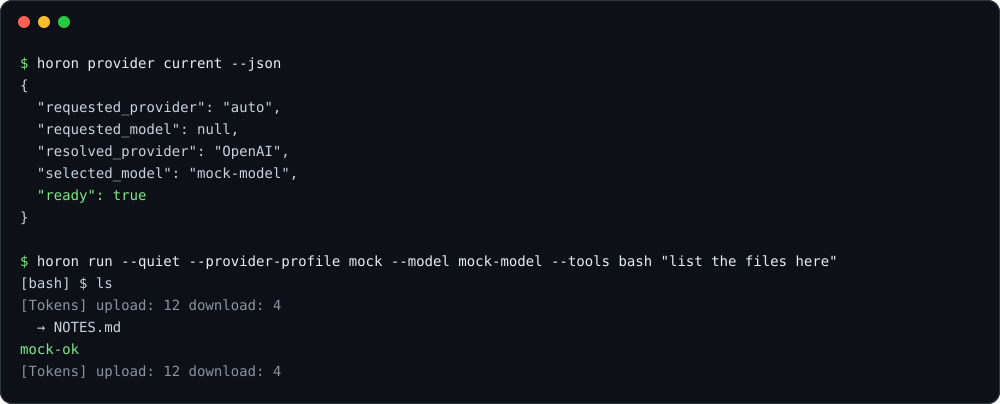

<p align="center">
  
</p>

<p align="center">
  <strong>헤드리스 코딩 에이전트. Rust 실행 파일 하나, OpenAI 호환 엔드포인트라면 무엇이든.</strong>
</p>

<p align="center">
  Language: <a href="README.md">English</a> | <strong>한국어</strong>
</p>

<p align="center">
  <a href="https://github.com/horon-ai/agent/releases/latest"></a>
  <a href="https://github.com/horon-ai/agent/actions/workflows/ci.yml"></a>
  <a href="LICENSE"></a>
  <a href="https://www.rust-lang.org"></a>
</p>

`horon-agent`는 horon의 에이전트 백엔드다. 모델 호출, 도구, 세션, MCP를 도는 에이전트 루프를 세 가지 방식으로 열어 준다. 한 번만 실행하는 명령, SDK용 유닉스 소켓 하네스 API, 에디터용 표준 입출력 Agent Client Protocol(ACP)이다. 헤드리스 실행 파일은 터미널 UI를 열지 않고, 모델 프로토콜도 OpenAI 호환 `/chat/completions` 하나만 쓴다.

- **계약으로 보장하는 헤드리스.** `horon-agent` 의존성 그래프에는 `ratatui`, `crossterm`, `horon-tui`, `horon-agent-tui*` 크레이트가 없고, 하나라도 닿으면 `scripts/ci/check_headless_graph.py`가 CI를 실패시킨다. 대화형 터미널 클라이언트는 에이전트 SDK를 쓰는 별도 `horon-tui` 패키지이고, 터미널에서 인자 없이 실행한 `horon`은 그 형제 실행 파일로 자기 프로세스를 넘긴다.
- **ACP v1과 v2.** `horon acp`는 `initialize`에 양쪽이 지원하는 가장 높은 프로토콜 버전으로 답한다.
- **모델 직접 호출.** 에이전트가 엔드포인트로 바로 POST한다. 사이에 라우터 프로세스나 플러그인 호스트가 없다.
- **가볍고 빠른 시작.** GitHub 호스티드 러너에서 한 턴 실행이 Linux 69.8 ms, macOS 104.7 ms 걸렸다([수치와 한계](#벤치마크)).

## 설치

**macOS · Linux**

```sh
curl -fsSL https://raw.githubusercontent.com/horon-ai/agent/main/scripts/install/install.sh | bash
```

**Windows (PowerShell)**

```powershell
irm https://raw.githubusercontent.com/horon-ai/agent/main/scripts/install/install.ps1 | iex
```

설치 스크립트는 릴리스 압축 파일과 `SHA256SUMS`를 받아 `horon-agent install-release`에 넘긴다. 이 명령이 체크섬을 확인하고, 바뀌지 않는 버전 디렉터리를 만들고, `stable`/`current` 링크를 바꾼다. 같은 버전 디렉터리에 다른 바이트가 있으면 덮어쓰지 않고 거부한다([자세히](docs/release/INSTALL.ko.md)).

**컨테이너 (Linux, amd64·arm64)**

```sh
docker run --rm ghcr.io/horon-ai/agent:latest --version
```

**소스에서 빌드** (Rust 1.99 이상, edition 2024)

```sh
cargo build --release -p horon-agent
./target/release/horon-agent --version
```

릴리스 자산은 Linux(x86_64, aarch64), macOS(aarch64, x86_64), Windows(x86_64, aarch64), FreeBSD(x86_64)를 담는다. 런처는 `horon-agent`이고, v0.1.3부터 설치 때 별칭 `horon`(이 문서들이 쓰는 기본 명령)과 더 짧은 `hrn`도 만든다. 셋 다 같은 실행 파일이다. 데이터는 `~/.horon`에 두고(`HORON_HOME`으로 바꿀 수 있다), v0.1.1까지의 릴리스는 `~/.horon-agent`를 쓴다.

## 빠른 시작

에이전트가 쓸 엔드포인트를 정한다. OpenAI 호환 서버면 모두 된다. 아래는 키가 필요 없는 로컬 서버 예시다.

```toml
# ~/.horon/config.toml
[provider]
default_provider = "local"

[providers.local]
type = "openai-compatible"
base_url = "http://127.0.0.1:11434/v1"
auth = "none"
default_model = "my-model"
```

호스팅 엔드포인트라면 `auth = "bearer"`와 `api_key_env = "MY_API_KEY"`를 쓴다. 준비 상태를 확인하고 한 턴을 실행한다.

```sh
horon provider current --json   # 프로파일이 정해지면 "ready": true
horon run "summarize this repo"
```

<p align="center">
  
</p>

<sub>`dev` 빌드를 저장소의 결정적 모의 모델 서버(`scripts/perf/mock_llm_server.py`)에 붙여 격리된 홈 디렉터리에서 실제로 실행해 얻은 출력이다. 모델 응답은 모의 서버의 고정 문구다.</sub>

프로파일이 없으면 모델 호출은 네트워크에 닿기 전에 멈추고 빠진 `[providers.<name>]` 표를 알려 준다. 모든 키(`headers`, `extra_body`, `context_window`, `openrouter`·`zai`·`kimi`·`ollama` 같은 내장 프로파일)는 [docs/provider/MODEL.ko.md](docs/provider/MODEL.ko.md)에 있다.

## 실행 방법

| 명령 | 하는 일 |
| --- | --- |
| `horon run "<메시지>"` | 메시지 하나를 보내고 턴이 끝날 때까지 도구를 실행한 뒤 종료한다. |
| `horon repl` | 줄 단위 간단한 REPL(TUI 아님). |
| `horon serve` | 유닉스 소켓(`HORON_AGENT_SOCKET`)에서 도는 백그라운드 에이전트 데몬. |
| `horon api-bridge` | SDK 클라이언트용 하네스 API 소켓(`HORON_AGENT_API_SOCKET`, Unix 전용). |
| `horon acp` | 에디터용 표준 입출력 ACP v1/v2 어댑터. |

### 에디터 (ACP)

`horon`(또는 `horon-agent`)을 인자 `acp`와 함께 외부 에이전트로 등록한다. Zed(`settings.json`) 예시다.

```json
{
  "agent_servers": {
    "horon agent": {
      "type": "custom",
      "command": "/absolute/path/to/horon-agent",
      "args": ["acp"]
    }
  }
}
```

JetBrains와 다른 ACP 클라이언트도 같은 두 값을 받는다. [docs/protocol/ACP.ko.md](docs/protocol/ACP.ko.md)를 본다.

### SDK

| 언어 | 패키지 이름 | 위치 |
| --- | --- | --- |
| TypeScript | `@horon-ai/agent-sdk` | [`sdk/typescript`](sdk/typescript) |
| Python | `horon-agent-sdk` | [`sdk/python`](sdk/python) |

둘 다 `api-bridge` 소켓으로 하네스 API(프로토콜 v1)를 쓰고, `launch()`로 자체 데몬을 띄울 수 있다. 이 글을 쓰는 시점에는 어느 패키지도 npm이나 PyPI에 올라 있지 않으므로 소스 체크아웃에서 설치한다. 단계는 각 SDK의 README에 있다.

## 구조

<p align="center">
  
</p>

크레이트 경계와 플랫폼 어댑터는 [docs/architecture/CRATES.ko.md](docs/architecture/CRATES.ko.md), 데몬·세션·소켓은 [docs/architecture/SERVER.ko.md](docs/architecture/SERVER.ko.md)에 있다.

## 기능

- **핵심 도구 18개.** `bash`, `read`, `write`, `edit`, `replace`, `apply_patch`, `agentgrep`, `ls`, `webfetch`, `websearch`, `skill_manage`, `mcp`, `monitor`, `undo`, `ask`, `todo`, `session_search`, `swarm`. core 세션은 이 중 일곱 개와 `toolbox`를 처음부터 보내고, 나머지 열한 개는 시스템 프롬프트에 이름만 적어 `toolbox`로 부르게 해서 첫 요청을 작게 유지한다. 프로필은 `core`(기본), `full`, `acp`, `minimal`, `none`이다([docs/runtime/TOOLS.ko.md](docs/runtime/TOOLS.ko.md)).
- **추가만 하는 세션.** 이력은 `<홈>/sessions/<id>/events.jsonl` 이벤트 로그이고 큰 페이로드는 내용 주소 blob에 둔다. 보관, 압축, 되감기는 기록을 덧붙일 뿐 원본을 지우지 않는다. `horon session inspect|doctor|export|import|migrate|recover-to`로 저장소를 다룬다([docs/protocol/SESSION_STORE.ko.md](docs/protocol/SESSION_STORE.ko.md)).
- **편집 안전 장치.** 저널이 파일 편집의 `undo`를 받쳐 주고, `redo`와 hashline 앵커는 켜야 쓴다([docs/runtime/TOOLS.ko.md](docs/runtime/TOOLS.ko.md)).
- **MCP와 스킬.** `horon mcp`는 설정된 MCP 서버를 나열하고 원격 서버의 OAuth 자격 증명을 관리한다. 스킬은 `skill://`로 읽고 `skill_manage`로 관리한다.
- **무인 실행.** 턴 복구, `horon runtime-state`(영속 대기 입력을 조회·정리), `horon approvals`(사람을 기다리다 멈춘 실행에 사람의 판정을 기록)로 사람이 자리에 없는 실행을 받친다([docs/safety/SAFETY.ko.md](docs/safety/SAFETY.ko.md)).
- **에이전트 간 메시지.** 켜야 쓰는 `irc` 메일박스 버스(`[tools] irc = true`)로 한 데몬 안의 에이전트가 `send`, `wait`, `inbox`, `list`를 쓴다([docs/runtime/IRC.ko.md](docs/runtime/IRC.ko.md)).
- **워크스페이스 신뢰.** 프로젝트 안의 MCP 설정은 다이제스트를 신뢰하기 전까지 건너뛰고, `--trust-workspace`가 그 결정을 기록한다([docs/safety/SECURITY.ko.md](docs/safety/SECURITY.ko.md)).
- **OpenSSL 없는 TLS.** 내장 webpki 루트와 OS 신뢰 저장소의 합집합을 쓰는 rustls다. Linux 바이너리는 glibc, libm, libgcc_s만 있으면 뜬다([docs/release/INSTALL.ko.md](docs/release/INSTALL.ko.md)).

## 벤치마크

`.github/workflows/benchmark-docs.yml`이 GitHub 호스티드 러너에서 커밋 `2a4027c`로 jcode v0.99.1과 비교해 잰 값이다. 결정적 모의 모델을 쓰고 턴마다 `ls` 도구를 한 번 부른다. OS마다 기계가 달라서 같은 줄 안에서만 비교하고 줄끼리는 비교하지 않는다.

<p align="center">
  
</p>

| Linux (`ubuntu-24.04`) | horon | jcode |
| --- | --- | --- |
| 한 턴 실행, 중앙값 | 69.8 ms | 149.4 ms |
| 스킬 호출, 중앙값 | 57.8 ms | 59.2 ms |
| MCP 도구 호출, 중앙값 | 86.2 ms | 182.1 ms |
| 한 턴 최대 프로세스 트리 RSS | 36.4 MB | 38.3 MB |
| 세션 하나 추가당 메모리(3턴 뒤 유휴) | 201.5 KB | 127.9 KB |
| 설치 크기 | 110.5 MB | 163.4 MB |

macOS에서는 한 턴(104.7 ms 대 361.6 ms), 스킬(118.4 ms 대 270.0 ms), MCP(111.8 ms 대 659.2 ms) 모두 horon이 빨랐다. **Windows에서는 한 턴 실행에서 jcode가 더 빨랐고**(112.9 ms 대 189.0 ms) 스킬은 비슷했다. MCP 호출은 horon이 빨랐다(215.8 ms 대 306.2 ms). Linux에서는 세션 하나를 더할 때 jcode가 메모리를 덜 쓴다. 이 값은 한 커밋에서 CI로 얻은 표본이며 보장이 아니다. 도구 여덟 개의 전체 표와 측정 방법, 수치가 말해 주지 않는 것은 [docs/performance/RESULTS.ko.md](docs/performance/RESULTS.ko.md)와 [docs/performance/BENCHMARK.ko.md](docs/performance/BENCHMARK.ko.md)에 있다.

## 설정 기본값

| 설정 | 기본값 | 다른 값 |
| --- | --- | --- |
| 도구 프로필(`--tool-profile`, `[tools] profile`) | `core` | `full`, `acp`, `minimal`, `none` |
| `[acp] profile` | `standard` | `extended`, `full` |
| `[tools] ask_policy` | `recommended` | `error` |
| `[tools] bash_pty` | `auto` | `off`, `always` |
| `[features] turn_recovery` | `conservative` | `aggressive`, `off` |
| `[storage] sync` | `full`(정전에도 내구성 보장) | `fast` |
| `[server] idle_hibernation_secs` | `1800` | `0`이면 끔 |
| `serve`의 업데이트 확인 | 실행하지 않음 | `--no-update`는 어디서든 건너뜀 |

계약에 속하는 기본값 전체는 `AGENTS.md`에 있다.

## 문서

문서는 영어(기본)와 한국어(`.ko.md`) 두 벌로 쓰여 있다. 영어본은 바이너리에 들어가 `horon_agent_docs` 도구가 제공한다.

| 주제 | 문서 |
| --- | --- |
| 색인과 고정 요구사항 | [docs/README.ko.md](docs/README.ko.md) |
| 모델 엔드포인트와 API 키 | [docs/provider/MODEL.ko.md](docs/provider/MODEL.ko.md) |
| 에디터와 ACP | [docs/protocol/ACP.ko.md](docs/protocol/ACP.ko.md) |
| SDK용 하네스 API | [docs/protocol/HARNESS_API.ko.md](docs/protocol/HARNESS_API.ko.md) |
| 도구, 승인, 편집 안전 장치 | [docs/runtime/TOOLS.ko.md](docs/runtime/TOOLS.ko.md) |
| 턴, 복구, `--resume` | [docs/runtime/TURNS.ko.md](docs/runtime/TURNS.ko.md) |
| 릴리스 설치와 Linux 서버 | [docs/release/INSTALL.ko.md](docs/release/INSTALL.ko.md) |
| 성능 측정 방법과 결과 | [docs/performance/BENCHMARK.ko.md](docs/performance/BENCHMARK.ko.md) |

## 기여

먼저 [`AGENTS.md`](AGENTS.md)를 읽는다. 이 문서가 최상위 계약이다. 모든 변경은 세 가지를 지킨다. `horon-agent` 패키지에 터미널 UI 없음, ACP v1·v2 모두 지원, 기록된 기준선 대비 측정된 성능 회귀 없음.

- `dev`에서 브랜치를 만들고 `dev`로 풀 리퀘스트를 연다. 모든 풀 리퀘스트는 이 저장소의 실제 이슈를 연결해야 한다(`Closes #123`). `Require Linked Issue` 검사가 이를 확인한다.
- 푸시하기 전에 검사를 돌린다.

  ```sh
  cargo fmt --all -- --check
  cargo clippy --locked --all-targets --all-features -- -D warnings
  cargo test --workspace
  ```

- 성능 주장은 개발자 기계가 아니라 GitHub Actions의 벤치마크 워크플로로 낸다.

## 라이선스

[MIT](LICENSE). 저작권 2025 Jeremy Huang, 2026 horon-ai.
