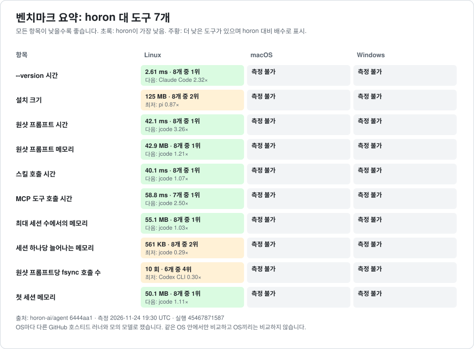
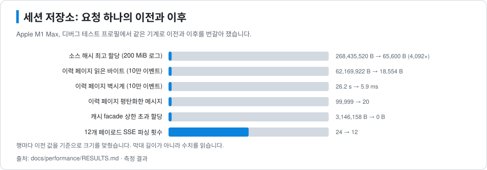
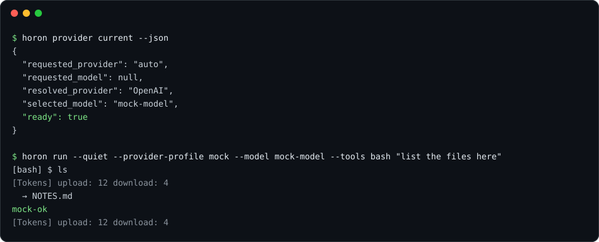

<p align="center">
  
</p>

<p align="center">
  <strong>에이전트는 하나, 동등한 모드는 둘. 프로그램이 움직이거나 사람이 터미널에서 직접 움직이며, 모델은 Chat Completions, Responses, Anthropic Messages, Gemini generateContent 중 한 방식으로 부른다.</strong>
</p>

<p align="center">
  Language: <a href="README.md">English</a> | <strong>한국어</strong>
</p>

<p align="center">
  <a href="https://github.com/horon-ai/agent/releases/latest"></a>
  <a href="https://github.com/horon-ai/agent/actions/workflows/ci.yml"></a>
  <a href="LICENSE"></a>
  <a href="https://www.rust-lang.org"></a>
</p>

horon agent는 엔진 하나 위에 동등한 모드 두 개를 둔 에이전트다. 헤드리스 모드에서는 프로그램이 세션을 움직인다. 한 번만 실행하는 명령, SDK, ACP로 붙는 에디터, 표준 입출력 RPC를 쓰는 호스트 프로그램이 여기에 속한다. TUI 모드에서는 사람이 터미널 클라이언트 `horon-tui`로 직접 움직인다. 두 모드는 같은 데몬에 붙어 세션·도구·MCP 서버·설정을 함께 쓴다. 달라지는 것은 반대편에 누가 있느냐뿐이고, 어느 쪽도 다른 쪽의 축소판이 아니다.

모델은 프로파일의 `type`이 고르는 네 가지 방식(OpenAI Chat Completions, OpenAI Responses, Anthropic Messages, Gemini generateContent) 가운데 하나로 부른다. 공급자 런타임 하나가 설정된 엔드포인트로 직접 POST한다.

릴리스마다 같은 태그에서 빌드한 바이너리 두 개가 나온다. 에이전트 바이너리 `horon-agent`는 헤드리스 모드를 맡고 두 모드가 붙는 데몬을 돌리며, 전체 화면 터미널 UI를 그리지 않는다. TUI 바이너리 `horon-tui`는 에이전트 SDK 위에 만든 별도 패키지이고, 에이전트 옆에 자체 압축 파일로 나온다.

| 모드 | 누가 움직이나 | 진입 명령 |
| --- | --- | --- |
| 헤드리스 | 프로그램 | `run`, `serve`, `api-bridge`, `acp`, `rpc` |
| TUI | 터미널 앞의 사람 | 인자 없는 `horon`(자기 프로세스를 `horon-tui`로 넘긴다) |

## 숫자



- 이벤트 10만 개 세션의 이력 페이지 한 장은 62,169,922 B 대신 18,554 B를 읽고, 26.2 s 대신 5.9 ms가 걸립니다. 200 MiB 소스 해시의 최고 할당은 268,435,520 B 대신 65,600 B입니다.
- jcode와 다른 도구 여섯 개를 비교한 값은 [벤치마크](#벤치마크)의 자동 생성 표에 있습니다. 수치는 개발자 기계가 아니라 GitHub Actions 실행에서 나옵니다.



위 수치는 모두 측정값이고 실행 기록은 [docs/performance/RESULTS.ko.md](docs/performance/RESULTS.ko.md)에 있습니다. 방법과 한계는 [docs/performance/BENCHMARK.ko.md](docs/performance/BENCHMARK.ko.md)에 있습니다. [설치](#설치)는 명령 한 줄입니다.

## 설치

**macOS · Linux**

```sh
curl -fsSL https://raw.githubusercontent.com/horon-ai/agent/main/scripts/install/install.sh | bash
```

**Windows (PowerShell)**

```powershell
irm https://raw.githubusercontent.com/horon-ai/agent/main/scripts/install/install.ps1 | iex
```

**컨테이너 (Linux, amd64·arm64)**

```sh
docker run --rm ghcr.io/horon-ai/agent:latest --version
```

**소스에서 빌드** (Rust 1.99 이상, edition 2024)

```sh
cargo build --release -p horon-agent
./target/release/horon-agent --version
```

설치 스크립트는 릴리스 압축 파일과 `SHA256SUMS`를 함께 받아 `horon install-release`에 넘긴다. 이 명령이 체크섬을 확인하고, 바뀌지 않는 버전 디렉터리를 만든 뒤 `stable`·`current` 링크를 바꾼다. 같은 버전 디렉터리에 다른 바이트가 이미 있으면 덮어쓰지 않고 거부한다([자세히](docs/release/INSTALL.ko.md)).

설치 스크립트가 만드는 실행 이름은 셋이다. 이 문서의 모든 예제가 쓰는 `horon`, 같은 명령을 짧게 부르는 `hrn`, 실행 파일 자체의 이름인 `horon-agent`다. 셋 다 같은 파일을 가리킨다. 데이터는 `~/.horon`에 두고 `HORON_HOME`으로 바꿀 수 있으며, v0.1.1까지의 릴리스는 `~/.horon-agent`를 쓴다.

릴리스 자산은 Linux(x86_64, aarch64), macOS(aarch64, x86_64), Windows(x86_64, aarch64), FreeBSD(x86_64)를 담는다.

## 빠른 시작

에이전트가 쓸 엔드포인트를 정한다. 방식은 프로파일의 `type`이 고르며, 아래는 키가 필요 없는 로컬 Chat Completions 서버 예시다.

```toml
# ~/.horon/config.toml
[provider]
default_provider = "local"

[providers.local]
type = "openai-compatible"
base_url = "http://127.0.0.1:11434/v1"
auth = "none"
default_model = "my-model"
```

호스팅 엔드포인트라면 대신 `auth = "bearer"`와 `api_key_env = "MY_API_KEY"`를 쓴다. 그다음 준비 상태를 확인하고 한 턴을 돌린다.

```sh
horon provider current --json   # 프로파일이 정해지면 "ready": true
horon run "summarize this repo"
```

<p align="center">
  
</p>

<sub>`dev` 빌드를 저장소의 결정적 모의 모델 서버(`scripts/perf/mock_llm_server.py`)에 붙여 격리된 홈 디렉터리에서 실제로 실행해 얻은 출력이다. 모델 응답은 모의 서버의 고정 문구다.</sub>

프로파일을 정하지 않으면 모델 호출은 네트워크에 닿기 전에 멈추고 빠진 `[providers.<name>]` 표를 알려 준다. `headers`, `extra_body`, `context_window`와 `openrouter`·`zai`·`kimi`·`ollama` 같은 내장 프로파일까지 모든 키는 [docs/provider/MODEL.ko.md](docs/provider/MODEL.ko.md)에 있다.

이름 있는 프로파일에 `stream_first_event_timeout_secs`와 `stream_idle_timeout_secs`를 두면 첫 응답과 응답 도중 대기 시간을 따로 제한할 수 있다.
`max_in_flight_requests`를 지정하면 같은 프로파일을 쓰는 여러 세션의 동시 요청 수를 제한할 수 있다.
터미널에서 `/modelpreset`으로 이름을 붙인 [세션 모델 설정](docs/provider/MODEL.ko.md#세션-모델-프리셋)을 미리 보고 적용할 수 있다.
`horon --isolated-profile <name>`으로 설정, 세션, 인증 자료, daemon 소켓을 격리된 로컬 프로필에 둘 수 있다([설치 문서](docs/release/INSTALL.ko.md#런처-별칭-horon-hrn)).

## 실행 방법

인자 없는 `horon`만 TUI 모드를 열고, 아래 하위 명령은 모두 헤드리스 모드다. `horon repl`은 전체 화면 클라이언트 없이 쓰려는 사람을 위해 에이전트 바이너리가 직접 제공하는 단순한 줄 단위 입력 프롬프트다.

| 명령 | 하는 일 |
| --- | --- |
| `horon`(하위 명령 없음) | 터미널에서는 서버를 띄운 뒤 형제 파일 `horon-tui`로 자기 프로세스를 넘긴다. 키 바인딩, 사용자 파일, 설정 화면이 있다([문서](docs/runtime/TUI.ko.md)). 파이프, `HORON_NO_TUI=1`, 형제 파일 부재 중 하나면 어떤 조건인지와 설치 명령을 알리는 문장을 남기고 0이 아닌 코드로 끝난다. |
| `horon run "<메시지>"` | 메시지 하나를 보내고, 턴이 끝날 때까지 도구를 실행한 뒤 종료한다. `--thinking`과 `--service-tier`로 [모델 옵션](docs/provider/MODEL.ko.md#설정)을 지정한다. `--no-pty`로 셸 도구에 파이프를 쓰며 `--no-session`으로 실행을 메모리에만 두고 [`--max-time`](docs/runtime/TURNS.ko.md#실행-시간-제한)으로 실행 시간을 제한하며 `--warn-cost`와 `--max-cost`로 추정 비용을 감시한다. |
| `horon repl` | 전체 화면 클라이언트 없이 터미널에서 한 줄씩 입력한다. |
| `horon serve` | 유닉스 소켓(`HORON_AGENT_SOCKET`)에서 도는 백그라운드 에이전트 데몬. |
| `horon api-bridge` | SDK 클라이언트용 하네스 API 로컬 소켓(`HORON_AGENT_API_SOCKET`). Unix 소켓이거나 Windows의 네임드 파이프다. |
| `horon acp` | 에디터용 표준 입출력 ACP v1·v2 어댑터. |
| `horon stats --from 2026-11-01 --through 2026-11-21` | 저장한 토큰 사용량을 UTC 날짜, 제공자와 모델별로 표시합니다. `--json`으로 구조화된 결과를 받고, 터미널 클라이언트에서는 `/stats`로 연결된 세션의 사용량을 봅니다. |
| `horon rpc` | 프로세스를 직접 소유한 호스트 프로그램용 표준 입출력 JSONL RPC 어댑터. 표준 입력으로 한 줄에 JSON 명령 하나, 표준 출력으로 한 줄에 프레임 하나를 주고받는다([문서](docs/protocol/RPC.ko.md)). `--mode rpc`도 같은 어댑터를 고른다. |
| `horon completions <bash\|zsh\|fish>` | 데몬을 시작하지 않고 셸 자동완성 스크립트를 출력한다. |
| `horon stream-rules [TEXT]` | 스트림 규칙을 검사하고 모델 답변 예시에 맞는 규칙을 오프라인에서 확인한다. |
| `horon tokens [TEXT]` | UTF-8 텍스트를 인자나 표준 입력으로 받거나 `--file`에서 읽어 오프라인으로 토큰 수를 추정한다. `--model`로 알려진 토크나이저 계열을 고르며 기본 추정 방식을 사용하면 결과에 표시한다. |
| `horon agents` | 세션을 시작하지 않고 에이전트 정의의 출처와 설정된 모델 및 도구를 나열한다. |
| `horon provider status [--json]` | 설정된 프로파일마다 자격 증명 출처와 로컬 상태(`authenticated`, `unauthenticated`, `unknown`)를 표시한다. 자격 증명 값은 출력하지 않고 제공자에도 접속하지 않는다. |
| `horon compact-text <FILE\|->` | UTF-8 텍스트 파일(또는 표준 입력, 48KiB 이하)을 요약해 표준 출력에 내고 생략한 항목을 표준 오류에 나열한다. 원본은 고치지 않는다. `--max-tokens`로 요약 길이를 제한한다. |

`horon run --wait-async "<메시지>"`는 해당 실행이 시작한 작업을 기다리고 각 작업의 최종 상태를 한 번씩 표시합니다. `--max-time`은 응답과 작업 대기를 합친 시간을 제한합니다. 시간을 넘기면 확인한 작업 상태를 표시하고 0이 아닌 코드로 종료합니다.

`horon run --system-template <FILE>`은 텍스트 템플릿을 한 번 렌더링해 그 실행의 시스템 프롬프트로 쓴다. 변수는 `{{cwd}}`, `{{date}}`, `{{model}}`이며 치환된 값은 다시 해석하지 않는다. 모르는 변수, 닫히지 않은 `{{`, 16KiB를 넘는 템플릿은 모델 요청 전에 거절한다.

`horon run --no-session "<메시지>"`는 실행을 메모리에만 둡니다. `$HORON_HOME` 아래에 세션 로그, 체크포인트, 카탈로그 행, 실행 저널을 쓰지 않으므로 실행 뒤에 이어가거나 복구할 수 없고, 실패한 실행도 흔적을 남기지 않습니다. `--json`과 `--ndjson` 출력의 세션 ID는 저장된 세션을 가리키지 않습니다. 로그와 사용량 기록 같은 세션 밖 상태는 평소처럼 기록합니다. 저장된 세션이 필요한 `--resume`, `--continue`, `--goal`과는 함께 쓸 수 없습니다. `todo`처럼 세션별 파일을 따로 쓰는 도구는 이 보장에 포함되지 않습니다.

`horon run --warn-cost <USD>`는 실행의 추정 비용이 그 금액에 닿으면 표준 오류에 경고를 한 번 표시합니다. `--max-cost <USD>`는 추정 비용이 그 금액에 닿은 뒤로 새 모델 요청을 보내지 않고, 실행은 비용 상한 오류로 끝납니다. 추정은 응답이 보고한 토큰과 가격 카탈로그로 계산합니다. 이미 보낸 요청은 끝까지 처리해 합산하므로 합계가 처리 중이던 만큼 상한을 넘을 수 있습니다. 가격을 모르는 모델은 따로 보고하며 무료로 세지 않으므로 상한이 적용되지 않습니다. 같은 프로세스가 소유한 자식 에이전트도 같은 실행에 합산합니다. 두 옵션이 없으면 요청은 달라지지 않습니다.

`horon acp`는 `initialize`에 양쪽이 지원하는 가장 높은 프로토콜 버전으로 답하므로 v1 클라이언트와 v2 클라이언트가 모두 붙는다.

### 터미널 클라이언트

`horon-tui`가 TUI 모드다. 거슬러 읽을 수 있고 모델의 마크다운을 렌더링하는 대화 기록 창, 여덟 행까지 자라는 여러 줄 편집기, 도구 호출을 붙잡고 `y`, `a`, `n`, `esc`를 받는 승인 프롬프트, 모델·세션 선택 목록, `/settings` 뒤에 있는 설정 화면을 제공한다. 별도 패키지(`crates/tui`)이고 `horon-agent-sdk`로 만들어 다른 클라이언트와 같은 데몬·세션에 붙는다. 그래서 터미널 라이브러리가 에이전트 바이너리에 들어가지 않는다.

터미널에서 `horon`, `hrn`, `horon-agent`를 인자 없이 실행하면 시작한다. 서버가 없으면 띄운 뒤 자기 프로세스를 에이전트 옆의 `horon-tui`로 넘긴다. 이때 새 세션이 실행한 디렉터리에 속하도록 작업 디렉터리를 넘기고, `--resume <id>`를 줬다면 세션 번호도 넘긴다. 먼저 조건 셋을 확인한다. 표준 입력과 표준 출력이 모두 터미널이고, `HORON_NO_TUI`가 설정되지 않았고, 실행 중인 파일 옆에 `horon-tui`가 있어야 한다. 파이프나 리디렉션이면 클라이언트 대신 그 문장을 남기므로 스크립트와 CI는 이유를 받는다. 조건이 맞지 않으면 어떤 조건인지 알리고, 대화형 클라이언트 설치 명령을 안내한 뒤 0이 아닌 코드로 끝난다.

현재 작업 디렉터리에서 가장 최근에 활동한 저장 세션을 다시 열려면 `horon --continue`를 실행한다. 특정 세션을 고르려면 `--resume <id>`를 사용한다.

`horon --goal "Ship a fix" --goal-budget 1200`으로 새 세션에 목표와 토큰 예산을 설정할 수 있습니다.

설치 스크립트는 에이전트 압축 파일 옆에서 `horon-tui-<플랫폼 접미사>.tar.gz`도 받아 `SHA256SUMS`로 검증한다. 이 압축 파일은 선택 사항이다. 배포가 올리지 않았거나, 다이제스트가 맞지 않거나, 소스 빌드이거나, FreeBSD이면 경고 한 줄을 남기고 에이전트만 설치하거나 그대로 둔다. 사용자 파일은 `$HORON_HOME/tui.toml`, `themes/<이름>.json`, `keybindings.toml`, `commands/<이름>.md`, 프로젝트의 `.horon/commands/<이름>.md`이고 모든 키는 [docs/runtime/TUI.ko.md](docs/runtime/TUI.ko.md)에 있다.

### 에디터 (ACP)

`horon`(또는 `horon-agent`)을 인자 `acp`와 함께 외부 에이전트로 등록한다. Zed(`settings.json`) 예시다.

```json
{
  "agent_servers": {
    "horon agent": {
      "type": "custom",
      "command": "/absolute/path/to/horon",
      "args": ["acp"]
    }
  }
}
```

JetBrains와 다른 ACP 클라이언트도 같은 두 값을 받는다. 표준 입출력 계약과 v2의 차이는 [docs/protocol/ACP.ko.md](docs/protocol/ACP.ko.md)에 있다.

### 호스트 프로그램 (RPC)

프로세스를 직접 소유한 프로그램은 터미널을 넘겨받는 대신 에이전트를 직접 구동할 수 있다. `horon rpc` 또는 `horon --mode rpc`는 표준 입력에서 한 줄에 JSON 명령 하나를 읽고 표준 출력으로 한 줄에 프레임 하나를 쓴다. 스트리밍 턴, 취소, 세션 제어를 지원하고, 호스트가 둘 다 넘기면 서브커맨드가 이긴다. 표준 출력에는 프레임만 나가고 진단은 표준 오류로 가며, 표준 입력을 닫으면 프로세스가 끝난다. 이 모드는 프로토콜 버전 1을 쓰므로 1 MiB를 넘는 프레임은 쪼개지 않고 오류가 된다. 터미널 클라이언트도 ACP도 아니다. `horon-tui`는 하네스 API로 붙고, RPC는 ACP를 쓸 수 없는 호스트를 받는다([문서](docs/protocol/RPC.ko.md)).

### SDK

| 언어 | 패키지 이름 | 위치 |
| --- | --- | --- |
| TypeScript | `@horon-ai/agent-sdk` | [`packages/sdk/typescript`](packages/sdk/typescript) |
| Python | `horon-agent-sdk` | [`packages/sdk/python`](packages/sdk/python) |

둘 다 `api-bridge` 소켓으로 하네스 API(프로토콜 v1)를 쓰고 `launch()`로 자체 데몬을 띄울 수 있다. 아직 어느 패키지도 npm이나 PyPI에 올라 있지 않으므로 소스 체크아웃에서 설치한다. 단계는 각 SDK README에 있다.

## 기능

<details>
<summary>기능 전체</summary>

| 기능 | 설명 |
| --- | --- |
| 핵심 도구 18개 | `bash`, `read`, `write`, `edit`, `replace`, `apply_patch`, `agentgrep`, `ls`, `webfetch`, `websearch`, `skill_manage`, `mcp`, `monitor`, `undo`, `ask`, `todo`, `session_search`, `swarm`. core 세션은 이 중 일곱 개와 `toolbox`를 처음부터 보내고, 나머지 열한 개는 시스템 프롬프트에 이름만 적어 `toolbox`로 부르게 하므로 첫 요청이 작다. 프로필은 `core`(기본), `full`, `acp`, `minimal`, `none`이다([문서](docs/runtime/TOOLS.ko.md)). |
| 추가만 하는 세션 | 이력은 `<홈>/sessions/<id>/events.jsonl` 이벤트 로그이고, 큰 페이로드는 내용 주소 blob에 둔다. 보관, 압축, 되감기는 기록을 덧붙일 뿐 원본을 지우지 않는다. `horon session` 하위 명령이 그 저장소를 조회·점검·내보내기·가져오기·이전·복구·보관·복원하고, 파괴적인 명령은 `delete <id> --yes` 하나뿐이며 실행 중인 데몬이 열고 있는 세션은 거부한다([문서](docs/protocol/SESSION_STORE.ko.md)). |
| 편집 안전 장치 | 저널이 파일 편집의 `undo`를 받쳐 주고, `redo`와 hashline 앵커는 켜야 쓴다([문서](docs/runtime/TOOLS.ko.md)). |
| 목표 예산 | 이어 가는 목표에 `budget_tokens`를 둘 수 있다. 세션 지출이 그 값에 닿으면 목표가 `budget_limited`가 되고, 지금까지의 결과를 기록하라고 모델에 알리는 마무리 턴을 한 번 준 뒤 멈춘다. 예산을 올리고 목표를 `active`로 되돌리는 일은 운영자가 정한다([문서](docs/runtime/TURNS.ko.md)). |
| MCP와 스킬 | `horon mcp`가 설정된 MCP 서버를 나열하고 원격 서버의 OAuth 자격 증명을 관리한다. 스킬은 `skill://`로 읽고 `skill_manage`로 관리한다. |
| 무인 실행 | 턴 복구, 영속 대기 입력을 다루는 `horon runtime-state`, 사람을 기다리다 멈춘 실행에 사람의 판정을 기록하는 `horon approvals`가 사람이 자리에 없는 실행을 받친다([문서](docs/safety/SAFETY.ko.md)). |
| 에이전트 간 메시지 | 켜야 쓰는 `irc` 메일박스 버스(`[tools] irc = true`)로 한 데몬 안의 에이전트가 `send`, `wait`, `inbox`, `list`를 쓴다([문서](docs/runtime/IRC.ko.md)). |
| 워크스페이스 신뢰 | 프로젝트 안의 MCP 설정은 다이제스트를 신뢰하기 전까지 건너뛰고, `--trust-workspace`가 그 결정을 기록한다([문서](docs/safety/SECURITY.ko.md)). |
| OpenSSL 없는 TLS | 내장 webpki 루트와 OS 신뢰 저장소를 합쳐 쓰는 rustls다. Linux 바이너리는 glibc, libm, libgcc_s만 있으면 뜬다([문서](docs/release/INSTALL.ko.md)). |

</details>

## 구조

<p align="center">
  
</p>

크레이트 경계와 플랫폼 어댑터는 [docs/architecture/CRATES.ko.md](docs/architecture/CRATES.ko.md), 데몬·세션·소켓은 [docs/architecture/SERVER.ko.md](docs/architecture/SERVER.ko.md)에 있다. 터미널 라이브러리가 에이전트 바이너리에 들어오지 않도록 CI에서 `scripts/ci/check_headless_graph.py`가 확인하며, `horon-agent`에서 `ratatui`, `crossterm`, `horon-tui`, `horon-agent-tui*` 크레이트 중 하나라도 닿으면 실패한다.

## 벤치마크

<!-- bench-summary:start -->

`.github/workflows/benchmark-docs.yml`이 이 요약을 그 실행의 `compare.json`에서 다시 씁니다. 버전 표기는 러너가 실제로 설치한 실행 파일에서 읽은 값이지 손으로 적은 상수가 아닙니다.

측정 커밋 `e7b81ddfd166f2609b77ddb0d2080831adab4c34`, 2026-11-20 18:54 UTC. OS마다 다른 기계이므로 같은 줄 안에서만 비교합니다.
jcode v1.0.1(릴리스 `v1.0.1`, 커밋 `10114429c8133994861d6c915a2483d397c0f7c2`).

| Linux (`ubuntu-24.04`) | horon | jcode |
| --- | --- | --- |
| 원샷 프롬프트 시간 | 45.0 ms | 148.2 ms |
| 스킬 호출 시간 | 37.3 ms | 53.9 ms |
| MCP 도구 호출 시간 | 64.2 ms | 164.8 ms |
| 원샷 프롬프트 메모리 | 41.1 MB | 80.1 MB |
| 세션 하나당 늘어나는 메모리 | 379.9 KB | 173.4 KB |
| 설치 크기 | 117.7 MB | 191.4 MB |
| 첫 모델 요청 본문 / 도구 목록 바이트 | 3,699 / 2,358 | 2,888 / 1,100 |

| macOS (`macos-latest`) | horon | jcode |
| --- | --- | --- |
| 원샷 프롬프트 시간 | 46.6 ms | 271.6 ms |
| 스킬 호출 시간 | 38.9 ms | 182.4 ms |
| MCP 도구 호출 시간 | 58.7 ms | 267.9 ms |
| 원샷 프롬프트 메모리 | 31.6 MB | 37.8 MB |
| 세션 하나당 늘어나는 메모리 | 410.9 KB | 333.1 KB |
| 설치 크기 | 99.0 MB | 161.3 MB |
| 첫 모델 요청 본문 / 도구 목록 바이트 | 3,587 / 2,358 | 2,776 / 1,100 |

| Windows (`windows-latest`) | horon | jcode |
| --- | --- | --- |
| 원샷 프롬프트 시간 | 237.1 ms | 177.3 ms |
| 스킬 호출 시간 | 226.8 ms | 272.0 ms |
| MCP 도구 호출 시간 | 274.5 ms | 376.4 ms |
| 원샷 프롬프트 메모리 | 33.1 MB | 30.4 MB |
| 세션 하나당 늘어나는 메모리 | 358.3 KB | 304.4 KB |
| 설치 크기 | 100.3 MB | 153.2 MB |
| 첫 모델 요청 본문 / 도구 목록 바이트 | 3,654 / 2,358 | 2,878 / 1,111 |

[실행](https://github.com/horon-ai/agent/actions/runs/44792005623)

<!-- bench-summary:end -->

이 값은 한 커밋에서 CI로 얻은 표본이며 보장이 아니다. 도구 여덟 개의 전체 표, TUI 측정, 측정 방법, 수치가 말해 주지 않는 것은 [docs/performance/RESULTS.ko.md](docs/performance/RESULTS.ko.md)와 [docs/performance/BENCHMARK.ko.md](docs/performance/BENCHMARK.ko.md)에 있다.

## 설정 기본값

<details>
<summary>기본값 전체</summary>

| 설정 | 기본값 | 다른 값 |
| --- | --- | --- |
| 도구 프로필(`--tool-profile`, `[tools] profile`) | `core` | `full`, `acp`, `minimal`, `none` |
| `[acp] profile` | `standard` | `extended`, `full` |
| `[tools] ask_policy` | `recommended` | `error` |
| `[tools] bash_pty` | `auto` | `off`, `always` |
| `[tools] bash_direnv` | `false` | `true`는 신뢰한 작업 폴더에서 승인된 direnv 파일의 새 변수를 가져온다 |
| `[tools] output_column_cap` | `0`(꺼짐) | 텍스트 미리보기 한 줄에 표시할 유니코드 문자 수(양의 정수) |
| `[features] turn_recovery` | `conservative` | `aggressive`, `off` |
| `[agents] swarm_child_runtime_secs`, `swarm_child_request_limit` | `0`(꺼짐) | 자식별 실행 시간(초) 또는 모델 요청 횟수를 양의 정수로 지정한다 |
| `[agents] swarm_child_request_notice`, `swarm_max_spawn_effort` | `true`, 미설정 | 마지막 요청 알림을 끄거나 자식 생성 시 추론 강도 상한을 지정한다 |
| `[storage] sync` | `full`(정전에도 기록이 남는다) | `fast` |
| `[server] idle_hibernation_secs` | `1800` | `0`이면 끈다 |
| `serve`의 업데이트 확인 | 실행하지 않음 | `--no-update`가 어디서든 건너뛴다 |

</details>

계약에 속하는 기본값 전체는 [`AGENTS.md`](AGENTS.md)에 있다.

## 문서

문서는 영어(기본)와 한국어(`.ko.md`, `docs/README.ko.md`처럼 같은 폴더에 나란히) 두 벌로 쓰여 있다. 영어본은 바이너리에 들어가 `horon_agent_docs` 도구가 제공한다. [agent.horon.ai](https://agent.horon.ai)는 [packages/docs-site](packages/docs-site)에 있는 Mintlify 사이트다. Reference 탭은 `scripts/ci/sync_docs_site.py`가 `docs/`, `PHILOSOPHY.md`, SDK·npm README에서 생성하고, 안내 페이지는 영어로 손수 쓴다. 그래서 안내 페이지가 되풀이하는 동작이 바뀌면 그 페이지도 함께 고친다.

| 주제 | 문서 |
| --- | --- |
| 문서 사이트(`agent.horon.ai`) | [https://agent.horon.ai](https://agent.horon.ai) |
| 문서 사이트 원본 | [packages/docs-site](packages/docs-site) |
| 색인과 고정 요구사항 | [docs/README.ko.md](docs/README.ko.md) |
| 설계 원칙 | [PHILOSOPHY.ko.md](PHILOSOPHY.ko.md) |
| 터미널 클라이언트와 사용자 파일 | [docs/runtime/TUI.ko.md](docs/runtime/TUI.ko.md) |
| 모델 엔드포인트와 API 키 | [docs/provider/MODEL.ko.md](docs/provider/MODEL.ko.md) |
| 에디터와 ACP | [docs/protocol/ACP.ko.md](docs/protocol/ACP.ko.md) |
| 표준 입출력 RPC 호스트 프로그램 | [docs/protocol/RPC.ko.md](docs/protocol/RPC.ko.md) |
| SDK용 하네스 API | [docs/protocol/HARNESS_API.ko.md](docs/protocol/HARNESS_API.ko.md) |
| 도구, 승인, 편집 안전 장치 | [docs/runtime/TOOLS.ko.md](docs/runtime/TOOLS.ko.md) |
| 턴, 복구, `--resume` | [docs/runtime/TURNS.ko.md](docs/runtime/TURNS.ko.md) |
| 릴리스 설치와 Linux 서버 | [docs/release/INSTALL.ko.md](docs/release/INSTALL.ko.md) |
| 성능 측정 방법과 결과 | [docs/performance/BENCHMARK.ko.md](docs/performance/BENCHMARK.ko.md) |

## 기여

먼저 [`AGENTS.md`](AGENTS.md)를 읽는다. 이 문서가 최상위 계약이다. 모든 변경은 세 가지를 지킨다. 에이전트 바이너리 `horon-agent`에 터미널 UI 없음(TUI 모드는 TUI 바이너리 `horon-tui`에 있다), ACP v1·v2 모두 지원, 기록된 기준선 대비 측정된 성능 회귀 없음.

- `dev`에서 브랜치를 만들고 `dev`로 풀 리퀘스트를 연다. `main`은 릴리스 풀 리퀘스트로 바뀐다. 모든 풀 리퀘스트는 이 저장소의 실제 이슈를 연결해야 한다(`Closes #123`). `Require Linked Issue` 검사가 이를 확인한다.
- 푸시하기 전에 검사를 돌린다. `scripts/ci/check_all.sh`가 CI의 Format·Quality Guardrails 단계를 돌리고, Rust 검사는 다음과 같다.

  ```sh
  cargo fmt --all -- --check
  cargo clippy --locked --all-targets --all-features -- -D warnings
  cargo test --workspace
  ```

- 성능 주장은 개발자 기계가 아니라 GitHub Actions의 벤치마크 워크플로에서 낸다.

## 라이선스

[MIT](LICENSE). 저작권 2025 Jeremy Huang, 2026 horon-ai.
