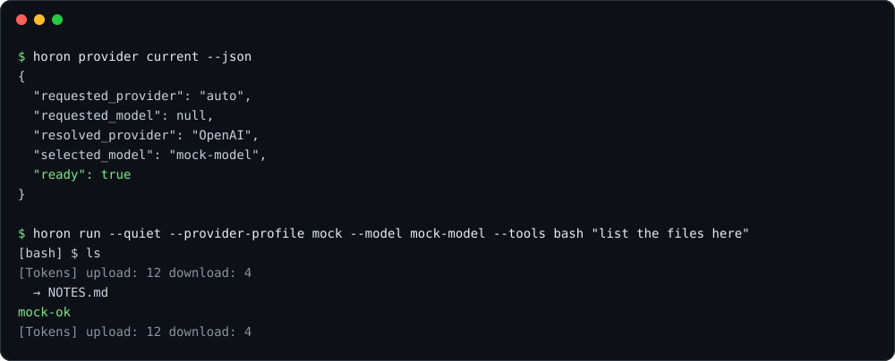

<p align="center">
  
</p>

<p align="center">
  <strong>A headless coding agent. One Rust binary, any OpenAI-compatible endpoint.</strong>
</p>

<p align="center">
  Language: <strong>English</strong> | <a href="README.ko.md">한국어</a>
</p>

<p align="center">
  <a href="https://github.com/horon-ai/agent/releases/latest"></a>
  <a href="https://github.com/horon-ai/agent/actions/workflows/ci.yml"></a>
  <a href="LICENSE"></a>
  <a href="https://www.rust-lang.org"></a>
</p>

`horon-agent` is the agent backend for horon. It runs the agent loop (model calls, tools, sessions, MCP) and exposes it three ways: a one-shot command, a Unix-socket harness API for SDKs, and the Agent Client Protocol (ACP) on stdio for editors. The headless binary never opens a terminal UI and speaks one model protocol: OpenAI-compatible `/chat/completions`.

- **Headless by contract.** The `horon-agent` dependency graph holds no `ratatui`, `crossterm`, `horon-tui`, or `horon-agent-tui*` crate, and `scripts/ci/check_headless_graph.py` fails CI if one becomes reachable. The interactive terminal client is the separate `horon-tui` package on the agent SDK, and bare `horon` on a terminal replaces itself with that sibling binary.
- **ACP v1 and v2.** `horon acp` answers `initialize` with the highest protocol version both sides support.
- **Direct model calls.** The agent POSTs to your endpoint. There is no router process or plugin host in between.
- **Small and fast to start.** On GitHub-hosted runners a one-shot turn took 69.8 ms on Linux and 104.7 ms on macOS ([numbers and caveats](#benchmarks)).

## Install

**macOS · Linux**

```sh
curl -fsSL https://raw.githubusercontent.com/horon-ai/agent/main/scripts/install/install.sh | bash
```

**Windows (PowerShell)**

```powershell
irm https://raw.githubusercontent.com/horon-ai/agent/main/scripts/install/install.ps1 | iex
```

The installer downloads the release archive and `SHA256SUMS`, then hands them to `horon-agent install-release`, which verifies the checksum, stages an immutable version directory and switches the `stable`/`current` links. A version directory that already holds different bytes is refused, not overwritten ([details](docs/release/INSTALL.md)).

**Container (Linux, amd64 and arm64)**

```sh
docker run --rm ghcr.io/horon-ai/agent:latest --version
```

**From source** (Rust 1.99+, edition 2024)

```sh
cargo build --release -p horon-agent
./target/release/horon-agent --version
```

Release assets cover Linux (x86_64, aarch64), macOS (aarch64, x86_64), Windows (x86_64, aarch64) and FreeBSD (x86_64). The launcher is `horon-agent`, and since v0.1.3 the installer also creates the aliases `horon` (the command used throughout these docs) and `hrn` (shorter); all three run the same binary. Data lives in `~/.horon` (override with `HORON_HOME`); releases up to v0.1.1 use `~/.horon-agent`.

## Quick start

Point the agent at an endpoint. Any OpenAI-compatible server works; this example uses a local one with no key.

```toml
# ~/.horon/config.toml
[provider]
default_provider = "local"

[providers.local]
type = "openai-compatible"
base_url = "http://127.0.0.1:11434/v1"
auth = "none"
default_model = "my-model"
```

For a hosted endpoint, set `auth = "bearer"` and `api_key_env = "MY_API_KEY"` instead. Then check readiness and run a turn:

```sh
horon provider current --json   # "ready": true when a profile resolves
horon run "summarize this repo"
```

<p align="center">
  
</p>

<sub>Captured from a real run of a `dev` build against the repository's deterministic mock model server (`scripts/perf/mock_llm_server.py`), with an isolated home directory. The model reply is the mock's fixed text.</sub>

With no profile configured, a model call stops before the network and names the missing `[providers.<name>]` table. See [docs/provider/MODEL.md](docs/provider/MODEL.md) for every key (`headers`, `extra_body`, `context_window`, built-in profiles such as `openrouter`, `zai`, `kimi`, `ollama`).

## Ways to run it

| Command | What it does |
| --- | --- |
| `horon run "<message>"` | Send one message, run tools until the turn ends, exit. |
| `horon repl` | Simple line-based REPL (no TUI). |
| `horon serve` | Background agent daemon on a Unix socket (`HORON_AGENT_SOCKET`). |
| `horon api-bridge` | Harness API on a Unix socket for SDK clients (`HORON_AGENT_API_SOCKET`, Unix only). |
| `horon acp` | ACP v1/v2 adapter on stdio for editors. |

### Editors (ACP)

Register `horon` (or `horon-agent`) with the argument `acp` as an external agent. In Zed (`settings.json`):

```json
{
  "agent_servers": {
    "horon agent": {
      "type": "custom",
      "command": "/absolute/path/to/horon-agent",
      "args": ["acp"]
    }
  }
}
```

JetBrains and other ACP clients take the same two values. See [docs/protocol/ACP.md](docs/protocol/ACP.md).

### SDKs

| Language | Package name | Location |
| --- | --- | --- |
| TypeScript | `@horon-ai/agent-sdk` | [`sdk/typescript`](sdk/typescript) |
| Python | `horon-agent-sdk` | [`sdk/python`](sdk/python) |

Both talk the harness API (protocol v1) over the `api-bridge` socket and can start their own daemon with `launch()`. As of this writing neither package is on npm or PyPI, so install from a source checkout; each SDK README has the steps.

## Architecture

<p align="center">
  
</p>

Crate boundaries and the platform adapters are in [docs/architecture/CRATES.md](docs/architecture/CRATES.md); the daemon, sessions and sockets are in [docs/architecture/SERVER.md](docs/architecture/SERVER.md).

## Features

- **A core tool set of 18.** `bash`, `read`, `write`, `edit`, `replace`, `apply_patch`, `agentgrep`, `ls`, `webfetch`, `websearch`, `skill_manage`, `mcp`, `monitor`, `undo`, `ask`, `todo`, `session_search` and `swarm`. A core session sends seven of them up front plus `toolbox`, names the other eleven in the system prompt, and reaches them through `toolbox`, which keeps the first request small. Profiles: `core` (default), `full`, `acp`, `minimal`, `none` ([docs/runtime/TOOLS.md](docs/runtime/TOOLS.md)).
- **Append-only sessions.** History is an event log at `<home>/sessions/<id>/events.jsonl` with large payloads in content-addressed blobs. Archive, compaction and rewind append records and never delete an original. `horon session inspect|doctor|export|import|migrate|recover-to` work on the store ([docs/protocol/SESSION_STORE.md](docs/protocol/SESSION_STORE.md)).
- **Edit safety.** A journal backs `undo` for file edits, and `redo` and hashline anchors are opt-in ([docs/runtime/TOOLS.md](docs/runtime/TOOLS.md)).
- **MCP and skills.** `horon mcp` lists configured MCP servers and manages remote-server OAuth credentials; skills are read through `skill://` and managed with `skill_manage`.
- **Unattended runs.** Turn recovery, `horon runtime-state` (inspect and settle durable pending inputs) and `horon approvals` (record a human verdict for a run that stopped waiting on a person) support runs with no one at the keyboard ([docs/safety/SAFETY.md](docs/safety/SAFETY.md)).
- **Agent-to-agent messaging.** An opt-in `irc` mailbox bus (`[tools] irc = true`) lets agents in one daemon `send`, `wait`, `inbox` and `list` ([docs/runtime/IRC.md](docs/runtime/IRC.md)).
- **Workspace trust.** Project-local MCP config is skipped until its digest is trusted; `--trust-workspace` records the decision ([docs/safety/SECURITY.md](docs/safety/SECURITY.md)).
- **TLS without OpenSSL.** rustls with the union of bundled webpki roots and the OS trust store; the Linux binary needs only glibc, libm and libgcc_s ([docs/release/INSTALL.md](docs/release/INSTALL.md)).

## Benchmarks

Measured by `.github/workflows/benchmark-docs.yml` on GitHub-hosted runners, commit `2a4027c`, against jcode v0.99.1, using a deterministic mock model and one `ls` tool call per turn. Each OS runs on a different machine, so compare within a row, never across rows.

<p align="center">
  
</p>

| Linux (`ubuntu-24.04`) | horon | jcode |
| --- | --- | --- |
| One-shot turn, median | 69.8 ms | 149.4 ms |
| Skill invocation, median | 57.8 ms | 59.2 ms |
| MCP tool call, median | 86.2 ms | 182.1 ms |
| Peak tree RSS, one-shot | 36.4 MB | 38.3 MB |
| Memory per additional session, idle after 3 turns | 201.5 KB | 127.9 KB |
| Install size | 110.5 MB | 163.4 MB |

On macOS horon was faster on the one-shot (104.7 ms against 361.6 ms), skill (118.4 ms against 270.0 ms) and MCP (111.8 ms against 659.2 ms) runs. **On Windows jcode was faster on the one-shot turn** (112.9 ms against 189.0 ms) and tied on skills; horon was faster on the MCP call (215.8 ms against 306.2 ms). On Linux jcode adds less memory per extra session. These runs are single-commit CI samples, not a guarantee. The full tables for eight tools, the measurement method and what the numbers do not say are in [docs/performance/RESULTS.md](docs/performance/RESULTS.md) and [docs/performance/BENCHMARK.md](docs/performance/BENCHMARK.md).

## Configuration defaults

| Setting | Default | Other values |
| --- | --- | --- |
| Tool profile (`--tool-profile`, `[tools] profile`) | `core` | `full`, `acp`, `minimal`, `none` |
| `[acp] profile` | `standard` | `extended`, `full` |
| `[tools] ask_policy` | `recommended` | `error` |
| `[tools] bash_pty` | `auto` | `off`, `always` |
| `[features] turn_recovery` | `conservative` | `aggressive`, `off` |
| `[storage] sync` | `full` (power-loss durable) | `fast` |
| `[server] idle_hibernation_secs` | `1800` | `0` disables |
| Update check on `serve` | not run | `--no-update` skips it everywhere |

`AGENTS.md` lists the complete set of defaults that are part of the contract.

## Documentation

The docs are written in English (default) and Korean (`.ko.md` next to each file; for example `docs/README.ko.md`). The English files are compiled into the binary, where the `horon_agent_docs` tool serves them.

| Topic | Read |
| --- | --- |
| Index and fixed requirements | [docs/README.md](docs/README.md) |
| Model endpoints and API keys | [docs/provider/MODEL.md](docs/provider/MODEL.md) |
| Editors and ACP | [docs/protocol/ACP.md](docs/protocol/ACP.md) |
| Harness API for SDKs | [docs/protocol/HARNESS_API.md](docs/protocol/HARNESS_API.md) |
| Tools, approvals, edit safety | [docs/runtime/TOOLS.md](docs/runtime/TOOLS.md) |
| Turns, recovery, `--resume` | [docs/runtime/TURNS.md](docs/runtime/TURNS.md) |
| Release install and Linux servers | [docs/release/INSTALL.md](docs/release/INSTALL.md) |
| Performance method and results | [docs/performance/BENCHMARK.md](docs/performance/BENCHMARK.md) |

## Contributing

Read [`AGENTS.md`](AGENTS.md) first; it is the governing contract. Three requirements hold for every change: no terminal UI in the `horon-agent` package, ACP v1 and v2 both served, and no measured performance regression against the recorded baseline.

- Branch from `dev` and open the pull request against `dev`. Every pull request must link a real issue in this repository (`Closes #123`); the `Require Linked Issue` check enforces it.
- Run the checks before pushing:

  ```sh
  cargo fmt --all -- --check
  cargo clippy --locked --all-targets --all-features -- -D warnings
  cargo test --workspace
  ```

- Performance claims come from the benchmark workflows on GitHub Actions, not from a developer machine.

## License

[MIT](LICENSE). Copyright 2025 Jeremy Huang and 2026 horon-ai.
