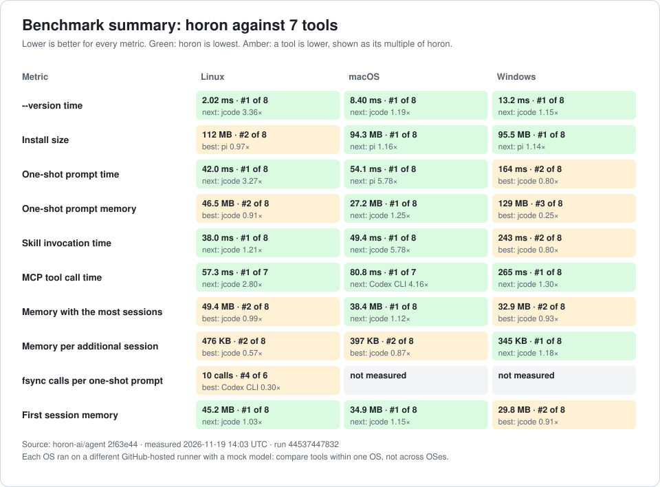
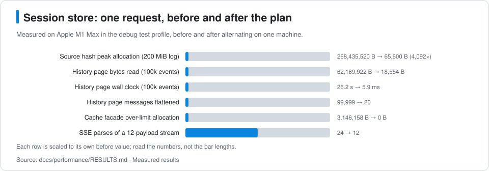
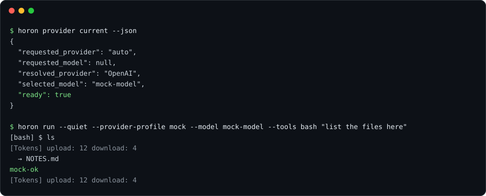

<p align="center">
  
</p>

<p align="center">
  <strong>One agent, two equal modes. A program drives it, or you drive it from the terminal, over Chat Completions, Responses, Anthropic Messages or Gemini generateContent.</strong>
</p>

<p align="center">
  Language: <strong>English</strong> | <a href="README.ko.md">한국어</a>
</p>

<p align="center">
  <a href="https://github.com/horon-ai/agent/releases/latest"></a>
  <a href="https://github.com/horon-ai/agent/actions/workflows/ci.yml"></a>
  <a href="LICENSE"></a>
  <a href="https://www.rust-lang.org"></a>
</p>

horon agent is one agent with two equal modes on one engine. In headless mode a program drives a session: a one-shot command, an SDK, an editor over ACP, or a host program over stdio RPC. In TUI mode a person drives it from the terminal through the `horon-tui` client. Both modes attach to the same daemon and share its sessions, tools, MCP servers and configuration. They differ only in who is on the other end, and neither is a reduced form of the other.

Model calls speak one of four wires, picked by the profile's `type`: OpenAI Chat Completions, OpenAI Responses, Anthropic Messages or Gemini generateContent. One provider runtime posts directly to the configured endpoint.

Each release ships two binaries built from the same tag. The agent binary `horon-agent` serves headless mode and runs the daemon both modes attach to; it never draws a full-screen terminal UI. The TUI binary `horon-tui` is a separate package built on the agent SDK and published beside it as its own archive.

| Mode | Who drives it | Entry points |
| --- | --- | --- |
| Headless | A program | `run`, `serve`, `api-bridge`, `acp`, `rpc` |
| TUI | A person at a terminal | bare `horon`, which replaces itself with `horon-tui` |

## Numbers



- One history page from a 100k-event session reads 18,554 B instead of 62,169,922 B and takes 5.9 ms instead of 26.2 s; a 200 MiB source hash peaks at 65,600 B instead of 268,435,520 B.
- The agent comparison against jcode and six other tools is the generated table under [Benchmarks](#benchmarks); its numbers come from a GitHub Actions run, never from a developer machine.



Every number above is a measured value with its run recorded in [agent.horon.ai/reference/performance/results](https://agent.horon.ai/reference/performance/results); the method and its limits are in [agent.horon.ai/reference/performance/benchmark](https://agent.horon.ai/reference/performance/benchmark). [Install](#install) takes one command.

## Install

**macOS · Linux**

```sh
curl -fsSL https://raw.githubusercontent.com/horon-ai/agent/main/scripts/install/install.sh | bash
```

**Windows (PowerShell)**

```powershell
irm https://raw.githubusercontent.com/horon-ai/agent/main/scripts/install/install.ps1 | iex
```

**Container (Linux, amd64 and arm64)**

```sh
docker run --rm ghcr.io/horon-ai/agent:latest --version
```

**From source** (Rust 1.99 or newer, edition 2024)

```sh
cargo build --release -p horon-agent
./target/release/horon-agent --version
```

The installer downloads the release archive along with `SHA256SUMS` and hands both to `horon install-release`, which verifies the checksum, stages an immutable version directory and switches the `stable` and `current` links. A version directory that already holds different bytes is refused, not overwritten ([details](https://agent.horon.ai/reference/release/install)).

It links three launchers: `horon`, the command every example here uses; `hrn`, the same command under a shorter name; and `horon-agent`, the executable's own name. All three run the same file. Data lives in `~/.horon`, which `HORON_HOME` overrides; releases up to v0.1.1 use `~/.horon-agent`.

Release assets cover Linux (x86_64, aarch64), macOS (aarch64, x86_64), Windows (x86_64, aarch64) and FreeBSD (x86_64).

## Quick start

Point the agent at an endpoint. The profile's `type` picks the wire; this one is a local Chat Completions server and needs no key.

```toml
# ~/.horon/config.toml
[provider]
default_provider = "local"

[providers.local]
type = "openai-compatible"
base_url = "http://127.0.0.1:11434/v1"
auth = "none"
default_model = "my-model"
```

For a hosted endpoint, use `auth = "bearer"` and `api_key_env = "MY_API_KEY"` instead. Then check readiness and run a turn:

```sh
horon provider current --json   # "ready": true once a profile resolves
horon run "summarize this repo"
```

<p align="center">
  
</p>

<sub>Captured from a real run of a `dev` build against the repository's deterministic mock model server (`scripts/perf/mock_llm_server.py`), with an isolated home directory. The model reply is the mock's fixed text.</sub>

With no profile configured, a model call stops before the network and names the missing `[providers.<name>]` table. [agent.horon.ai/reference/provider/model](https://agent.horon.ai/reference/provider/model) lists every key: `headers`, `extra_body`, `context_window`, and built-in profiles such as `openrouter`, `zai`, `kimi` and `ollama`.

Set `stream_first_event_timeout_secs` and `stream_idle_timeout_secs` in a named profile to limit startup and pauses during a streamed reply independently.
Set `max_in_flight_requests` to cap concurrent requests across sessions using the same profile.
Use `/modelpreset` in the terminal to preview and apply a named set of [session model choices](https://agent.horon.ai/reference/provider/model#session-model-presets).
Use `horon --isolated-profile <name>` to keep config, sessions, credentials and daemon sockets in an isolated local profile ([install notes](https://agent.horon.ai/reference/release/install#launcher-aliases-horon-hrn)).

## Ways to run it

Headless mode covers every subcommand below except bare `horon`, which opens TUI mode. `horon repl` is a plain line prompt served by the agent binary itself, for someone who wants no full-screen client.

| Command | What it does |
| --- | --- |
| `horon` (no subcommand) | Checks terminal handoff conditions first; if met, starts the server if needed and replaces itself with the `horon-tui` client beside it, with keybindings, user files and a settings screen ([docs](https://agent.horon.ai/reference/runtime/tui)). A pipe, `HORON_NO_TUI=1` or a missing sibling starts no daemon, names the condition and its remedy (the install command only when `horon-tui` is missing), and exits `1`. |
| `horon run "<message>"` | Sends one message, runs tools until the turn ends, then exits. Use `--thinking` and `--service-tier` to set [model options](https://agent.horon.ai/reference/provider/model#configuration), `--no-pty` to run shell tools through pipes, `--no-session` to keep the run in memory, `--add-dir <path>` (repeatable) to list extra workspace directories in the session context, [`--max-time`](https://agent.horon.ai/reference/runtime/turns#run-deadline) to limit the run, and `--warn-cost` or `--max-cost` to watch its estimated spend. |
| `horon repl` | One line at a time in the terminal, without the full-screen client. |
| `horon serve` | Background agent daemon on a Unix socket (`HORON_AGENT_SOCKET`). |
| `horon api-bridge` | Harness API on a local socket for SDK clients (`HORON_AGENT_API_SOCKET`): a Unix socket, or a named pipe on Windows. `--api-bind IP:PORT` also serves it on TCP with a bearer credential. |
| `horon api-credentials issue|rotate|revoke|list` | Issue, rotate, revoke or list the bearer tokens a TCP-exposed harness API accepts; the token is printed once ([docs](https://agent.horon.ai/reference/protocol/harness-api)). |
| `horon acp` | ACP v1 and v2 adapter on stdio, for editors. |
| `horon stats --from 2026-11-01 --through 2026-11-21` | Report stored token usage by UTC date, provider, and model. Add `--json` for structured output. In the terminal client, `/stats` reports the attached session. |
| `horon config show` / `horon config check` | `show` is read-only: lists effective settings with their source layer (`default`, `file`, `env`, `cli`) and never prints credentials (`--json` for structured output). `check` validates `config.toml` with the startup loader (applying one-time legacy `swarm_spawn_mode` migration), rejects malformed TOML, unknown keys, and an unknown `[provider] default_provider`, names the invalid entry, and exits `1` when invalid. |
| `horon rpc` | stdio JSONL RPC adapter for a host program that owns the process: one JSON command per line in, one frame per line out ([docs](https://agent.horon.ai/reference/protocol/rpc)). `--mode rpc` selects the same adapter. |
| `horon completions <bash\|zsh\|fish>` | Prints a shell completion script without starting a daemon. |
| `horon stream-rules [TEXT]` | Validates stream rules and previews matching rules for assistant text offline. |
| `horon tokens [TEXT]` | Estimates UTF-8 tokens offline from inline text, stdin, or `--file`. `--model` selects a known tokenizer family and the output labels any fallback. |
| `horon session cache [--apply] [--json]` | Lists the regenerable cache files of sessions no running agent owns and their sizes. It writes nothing until `--apply`, and never touches original logs, blobs or the runtime journal. |
| `horon agents` | Lists named agent definitions, their sources, and configured model and tools without starting a session. |
| `horon provider status [--json]` | Reports each configured profile's credential source and local status (`authenticated`, `unauthenticated`, or `unknown`) without printing credentials or contacting a provider. |
| `horon skills list [--json]`, `horon skills install <source> --approve` | Lists skills with the source and commit of installed ones, or installs one through the managed-skill installer from an https, ssh or file source or a local directory. Needs `[tools] managed_skills = true`. |
| `horon provider failover [--json]` | Shows the failover order the configuration produces and which setting excludes a step. Read-only: no model request, no account or quota change, no credential. |
| `horon compact-text <FILE\|->` | Summarizes a UTF-8 text file (or stdin, up to 48 KiB, never modified) on stdout and lists what it left out on stderr. `--max-tokens` bounds the summary. |
| `horon cloud doctor [--host <alias>]` | Checks that an SSH host is reachable and runs a horon-agent that supports `cloud move`, before you move a session. It prints one `ready`, `unreachable` or `incompatible` line with the next step, sends no session data and exits nonzero unless the host is ready. |
| `horon changelog [VERSION] [--json]` | Prints the published release notes of VERSION (default: the running release) without updating or installing anything. If the notes cannot be read it prints the version and the release page instead. Control characters in the notes are removed. |
| `horon package install\|list\|verify\|disable\|remove` | Installs, lists, hash-verifies, disables, or removes user-installed Rust extensions and plugins running in separate child processes ([docs](https://agent.horon.ai/reference/runtime/packages)). |
| `horon memory migrate [--dry-run]` | Imports the pre-wiki `memory/*.json` files into the per-user markdown wiki, reporting pages written and skipped. Idempotent; the JSON originals are never modified ([docs](https://agent.horon.ai/reference/runtime/memory#migration-from-json)). |
| `horon memory export <output> [--scope ...]` | Exports stored memory entries to a local file, masking recognizable credentials in exported fields and writing owner-only (`0o600`, `O_NOFOLLOW`) ([docs](https://agent.horon.ai/reference/runtime/memory#exporting-entries)). |
| `horon volume export\|import\|quiesce\|resume\|key\|delete-user\|deletion-status` | Backs up, restores, freezes for a snapshot or deletes one user's volume. `export` writes a tar of the memory pages with a metadata and manifest file; `import` verifies it into a new, empty home and rebuilds the index; `quiesce` checkpoints and fences writes before a snapshot and `resume` lifts the fence; `delete-user` runs the durable deletion steps and reports `deleted` only after every one finished ([docs](https://agent.horon.ai/reference/runtime/memory#exporting-importing-and-deleting-a-volume)). |
| `horon images --session <id> [--json] [--copy <number> <dest>]` | Lists the images a session generated, read from that session's stored `generate_image` results. Only regular files directly inside `generated-images/` are listed; a path outside it, a symbolic link or a missing file is shown as refused and cannot be copied. `--copy` writes one image to a new local file and never overwrites. Nothing is uploaded. |

`horon run --wait-async "<message>"` waits for jobs started by that run and reports each final status once. Set `--max-time` to bound the turn and job wait together. A timed-out run exits nonzero and reports the job statuses it observed.

`horon run --system-template <FILE>` renders a text template once as the system prompt for that run. The variables are `{{cwd}}`, `{{date}}` and `{{model}}`. A value is never expanded again. An unknown variable, an unclosed `{{` or a template over 16 KiB is refused before any provider request.

`horon run --no-session "<message>"` keeps the run in memory. It writes no session log, checkpoint, catalog row or run journal under `$HORON_HOME`, so the run cannot be resumed or recovered afterwards, and a failed run leaves nothing behind either. The session id in `--json` and `--ndjson` output names no stored session. Logs, usage records and other non-session state are written as usual. It cannot be combined with `--resume`, `--continue` or `--goal`, which need a stored session. Tools that keep their own per-session files, such as `todo`, are not covered by this guarantee.

`horon run --warn-cost <USD>` prints one warning on stderr when the estimated spend of that run reaches the amount. `--max-cost <USD>` rejects an unpriced remote route upfront with exit `1` before sending requests (non-local `base_url`, even with `auth = "none"`), while an unpriced model on an explicitly local endpoint (loopback, private, link-local, `localhost`, `.local`, `.lan`, or `host.docker.internal`) runs with a stderr warning and reports unpriced counts separately without capping them. For priced routes, `--max-cost` sends no new model request once the estimate reaches the cap, and the run fails with a spend cap error. The estimate comes from each response's reported tokens and the pricing catalog. A request already sent settles and is counted, so the total can exceed the ceiling by what was in flight. Child agents owned by the same process are charged to the same run. Without either option, requests are unchanged. (Also note `horon run` exits `1` on guardrail, `length`, or empty turns, and `auto_poke` defaults to `6` follow-up turns; see [TURNS.md](https://agent.horon.ai/reference/runtime/turns#non-zero-failure-auto-poke-cap-and-spend-caps).)

`horon run --role plan=<model>`, `--prewalk <model|role:<name>>` and `--no-prewalk` change model roles and the `[prewalk]` handoff for that one launch without touching `config.toml`. An unknown role, an empty model, or a model the active profile does not list fails before any request, and `--no-prewalk` wins over both `[prewalk]` and `--prewalk` ([docs](https://agent.horon.ai/reference/provider/model#launch-overrides)).

`horon run --config overlay.toml "<message>"` layers a TOML file over `config.toml` for that run only. The flag is repeatable. Later files win per key, omitted keys inherit, and tables merge key by key. A file that does not parse names itself, and the merged result is validated before any provider work.

`horon run --system-prompt <text|@file>` replaces the system prompt for that run and `--append-system-prompt <text|@file>` adds up to 16 KiB after the composed prompt. The tool definitions are sent either way, an append keeps the base prompt in place, and neither flag affects another session or a default run.

`horon run --plan --approve-plan "<message>"` approves the plan the model submits instead of waiting for an answer, so the run continues to its configured execution model (`[prewalk]`) under the normal approval policy. It requires `--plan`.

`horon run --approval write|all "<message>"` asks before file-changing calls (`write`) or before every call that is not read-only (`all`) for that run only. It can raise the approval mode but never lowers a stricter configured mode, and other sessions keep their own setting.

`horon acp` answers `initialize` with the highest protocol version both sides support, so v1 clients and v2 clients both work.

### Terminal client

`horon-tui` is TUI mode: a transcript pane that scrolls back and renders the model's Markdown, a multi-line editor that grows to eight rows, an approval prompt that parks a tool call and takes `y`, `a`, `n` or `esc`, model and session pickers, and a settings screen behind `/settings`. It is a separate package (`crates/tui`) on `horon-agent-sdk` and attaches to the same daemon and sessions as every other client, which is what keeps terminal libraries out of the agent binary.

It starts when you run bare `horon`, `hrn` or `horon-agent` on a terminal. Three conditions are checked first (before starting any daemon): stdin and stdout are both terminals, `HORON_NO_TUI` is unset, and `horon-tui` sits next to the running executable. When all three hold, the command starts the server if none is running and replaces itself with `horon-tui`, handing over the working directory so the new session belongs to the directory you ran it from, and the session id when you passed `--resume <id>`. When a condition fails, it starts no daemon, names the condition and its remedy (printing the install hint only when `horon-tui` is missing), and exits `1`, so scripts and CI get the reason rather than a client or orphan daemon.

Run `horon --continue` to reopen the most recently active saved session in the current working directory. Use `--resume <id>` to pick a specific session.

Use `horon --goal "Ship a fix" --goal-budget 1200` to attach an objective and token budget to a new session.

Use `horon --plan` to open a new terminal session in read-only plan mode, or `horon run --plan "<message>"` for one planning run. It needs `[tools] plan_mode = true`, conflicts with `--resume` and `--continue`, and fails before any model request otherwise. `/plan approve` ends read-only mode.

Use `horon --add-dir <path>` (repeatable) to open a session with extra workspace directories. Each path is resolved to an existing directory, a second spelling of the same directory collapses to one entry, and the list is part of the session context and stored with the session. In the client, `/dirs` lists it and `/dirs add <path>` or `/dirs remove <path>` changes it; removal never touches the directory. A listed root is workspace context, not an approval grant.

The installer fetches `horon-tui-<platform suffix>.tar.gz` beside the agent archive and verifies it against `SHA256SUMS`. That archive is optional: a release that does not publish one, a digest that does not match, a source build and FreeBSD all install or keep the agent alone with one warning line. User files are `$HORON_HOME/tui.toml`, `themes/<name>.json`, `keybindings.toml`, `commands/<name>.md` and the project's `.horon/commands/<name>.md`; every key is in [agent.horon.ai/reference/runtime/tui](https://agent.horon.ai/reference/runtime/tui).

### Editors (ACP)

Register `horon` (or `horon-agent`) with the argument `acp` as an external agent. In Zed (`settings.json`):

```json
{
  "agent_servers": {
    "horon agent": {
      "type": "custom",
      "command": "/absolute/path/to/horon",
      "args": ["acp"]
    }
  }
}
```

JetBrains and other ACP clients take the same two values. [agent.horon.ai/reference/protocol/acp](https://agent.horon.ai/reference/protocol/acp) covers the stdio contract and the v2 differences.

### Host programs (RPC)

A program that owns the process can drive the agent instead of handing it a terminal. `horon rpc`, or `horon --mode rpc`, reads one JSON command per line on stdin and writes one frame per line on stdout, with streaming turns, cancellation and session controls; the subcommand wins when a host passes both. stdout carries frames only, diagnostics go to stderr, and closing stdin ends the process. The mode speaks protocol version 1, so a frame over one mebibyte becomes an error instead of being chunked. This is neither the terminal client nor ACP: `horon-tui` attaches over the harness API, and RPC serves a host that cannot speak ACP ([docs](https://agent.horon.ai/reference/protocol/rpc)).

### SDKs

| Language | Package name | Location |
| --- | --- | --- |
| TypeScript | `@horon-ai/agent-sdk` | [`packages/sdk/typescript`](packages/sdk/typescript) |
| Python | `horon-agent-sdk` | [`packages/sdk/python`](packages/sdk/python) |

Both talk the harness API (protocol v1) over the `api-bridge` socket and can start their own daemon with `launch()`. Neither package is on npm or PyPI yet, so install from a source checkout; each SDK README has the steps.

## Features

<details>
<summary>All features</summary>

| Feature | What it does |
| --- | --- |
| Every built-in tool by default | A core session reaches every built-in tool. It sends eleven frequently used ones up front (`read`, `write`, `edit`, `apply_patch`, `bash`, `ls`, `agentgrep`, `todo`, `bg`, `websearch`, `webfetch`) plus `toolbox`, and `eval` when Python is on `PATH`; the rest are named in the system prompt and reached through `toolbox`, which keeps the first request small. A switch set to `false` removes a tool. Profiles: `core` (default), `full`, `acp`, `minimal`, `none` ([docs](https://agent.horon.ai/reference/runtime/tools)). |
| Append-only sessions | History is an event log at `<home>/sessions/<id>/events.jsonl`, with large payloads in content-addressed blobs. Archive, compaction and rewind append records and never delete an original. The `horon session` subcommands inspect, doctor, export, import, migrate, recover-to, archive and restore that store; `delete <id> --yes` is the one destructive command, and it refuses a session a running daemon has open ([docs](https://agent.horon.ai/reference/protocol/session-store)). |
| Edit safety | A journal backs `undo` for file edits, and `redo` and hashline anchors are on by default ([docs](https://agent.horon.ai/reference/runtime/tools)). |
| Goal budgets | A continuation goal can carry `budget_tokens`. When the session's spend reaches it, the goal moves to `budget_limited`, gets one wrap-up turn that tells the model to record what it has, and stops; raising the budget and setting the goal back to `active` is an operator decision ([docs](https://agent.horon.ai/reference/runtime/turns)). |
| MCP and skills | `horon mcp` lists configured MCP servers and manages remote-server OAuth credentials; skills are read through `skill://` and managed with `skill_manage`. |
| Unattended runs | Turn recovery, `horon runtime-state` for durable pending inputs and `horon approvals` for a run that stopped waiting on a person ([docs](https://agent.horon.ai/reference/safety/safety)). |
| Agent-to-agent messaging | An `irc` mailbox bus, on by default (`[tools] irc = false` removes it), lets agents in one daemon `send`, `wait`, `inbox` and `list` ([docs](https://agent.horon.ai/reference/runtime/irc)). |
| Workspace trust | Project-local MCP config is skipped until its digest is trusted, and `--trust-workspace` records the decision ([docs](https://agent.horon.ai/reference/safety/security)). |
| TLS without OpenSSL | rustls with the union of bundled webpki roots and the OS trust store; the Linux binary needs only glibc, libm and libgcc_s ([docs](https://agent.horon.ai/reference/release/install)). |

</details>

## Architecture

<p align="center">
  
</p>

Crate boundaries and platform adapters are in [agent.horon.ai/reference/architecture/crates](https://agent.horon.ai/reference/architecture/crates); the daemon, sessions and sockets are in [agent.horon.ai/reference/architecture/server](https://agent.horon.ai/reference/architecture/server). CI keeps terminal libraries out of the agent binary: `scripts/ci/check_headless_graph.py` fails if `ratatui`, `crossterm`, `horon-tui` or any `horon-agent-tui*` crate becomes reachable from `horon-agent`.

## Benchmarks

<!-- bench-summary:start -->

`.github/workflows/benchmark-docs.yml` rewrites this summary from the run's own `compare.json`; the version label is the binary each runner installed, not a hand-written constant.

Measured commit `7e3bdcf54d5fe7a17ffe25aa81a566d0d5c532fc`, 2026-11-28 02:32 UTC. Each OS runs on a different machine, so compare inside a row.
jcode v1.1.2 (Linux: release `v1.1.2`, commit `4f874c9ea6b7c3e228045fa8269e4d84bec66a6b`), v1.0.3 (macOS, Windows: release `v1.0.3`, commit `a0ae514c45451f12d5633ed4fa7c71614a9f4a42`).

| Linux (`ubuntu-24.04`) | horon | jcode | Claude Code | Codex CLI | OpenCode | pi | oh-my-pi (omp) | oh-my-openagent (omo) |
| --- | --- | --- | --- | --- | --- | --- | --- | --- |
| One-shot prompt time | 133.3 ms | 133.2 ms | 319.2 ms | 234.2 ms | 1.92 s | 275.9 ms | 1.19 s | 4.50 s |
| Skill invocation time | 38.9 ms | 39.4 ms | 306.8 ms | 277.5 ms | 2.22 s | 367.9 ms | 1.19 s | 4.94 s |
| MCP tool call time | 56.8 ms | 145.0 ms | 392.2 ms | 258.8 ms | 2.12 s | 394.9 ms | 1.84 s | 4.97 s |
| One-shot prompt memory | 54.9 MB | 54.4 MB | 224.5 MB | 184.8 MB | 641.4 MB | 125.8 MB | 379.8 MB | 771.9 MB |
| Memory per additional session | 591.9 KB | 274.3 KB | 207.1 MB | 168.5 MB | 6.6 MB | 138.2 MB | 404.4 MB | 624.0 MB |
| Install size | 131.1 MB | 154.3 MB | 804.9 MB | 449.4 MB | 647.5 MB | 124.1 MB | 485.1 MB | 607.9 MB |
| First model request, body / tool catalog bytes | 3,970 / 2,389 | 2,935 / 1,100 | 48,905 / 31,201 | 40,520 / 18,198 | 2,659 / 0 | 5,502 / 2,841 | 31,975 / 18,414 | 28,928 / 2,946 |

| macOS (`macos-latest`) | horon | jcode | Claude Code | Codex CLI | OpenCode | pi | oh-my-pi (omp) | oh-my-openagent (omo) |
| --- | --- | --- | --- | --- | --- | --- | --- | --- |
| One-shot prompt time | 72.3 ms | 401.0 ms | 534.1 ms | 697.1 ms | 4.09 s | 498.4 ms | 1.91 s | 9.37 s |
| Skill invocation time | 85.9 ms | 354.2 ms | 711.6 ms | 441.1 ms | 6.63 s | 749.2 ms | 2.01 s | 10.88 s |
| MCP tool call time | 125.6 ms | 397.4 ms | 760.2 ms | 429.7 ms | 4.31 s | 495.8 ms | 3.80 s | 13.05 s |
| One-shot prompt memory | 35.5 MB | 37.8 MB | 223.6 MB | 148.5 MB | 754.6 MB | 134.8 MB | 411.1 MB | 996.3 MB |
| Memory per additional session | 444.0 KB | 324.2 KB | 207.1 MB | 115.1 MB | 37.2 MB | 156.9 MB | 351.7 MB | 363.8 MB |
| Install size | 110.1 MB | 162.5 MB | 767.8 MB | 400.6 MB | 364.3 MB | 124.1 MB | 312.7 MB | 588.0 MB |
| First model request, body / tool catalog bytes | 3,811 / 2,389 | 2,776 / 1,100 | 49,397 / 31,675 | 40,541 / 18,198 | 2,659 / 0 | 5,513 / 2,841 | 30,952 / 18,414 | 28,978 / 2,946 |

| Windows (`windows-latest`) | horon | jcode | Claude Code | Codex CLI | OpenCode | pi | oh-my-pi (omp) | oh-my-openagent (omo) |
| --- | --- | --- | --- | --- | --- | --- | --- | --- |
| One-shot prompt time | 185.5 ms | 160.4 ms | 898.1 ms | 2.11 s | 5.67 s | 554.8 ms | 2.42 s | 22.02 s |
| Skill invocation time | 226.4 ms | 192.6 ms | 876.0 ms | 2.23 s | 7.96 s | 949.9 ms | 4.14 s | 23.14 s |
| MCP tool call time | 254.8 ms | 312.1 ms | 919.6 ms | 769.9 ms | 7.55 s | 818.8 ms | 6.38 s | 24.41 s |
| One-shot prompt memory | 33.2 MB | 33.8 MB | 341.3 MB | 276.9 MB | 961.2 MB | 134.8 MB | 392.0 MB | 649.9 MB |
| Memory per additional session | 525.7 KB | 316.1 KB | 211.1 MB | 142.7 MB | 5.8 MB | 108.0 MB | 369.4 MB | 427.9 MB |
| Install size | 112.2 MB | 154.3 MB | 806.4 MB | 548.6 MB | 639.1 MB | 124.1 MB | 337.3 MB | 601.4 MB |
| First model request, body / tool catalog bytes | 3,880 / 2,389 | 2,878 / 1,111 | 53,192 / 35,343 | 42,210 / 19,363 | 2,659 / 0 | 5,522 / 2,841 | 30,977 / 18,403 | 30,952 / 2,946 |

[Run](https://github.com/horon-ai/agent/actions/runs/46097112330)

<!-- bench-summary:end -->

These are single-commit CI samples, not a guarantee. The full tables for eight tools, the TUI suite, the measurement method and what the numbers do not say are in [agent.horon.ai/reference/performance/results](https://agent.horon.ai/reference/performance/results) and [agent.horon.ai/reference/performance/benchmark](https://agent.horon.ai/reference/performance/benchmark).

## Configuration defaults

<details>
<summary>All defaults</summary>

| Setting | Default | Other values |
| --- | --- | --- |
| Tool profile (`--tool-profile`, `[tools] profile`) | `core` | `full`, `acp`, `minimal`, `none` |
| `[acp] profile` | `standard` | `extended`, `full` |
| `[tools] ask_policy` | `recommended` | `error` |
| `[tools] bash_pty` | `auto` | `off`, `always` |
| `[tools] bash_direnv` | `false` | `true` imports new variables from approved direnv files in a trusted workspace |
| `[tools] output_column_cap` | `0` (disabled) | Positive Unicode character count per text preview line |
| `[features] turn_recovery` | `conservative` | `aggressive`, `off` |
| `[agents] swarm_child_runtime_secs`, `swarm_child_request_limit` | `0` (disabled) | Positive elapsed seconds or model request count per spawned child |
| `[agents] swarm_child_request_notice`, `swarm_max_spawn_effort` | `true`, unset | Turn off the final-request notice or set a maximum reasoning effort at spawn |
| `[storage] sync` | `full` (power-loss durable) | `fast` |
| `[server] idle_hibernation_secs` | `1800` | `0` disables |
| Update check on `serve` | not run | `--no-update` skips it everywhere |

</details>

[`AGENTS.md`](AGENTS.md) carries the complete set of defaults that are part of the contract.

## Documentation

Documentation comes in two sets. The developer reference is the Reference tab of [agent.horon.ai](https://agent.horon.ai), written in English and Korean in [packages/docs-site](packages/docs-site); its guide pages are English. The agent's own documentation is the English [docs/](docs/README.md) folder, compiled into the binary, where the `horon` tool searches it and `read horon://<page>` reads it (`horon://tools.md`).

| Topic | Read |
| --- | --- |
| Documentation site (`agent.horon.ai`) | [https://agent.horon.ai](https://agent.horon.ai) |
| Documentation site source | [packages/docs-site](packages/docs-site) |
| Index and fixed requirements | [agent.horon.ai/reference](https://agent.horon.ai/reference) |
| Design principles | [PHILOSOPHY.md](PHILOSOPHY.md) |
| Terminal client and its user files | [agent.horon.ai/reference/runtime/tui](https://agent.horon.ai/reference/runtime/tui) |
| Model endpoints and API keys | [agent.horon.ai/reference/provider/model](https://agent.horon.ai/reference/provider/model) |
| Editors and ACP | [agent.horon.ai/reference/protocol/acp](https://agent.horon.ai/reference/protocol/acp) |
| Host programs over stdio RPC | [agent.horon.ai/reference/protocol/rpc](https://agent.horon.ai/reference/protocol/rpc) |
| Harness API for SDKs | [agent.horon.ai/reference/protocol/harness-api](https://agent.horon.ai/reference/protocol/harness-api) |
| Tools, approvals, edit safety | [agent.horon.ai/reference/runtime/tools](https://agent.horon.ai/reference/runtime/tools) |
| Turns, recovery, `--resume` | [agent.horon.ai/reference/runtime/turns](https://agent.horon.ai/reference/runtime/turns) |
| Release install and Linux servers | [agent.horon.ai/reference/release/install](https://agent.horon.ai/reference/release/install) |
| Performance method and results | [agent.horon.ai/reference/performance/benchmark](https://agent.horon.ai/reference/performance/benchmark) |

## Contributing

Read [`AGENTS.md`](AGENTS.md) first; it is the governing contract. Three requirements hold for every change: no terminal UI in the agent binary `horon-agent`, with TUI mode living in the TUI binary `horon-tui`; ACP v1 and v2 both served; and no measured performance regression against the recorded baseline.

- Branch from `dev` and open the pull request against `dev`; `main` changes through release pull requests. Every pull request must link a real issue in this repository (`Closes #123`); the `Require Linked Issue` check enforces it.
- GitHub Actions owns full workspace verification, and every PR must finish with zero warnings (`python3 scripts/ci/run_warnings.py <run-id>`). Per the CI-first rules in `AGENTS.md`, agent sessions run only single-crate checks (`cargo check --locked -p <crate>`) or doc gates locally:

  ```sh
  python3 scripts/ci/check_docs_links.py
  python3 scripts/ci/check_docs_pairs.py
  python3 scripts/ci/sync_docs_site.py --check
  ```

- For full manual CI parity on a dedicated build host, `scripts/ci/check_all.sh` runs the Format and Quality Guardrails steps alongside `cargo fmt --all -- --check`, `cargo clippy --locked --all-targets --all-features -- -D warnings`, and `cargo test --workspace`.

- Performance claims come from the benchmark workflows on GitHub Actions, never from a developer machine.

## License

[MIT](LICENSE). Copyright 2025 Jeremy Huang and 2026 horon-ai.
