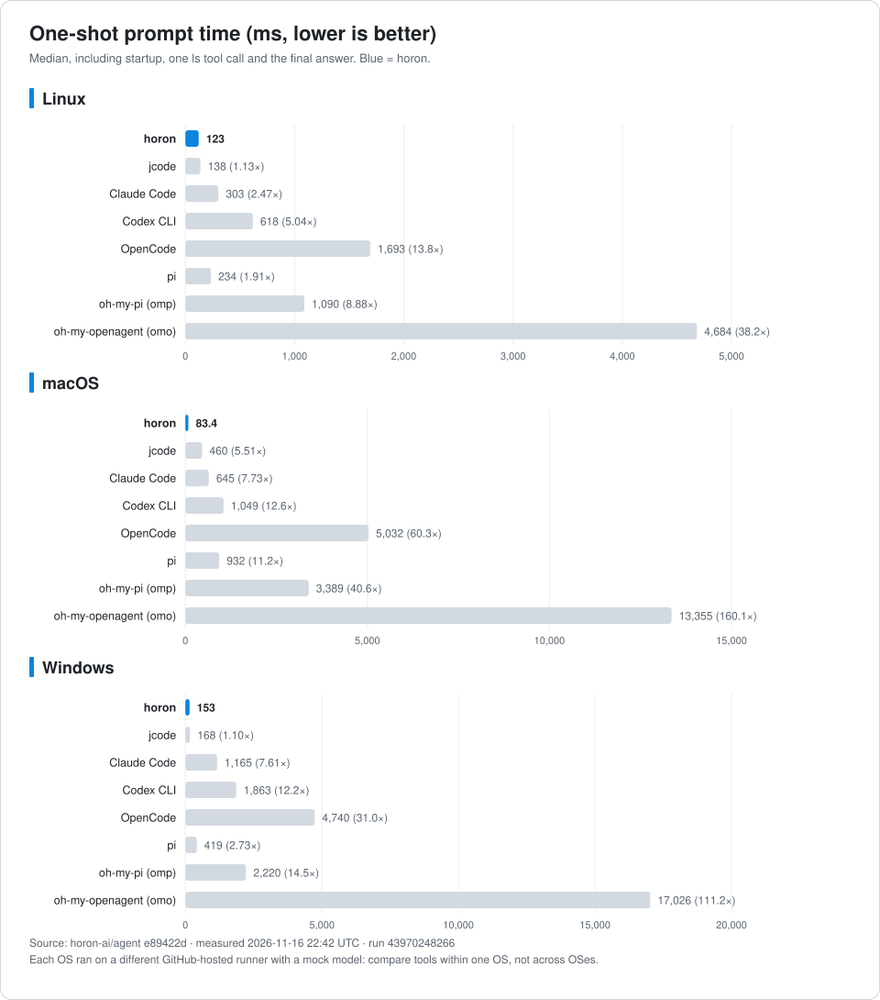

<p align="center">
  
</p>

<p align="center">
  <strong>One agent, two equal modes. A program drives it, or you drive it from the terminal, over Chat Completions, Responses, Anthropic Messages or Gemini generateContent.</strong>
</p>

<p align="center">
  Language: <strong>English</strong> | <a href="README.ko.md">한국어</a>
</p>

<p align="center">
  <a href="https://github.com/horon-ai/agent/releases/latest"></a>
  <a href="https://github.com/horon-ai/agent/actions/workflows/ci.yml"></a>
  <a href="LICENSE"></a>
  <a href="https://www.rust-lang.org"></a>
</p>

horon agent is a headless coding agent that speaks one of four model wires, picked by the profile's `type`: OpenAI Chat Completions, OpenAI Responses, Anthropic Messages or Gemini generateContent. It POSTs straight to your endpoint, with no router process and no plugin host in between, and one daemon answers every client: a one-shot command, an SDK, an editor over ACP, a host program over stdio RPC, or the `horon-tui` terminal client. Sessions, tools, MCP servers and configuration are shared across all of them. Only the driver changes.

The agent binary is `horon-agent`, and it never draws a terminal of its own. The terminal client is `horon-tui`, a separate package built on the agent SDK and released from the same tag as its own archive.

| Mode | Who drives it | Entry points |
| --- | --- | --- |
| Headless | A program | `run`, `serve`, `api-bridge`, `acp`, `rpc` |
| TUI | A person at a terminal | bare `horon`, which replaces itself with `horon-tui` |

## Install

**macOS · Linux**

```sh
curl -fsSL https://raw.githubusercontent.com/horon-ai/agent/main/scripts/install/install.sh | bash
```

**Windows (PowerShell)**

```powershell
irm https://raw.githubusercontent.com/horon-ai/agent/main/scripts/install/install.ps1 | iex
```

**Container (Linux, amd64 and arm64)**

```sh
docker run --rm ghcr.io/horon-ai/agent:latest --version
```

**From source** (Rust 1.99 or newer, edition 2024)

```sh
cargo build --release -p horon-agent
./target/release/horon-agent --version
```

The installer downloads the release archive along with `SHA256SUMS` and hands both to `horon install-release`, which verifies the checksum, stages an immutable version directory and switches the `stable` and `current` links. A version directory that already holds different bytes is refused, not overwritten ([details](docs/release/INSTALL.md)).

It links three launchers: `horon`, the command every example here uses; `hrn`, the same command under a shorter name; and `horon-agent`, the executable's own name. All three run the same file. Data lives in `~/.horon`, which `HORON_HOME` overrides; releases up to v0.1.1 use `~/.horon-agent`.

Release assets cover Linux (x86_64, aarch64), macOS (aarch64, x86_64), Windows (x86_64, aarch64) and FreeBSD (x86_64).

## Quick start

Point the agent at an endpoint. The profile's `type` picks the wire; this one is a local Chat Completions server and needs no key.

```toml
# ~/.horon/config.toml
[provider]
default_provider = "local"

[providers.local]
type = "openai-compatible"
base_url = "http://127.0.0.1:11434/v1"
auth = "none"
default_model = "my-model"
```

For a hosted endpoint, use `auth = "bearer"` and `api_key_env = "MY_API_KEY"` instead. Then check readiness and run a turn:

```sh
horon provider current --json   # "ready": true once a profile resolves
horon run "summarize this repo"
```

<p align="center">
  
</p>

<sub>Captured from a real run of a `dev` build against the repository's deterministic mock model server (`scripts/perf/mock_llm_server.py`), with an isolated home directory. The model reply is the mock's fixed text.</sub>

With no profile configured, a model call stops before the network and names the missing `[providers.<name>]` table. [docs/provider/MODEL.md](docs/provider/MODEL.md) lists every key: `headers`, `extra_body`, `context_window`, and built-in profiles such as `openrouter`, `zai`, `kimi` and `ollama`.

## Ways to run it

Headless mode covers every subcommand below except bare `horon`, which opens TUI mode. `horon repl` is a plain line prompt served by the agent binary itself, for someone who wants no full-screen client.

| Command | What it does |
| --- | --- |
| `horon` (no subcommand) | On a terminal, starts the server and replaces itself with the `horon-tui` client beside it, with keybindings, user files and a settings screen ([docs](docs/runtime/TUI.md)). A pipe, `HORON_NO_TUI=1` or a missing sibling prints a sentence naming the condition and the install command, then exits non-zero. |
| `horon run "<message>"` | Sends one message, runs tools until the turn ends, then exits. |
| `horon repl` | One line at a time in the terminal, without the full-screen client. |
| `horon serve` | Background agent daemon on a Unix socket (`HORON_AGENT_SOCKET`). |
| `horon api-bridge` | Harness API on a Unix socket for SDK clients (`HORON_AGENT_API_SOCKET`, Unix only). |
| `horon acp` | ACP v1 and v2 adapter on stdio, for editors. |
| `horon rpc` | stdio JSONL RPC adapter for a host program that owns the process: one JSON command per line in, one frame per line out ([docs](docs/protocol/RPC.md)). `--mode rpc` selects the same adapter. |

`horon acp` answers `initialize` with the highest protocol version both sides support, so v1 clients and v2 clients both work.

### Terminal client

`horon-tui` is TUI mode: a transcript pane, a one-line input, an approval prompt that parks a tool call and takes `y`, `a`, `n` or `esc`, and a settings screen behind `/settings`. It is a separate package (`crates/tui`) on `horon-agent-sdk` and attaches to the same daemon and sessions as every other client, which is what keeps terminal libraries out of the agent binary.

It starts when you run bare `horon`, `hrn` or `horon-agent` on a terminal. The command starts the server if none is running, then replaces itself with the `horon-tui` file beside the agent, handing over the working directory so the new session belongs to the directory you ran it from, and the session id when you passed `--resume <id>`. Three conditions are checked first: stdin and stdout are both terminals, `HORON_NO_TUI` is unset, and `horon-tui` sits next to the running executable. A pipe or a redirect prints that sentence instead, so scripts and CI get the reason rather than a client. When a condition fails, the command names it, prints the install hint for the interactive client, and exits non-zero.

The installer fetches `horon-tui-<platform suffix>.tar.gz` beside the agent archive and verifies it against `SHA256SUMS`. That archive is optional: a release that does not publish one, a digest that does not match, a source build and FreeBSD all install or keep the agent alone with one warning line. User files are `$HORON_HOME/tui.toml`, `themes/<name>.json`, `keybindings.toml`, `commands/<name>.md` and the project's `.horon/commands/<name>.md`; every key is in [docs/runtime/TUI.md](docs/runtime/TUI.md).

### Editors (ACP)

Register `horon` (or `horon-agent`) with the argument `acp` as an external agent. In Zed (`settings.json`):

```json
{
  "agent_servers": {
    "horon agent": {
      "type": "custom",
      "command": "/absolute/path/to/horon",
      "args": ["acp"]
    }
  }
}
```

JetBrains and other ACP clients take the same two values. [docs/protocol/ACP.md](docs/protocol/ACP.md) covers the stdio contract and the v2 differences.

### Host programs (RPC)

A program that owns the process can drive the agent instead of handing it a terminal. `horon rpc`, or `horon --mode rpc`, reads one JSON command per line on stdin and writes one frame per line on stdout, with streaming turns, cancellation and session controls; the subcommand wins when a host passes both. stdout carries frames only, diagnostics go to stderr, and closing stdin ends the process. The mode speaks protocol version 1, so a frame over one mebibyte becomes an error instead of being chunked. This is neither the terminal client nor ACP: `horon-tui` attaches over the harness API, and RPC serves a host that cannot speak ACP ([docs](docs/protocol/RPC.md)).

### SDKs

| Language | Package name | Location |
| --- | --- | --- |
| TypeScript | `@horon-ai/agent-sdk` | [`packages/sdk/typescript`](packages/sdk/typescript) |
| Python | `horon-agent-sdk` | [`packages/sdk/python`](packages/sdk/python) |

Both talk the harness API (protocol v1) over the `api-bridge` socket and can start their own daemon with `launch()`. Neither package is on npm or PyPI yet, so install from a source checkout; each SDK README has the steps.

## Features

| Feature | What it does |
| --- | --- |
| A core tool set of 18 | `bash`, `read`, `write`, `edit`, `replace`, `apply_patch`, `agentgrep`, `ls`, `webfetch`, `websearch`, `skill_manage`, `mcp`, `monitor`, `undo`, `ask`, `todo`, `session_search` and `swarm`. A core session sends seven of them up front plus `toolbox`, names the other eleven in the system prompt, and reaches them through `toolbox`, which keeps the first request small. Profiles: `core` (default), `full`, `acp`, `minimal`, `none` ([docs](docs/runtime/TOOLS.md)). |
| Append-only sessions | History is an event log at `<home>/sessions/<id>/events.jsonl`, with large payloads in content-addressed blobs. Archive, compaction and rewind append records and never delete an original. The `horon session` subcommands inspect, doctor, export, import, migrate, recover-to, archive and restore that store; `delete <id> --yes` is the one destructive command, and it refuses a session a running daemon has open ([docs](docs/protocol/SESSION_STORE.md)). |
| Edit safety | A journal backs `undo` for file edits, and `redo` and hashline anchors are opt-in ([docs](docs/runtime/TOOLS.md)). |
| Goal budgets | A continuation goal can carry `budget_tokens`. When the session's spend reaches it, the goal moves to `budget_limited`, gets one wrap-up turn that tells the model to record what it has, and stops; raising the budget and setting the goal back to `active` is an operator decision ([docs](docs/runtime/TURNS.md)). |
| MCP and skills | `horon mcp` lists configured MCP servers and manages remote-server OAuth credentials; skills are read through `skill://` and managed with `skill_manage`. |
| Unattended runs | Turn recovery, `horon runtime-state` for durable pending inputs and `horon approvals` for a run that stopped waiting on a person ([docs](docs/safety/SAFETY.md)). |
| Agent-to-agent messaging | An opt-in `irc` mailbox bus (`[tools] irc = true`) lets agents in one daemon `send`, `wait`, `inbox` and `list` ([docs](docs/runtime/IRC.md)). |
| Workspace trust | Project-local MCP config is skipped until its digest is trusted, and `--trust-workspace` records the decision ([docs](docs/safety/SECURITY.md)). |
| TLS without OpenSSL | rustls with the union of bundled webpki roots and the OS trust store; the Linux binary needs only glibc, libm and libgcc_s ([docs](docs/release/INSTALL.md)). |

## Architecture

<p align="center">
  
</p>

Crate boundaries and platform adapters are in [docs/architecture/CRATES.md](docs/architecture/CRATES.md); the daemon, sessions and sockets are in [docs/architecture/SERVER.md](docs/architecture/SERVER.md). The headless graph rule is checked in CI by `scripts/ci/check_headless_graph.py`, which fails if `ratatui`, `crossterm`, `horon-tui` or any `horon-agent-tui*` crate becomes reachable from `horon-agent`.

## Benchmarks

`.github/workflows/benchmark-docs.yml` runs a one-shot turn on GitHub-hosted runners at commit `f7a53f1` against jcode v0.99.1, with a deterministic mock model and exactly one `ls` tool call per turn. Each OS runs on a different machine, so compare inside a row and never across rows.

<p align="center">
  
</p>

| Linux (`ubuntu-24.04`) | horon | jcode |
| --- | --- | --- |
| One-shot turn, median | 43.1 ms | 144.1 ms |
| Skill invocation, median | 36.9 ms | 58.5 ms |
| MCP tool call, median | 61.9 ms | 177.5 ms |
| Peak tree RSS, one-shot | 39.8 MB | 41.7 MB |
| Memory per additional session, idle after 3 turns | 231.7 KB | 120.3 KB |
| First model request, body / tool catalog bytes | 3,731 / 2,390 | 3,245 / 1,433 |
| Install size | 115.6 MB | 163.4 MB |

horon took all three Linux time rows, and macOS followed the same shape: one-shot 55.2 ms against 366.4 ms, skill 48.8 ms against 273.0 ms, MCP 66.6 ms against 304.5 ms. Windows took the same three rows with narrower gaps: one-shot 118.3 ms against 129.3 ms, skill 129.3 ms against 153.1 ms, and MCP 161.3 ms against 257.9 ms. jcode still used less peak memory on a Windows one-shot (30.8 MB against 35.3 MB) and less memory per extra session on Linux.

These are single-commit CI samples, not a guarantee. The full tables for eight tools, the TUI suite, the measurement method and what the numbers do not say are in [docs/performance/RESULTS.md](docs/performance/RESULTS.md) and [docs/performance/BENCHMARK.md](docs/performance/BENCHMARK.md).

## Configuration defaults

| Setting | Default | Other values |
| --- | --- | --- |
| Tool profile (`--tool-profile`, `[tools] profile`) | `core` | `full`, `acp`, `minimal`, `none` |
| `[acp] profile` | `standard` | `extended`, `full` |
| `[tools] ask_policy` | `recommended` | `error` |
| `[tools] bash_pty` | `auto` | `off`, `always` |
| `[features] turn_recovery` | `conservative` | `aggressive`, `off` |
| `[storage] sync` | `full` (power-loss durable) | `fast` |
| `[server] idle_hibernation_secs` | `1800` | `0` disables |
| Update check on `serve` | not run | `--no-update` skips it everywhere |

[`AGENTS.md`](AGENTS.md) carries the complete set of defaults that are part of the contract.

## Documentation

The docs are written in English (default) and Korean (`.ko.md` next to each file, as in `docs/README.ko.md`). The English files are compiled into the binary, where the `horon_agent_docs` tool serves them. [agent.horon.ai](https://agent.horon.ai) is a separate, shorter set of pages written for Mintlify in [packages/docs-site](packages/docs-site); it is not generated from `docs/`, so a behavior change updates both by hand.

| Topic | Read |
| --- | --- |
| Documentation site (`agent.horon.ai`) | [https://agent.horon.ai](https://agent.horon.ai) |
| Documentation site source | [packages/docs-site](packages/docs-site) |
| Index and fixed requirements | [docs/README.md](docs/README.md) |
| Terminal client and its user files | [docs/runtime/TUI.md](docs/runtime/TUI.md) |
| Model endpoints and API keys | [docs/provider/MODEL.md](docs/provider/MODEL.md) |
| Editors and ACP | [docs/protocol/ACP.md](docs/protocol/ACP.md) |
| Host programs over stdio RPC | [docs/protocol/RPC.md](docs/protocol/RPC.md) |
| Harness API for SDKs | [docs/protocol/HARNESS_API.md](docs/protocol/HARNESS_API.md) |
| Tools, approvals, edit safety | [docs/runtime/TOOLS.md](docs/runtime/TOOLS.md) |
| Turns, recovery, `--resume` | [docs/runtime/TURNS.md](docs/runtime/TURNS.md) |
| Release install and Linux servers | [docs/release/INSTALL.md](docs/release/INSTALL.md) |
| Performance method and results | [docs/performance/BENCHMARK.md](docs/performance/BENCHMARK.md) |

## Contributing

Read [`AGENTS.md`](AGENTS.md) first; it is the governing contract. Three requirements hold for every change: no terminal UI in the `horon-agent` package, with TUI mode living in `horon-tui`; ACP v1 and v2 both served; and no measured performance regression against the recorded baseline.

- Branch from `dev` and open the pull request against `dev`. Every pull request must link a real issue in this repository (`Closes #123`); the `Require Linked Issue` check enforces it.
- Run the checks before pushing:

  ```sh
  cargo fmt --all -- --check
  cargo clippy --locked --all-targets --all-features -- -D warnings
  cargo test --workspace
  ```

- Performance claims come from the benchmark workflows on GitHub Actions, never from a developer machine.

## License

[MIT](LICENSE). Copyright 2025 Jeremy Huang and 2026 horon-ai.
