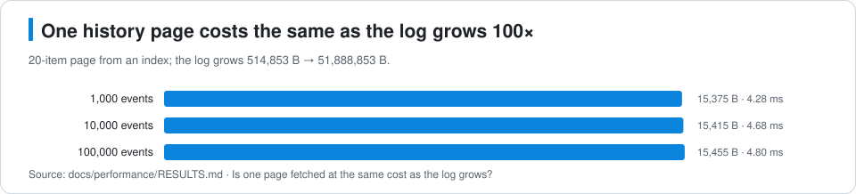
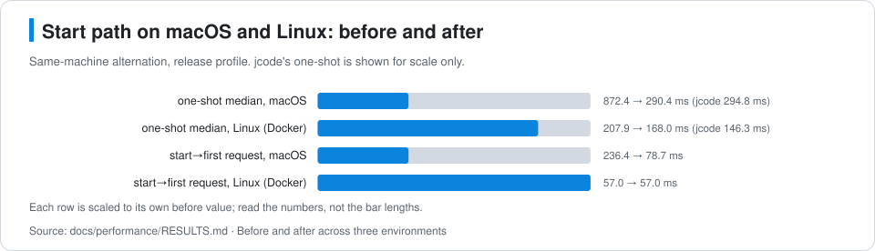
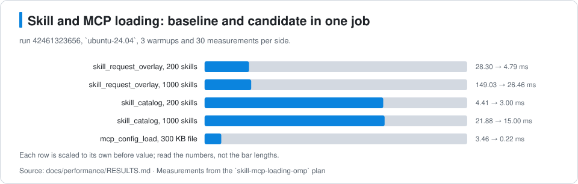
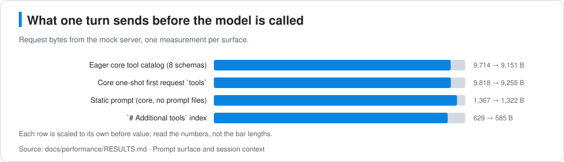

# Performance: measured results and their limits

Language: **English** | [한국어](RESULTS.ko.md)

This document records the measurements the `agent-runtime-performance-2` plan left on baseline B0 (the commit immediately before the plan started). The plan landed 19 performance commits on `dev`, and the same range holds one `fix(cli)` commit unrelated to this plan that has no bearing on the numbers below. The measured surfaces are the session store's hashes and history pages, the SSE parser, replication export, the result cache's threshold decision, and the attach/detach soak. Every measurement was taken on this machine (Apple M1 Max, debug test profile) by alternating before and after on the same machine.

All raw artifacts live under `.omo/evidence/agent-runtime-performance-2/`, a path ignored by `.gitignore:19`. The plan asked for the key numbers to be copied into the PR bodies, but in practice most PR bodies were one line. So anyone who clones this repository today cannot see a single measurement from this work. This page moves that record somewhere tracked; every number is copied verbatim from the evidence files above.

## At a glance

The charts are the reading; every exact number sits in the table of the section it belongs to, folded under a summary line so the tables never stand between the charts.


- One history page from a 100k-event session reads 18,554 B instead of 62,169,922 B and takes 5.9 ms instead of 26.2 s; a 200 MiB source hash peaks at 65,600 B instead of 268,435,520 B. Time and read bytes are the same as before.
- fsync calls per one-shot prompt on the GitHub Linux runner fell from 40 cold and 35 warm to 15 and 14 across the plans below. jcode stays at 5, because it does not commit conversation records; that gap is structural, not a tuning target.
- On macOS, one-shot went from 872.4 ms to 290.4 ms and start→first request from 236.4 ms to 78.7 ms, measured by alternating both builds on one machine. jcode's one-shot on the same runs was 294.8 ms.
- Linux one-shot went from 207.9 ms to 168.0 ms, still behind jcode's 146.3 ms. The gap on Windows is larger and is not claimed as closed.
- Memory per added session after the `jcode-parity-optimization` plan is 149.6 KB on Linux against jcode's 57.4 KB, down from 254.7 KB.
- No wall-clock improvement was established for the loading plan, and its A/A control says why: two runs of the same binary differ by more than any effect the plan could claim.

## Charts: latest automatic measurement

<!-- bench-charts:start -->

`.github/workflows/benchmark-docs.yml` redraws these charts from the competitor comparison of the automatic measurement below. Do not edit this section by hand. Lower is better in every chart, and horon is the blue bar.


| Metric | Chart |
| --- | --- |
| `--version` time | [01-version.svg](charts/01-version.svg) |
| Install size | [02-install-size.svg](charts/02-install-size.svg) |
| One-shot prompt time | [03-oneshot-time.svg](charts/03-oneshot-time.svg) |
| One-shot prompt memory | [04-oneshot-memory.svg](charts/04-oneshot-memory.svg) |
| Skill invocation time | [05-skill-time.svg](charts/05-skill-time.svg) |
| MCP tool call time | [06-mcp-time.svg](charts/06-mcp-time.svg) |
| Memory with the most sessions | [07-sessions-memory.svg](charts/07-sessions-memory.svg) |
| Memory per additional session | [08-per-session-memory.svg](charts/08-per-session-memory.svg) |
| fsync calls per one-shot prompt | [09-fsync-calls.svg](charts/09-fsync-calls.svg) |
| First session memory | [10-first-session-memory.svg](charts/10-first-session-memory.svg) |

The interactive client is a second binary; these charts are drawn from the `tui` suite only and are never mixed with the headless charts above.

| TUI metric | Chart |
| --- | --- |
| TUI latency | [tui-01-latency.svg](charts/tui-01-latency.svg) |
| TUI memory and size | [tui-02-memory.svg](charts/tui-02-memory.svg) |

<!-- bench-charts:end -->

## Measured results

Dimension labels follow this rule. `MEMORY` is allocation and memory, `TIME` is wall-clock time, `WORK` is iteration counts and byte volumes, and `RESOURCES` is file descriptor, thread and task counts. Dimensions are listed separately so that an improvement in one is not read as an improvement in another.

<details>
<summary>Exact numbers</summary>

| Change | Dimension | Before | After |
| --- | --- | --- | --- |
| Streaming source hash, peak allocation (200 MiB log) | `MEMORY` | 268,435,520 B | 65,600 B (4,092×) |
| Streaming source hash, bytes read | no change | 209,715,200 B | 209,715,200 B |
| Streaming source hash, wall clock | `TIME` (no improvement) | 6,434 ms | 6,404 ms |
| History page, flattened messages (100k events, 20-item page) | `WORK` | 99,999 | 20 |
| History page, bytes read | `WORK` | 62,169,922 B | 18,554 B |
| History page, wall clock | `TIME` | 26.2 s | 5.9 ms |
| SSE, parses of a 12-payload stream | `WORK` | 24 | 12 |
| Replication export, serialization count (64 → 256 event pages) | `WORK` | 129 | 513 (4× the events, 4.0× the serializations) |
| Replication export, bytes against the reference implementation (same 64 → 256) | `WORK` | 8,445,218 → 138,506,722 B (16.4×) | 102,903 → 411,795 B (4.0×) |
| Cache facade, over-limit path (temporary allocation · canonical serialization) | `MEMORY` | 3,146,158 B, 1 time | 0 B, 0 times |
| Cache facade, wall clock | `TIME` (no improvement) | about 19 ms per MiB | about 19 ms per MiB |
| Attach/detach soak, resources after 200 cycles | `RESOURCES` | fd 14, threads 25, tasks 2,141 | fd 14, threads 22, tasks 2,141 |

</details>

A few points are easy to misread from the table alone, so they are set out here.

- The source hash digest is the same as before on all five fixtures (61 KB, 618 KB, 6.2 MB, 62 MB, 200 MiB). The only thing that changed is peak allocation; the bytes read and the time taken are unchanged.
- The history page's `WORK` and `TIME` are two faces of the same request. Fetching one 20-item page from a 100k-event session used to replay the whole session, flatten 99,999 messages and read 62 MB; it now reads only the 20 records the index points at.
- In replication export, a 4× larger page made the old reference implementation grow bytes 16.4×, while the current implementation grows them 4.0×. So the cost is proportional to page length, not log length. Page bytes are byte-identical to B0, and the fixed digests `135cf07d...` (length 240,882) and `4a4855d4...` (length 26,979) reproduce unchanged.
- The cache facade no longer serializes canonical JSON once just to decide whether the cap is exceeded. The 1 MiB boundary is byte-exact (1,048,575 B is cached, 1,048,577 B is skipped). The path that actually caches still serializes once.
- The soak ran 200 cycles, 10 windows, 588.99 s. It measures the increment per window, and the failed rounds, quiescence misses (`quiescence_misses`) and non-returned resources (`non_returning`) are all empty.

### Is one page fetched at the same cost as the log grows?

With an index in place, fetching a 20-item page grew bytes read by only 0.5% when the log grew 100×. Replayed messages are 0 at all three sizes.



<details>
<summary>Exact numbers</summary>

| Events | Log size | Bytes the page read | Wall clock |
| --- | --- | --- | --- |
| 1,000 | 514,853 B | 15,375 B | 4.28 ms |
| 10,000 | 5,168,853 B | 15,415 B | 4.68 ms |
| 100,000 | 51,888,853 B | 15,455 B | 4.80 ms |

</details>

The log sizes in this table come from sessions the growth test builds itself, so they differ from the 100k-event fixture in the previous table (62,155,848 B). It is not the same measurement.

### Commits the table does not cover

The remaining commits changed bounds, the measurement surface or a decision rather than forming a before/after pair. There is a commit that makes NDJSON framing safe at UTF-8 boundaries and adds a frame limit, a commit that moves the hook's stdin write inside its deadline, and a commit that widens tool latency from execute to the whole dispatch. There is also a commit that adds count and byte caps plus a visible overflow to the event stream, a commit that removes the context copy taken before the compression decision, and a commit that moves bridge writes into a bounded queue outside the select loop. The measurement surface changed with a commit that fixes benchmark scripts that never ran because of syntax errors and adds a fixed fixture generator, a commit that adds step counters, allocation probes and a same-machine A/B runner, and a commit that makes the p99 key mandatory. The rest are the decision record rejecting four structural items on measurement, two commits adding the structural gate, the report template and the A/B guide, and a follow-up that cleans up a duplicate closure in the index header check.

## Measured but not adopted

Six items were measured and then rejected. Each item carries the numbers a later attempt would have to beat to overturn that decision.

| Item | Decision | Numbers behind it |
| --- | --- | --- |
| Idle session eviction policy | not adopted | 0.999 fds and 0.998 threads per session, 0.41 MB RSS. The slope does not bend from 1 to 1,000 sessions. The `job_count` that `server:memory` reports is 0 at all five population counts, and the soak returns the session count to 0 |
| `globalEvents` multiplexing | not adopted (protocol change) | 7.4 consumer-side fds and 3.0 threads per watched session. The daemon's own share is 1.0 connection per session, and the bridge attaches one session per connection |
| Narrowing the session map lock scope | not adopted | Removing an unrelated session waits for the whole import. 861 / 5,561 / 11,255 / 24,499 ms at 1 / 20 / 60 / 150 events, ratio 1.00 |
| Replacing the 25 ms interrupt poll timer with notification | not adopted | It would save a worst case of 29.7 ms (27.6 ms on average) at the cost of restructuring a wakeup once per watch-group round |
| Overlapping the `run.stopped` journal write with the close-save (#144, #129) | not adopted (slower) | Windows last request → exit, median against `dev` in the same job: 39.8 → 56.4 ms over 5 samples (run 42759006826) and 35.2 → 42.8 ms over 20 samples (run 42764256757; IQR 33.0–40.9 vs 40.7–45.5). Linux and macOS were ties. #146 later removed the close-save flush itself, which brought the same span to 32.5 ms |
| Resolving the fixed Windows shell environment once per process (#124, #122) | not adopted (tie) | Tool round-trip span on Windows, 20 samples: 74.3 → 73.5 ms (run 42735692366), inside the min–max range. Nearly all of the round trip is the `cmd.exe` start, not the per-call env table or PATH search |

Rejecting something on numbers is not a failure. The plan defined success as "when no improvement shows up, the item ends as not adopted with its reasoning attached. That counts as success too." The last column above is that reasoning.

## What these numbers do not say

This section is the point of this page. Leave out any one of the statements below and the page leads the reader to the wrong conclusion.

- **The source hash improvement covers the hashing stage only, and the store path streams its validation.** `crates/base/src/session/event_commit.rs:120-133` hashes the captured prefix through one 64 KiB buffer and `:148-166` compares the reserved tail in a buffer of the same size, so saving a large log no longer allocates a copy of it. The plan recorded 156,518 B for a 7 KB log and 8,293,580 B for a 553 KB log from a save whose peak did follow the log size; those figures do not describe this path any more.
- **The history page improvement covers repeated paging while the head does not move.** The index is tied to the log's identity stamp (device, inode, length, mtime, ctime), so a single append, import or reset invalidates it. A session that keeps growing therefore pays the old cost once more and rebuilds the index. That rebuild cost was not measured. A single page fetch from a new head is not faster.
- **The cache improvement is allocation, not throughput.** Wall clock is about 19 ms per MiB on both sides. Escaping cost dominates either way.
- **The soak asserts fds, threads, queues, pending requests and tasks. Not RSS.** RSS rose from 68.4 MB to 79.5 MB and then stayed flat (peak 83.7 MB), and is recorded as an observation only.
- **The 200-cycle soak resolves one leaked resource per 20 cycles.** The plan asked for 1,000 cycles; that form now runs weekly in `Attach/Detach Soak` (`.github/workflows/soak.yml`) and its first run was clean, while the pull-request form is the same test at 20 cycles inside the structural gate (`scripts/perf/check_structural.py:136-146`).
- **The structural gate did not assert the frame limit when this plan closed.** The counters the gate read then included no frame count, and the frame limit was held by `crates/harness-api-server/src/framing_tests.rs` alone. The gate now has a `frame` section (`scripts/perf/check_structural.py`): the bridge reader and the SDK reader each report `max_frame_bytes`, `accepted_frame_bytes` and `rejected_frame_bytes`, and the gate requires the cap to equal `frame_max_bytes` (64 MiB) and the smallest refused frame to be exactly one byte above the largest accepted one. It still counts no frames.
- **The `shared_context` map these numbers once covered no longer exists.** It was removed with the rest of the topic-channel store (#299), so the soak no longer samples it and the table above carries no figure for it. The historical reading stands as recorded: 0 at every population count, which meant "nobody used it" rather than "nothing leaks". What survives in the `server:memory` payload is the swarm block beside it — `member_count`, `status_counts`, `swarm_count`, `swarm_membership_count`, `plan_count`, `plan_item_count` and their byte estimates (`crates/app-core/src/server/debug_server_state.rs`) — and that block is what a future soak would sample.
- **The replication export's serialization factor is fixed per page.** It is 513 at the 256-event cap, but export time still grows with the log (278.2 ms for 1,000 events, 2,657.2 ms for 10,000). Bytes are flat within a page, not across the whole export.
- **The cache facade's warm-restore time is a single-shot measurement.** It includes page cache variance, and in the same case the range covers 108.6 / 901.8 ms on the lane and 108.9 / 499.7 ms for the lead's re-run. Only the byte-exact boundary decision is reproducible.
- **The absolute milliseconds of the four not-adopted decisions are not release numbers.** They were taken in the debug test profile in a scratch home; what transfers is the ratio (wait time equals import time, session creation about 1.2 s).
- **The 7.4 fds and 3.0 threads for `globalEvents` are consumer-side costs.** The SDK and the daemon ran in the same process, so both ends were counted together. The 100-session and 1,000-session numbers are arithmetic on this per-session value, not a second measurement.

## How to reproduce

Give each measurement its own `CARGO_TARGET_DIR` and run them one at a time. Two test binaries on one target directory produce a different failure every time, and that failure says nothing about the code.

```bash
export CARGO_TARGET_DIR="$PWD/.target-measure"
```

Measurement logs come from the repository's generator. Below are the 200 MiB log and the 100k-event log.

```bash
python3 scripts/perf/fixtures/gen_event_log.py --bytes 209715200 --seed 20261021 --out /tmp/event-log-200mib/
python3 scripts/perf/fixtures/gen_event_log.py --events 100000 --seed 20261021 --out /tmp/event-log-100000/
```

For the source hash, the probe example prints a full read and a streaming digest side by side.

```bash
cargo build --locked -p horon-agent-base --example source_hash_probe
"$CARGO_TARGET_DIR/debug/examples/source_hash_probe" hash /tmp/event-log-200mib/events.jsonl
```

For the history page, the 100k-event fixture is passed in through an environment variable, and a separate test checks equality with the committed 500-record baseline.

```bash
HISTORY_PAGE_PERF_FIXTURE=/tmp/event-log-100000/events.jsonl \
  cargo test --locked -p horon-agent-harness-api-server --lib history_page_perf -- --nocapture --test-threads=1
cargo test --locked -p horon-agent-harness-api-server --lib pages_match_the_committed_pre_change_baseline -- --nocapture
```

For the SSE parser, the same event sequence and parse count are printed at four chunk sizes.

```bash
cargo test --locked -p horon-agent-provider-openai --lib stream::stream_tool_tests::chunked_replay_yields_the_same_events_at_every_chunk_size -- --nocapture
```

For replication export, tests in the repository check page byte equality and the cap. The QA harness that printed the serialization counts in the table (129 / 513) lives in `.omo/evidence/agent-runtime-performance-2/qa_task14.py` and is untracked, so a reader who clones the repository cannot reproduce those counts directly. The digests and lengths do reproduce.

```bash
cargo test --locked -p horon-agent-session-store replication -- --nocapture
```

For the cache facade, a test prints the serialization counts on both sides of the boundary and an example prints the allocation peak.

```bash
cargo test --locked -p horon-agent-base --lib event_cache -- --nocapture
cargo build --locked -p horon-agent-base --example facade_cache_probe
```

The soak has a 200-cycle default form and a 1,000-cycle variant behind `#[ignore]`. The 1,000-cycle form is what the scheduled `Attach/Detach Soak` workflow (`.github/workflows/soak.yml`) runs weekly; it is not part of `CI Required`, so a retention failure never blocks a pull request, and it opens or updates one tracking issue instead of failing a review.

```bash
HORON_AGENT_WORKSPACE_TRUST=trust \
  cargo test --locked -p horon-agent --test e2e soak_attach_detach::soak_attach_detach_returns_every_counter_to_baseline -- --exact --nocapture
HORON_AGENT_WORKSPACE_TRUST=trust \
  cargo test -p horon-agent --test e2e soak_attach_detach_1000_cycles -- --ignored --exact --nocapture
```

The scheduled run is reproducible by hand: `gh workflow run soak.yml --ref dev -f cycles=1000`. Its report is the `soak-attach-detach-report` artifact, and `python3 scripts/perf/check_soak.py <captured log>` renders the same Markdown from a local run.

### The 1,000-cycle baseline on a hosted runner

The first run was the `dev` push after the workflow merged ([run 43600180217](https://github.com/horon-ai/agent/actions/runs/43600180217), commit `af41e0b7`), on `ubuntu-24.04` with `HORON_AGENT_PERF_COUNTERS=1`.

| Measure | Value |
| --- | --- |
| Cycles | 1,000, in 10 windows of 100 |
| Cycle time | 7 min 38 s (13:34:30Z → 13:42:08Z), about 0.46 s per cycle |
| Whole job | 10 min 56 s including the cold build |
| Verdict | `STRUCTURAL_PERF section=soak cycles=1000 fd_retention=0 thread_retention=0 non_returning=0` |
| Report | **Clean.** Every counter returned to its baseline |

| Counter | Baseline → final | Slope per 100 cycles |
| --- | --- | --- |
| `fd_count` | 16 → 16 | +0.000 |
| `thread_count` | 16 → 16 | +0.000 |
| `queue_depth_high_water` | 0 → 1 | +0.100 |
| `pending_requests`, `interrupt_poll_wakeups`, `background_tasks`, `live_sessions`, `connected_clients` | 0 → 0 | +0.000 |

`queue_depth_high_water` is a high-water mark, not a final value: it records the deepest queue seen at any point, so a transient 1 is not retention. The 180-minute job timeout leaves more than an order of magnitude of headroom over the measured run.

How to use the structural gate and the A/B runner, the required keys of the report template, and the procedure for raising a bound are in [`docs/performance/BENCHMARK.md`](BENCHMARK.md). The gate command is `python3 scripts/perf/check_structural.py` and the A/B runner is `scripts/perf/ab_perf.py`.

## Status

The plan has 17 items: 14 are done and 3 are partially done (`[~]`). Partially done means the following.

| Item | Status | Meaning |
| --- | --- | --- |
| 7. NDJSON framing caps for both SDKs | `[~]` | The code and tests are on `dev` and verified. The evidence file this item pointed at disappeared with a worktree and was not reconstructed. The behavior is proven, the evidence trail is not |
| 12. Auxiliary and result cache byte accounting | `[~]` | The code is on `dev`, and the lead re-ran the decisive lines and reproduced them. The lane's raw evidence file is gone, and the file now in its place is a reconstruction that labels itself `recovered` |
| 15. Attach/detach soak | `[x]` | The 1,000-cycle plan item now runs: `.github/workflows/soak.yml` runs it weekly and on demand, and the first run completed 1,000 cycles clean in 7 min 38 s (`fd_retention=0`, `thread_retention=0`, `non_returning=0`, run 43600180217). The 200-cycle form stays the pull-request gate, run at 20 cycles by the structural gate (`scripts/perf/check_structural.py:136-146`) |
| 17. CI structural gate and report template | `[~]` | The gate really runs (42 bounds in `scripts/perf/structural_budget.json`, `EXIT=0`, `EXIT=1` on violation, `EXIT=2` when a measurement is missing, 84 contract tests in `scripts/perf/test_check_structural.py`). Two conditions from the plan remain. There is no frame count counter, and "passes at B0" is structurally impossible (the code that prints the `STRUCTURAL_PERF` line landed after B0). The gate now asserts the frame cap itself in its `frame` section for both readers, and still reads no frame count |

The other 13 items are done.

## Measurements from the `agent-rust-loading-durable-runtime` plan (separate plan, separate baseline)

The table above records the `agent-runtime-performance-2` plan. Below is what the
`agent-rust-loading-durable-runtime` plan, which ran later, left behind; both its baseline commit
and its measurement tools are different. Numbers from the two plans are not compared in one table.

The raw artifacts for this plan are under `.omo/evidence/agent-rust-loading-durable-runtime/`.

### Time improvement: not established

The measurement tools (`scripts/perf/bench_loading.py` and `crates/base/examples/loading_probe.rs`)
are outputs of this plan, so the baseline commit immediately before it does not contain the same
tools. Instead of comparing two different measurement programs, the plan used a control (A/A) that
alternately measured two configurations of the same binary 30 times each
(`aa_control: true`). The result is `improvement_claim: false`.

| Segment | A p50 / p95 (ms) | B p50 / p95 (ms) |
| --- | --- | --- |
| attach_history | 671.2 / 1579.2 | 691.7 / 2047.0 |
| provider_dispatch | 12.0 / 26.5 | 13.3 / 66.2 |
| resume_ready | 309.9 / 733.9 | 299.2 / 675.1 |
| session_save | 906.8 / 1271.5 | 993.2 / 1412.7 |
| skill_catalog | 0.2 / 0.2 | 0.2 / 1.4 |

The spread between two runs of the same binary is larger than any effect this plan could claim, and
it does not lean in one direction. So **no wall-clock improvement is claimed.**

### Structural counters: measured, and the bounds hold

These items are judged by counters instead of time. There are two kinds of evidence, and they
measure different things.

- `python3 scripts/perf/check_structural.py` exited 0, **passing all 45 bounds** (0 failures, 0
  missing). The counters this gate actually reads come in six groups: queue depth, pending
  requests, history page cost, hash buffer, frame limit, and the attach/detach soak.
- The items in the table below are **not** read by that gate. A named test per item asserts each
  one directly.

| Item | Dimension | What changed | Test that pins it |
| --- | --- | --- | --- |
| Store validation | `MEMORY` | Commit validation streams through a fixed 64 KiB buffer instead of allocating the whole file. Source length only adds passes | `hash_stream` |
| Request snapshot | `WORK` | Deep-copying messages in the same request no longer grows with history length | `request_snapshot_reuse` |
| Skill list | `WORK` | At most one overlay scan per request, section cap 49,152 B (UTF-8) | `skill_snapshot_budget` |
| Connection setup | `WORK` | Zero built-in tool constructors called outside core, and the start path does not wait for prewarm networking | `loading_deferred_setup` |
| Session resume | `WORK` | Live session reload and duplicate save during resume removed | `loading_live_resume` |

`MEMORY` and `TIME` are not mixed. None of the items above claims a wall-clock improvement.

### What this plan did not measure

- Release profile numbers. Every measurement is in the debug profile.
- Throughput at multi-device or production scale.
- Provider call speed. Provider network time is outside this plan's scope.

## Measurements from the `agent-irc-bus` plan

These are measurements from the `agent-irc-bus` plan, run separately from the two records above. That plan added the mailbox bus between agents and the `irc` tool; baseline B0 is `50eed12` (the commit immediately before the plan started on `dev`) and the candidate is `c9d9d8c` (wave 3 merge). Numbers in this record are not compared with the two earlier records.

The raw artifacts are in `.hyper/qa/agent-irc-bus/11-happy.txt` (the A/B report JSON, three throughput runs, and the structural gate's `irc` area) and `.hyper/qa/agent-irc-bus/11-failure.txt` (the A/A control). `.hyper/` is ignored by the repository, so this section is the tracked record.

### Measurement conditions

| Item | Value |
| --- | --- |
| Machine | Apple M1 Max, 10 cores, 64 GiB memory |
| Kernel | `Darwin Alpoxs-MacBook.local 25.4.0 ... RELEASE_ARM64_T6000 arm64` |
| Toolchain | `rustc 1.99.1`, `cargo 1.99.1` |
| Build profile | release, no feature set (both sides `cargo build --locked --release -p horon-agent-base --example perf_counters_surface`) |
| Workload | One run of `perf_counters_surface` (a fresh process per run) |
| Load during measurement | Load averages 50.10 / 44.73 / 44.59 (1 / 5 / 15 minutes), 4 `rustc` and `cargo` processes |
| Repetitions | 3 warmups, 10 runs per side, the two sides alternating |
| B0 binary | `48c69b5c...`, commit `50eed12` |
| Candidate binary | `a82fb191...`, commit `c9d9d8c` |

Compilations unrelated to this plan were running in several repositories during the measurement. The observed load averages over that period ranged from 36 to 64, and the `rustc` and `cargo` process count was observed between 4 and 17. So the absolute times in this section are not values from a quiet machine.

### A/B: no regression

`scripts/perf/ab_perf.py` exited 0 and the adoption decision is `not-adopted-no-measurable-change`. It is not `reject-regression`, which would mean a regression; the median difference is inside the noise band, so the value claims neither improvement nor regression.

| Item | B0 | Candidate | Difference |
| --- | --- | --- | --- |
| Median | 5.23 ms | 5.39 ms | +0.16 ms (+3.09%) |
| p95 | 7.06 ms | 7.10 ms | +0.05 ms |
| Noise band (`max(3*1.4826*MAD, 1% of the median)`) | | | ±1.35 ms, inside the band |
| `cpu_user_ms` median | 2.22 ms | 2.18 ms | -0.04 ms |
| `cpu_system_ms` median | 1.55 ms | 1.60 ms | +0.05 ms |
| `peak_rss_bytes` median | 6,045,696 B | 6,029,312 B | -16,384 B |
| `fd_count` / `thread_count` median | 3 / 1 | 3 / 1 | same |
| Failures / timeouts | 0 / 0 | 0 / 0 | |
| `read_bytes` median | 0 B | 0 B | same |

For `allocated_bytes`, `pss_bytes` and `retained_bytes`, which the workload did not report, the runner leaves `null` rather than 0 and lists the three names in `counts.missing`. p99 was refused because there were 10 samples, with the reason that it needs at least 20.

### A/A control: no false regression

The control run, with the same candidate binary on both sides, ended as `control-no-change`. Medians were 6.48 ms and 6.70 ms, a 0.22 ms (3.43%) difference, but inside the ±1.58 ms noise band. So the 0.16 ms difference in the A/B above is smaller than this instrument can resolve, which is evidence that the runner does not invent regressions.

### IRC throughput

`cargo run --locked --release -p horon-agent-irc-core --example irc_throughput` was run 3 times. The message count is the default 100,000 and `broadcast64` rounds down to a multiple of 64, giving 99,968.


<details>
<summary>Exact numbers</summary>

| Scenario | Run 1 | Run 2 | Run 3 | Median | Range |
| --- | --- | --- | --- | --- | --- |
| `direct_waiter` (msg/s) | 105,291 | 107,434 | 111,523 | 107,434 | 105,291 ~ 111,523 |
| `direct_deliver` (msg/s) | 2,410,858 | 2,229,008 | 2,392,230 | 2,392,230 | 2,229,008 ~ 2,410,858 |
| `broadcast64` (msg/s) | 3,237,934 | 3,141,178 | 3,141,375 | 3,141,375 | 3,141,178 ~ 3,237,934 |

</details>

`direct_waiter` uses 64 receiver task pairs (`WAITER_PAIRS = 64`) waiting in `wait` at the same time. From the second round on, each receiver task sends one message to its peer that creates a reply obligation and then enters `wait`, and the driver confirms all 64 waiters are registered before sending one message per live pair. Round trips within a pair are ordered, but the 64 pairs run concurrently. `direct_deliver` is a fake delivery path that returns the injection immediately, and `broadcast64` is the path that sends one body to 64 recipients.

todo 6 first measured `direct_waiter` at 39,128 msg/s (`6-happy.txt`, 100,000 messages in 2,555,678 us); after todo 12 removed the timer round trip that every `wait` call carried, this measurement gives 107,434 msg/s. That is about 2.75×. todo 12's own measurement is 124,071 msg/s (`12-happy.txt`), and this value is lower. That looks like a load difference at measurement time, since the code path is the same.

### Structural gate `irc`

`python3 scripts/perf/check_structural.py --only irc` exited 0, passing all five bounds.

| Counter | Observed | Bound |
| --- | --- | --- |
| `mailbox_high_water` | 100 | at most 100 |
| `mailbox_dropped` | 900 | equal to 900 |
| `broadcast_body_allocations` | 1 | equal to 1 |
| `waiters_live_after_churn` | 0 | equal to 0 |
| `broadcast_inflight_high_water` | 16 | at most 16 |

### What these numbers do not say

- **The A/B workload measures process start and counter printing, not the bus.** `perf_counters_surface` does not start a daemon; it prints a counter snapshot once. The IRC bus is off in the default configuration and never reaches this path, so all this A/B says is "no regression in shared code". The throughput table answers for the bus itself.
- **Throughput is measured inside one process.** The example puts `IrcBus` with a fake directory and a fake deliverer in one process. It does not include daemon transport, serialization, session state transitions or model calls. Response time for a real agent conversation cannot be predicted from these numbers.
- **The `direct_waiter` number is sensitive to machine load.** The three runs here range from 105,291 to 111,523, and against todo 6's 39,128 (`6-happy.txt`) that is about 2.75×. The difference between todo 12's 124,071 (`12-happy.txt`) and this value looks like a load difference at measurement time, so the value worth carrying over is the ratio, not the absolute throughput.
- **The A/B absolute times are not values from a quiet machine.** Observed load averages during the measurement ranged from 36 to 64, with `cargo test`, `cargo clippy` and `cargo build` running in unrelated repositories. Because the A/B alternates the two sides and the A/A confirms the noise band, the direction of the comparison holds, but the single-digit millisecond absolute values do not reproduce under other conditions.
- **There is no p99.** With 10 samples the runner refused it, citing fewer than 20.
- **Three metrics were not measured.** `allocated_bytes`, `pss_bytes` and `retained_bytes` are `null` and listed in `counts.missing` because the workload did not report them. Do not read them as 0.
- **The structural gate does not measure time.** The five values above say only that shapes are inside their bounds, not that anything is fast.

## Measurements from the `platform-adapter-perf` plan

These are measurements from the `platform-adapter-perf` plan, run separately from the three records above. That plan gathered OS-specific code into five `crates/platform-*` crates, removed fsyncs for derived caches that can be rebuilt from session storage, built the HTTPS client's TLS configuration once per process, and turned price-list refresh off by default. Baseline B0 is `738712a` (the commit immediately before the plan started on `dev`) and the candidate is `215bfdb` (the work branch). Numbers in this record are not compared with the three earlier records.

The raw artifacts are under `.hyper/qa/platform-adapter-perf/after/`. `.hyper/` is ignored by the repository, so this section is the tracked record.

| File | Contents |
| --- | --- |
| `compare-macos.json`, `compare-linux.json`, `compare-linux-times.json` | Three-line comparison (horon B0, horon candidate, jcode). Linux `compare-linux.json` uses `--syscalls`; time numbers are from `compare-linux-times.json` |
| `fsync-linux.txt` | fsync and fdatasync call counts for one one-shot, cold and warm |
| `ab-*.json` | Same-machine A/B reports (the runner's output JSON as is) |
| `github-baseline/`, `github-candidate/` | Artifacts of GitHub `benchmark.yml` runs 42294971747 (`--ref dev`) and 42294976581 (branch) |
| `structural.log` | Full `check_structural.py` output |

### Measurement conditions

| Item | macOS | Linux | GitHub runner |
| --- | --- | --- | --- |
| Machine | Apple M1 Max, 10 cores | Docker `rust:1-trixie`, linux/aarch64, 10 cores | `ubuntu-latest`, linux/x86_64, 4 cores |
| Toolchain | `rustc 1.99.1` | the container's distro rustc | `stable` (at run time) |
| Profile | release | release | release |
| The two binaries within one measurement | same machine, alternating | same | different runs, different runner instances |
| Competing tool | jcode v0.99.1 (`7206efd0c`) | same | same |

Every line within one measurement talks to the same mock model server, so no API fees or secrets are involved. macOS and Linux measured the B0 binary and the candidate binary within one run; for GitHub, the `dev` run and the branch run were started separately. So in the table below the GitHub column is "two runs", not "before and after".

### Before and after across three environments

one-shot is the median of a single `run` question (startup, one `ls` tool round trip, final response). start→first request runs from connecting to the api-bridge socket to the first `list_sessions` response. fsync is the number of fsync and fdatasync calls a single one-shot makes. Memory is the idle RSS of the daemon process tree.



<details>
<summary>Exact numbers</summary>

| Metric | Environment | B0 `738712a` | Candidate `215bfdb` | Change | jcode | Candidate / jcode |
| --- | --- | --- | --- | --- | --- | --- |
| one-shot median | macOS | 872.4 ms | 290.4 ms | -66.7% | 294.8 ms | 0.99× |
| one-shot median | Linux (Docker) | 207.9 ms | 168.0 ms | -19.2% | 146.3 ms | 1.15× |
| one-shot median | GitHub runner | 185.3 ms | 499.8 ms | separate runs, not comparable | 145.5 ms / 357.8 ms | not comparable |
| start→first request | macOS | 236.4 ms | 78.7 ms | -66.7% | not applicable | not applicable |
| start→first request | Linux (Docker) | 57.0 ms | 57.0 ms | -0.03% | not applicable | not applicable |
| start→first request | GitHub runner | 23.7 ms | 25.3 ms | separate runs | not applicable | not applicable |
| fsync and fdatasync calls | Linux (Docker) | 175 cold / 170 warm | 40 cold / 35 warm | -77% | 19 cold / 5 warm | 7.0× |
| fsync and fdatasync calls | GitHub runner | cannot measure | 40 cold / 35 warm | cannot measure | 19 / 10 / 5 calls | 3.5× |
| First-session idle RSS | macOS | 32.73 MiB | 29.52 MiB | -9.8% | 37.34 MiB | 0.79× |
| First-session idle RSS | Linux (Docker) | 32.05 MiB | 33.37 MiB | +4.1% | 40.29 MiB | 0.83× |
| Increment per session | macOS | 592 KiB | 320 KiB | -46% | 544 KiB | 0.59× |
| Increment per session | Linux (Docker) | 1396 KiB | 944 KiB | -32% | 144 KiB | 6.6× |
| First-session idle RSS | GitHub runner | cannot measure | 39.9 MiB | cannot measure | 43.0 MiB | 0.93× |
| Increment per session | GitHub runner | cannot measure | 319 KiB | cannot measure | 38 KiB | 8.3× |

</details>

The candidate column in this table was measured with the `215bfdb` binary. Of the changes that later landed on the branch, only one touched the start path, the deferred HTTP client (`b6dcfc0`); the time and memory re-measurements are in the "Memory" section below. The 11 fixes from the F2 quality review also left these numbers unchanged, and re-measuring with the same runner gives Linux fsync cold 40 · warm 35 again ("fsync" in `F2-review.md`).

The decision to hold fsync at 40 or below uses the values from the `bench_compare.py --syscalls` runner (cold 40 · warm 35). todo 6's own driver used a different HOME and prompt shape and measured cold 45 · warm 40 on the same candidate binary, and in that run only warm meets the 40 bound ("result against the plan" in `6-linux-fsync.txt`).

Absolute values on hosted runners differ per machine and mean nothing, so the GitHub column says only that "the workflow runs on the branch as-is and fsync counts are recorded too". All three session measurements in the GitHub B0 run failed with `daemon socket not ready`. That run uses `dev`'s `bench_compare.py`, and the fix for the removal of `serve --debug-socket` (todo 13) is still only on the branch. So the session values from GitHub B0 are not 0.

### Same-machine A/B: no regression on the time paths

`scripts/perf/ab_perf.py` runs the two binaries alternately in blocks and reports the noise band `max(3*1.4826*MAD, 1% of the median)` alongside. Only differences outside the band are called an improvement or a regression.

One row is one path. one-shot, start→first request and the session paths go through a small probe that does the setup for them (scratch HOME, mock model address, daemon start), so the absolute values here are larger than in the environment table above by the probe's own startup. Both sides use the same probe, so the direction of the comparison is unchanged.

<details>
<summary>Exact numbers</summary>

| Path | Environment | B0 | Candidate | Difference | Noise band | Verdict |
| --- | --- | --- | --- | --- | --- | --- |
| one-shot | macOS | 1121.85 ms | 435.79 ms | -61.2% | ±93.95 ms | improved |
| start→first request | macOS | 236.36 ms | 78.72 ms | -66.7% | ±10.36 ms | improved |
| Two session paths | macOS | 3295.26 ms | 2259.88 ms | -31.4% | ±131.13 ms | improved |
| `--version` load | macOS | 7.76 ms | 7.52 ms | -3.0% | ±1.36 ms | inside the band |
| `perf_counters_surface` | macOS | 4.74 ms | 4.80 ms | +1.3% | ±1.41 ms | inside the band |
| one-shot | Linux | 265.02 ms | 217.62 ms | -17.9% | ±14.61 ms | improved |
| `--version` load | Linux | 2.60 ms | 2.63 ms | +1.2% | ±0.39 ms | inside the band |
| `perf_counters_surface` | Linux | 0.46 ms | 0.47 ms | +1.6% | ±0.08 ms | inside the band |
| start→first request | Linux | 57.03 ms | 57.02 ms | -0.03% | ±2.93 ms | inside the band |
| One session path | Linux | 14882 ms | 14836 ms | -0.3% | ±148.82 ms | inside the band |
| Two session paths | Linux | 14936 ms | 14858 ms | -0.5% | ±149.36 ms | inside the band |

</details>

Tool latency and startup steps were checked separately on the same machine. Alternating the 14 cases in `bench_tools.py` three times each gives median differences between -15.7% and +5.4%, and the cases that grew are `ls` (+5.4%), `agentgrep` (+1.1%) and `read (repo Cargo.toml)` (+0.9%). For `ls`, B0's three runs are 2.21 / 2.46 / 3.57 ms and the candidate's are 2.58 / 2.59 / 2.64 ms, which falls inside B0's own run-to-run spread. `bench_startup.py` gives a server-ready median of 10.8–10.9 ms (B0) and 11.0 ms (candidate), and a total bridge time of 18.1–18.6 ms and 17.9–18.6 ms, which overlap. The 20–40% spread across tool cases unrelated to the change in the GitHub candidate run is a runner instance difference and does not reproduce on the same machine.

macOS dropped sharply because the two costs this plan targeted existed only on macOS. The path that took `F_FULLFSYNC` on every save, derived caches included, now syncs the source only, and the path that read a keychain certificate per reqwest client became one construction per process. As a control, `--version` load and `perf_counters_surface` are inside the band in both environments. Neither path touches storage or TLS, so they are exactly where a regression in shared code would have shown up first.

### Memory: the first Linux daemon RSS numbers, and what re-measuring showed

The time paths got slower nowhere. Memory was first recorded as an increase in Linux daemon RSS (`rss`), and only later was it established that the measurement method itself cannot compare two builds. The first numbers come first, then the re-measurement and the fix below them.

<details>
<summary>Exact numbers</summary>

| Measurement | Environment | B0 | Candidate | Difference |
| --- | --- | --- | --- | --- |
| Daemon idle, 0 sessions | macOS | 27.82 MiB | 24.09 MiB | -3.73 MiB (-13.4%) |
| Daemon idle, 1 session | macOS | 32.34 MiB | 28.95 MiB | -3.39 MiB (-10.5%) |
| Daemon idle, 0 sessions | Linux | 27.88 MiB | 29.01 MiB | +1.13 MiB (+4.1%) |
| Daemon idle, 1 session | Linux | 31.74 MiB | 32.75 MiB | +1.01 MiB (+3.2%) |
| one-shot peak RSS (8 runs) | Linux | 32.46 MiB | 32.87 MiB | +0.41 MiB (+1.3%, ranges overlap) |
| Same-binary control (A/A) | Linux | 27.83 MiB | 27.87 MiB | +0.03 MiB (+0.1%) |

</details>

The Linux difference is in the executable's resident pages, not the heap. Summing `/proc/<pid>/smaps` by mapping type for the 1-session state gives the following.

| Mapping | B0 | Candidate | Difference |
| --- | --- | --- | --- |
| Executable `r-xp` | 26176 KiB | 27136 KiB | +960 KiB |
| Executable `r--p` | 1508 KiB | 1508 KiB | 0 |
| Anonymous `rw-p` | 1796 KiB | 1730 KiB | -66 KiB |
| Everything else | 1784 KiB | 1784 KiB | 0 |

Running the same measurement once more gives an `r-xp` difference between +960 and +1472 KiB and an anonymous difference between -66 and +156 KiB. The direction is the same both times and the size is overwhelmingly on the executable side. With no sessions the direction is the same, `r-xp` +1152 KiB and anonymous +10 KiB. Minor page fault medians are 1574 and 1584, effectively equal, and major page faults are 0 on both sides. The binary grew 276,928 B and `.text` grew 100,576 B, so the added residency is larger than the file size. That means more code pages are actually touched. The per-session increment, by contrast, fell from 1396 KiB (B0) to 944 KiB.

#### Re-measured: the difference was page cache, not code

The first numbers came from an A/A control that writes the same file on both sides, so they only guarantee "this one binary measures repeatedly". Building the same source twice independently and measuring with the same method moves more than that difference.

| Control | rss median | `r-xp` median |
| --- | --- | --- |
| Same commit, build 1 vs build 2 | 22.22 vs 21.63 MiB | 22068 vs 22028 KiB |
| Same commit, build 1 vs build 3 | 22.22 vs 26.33 MiB | 22068 vs 21948 KiB |
| Candidate commit, build 1 vs build 2 | 27.00 vs 23.17 MiB | 22576 vs 22716 KiB |
| Same bytes, different path | 14.39 vs 26.85 MiB | 11276 vs 24076 KiB |

The cause is that resident `r-xp` pages are not executed code but page cache folios the kernel faulted in alongside it. The median length of a resident run is 32–48 pages (64 KiB folios) while the executed run is 1–2 pages. Two builds of the same source therefore differ by up to 8 MiB in residency.

The measurement was changed to values the cache cannot move. It counts the 4 KiB code pages executed in a callgrind instruction dump (`--dump-instr=yes`), and `rss` was measured after dropping the page cache with `posix_fadvise(DONTNEED)` before every start and pinning `fault_around_bytes` to 4096.

| Build | Executed code pages | `rss` median (controlled) |
| --- | --- | --- |
| Baseline 738712a #1 | 1765 | 26.42 MiB |
| Baseline #2 | 1765 | 26.37 MiB |
| Candidate f5f5868 #1 | 1771 | 26.92 MiB |
| Candidate #2 | 1778 | - |
| Candidate #3 | 1771 | - |

The build-to-build spread within one side (baseline 1759–1765) equals or exceeds the difference between the sides (1765 vs 1771). So the "+1.0–1.3 MiB of resident executable code" recorded first is not a regression attributable to this change.

#### What was actually fixed: building the TLS trust store at startup

`serve` builds the tool registry at startup. At that point `WebFetchTool::new`, `WebSearchTool::new`, `DiscoverToolsTool::new` and `NotificationDispatcher::new` each held `shared_http_client()`, and building that client means parsing all 449 trust-store anchors.

    shared_http_client -> ClientBuilder::build -> openssl_probe::probe
      -> rustls_native_certs::load_pem_certs
      = 83% of startup instructions, 194 of 878 executed code pages

The four constructors no longer hold the client. `shared_http_client()` is already a process-wide `OnceLock`, so calling it at the point where a request is sent is enough.

| Side | Executed code pages | `rss` median | `r-xp` median |
| --- | --- | --- | --- |
| Baseline | 1765 | 26.42 MiB | 22068 KiB |
| Candidate before the fix | 1771 | 26.92 MiB | 22576 KiB |
| Candidate after the fix | 1755 | 26.59 MiB | 22208 KiB |

After the fix the executed code pages are below the baseline (1755 vs 1765). The remaining `rss` difference of +0.17 MiB is inside the same-source build-to-build spread seen above (up to 8 MiB in the controlled measurement, 0.6 MiB within the same pair) and does not appear as an executed-code difference.

The rest of the start path is the same on both sides. System calls up to idle are 5416 vs 5428 (46 of 53 kinds identical) and files opened are 364 vs 365.

### Structural gate

`python3 scripts/perf/check_structural.py` exited 0, passing all 55 bounds (0 failures, 0 missing). This gate does not read wall-clock time, so it holds a different axis from the time numbers above.

### What these numbers do not say

- **The two runs on GitHub runners are not a before and after comparison.** They are different hosted runner instances, and only the branch workflow turns on `--syscalls`, so only the candidate run has strace attached. In the candidate run even binaries unrelated to this change got uniformly slower: jcode 145.5 → 357.8 ms, Claude Code 452.1 → 913.9 ms, Codex CLI 369.4 → 2273.1 ms, OpenCode 2.98 → 5.81 s, pi 928.4 → 2109.5 ms. Unchanged executables got more than twice as slow, so the difference between the two runs comes from the runner and the instrumentation, not from this plan. The strace cost measured on the same Docker machine was +255 to +259 ms per one-shot, and tool latency in the candidate run is uniformly higher even for unchanged cases (`bash (true)` 2.2 → 3.1 ms, `read (tiny file)` 0.5 → 0.6 ms). This plan's regression verdict uses the two environments measured on the same machine, macOS and Docker Linux.
- **macOS's -66.7% covers only this plan's two costs.** `--version` load and `perf_counters_surface`, which go through neither the store path nor the client construction path, are inside the band. Model latency, tool execution time and prompt assembly time are not part of this number.
- **fsync call counts are only counted in a Linux container.** macOS has no `strace`, and this plan did not change macOS's default syncing (a plain fsync, only with the setting `[storage] sync = "fast"`).
- **The first Linux daemon RSS reading of +1.0–1.3 MiB was not a regression.** It was measuring page cache folios the kernel faulted in alongside the code, not the code that ran. Two builds of the same source vary more than that, so the number cannot decide this change. Re-measured with executed code pages, which cache cannot move, the candidate is below the baseline (1755 vs 1765 after the fix) and the controlled `rss` difference is inside the same-source build spread. The path that built the TLS trust store at startup was found and removed instead (see "What was actually fixed" above).
- **First-session RSS and the per-session increment are different axes.** The Linux candidate is +1.3 MiB higher on the first session while the per-session increment is -452 KiB lower. The two values are not merged into one "memory" figure.
- **`perf_counters_surface` does not start a daemon.** All this workload says is that there is no regression in shared code; the cost of the store path or the TLS path is answered by the one-shot table.
- **There is no p99.** With 12 or fewer samples the runner refused it, citing fewer than 20.

## Measurements from the `cache-context-session-opt` plan

This plan puts a `prompt_cache_key` and a retention period on OpenAI-compatible requests (`ee9f46bc`), stops recomputing that key for the same input (`263ab39e`), brings the compression tail into the recovery band (0.8 of the baseline) (`6e7f5052`), and merges a batch save's log syncs into one at the end of the batch (`626eebb3`). Performance is measured only on GitHub Actions. The candidate is `dev`'s `e95b8773`, and the measurement is the 2026-11-07 `benchmark.yml` run 42371020359 (`--ref dev`, linux, macos and windows all succeeding) plus the `structural-perf.yml` run 42371014382 (succeeding). The comparison baseline is the same-runner values recorded in the `platform-adapter-perf` section above.

| Metric | Environment | Earlier record | Candidate `e95b8773` | Change |
| --- | --- | --- | --- | --- |
| one-shot fsync and fdatasync calls (3 samples) | GitHub Linux runner | 40 cold / 35 warm | 32 cold / 27 warm | -20% cold, -23% warm |
| Of which fsync / fdatasync (cold) | GitHub Linux runner | not applicable | 16 / 16 | not applicable |
| Multiple against jcode (warm) | GitHub Linux runner | 7.0× (35 / 5) | 5.4× (27 / 5) | gap narrowed |
| one-shot time median | GitHub macOS runner | not applicable | 175.52 ms (jcode 341.8 ms) | not applicable |
| one-shot time median | GitHub Windows runner | not applicable | 269.02 ms (jcode 175.37 ms) | not applicable |
| Structural performance gate | GitHub Linux runner | passes | passes | no regression |

The calls that went away are log-line fdatasyncs. That a 3-message batch save's `LogFileSync` dropped from 3 to 1 is pinned by `crates/session-store/tests/batch_sync.rs`.

### What these numbers do not say

- **The one-shot time has 3 samples.** This section only records the current value per OS; it is not an A/B against earlier time values on the same runner. The automatic measurement section below keeps re-measuring the same suites on `main`.
- **The effect of the cache key is not here.** The benchmark uses a mock model server, so no cache hits occur. Hits show up only as `cached_tokens` from a real model vendor. Key computation cost is memoized so that it costs one comparison as long as the input does not change within a session (`crates/provider-openai/src/chat/prompt_cache_memo.rs`).
- **The compression recovery band is not a time metric.** Unit tests confirm that the tail left by a 24k window drops from 10,800 to 3,625 tokens while the 200k window stays at 140,000 / 20,000.

## Measurements from the `jcode-parity-optimization` plan

This plan skips the price-list read and the second config parse on default runs (`76a510fd`), replaces the per-session store thread with a shared writer pool of at most 4 (`c75dd149`), commits the dirty marker with a single directory fsync (`af13232d`), and drops the derived cache of sessions idle for more than 30 minutes (`1266059d`). Performance is measured only on GitHub Actions. The `benchmark.yml` `baseline_ref` input measured the `main` baseline (`b62a79c9`) and the candidate **inside one job, on the same runner, against the same mock model server, alternating**, so before/after below is a same-machine A/B. The runs are 42388003895 from 2026-11-08 (linux and macos, sessions 1·10·100, 3 turns, one-shot 3 samples) and 42389421614 (macos, one-shot 20 samples).


<details>
<summary>Exact numbers</summary>

| Metric | Environment | Before `b62a79c9` | After | jcode v0.99.1 |
| --- | --- | --- | --- | --- |
| Memory slope per added session | GitHub Linux runner | 254.7 KB | 149.6 KB | 57.4 KB |
| Memory slope per added session | GitHub macOS runner | 249.6 KB | 185.1 KB | 153.4 KB |
| Threads per session | GitHub Linux runner | 1.14 | 0.16 | 0.07 |
| Threads per session | GitHub macOS runner | 1.34 | 0.26 | not measurable |
| Tree RSS after a 100-session turn | GitHub Linux runner | 96.2 MB | 79.2 MB | 65.5 MB |
| Tree RSS after a 100-session turn | GitHub macOS runner | 84.5 MB | 75.4 MB | 70.1 MB |
| one-shot fsync and fdatasync calls (cold, first sample) | GitHub Linux runner | 32 | 27 | 19 |
| one-shot fsync and fdatasync calls (warm, last sample) | GitHub Linux runner | 27 | 22 | 5 |
| one-shot time median (3 samples) | GitHub Linux runner | 367.0 ms | 363.9 ms | 288.7 ms |
| one-shot time median (20 samples) | GitHub macOS runner | 219.3 ms | 215.8 ms | 312.9 ms |

</details>

Fds per session are 1.00 before and after in both environments.

### What these numbers do not say

- **The 3-sample macOS median looked like a regression.** In 42388003895 the after value was 384.3 ms and the before value 254.4 ms, but the samples were spread across 616·384·245 ms (after) and 594·254·235 ms (before). Repeating the same comparison with 20 samples in 42389421614 gave medians of 215.8 against 219.3 ms and minima of 174.7 against 173.5 ms, with no difference. That is why `benchmark.yml` gained the `oneshot_runs` input.
- **The gap with jcode still exists.** On Linux, memory per added session is about 2.6× jcode's and one-shot is 1.26× slower. This plan narrowed the gap rather than removing it.
- **The per-session thread target (slope below 0.1) was met only on Linux.** The slope across the 1·10·100 session points was 0.16 on Linux and 0.26 on macOS. In 42397804493, which adds session 500 (same-runner A/B, one-shot 20 samples), Linux is 0.05 (was 1.04, jcode 0.02) and macOS is 0.40 (was 1.45). On Linux the three-point value was noise from runtime threads at low session counts, but macOS stays above 0.1 even at 500 sessions. The writer pool is at most 4, so the remaining macOS slope comes from somewhere else (it looks like the daemon's blocking worker threads); the cause was not confirmed. Tree RSS after a 500-session turn is Linux 289.2 → 189.9 MB (jcode 159.9 MB) and macOS 226.8 → 161.7 MB (jcode 156.8 MB).
- **macOS one-shot medians point in opposite directions across two measurements.** With 20 samples, 42389421614 gives 215.8 after against 219.3 ms before, and 42397804493 gives 199.4 against 188.7 ms (+5.7%); the minima were the same both times (174.7 against 173.5, 168.7 against 168.6 ms). Linux in the same run is 410.6 against 407.6 ms. It was not judged a regression, but it does mean the hosted runner's noise band is about ±6%.
- **The per-path A/B in `ab_perf.py` was not run.** This plan's time non-regression verdict rests on the one-shot table above (same runner, alternating) and the structural performance gate; per-path A/B for `perf_counters_surface` or start→first request is not in the record.
- **The effect of hibernation is not in the table above.** The benchmark rests briefly right after a turn and then measures, so the 30-minute window never passes. Whether release actually happens is checked by `crates/app-core/src/server/idle_hibernation_tests.rs`.

## Measurements from the `skill-mcp-loading-omp` plan

This plan changed how the skill list, work-folder skills and MCP user config load. The verdict comes from a single run of `.github/workflows/loading-ab.yml`. Numbers measured on a development machine were not used for the verdict.

### Measurement conditions

- Run: [run 42461323656](https://github.com/horon-ai/agent/actions/runs/42461323656), 2026-11-08, both sides built in release and alternated within one `ubuntu-24.04` job.
- Baseline `23007c9b` (the commit where the loading counters first landed), candidate `83f2b6c7`. Toolchain `rustc 1.99.1`.
- `bench_loading.py --mode warm --events 0 --skills 0,200,1000`, 3 warmups, 30 measurements each. Two conditions: an 8 KiB body with a 300 KB `~/.claude.json`, and both at 0. The fixture turns on `[mcp] claude_user = true`, so both sides read the same file.
- One measurement step is 9 requests (`REPEAT_REQUESTS`).

### Counters: all three conditions hold

| Fixture (8 KiB body, 300 KB MCP) | Counter | Baseline | Candidate |
| --- | --- | --- | --- |
| 200 skills | `skill_catalog` `skill_bytes_read` | 1,656,290 | 819,200 |
| 1000 skills | `skill_catalog` `skill_bytes_read` | 8,281,890 | 4,096,000 |
| 0, 200 and 1000 skills | `mcp_config_load` `mcp_config_reads` | 9 | 0 |
| 0, 200 and 1000 skills | `skill_request_overlay` `skill_file_reads` | 0 | 0 |

The `skill_bytes_read` values for the 0-body condition (23,490 / 117,890) are the same on both sides. The files have only a front matter and no body to save. `skill_request_overlay` file reads are 0 on the baseline too. The baseline rewrites the same list within the request scope and instead rescans the folder on every request. That cost shows up in the times below.

### Time (p50, p95 in parentheses, ms)



<details>
<summary>Exact numbers</summary>

| Step | Condition | Baseline | Candidate |
| --- | --- | --- | --- |
| `skill_request_overlay` | 200 skills, 8 KiB body | 28.30 (29.09) | 4.79 (4.96) |
| `skill_request_overlay` | 1000 skills, 8 KiB body | 149.03 (153.92) | 26.46 (27.83) |
| `skill_catalog` | 200 skills, 8 KiB body | 4.41 (4.53) | 3.00 (3.11) |
| `skill_catalog` | 1000 skills, 8 KiB body | 21.88 (22.64) | 15.00 (15.32) |
| `skill_catalog` | 1000 skills, 0 body | 15.71 (15.98) | 14.82 (15.28) |
| `mcp_config_load` | 300 KB MCP | 3.46 (3.71) | 0.22 (0.26) |

</details>

The candidate medians for all 14 cases in `bench_tools.py` equal or beat the baseline (5 samples each, same job).

### Fixed during measurement

- In the first run ([run 42458666340](https://github.com/horon-ai/agent/actions/runs/42458666340)) `skill_catalog` in the 0-body condition exceeded the baseline's p95 (1000 skills 9.65 → 13.52 ms). The cause was name-collision handling walking the earlier list from the start for every skill, and building a namespace string and comparison key per skill even with no collision. `abd7618e` and `83f2b6c7` added the name index, compute the namespace only on collision, drop one thread, and parse front matter within the first 4 KiB without a heap buffer; the table above is the result after those fixes.
- The benchmark script's MCP fixture check changed from "was the file read again during the measurement step" to "was the server from that file loaded" (`b3a053b3`). Not re-reading a file the parse cache already holds is the point of this change.

### What these numbers do not say

- The runner differs per run, so the same baseline moved by several ms between runs (0 body, 1000 skills `skill_catalog` baseline 9.65 / 15.62 / 15.71 ms). Comparisons were only made between the two sides within the same run.
- Cold start (an empty page cache) was not measured.
- Windows has no ctime, so a skill file edited to the same size with its modification time restored may not show up on the next request (`docs/runtime/PROMPT.md`).

## Fewer fsyncs and the structural difference from jcode (#47)

Three changes landed. A session that has never made an explicit choice no longer writes `false` to `local-head-explicit.json` (A), and the session writer no longer re-flushes the parent of the already existing `sessions/` root on every open (B). The durable runtime journal, in the other direction, now commits a newly created folder's entry to its parent (C). Before C, `runtime.jsonl` could vanish along with its folder after a power loss even though it had already returned `Ok`. The contract is in [`../protocol/SESSION_STORE.md`](../protocol/SESSION_STORE.md). The measurement is `benchmark.yml` run 42531992327 on 2026-11-09, with baseline `dev` (`c3e3ceeb`) and candidate (`d9d2c836`) alternating within one job on the same runner. one-shot has 5 samples. The fsync counts across plans are the second chart under "At a glance".

<details>
<summary>Exact numbers</summary>

| Metric | Environment | Before `c3e3ceeb` | After `d9d2c836` | jcode v0.99.1 |
| --- | --- | --- | --- | --- |
| one-shot fsync and fdatasync calls (warm) | GitHub Linux runner | 16 | 15 | 5 |
| one-shot time median (min–max) | GitHub Linux runner | 60.5 ms (54.2–133.1) | 57.7 ms (54.3–111.4) | 146.9 ms |
| one-shot time median (min–max) | GitHub macOS runner | 98.3 ms (90.3–389.4) | 115.1 ms (96.1–393.0) | 362.4 ms |
| one-shot time median (min–max) | GitHub Windows runner | 257.5 ms (235.0–562.6) | 284.8 ms (225.8–468.6) | 146.9 ms |
| Skill call time median (min–max) | GitHub Windows runner | 243.3 ms (220.2–260.9) | 264.6 ms (235.0–366.3) | 205.9 ms |
| MCP call time median (min–max) | GitHub Linux runner | 72.3 ms (70.2–144.0) | 101.8 ms (72.3–288.0) | 169.0 ms |
| MCP call time median (min–max) | GitHub Windows runner | 287.5 ms (276.9–302.2) | 299.3 ms (277.5–350.7) | 317.8 ms |
| Memory per added session, after a turn | GitHub Linux runner | 516.7 KB | 404.2 KB | 218.0 KB |
| Memory per added session, after a turn | GitHub Windows runner | 378.5 KB | 353.8 KB | 324.9 KB |

</details>

Every before/after difference in the time cells is inside its min–max range, so it is read as a tie. This change never adds a flush to the time path; it only removes them (C's flush happens only when the journal folder is first created and is not paid per append).

Windows one-shot and skill calls are slower than jcode regardless of this change (#44, #45). This table does not claim to have narrowed that.

### The remaining gap of 10 calls is structural

- jcode's one-shot fsyncs all come from its usage-statistics SQLite (`model-usage-v1.sqlite3`, WAL). Conversation records (the session journal and snapshots) are written with `append_json_line_fast` and `write_json_fast` and are not flushed. So jcode is safe against process crashes but loses conversations still in the kernel on a power cut.
- All 15 of horon's calls are commits of source data. One per event log commit, the folder entry at session creation, the local state file (`local-runtime.json`) and its folder, and the durable runtime journal and its folder.
- Per the AGENTS.md policy, the following were not added. Group commit that flushes once at the end of a turn (tool result records would stay uncommitted), an async flush thread (it commits after `Ok`, which weakens the contract), and `sync_file_range` with `O_DSYNC` (either not durable or more calls).
- Going lower requires a storage format change that merges the local state file and the event log into one record. That is a separate design task.

### What these numbers do not say

- **fsync call counts are only counted on Linux.** macOS has no `strace`. The three changes apply at the same ratio to macOS `F_FULLFSYNC` and Windows `FlushFileBuffers`, but those counts were not measured.
- **A cold first run may add one call.** C also commits the home folder entry the first time it creates `durable-runtime/`, so it costs one more per home directory.

## Close-save and per-session memory: cause diagnosis and structural difference (#44, #45, #47, #48)

After splitting the lag in Windows single-shot runs and skill calls, and the per-session memory growth, into diagnostic records, only one fix landed that does not weaken data safety. Closing at the end of a run only changes state, yet the auxiliary record (`AuxiliaryRecorded`) also carried the state, pid and last activity time (`runtime_history`), so every close did an event log commit, a binding commit and a derived cache rewrite. Nothing reads these values and the source is `local-runtime.json`, so they were removed from the auxiliary record ([`../protocol/SESSION_STORE.md`](../protocol/SESSION_STORE.md)). The measurement is `benchmark.yml` run 42572765871 on 2026-11-09, with baseline `dev` (`fca59cd6`) and candidate (`1dd5cd2d`) alternating within one job on the same runner. There are 5 samples.

| Metric | Environment | Before | After | jcode v0.99.1 |
| --- | --- | --- | --- | --- |
| one-shot fsync and fdatasync calls (warm) | GitHub Linux runner | 15 | 14 | 5 |
| one-shot last request → exit (median) | GitHub Linux runner | 11.5 ms | 8.2 ms | 4.4 ms |
| one-shot last request → exit (median) | GitHub Windows runner | 61.8 ms | 46.5 ms | 11.9 ms |
| one-shot time median (min–max) | GitHub Linux runner | 61.5 ms (60–63) | 58.7 ms (57–100) | 144.9 ms |
| one-shot time median (min–max) | GitHub Windows runner | 255.8 ms (224–303) | 224.3 ms (220–305) | 151.7 ms |
| Skill call time median (min–max) | GitHub Linux runner | 57.0 ms (55–60) | 53.4 ms (52–54) | 56.3 ms (55–58) |
| Skill call time median (min–max) | GitHub Windows runner | 260.5 ms (256–306) | 250.6 ms (233–263) | 232.7 ms (211–256) |
| MCP call time median (min–max) | GitHub Windows runner | 301.6 ms (281–363) | 269.8 ms (255–279) | 337.2 ms |

Linux skill calls no longer overlap jcode's range and are now faster. The Windows time cells overlap before and after, so they are read only for direction.

### What remains in the Windows shutdown phase

The Windows one-shot shutdown phase, split with a diagnostic build (run 42568847961, per-phase timing logs), was 15 ms saving the final response (about 8 ms event log commit, about 4.5 ms derived cache rewrite), 10 ms recording the `run.stopped` journal, 18 ms close-save, and about 4 ms process cleanup. This fix reduced only close-save, to a single binding commit. The remaining shares were not reduced, for the reasons below.

- The event log and the `run.stopped` journal are source data. Windows `FlushFileBuffers` costs several ms per call, but removing it would lose conversation and run state on a power cut. jcode does not commit conversation records, so this difference is structural.
- The derived cache rewritten on every commit (about 4.3 ms, no flush) is read by other clients that attach mid-turn, so its write cadence was not changed.
- The bash run in the tool round trip (about 23 ms on Windows) is the cost of running the benchmark's `ls` through `cmd.exe /D /S /C`. It cannot be reduced without changing the shell.
- The first HTTP client construction in the startup phase costs 5 ms, and the guess that reading the certificate store was the cause was rejected by measurement.

### Per-session memory (#48)

In run 42568289247 (Linux, right after a turn, the 1·5·10 session slope), of the 477 KB RSS per added session, anonymous memory was 440 KB, data the allocator reported as live was 234 KB, and RSS after `allocator:purge` was 417 KB. Comparing 1 and 10 sessions with heaptrack (diagnostic run 42571121373), the live heap grows about 247 KB per session, and the largest growth points are session creation 29 KB, the locked tool list 10 KB and the event position index 8 KB, all data a session actually uses. There is no leak.

- Returning memory only freed 60 KB, so the other roughly 200 KB is fragmentation inside the allocator's arena. Returning more often would have little effect.
- On macOS the live data growth is 140 KB for horon against 191 KB for jcode, and the after-turn growth in this run's Windows measurement is 310 KB for horon against 396 KB for jcode. The Linux difference comes from allocator (glibc) fragmentation, and changing the allocator carries a high regression risk on other paths, so it was not done here.

## Measurements from the `perf-bench-harness-prompt` plan

This plan measured the request bytes and prompt surface a turn pays for, cut them, and bounded them in the structural gate (#324). It also changes one behaviour: an edit to `.horon/prompt-overlay.md`, `preferred-tools.md` or `system-prompt.md` during a session now takes effect at the next session boundary (new session, `/clear`, working-directory change, restore), the rule AGENTS.md already followed.

### Measurement conditions

- Three-OS A/B: [run 43667470921](https://github.com/horon-ai/agent/actions/runs/43667470921), candidate `f5993e9d`, baseline `horon-base` built from `dev` `5285d2a4` in the same job. `suites=compare`, `oneshot_runs=5`, median with min–max. A difference inside the min–max overlap is a tie.
- Linux A/B with `compare,startup,tools`: [run 43670649131](https://github.com/horon-ai/agent/actions/runs/43670649131).
- macOS re-measurement of `compare`: [run 43672354272](https://github.com/horon-ai/agent/actions/runs/43672354272), taken because the first macOS `--version` sample did not overlap.
- Byte and counter values: structural gate [run 43666931419](https://github.com/horon-ai/agent/actions/runs/43666931419) and ci.yml [run 43662099986](https://github.com/horon-ai/agent/actions/runs/43662099986), identical on ubuntu and macOS. The before values come from wave 1 on the same branch (`308f6c5e`, equal to `dev` for these surfaces).

### Prompt surface and session context



<details>
<summary>Exact numbers</summary>

| Surface | Before | After |
| --- | --- | --- |
| Eager core tool catalog (8 schemas) | 9,714 B | 9,151 B |
| Core one-shot first request `tools` (mock server) | 9,818 B | 9,255 B |
| Static prompt (core, no prompt files) | 1,367 B, 319 tokens | 1,322 B, 305 tokens |
| `# Additional tools` index | 629 B, 5 rows cut mid-sentence | 585 B, 1 row (`todo`) |
| Prompt source probes over 9 unchanged requests | 54 | 0 |
| Session-context `git` processes, outside a repository / in a work tree | 1 / 3 | 0 / 1 |
| GPU probe processes without a PCI display controller | 1 | 0 |

</details>

PR #332 set the tool catalog ceiling to 9,151 B. Shortening the shared `intent` description in `1dfdd06a` brought the eight schemas to 8,975 B, the current ceiling. The static prompt measured 1,322 B and nine unchanged requests made zero prompt-source reads. On the same Linux runner, the first request's `tools` field fell from 9,255 B at `83da1c39` to 9,079 B. This puts the catalog 25 B below the 9,000 B target and the first request 739 B below the original 9,818 B. [Structural measurements](https://github.com/horon-ai/agent/actions/runs/44190404248/job/134418534689) · [First requests sent to the mock server](https://github.com/horon-ai/agent/actions/runs/44190400494/artifacts/14378517143)

### Time and memory (median ms, min–max in parentheses)


<details>
<summary>Exact numbers</summary>

| OS | Scenario | `horon-base` (dev) | Candidate |
| --- | --- | --- | --- |
| Linux | one-shot | 40.24 (39.92–179.35) | 29.35 (28.39–44.31) |
| Linux | core one-shot | 42.92 (41.29–49.03) | 31.31 (30.72–45.41) |
| Linux | skill call | 37.43 (36.77–38.08) | 26.31 (25.22–26.45) |
| Linux | MCP tool call | 55.62 (50.58–57.65) | 40.16 (39.54–44.96) |
| macOS | one-shot | 54.93 (53.10–495.17) | 47.07 (44.89–265.97) |
| macOS | core one-shot | 60.63 (55.86–88.40) | 49.28 (48.89–127.21) |
| macOS | skill call | 108.27 (85.84–128.53) | 62.82 (51.71–87.13) |
| macOS | MCP tool call | 82.51 (80.09–191.23) | 76.41 (73.10–206.67) |
| Windows | one-shot | 170.15 (158.82–229.05) | 188.26 (142.17–370.69) |
| Windows | core one-shot | 200.21 (171.71–436.16) | 179.55 (149.18–427.49) |
| Windows | skill call | 176.06 (158.48–180.42) | 145.75 (139.41–231.53) |
| Windows | MCP tool call | 302.51 (201.68–494.52) | 268.93 (172.28–412.46) |

</details>

- One-shot peak RSS: Linux 46.6 → 39.4 MB, macOS 31.6 → 24.0 MB, Windows 33.9 → 33.6 MB. One-shot fsync calls stay at 10 on Linux for both sides.
- The Linux run 43670649131 agrees: one-shot 48.69 → 34.59 ms, skill call 43.12 → 30.72 ms, MCP tool call 78.07 → 49.12 ms, peak RSS 40.0 → 38.3 MB, fsync 10 and 10.
- No scenario got slower with non-overlapping ranges. Windows one-shot (170.15 → 188.26) and macOS MCP tool call in run 43672354272 (101.94 → 107.63) have a worse median inside overlapping ranges, which is a tie.
- `--version`: the first macOS sample was 7.36 (6.99–7.50) → 7.89 (7.79–8.18) ms, which does not overlap. The re-measurement gave 9.27 (8.96–10.48) → 8.29 (7.99–8.43) ms, non-overlapping the other way, and Linux and Windows overlap in both runs. The `--version` path has no code change on this branch, so the first sample is runner noise.
- Startup and tools suites have no same-job baseline and are reported only: `serve` socket ready 20.39 ms (20.57 ms in the dev baseline run 43612646876), bridge no-op reply 21.59 ms (21.89 ms).

### What these numbers do not say

- The time cut is not attributed. Fewer `git` processes per session context and less per-request prompt work both run on the measured paths, but no run splits the difference between them.
- `[features] foreign_rules` (off by default) still reads its rule files on every request and is not counted by the prompt source reads.
- Both Windows benchmark builds print the same two `linker stdout` lines for the baseline and the candidate. They come from the benchmark's Windows release link, not from this change; the ci.yml runs of this branch have no warning.

## Automatic measurement: latest measured commit on `main`

When a commit on `main` passes both CI and the structural performance gate, and the agent code (`src`, `crates`, `Cargo.toml`, `Cargo.lock`, `.cargo`, `rust-toolchain.toml`, `scripts/perf`) has changed since the previous measurement, `.github/workflows/benchmark-docs.yml` runs the full benchmark suite separately per OS on Linux, macOS and Windows and rewrites the section below on both `main` and `dev`. There is one section per OS, and one run writes both this file and `RESULTS.ko.md`, so the English and Korean blocks always name the same commit. `suites=all` covers every regular suite and never `install`, so no row below times an installation; install times come from a dispatch of the install suite, which measures a pinned published release rather than the measured commit. How the measurement works and what each suite means are in "Automatic measurement" in [`BENCHMARK.md`](BENCHMARK.md).

<!-- bench-auto:start commit=674f49d9f892b7e83383cd7d92ad2a6b5419727c -->

## Headless (`horon-agent`)

`.github/workflows/benchmark-docs.yml` rewrites this section automatically. Do not edit it by hand.

- Commit: `674f49d9f892b7e83383cd7d92ad2a6b5419727c`
- Measured at: 2026-11-20 02:51 UTC
- Run: <https://github.com/horon-ai/agent/actions/runs/44658465265> (raw JSON is in the per-OS `benchmark-<os>-<run_id>` artifacts)

Each OS is measured separately on a different GitHub-hosted runner. The machines differ, so do not compare absolute values across OSes; read only the relative comparison within one OS (multiples of horon) and the trend between commits.

| OS | Runner | Binary | Status |
| --- | --- | --- | --- |
| Linux | `ubuntu-24.04` | `horon-agent v0.1.0-dev (674f49d)` | Success |
| macOS | `macos-latest` | `horon-agent v0.1.0-dev (674f49d)` | Success |
| Windows | `windows-latest` | `horon-agent v0.1.0-dev (674f49d)` | Success |

### Linux

#### Coding agent comparison (headless, mock model)

Host: linux/x86_64, 4 CPUs, Python 3.12.16. Baseline: **horon**. Samples per one-shot, skill and MCP cell: 5.

| Tool | Version | `--version` (median) | Install size |
|---|---|---|---|
| horon | horon-agent v0.1.0-dev (674f49d) | 3.4 ms | 112.1 MB |
| jcode | jcode v0.99.1 (7206efd0c) | 11.0 ms | 163.4 MB |
| Claude Code | 2.1.317 (Claude Code) | 11.4 ms | 632.2 MB |
| Codex CLI | codex-cli 0.166.0 | 43.5 ms | 435.0 MB |
| OpenCode | 1.19.5 | 490.6 ms | 613.4 MB |
| pi | 1.5.0 | 255.0 ms | 109.0 MB |
| oh-my-pi (omp) | omp/18.18.0 | 671.1 ms | 413.9 MB |
| oh-my-openagent (omo) | omo 5.1.64 (engine: senpi 2026.11.5-1) | 125.2 ms | 520.7 MB |

**One-shot headless prompt** (includes startup, one `ls` tool call, final answer)

| Tool | Time (median) | Min–max | vs horon | Peak tree RSS | vs horon | Tool round-trip | fsync calls | request bytes | Note |
|---|---|---|---|---|---|---|---|---|---|
| horon | 42.6 ms | 42.2 ms–52.0 ms | baseline | 38.2 MB | baseline | yes | 10 | 3,709 / 2,368 (1 tools) | — |
| jcode | 146.2 ms | 145.3 ms–205.3 ms | 3.43× more | 38.3 MB | same | yes | 5 | 3,245 / 1,433 (1 tools) | — |
| Claude Code | 471.1 ms | 470.9 ms–480.8 ms | 11.05× more | 204.4 MB | 5.36× more | yes | — | 45,782 / 29,653 (12 tools) | — |
| Codex CLI | 492.2 ms | 485.1 ms–525.3 ms | 11.54× more | 195.1 MB | 5.11× more | yes | 6 | 39,432 / 17,271 (9 tools) | — |
| OpenCode | 3.06 s | 2.95 s–3.16 s | 71.75× more | 590.3 MB | 15.47× more | yes | 4 | 2,659 / 0 (0 tools) | — |
| pi | 421.3 ms | 419.6 ms–444.8 ms | 9.88× more | 113.6 MB | 2.98× more | yes | — | 5,502 / 2,841 (4 tools) | — |
| oh-my-pi (omp) | 2.15 s | 1.80 s–2.28 s | 50.40× more | 400.2 MB | 10.49× more | yes | 71 | 29,860 / 18,533 (11 tools) | — |
| oh-my-openagent (omo) | 6.29 s | 6.20 s–6.68 s | 147.46× more | 683.7 MB | 17.92× more | yes | 36 | 27,452 / 2,424 (2 tools) | — |

`request bytes` is the first model request of the first run as the mock server received it: JSON body bytes / tool catalog bytes (tools offered).

**Core-profile one-shot** (the one-shot turn without `--tools`, so the request carries the default core surface: the eager tools, `toolbox` and the listed-tool index)

| Tool | Time (median) | Min–max | vs horon | Peak tree RSS | vs horon | Via | Tool round-trip | Note | request bytes |
|---|---|---|---|---|---|---|---|---|---|
| horon | 45.3 ms | 44.8 ms–48.1 ms | baseline | 41.1 MB | baseline | — | yes | — | 11,078 / 9,079 (8 tools) |
| jcode | — | — | — | — | — | — | — | skipped: jcode has no core tool profile | — |
| Claude Code | — | — | — | — | — | — | — | skipped: Claude Code has no core tool profile | — |
| Codex CLI | — | — | — | — | — | — | — | skipped: Codex CLI has no core tool profile | — |
| OpenCode | — | — | — | — | — | — | — | skipped: OpenCode has no core tool profile | — |
| pi | — | — | — | — | — | — | — | skipped: pi has no core tool profile | — |
| oh-my-pi (omp) | — | — | — | — | — | — | — | skipped: oh-my-pi (omp) has no core tool profile | — |
| oh-my-openagent (omo) | — | — | — | — | — | — | — | skipped: oh-my-openagent (omo) has no core tool profile | — |

**Skill invocation** (process start to final answer, including skill discovery and one load of the fixture skill)

| Tool | Time (median) | Min–max | vs horon | Peak tree RSS | vs horon | Via | Tool round-trip | Note |
|---|---|---|---|---|---|---|---|---|
| horon | 38.0 ms | 37.4 ms–39.4 ms | baseline | 17.6 MB | baseline | skill-uri | yes | — |
| jcode | 58.8 ms | 57.4 ms–63.5 ms | 1.55× more | 40.6 MB | 2.32× more | skill-tool | yes | — |
| Claude Code | 448.9 ms | 425.1 ms–465.2 ms | 11.83× more | 204.0 MB | 11.62× more | skill-tool | yes | — |
| Codex CLI | 578.5 ms | 508.2 ms–613.3 ms | 15.24× more | 191.9 MB | 10.94× more | file-read | yes | — |
| OpenCode | 3.27 s | 3.16 s–3.38 s | 86.27× more | 592.5 MB | 33.76× more | skill-tool | yes | — |
| pi | 539.0 ms | 526.5 ms–566.9 ms | 14.20× more | 125.3 MB | 7.14× more | file-read | yes | — |
| oh-my-pi (omp) | 2.08 s | 1.79 s–2.12 s | 54.90× more | 393.6 MB | 22.42× more | file-read | yes | — |
| oh-my-openagent (omo) | 6.86 s | 6.66 s–6.96 s | 180.71× more | 694.7 MB | 39.58× more | file-read | yes | — |

**MCP tool call** (process start to final answer, including starting the fixture stdio MCP server and one `bench_echo` call)

| Tool | Time (median) | Min–max | vs horon | Peak tree RSS | vs horon | Via | Tool round-trip | MCP ready | Note |
|---|---|---|---|---|---|---|---|---|---|
| horon | 63.8 ms | 61.5 ms–74.8 ms | baseline | 42.7 MB | baseline | mcp-call | yes | 47.3 ms | — |
| jcode | 181.4 ms | 177.3 ms–222.2 ms | 2.84× more | 54.0 MB | 1.26× more | mcp-action | yes | 145.8 ms | — |
| Claude Code | 558.4 ms | 552.5 ms–575.5 ms | 8.75× more | 227.6 MB | 5.33× more | mcp-tool | yes | 410.8 ms | — |
| Codex CLI | 525.2 ms | 492.5 ms–545.6 ms | 8.23× more | 186.9 MB | 4.38× more | mcp-tool | yes | 376.5 ms | — |
| OpenCode | 3.14 s | 3.12 s–3.17 s | 49.13× more | 567.6 MB | 13.29× more | mcp-tool | yes | 2.84 s | — |
| pi | 587.2 ms | 584.8 ms–608.3 ms | 9.20× more | 139.9 MB | 3.28× more | mcp-tool | yes | 524.8 ms | — |
| oh-my-pi (omp) | 2.16 s | 2.15 s–2.23 s | 33.90× more | 399.6 MB | 9.35× more | mcp-route | yes | 1.75 s | — |
| oh-my-openagent (omo) | — | — | — | — | — | mcp-tool | no | — | failed: the fixture sentinel never came back |

**Session memory** (idle after 3 turn(s) per session; sizes are process-tree sums, RSS; PSS also recorded on Linux). "Each additional" is the least-squares slope across the measured session counts; 0 B means growth stayed below RSS sampling noise. Threads and descriptors come from the daemon's own `server:memory` after the turns. Processes are counted in the same tree walk as the RSS sample (PSS shares it on Linux), so the count and the bytes describe one observation; a PID shared by two session roots counts once, a root that already exited is counted as neither bytes nor process, and a cell that could not be read is —, never 0.

| Tool | First session | Each additional | vs horon (additional) | Threads/session | FDs/session | Processes (idle) | Processes/session | First (post-turn) | Each additional (post-turn) |
|---|---|---|---|---|---|---|---|---|---|
| horon | 37.6 MB | 109.1 KB | baseline | 0.22 | 1.00 | 1 | 0.00 | 44.9 MB | 425.2 KB |
| jcode | 42.9 MB | 52.9 KB | 2.06× less | 0.21 | — | 1 | 0.00 | 45.9 MB | 265.1 KB |
| Claude Code | 149.8 MB | 146.7 MB | 1,377× more | — | — | 1 | 1.00 | 185.1 MB | 179.8 MB |
| Codex CLI | 128.6 MB | 132.8 MB | 1,246× more | — | — | 1 | 1.00 | 162.3 MB | 163.5 MB |
| OpenCode | 243.4 MB | 457.5 KB | 4.19× more | — | — | 1 | 0.00 | 454.3 MB | 4.9 MB |
| pi | 109.2 MB | 107.8 MB | 1,012× more | — | — | 1 | 1.00 | 133.9 MB | 126.9 MB |
| oh-my-pi (omp) | 348.3 MB | 61.6 MB | 578.13× more | — | — | 1 | 1.00 | 437.3 MB | 354.7 MB |
| oh-my-openagent (omo) | 273.3 MB | 50.0 MB | 469.18× more | — | — | 1 | 1.00 | 614.6 MB | 578.5 MB |

Threads/descriptors unavailable: jcode (server:memory did not report fd_count)

**Post-turn tree RSS per session count**

| Tool | 1 session(s) | 5 session(s) | 10 session(s) |
|---|---|---|---|
| horon | 44.9 MB | 47.0 MB | 48.7 MB |
| jcode | 45.9 MB | 47.3 MB | 48.3 MB |
| Claude Code | 185.1 MB | 914.1 MB | 1.8 GB |
| Codex CLI | 162.3 MB | 811.7 MB | 1.6 GB |
| OpenCode | 454.3 MB | 481.2 MB | 499.2 MB |
| pi | 133.9 MB | 615.4 MB | 1.2 GB |
| oh-my-pi (omp) | 437.3 MB | 1.8 GB | 3.5 GB |
| oh-my-openagent (omo) | 614.6 MB | 2.9 GB | 5.7 GB |

**Live processes per session count** (idle / post-turn)

| Tool | 1 session(s) | 5 session(s) | 10 session(s) |
|---|---|---|---|
| horon | 1 / 1 | 1 / 1 | 1 / 1 |
| jcode | 1 / 1 | 1 / 1 | 1 / 1 |
| Claude Code | 1 / 1 | 5 / 5 | 10 / 10 |
| Codex CLI | 1 / 1 | 5 / 5 | 10 / 10 |
| OpenCode | 1 / 1 | 1 / 1 | 1 / 1 |
| pi | 1 / 1 | 5 / 5 | 10 / 10 |
| oh-my-pi (omp) | 1 / 1 | 5 / 5 | 10 / 10 |
| oh-my-openagent (omo) | 1 / 4 | 5 / 20 | 10 / 40 |

#### Startup

```text
Benchmarking: /home/runner/work/agent/agent/bench-bin/horon-agent
============================================================

--help (binary load):
  Min:    1.92 ms
  Max:    2.44 ms
  Mean:   2.00 ms
  Median: 1.95 ms
  Stdev:  0.16 ms

--version:
  Min:    1.77 ms
  Max:    1.87 ms
  Mean:   1.82 ms
  Median: 1.82 ms
  Stdev:  0.03 ms

Measuring isolated server startup (10 runs)...

Server ready (isolated socket connectable):
  Min:    20.37 ms
  Max:    20.43 ms
  Mean:   20.39 ms
  Median: 20.39 ms
  Stdev:  0.02 ms

Server startup stages (one extra run with HORON_AGENT_STARTUP_PROFILE=1, not timed):
  stage             at ms  delta ms   share
  panic_hook          0.0       0.0    0.1%
  logging_init        0.1       0.1   14.5%
  nofile_limit        0.3       0.2   26.6%
  perm_harden         0.3       0.0    0.9%
  args_parse          0.3       0.0    0.1%
  config_loaded       0.4       0.1   13.1%
  server_new          0.7       0.3   38.0%
  socket_bound        0.8       0.1    6.7%

Measuring harness bridge readiness (10 runs)...

Bridge stage: api socket connectable:
  Min:    20.41 ms
  Max:    20.76 ms
  Mean:   20.67 ms
  Median: 20.72 ms
  Stdev:  0.11 ms

Bridge stage: hello_ok:
  Min:    20.85 ms
  Max:    21.25 ms
  Mean:   21.12 ms
  Median: 21.17 ms
  Stdev:  0.12 ms

Bridge stage: no-op reply:
  Min:    21.19 ms
  Max:    21.57 ms
  Mean:   21.45 ms
  Median: 21.50 ms
  Stdev:  0.12 ms

Bridge total (socket -> no-op):
  Min:    21.19 ms
  Max:    21.57 ms
  Mean:   21.45 ms
  Median: 21.50 ms
  Stdev:  0.12 ms

============================================================
Summary:
  Binary load median:      ~1.9 ms
  Server ready median:     ~20.4 ms
  Bridge total median:     ~21.5 ms
```

#### Session loading (COLD)

```text
binary   /home/runner/work/agent/agent/bench-bin/examples/loading_probe (e372337528e0)
stages   /home/runner/work/agent/agent/bench-bin/examples/resume_stage_probe (e05b11ad31bb, 3 cold pass(es) per session fixture)
mode     cold
protocol COLD: every measured run gets its own freshly copied HOME; no derived cache from an earlier run exists, so each sample is a first load of the fixture.
fixtures /tmp/horon-loading-bench-cpx7dr_g
note     --warmup 3 is ignored in cold mode: every sample gets a fresh HOME
fixture events=0 skills=0 body=0 mcp=0 mode=cold -> measured (fixture-stage counters stable: True, criterion within 1% of the median - vacuous, this fixture has no session)
  skill_catalog     p50    0.006/0.007    p95    0.017/0.008    delta  +0.000 ms  control-no-change
  skill_request_overlay p50    0.038/0.038    p95    0.050/0.055    delta  -0.000 ms  control-no-change
  mcp_config_load   p50    0.053/0.053    p95    0.053/0.059    delta  -0.000 ms  control-no-change
  attach_history    p50    0.000/0.000    p95    0.000/0.000    delta  -0.000 ms  control-no-change
  resume_ready      p50    0.000/0.000    p95    0.000/0.000    delta  +0.000 ms  control-no-change
  provider_dispatch p50    0.000/0.000    p95    0.000/0.000    delta  -0.000 ms  control-no-change
  session_save      p50    4.592/4.584    p95    6.286/4.627    delta  -0.009 ms  control-no-change
  total store_read_bytes p50 23076  full_source_hashes p50 1  skill_dir_reads p50 1
  decomposition not_applicable: this fixture has no session log
  total skill_file_reads p50 0  skill_bytes_read p50 0  mcp_config_reads p50 0  mcp_config_bytes p50 0
  SPREAD   a session_save store_read_bytes 23068..23084 (4 distinct values)
  SPREAD   b session_save store_read_bytes 23068..23080 (4 distinct values)
fixture events=0 skills=200 body=0 mcp=0 mode=cold -> measured (fixture-stage counters stable: True, criterion within 1% of the median - vacuous, this fixture has no session)
  skill_catalog     p50    1.169/1.178    p95    1.196/1.201    delta  +0.009 ms  control-no-change
  skill_request_overlay p50    1.845/1.829    p95    1.870/1.868    delta  -0.016 ms  control-no-change
  mcp_config_load   p50    0.058/0.059    p95    0.058/0.069    delta  +0.001 ms  control-drift
  attach_history    p50    0.000/0.000    p95    0.000/0.000    delta  +0.000 ms  control-no-change
  resume_ready      p50    0.000/0.000    p95    0.000/0.000    delta  +0.000 ms  control-no-change
  provider_dispatch p50    0.000/0.000    p95    0.000/0.000    delta  -0.000 ms  control-no-change
  session_save      p50    5.650/5.562    p95    6.685/6.534    delta  -0.088 ms  control-no-change
  total store_read_bytes p50 23076  full_source_hashes p50 1  skill_dir_reads p50 1
  decomposition not_applicable: this fixture has no session log
  total skill_file_reads p50 200  skill_bytes_read p50 23490  mcp_config_reads p50 0  mcp_config_bytes p50 0
  SPREAD   a session_save store_read_bytes 23064..23088 (6 distinct values)
  SPREAD   b session_save store_read_bytes 23056..23084 (6 distinct values)
fixture events=1000 skills=0 body=0 mcp=0 mode=cold -> measured (fixture-stage counters stable: True, criterion within 1% of the median)
  skill_catalog     p50    0.005/0.005    p95    0.006/0.007    delta  -0.000 ms  control-no-change
  skill_request_overlay p50    0.037/0.037    p95    0.043/0.038    delta  -0.000 ms  control-no-change
  mcp_config_load   p50    0.053/0.053    p95    0.054/0.067    delta  -0.000 ms  control-no-change
  attach_history    p50  151.766/152.245  p95  153.861/152.927  delta  +0.479 ms  control-no-change
  resume_ready      p50   27.360/27.266   p95   27.563/27.416   delta  -0.095 ms  control-no-change
  provider_dispatch p50    0.974/0.979    p95    0.990/0.988    delta  +0.005 ms  control-no-change
  session_save      p50    4.256/4.213    p95    4.561/4.737    delta  -0.044 ms  control-no-change
  total store_read_bytes p50 5311413  full_source_hashes p50 2  skill_dir_reads p50 1
  decomposition 3/3 cold pass(es); anchor attach_history p50 151.766 ms (load 124.405 + history 27.397)
    selection          p50     0.016 ms  min     0.015  max     0.018  ratio 0.0% of anchor
    checkpoint_recent  p50    93.800 ms  min    93.204  max    94.400  ratio 61.8% of anchor
    log_read           p50     0.046 ms  min     0.042  max     0.049  ratio 0.0% of anchor
    full_scan          p50    14.643 ms  min    14.621  max    14.736  ratio 9.6% of anchor
    blob_read          p50     0.003 ms  min     0.003  max     0.005  ratio 0.0% of anchor
    graph_replay       p50    10.351 ms  min    10.305  max    10.401  ratio 6.8% of anchor
    metadata_json      p50     0.006 ms  min     0.006  max     0.007  ratio 0.0% of anchor
    messages_json      p50     0.709 ms  min     0.691  max     0.714  ratio 0.5% of anchor
    messages_decode    p50     0.663 ms  min     0.648  max     0.678  ratio 0.4% of anchor
    source_hash        p50     0.386 ms  min     0.368  max     0.398  ratio 0.3% of anchor
    history_rescan     p50    28.064 ms  min    27.864  max    28.166  ratio 18.5% of anchor
    page_index         p50    30.641 ms  min    30.246  max    30.676  ratio 20.2% of anchor
  total skill_file_reads p50 0  skill_bytes_read p50 0  mcp_config_reads p50 0  mcp_config_bytes p50 0
  SPREAD   a attach_history store_read_bytes 4189187..4189195 (3 distinct values)
  SPREAD   a resume_ready store_read_bytes 1099128..1099136 (3 distinct values)
  SPREAD   a session_save store_read_bytes 23074..23090 (5 distinct values)
  SPREAD   b attach_history store_read_bytes 4189191..4189195 (3 distinct values)
  SPREAD   b resume_ready store_read_bytes 1099132..1099136 (3 distinct values)
  SPREAD   b session_save store_read_bytes 23070..23090 (7 distinct values)
fixture events=1000 skills=200 body=0 mcp=0 mode=cold -> measured (fixture-stage counters stable: True, criterion within 1% of the median)
  skill_catalog     p50    1.168/1.167    p95    1.196/1.184    delta  -0.001 ms  control-no-change
  skill_request_overlay p50    1.848/1.834    p95    1.892/1.870    delta  -0.014 ms  control-no-change
  mcp_config_load   p50    0.058/0.058    p95    0.062/0.063    delta  -0.000 ms  control-no-change
  attach_history    p50  152.595/151.874  p95  153.734/152.644  delta  -0.721 ms  control-no-change
  resume_ready      p50   27.431/27.396   p95   27.591/27.721   delta  -0.035 ms  control-no-change
  provider_dispatch p50    0.982/0.988    p95    1.004/0.997    delta  +0.006 ms  control-no-change
  session_save      p50    4.134/4.023    p95    4.327/4.467    delta  -0.111 ms  control-no-change
  total store_read_bytes p50 5311410  full_source_hashes p50 2  skill_dir_reads p50 1
  decomposition 3/3 cold pass(es); anchor attach_history p50 152.595 ms (load 125.333 + history 27.330)
    selection          p50     0.017 ms  min     0.017  max     0.018  ratio 0.0% of anchor
    checkpoint_recent  p50    95.461 ms  min    93.939  max    96.048  ratio 62.6% of anchor
    log_read           p50     0.048 ms  min     0.048  max     0.050  ratio 0.0% of anchor
    full_scan          p50    14.494 ms  min    14.493  max    14.501  ratio 9.5% of anchor
    blob_read          p50     0.004 ms  min     0.002  max     0.005  ratio 0.0% of anchor
    graph_replay       p50    10.342 ms  min    10.329  max    10.364  ratio 6.8% of anchor
    metadata_json      p50     0.006 ms  min     0.005  max     0.007  ratio 0.0% of anchor
    messages_json      p50     0.683 ms  min     0.681  max     0.703  ratio 0.4% of anchor
    messages_decode    p50     0.670 ms  min     0.664  max     0.687  ratio 0.4% of anchor
    source_hash        p50     0.367 ms  min     0.364  max     0.373  ratio 0.2% of anchor
    history_rescan     p50    28.283 ms  min    28.047  max    28.443  ratio 18.5% of anchor
    page_index         p50    30.363 ms  min    30.147  max    30.900  ratio 19.9% of anchor
  total skill_file_reads p50 200  skill_bytes_read p50 23490  mcp_config_reads p50 0  mcp_config_bytes p50 0
  SPREAD   a attach_history store_read_bytes 4189191..4189195 (2 distinct values)
  SPREAD   a resume_ready store_read_bytes 1099132..1099136 (2 distinct values)
  SPREAD   a session_save store_read_bytes 23070..23094 (7 distinct values)
  SPREAD   b attach_history store_read_bytes 4189187..4189195 (2 distinct values)
  SPREAD   b resume_ready store_read_bytes 1099130..1099136 (2 distinct values)
  SPREAD   b session_save store_read_bytes 23066..23090 (6 distinct values)
fixture events=10000 skills=0 body=0 mcp=0 mode=cold -> measured (fixture-stage counters stable: True, criterion within 1% of the median)
  skill_catalog     p50    0.006/0.006    p95    0.023/0.007    delta  -0.000 ms  control-no-change
  skill_request_overlay p50    0.038/0.038    p95    0.039/0.038    delta  -0.000 ms  control-no-change
  mcp_config_load   p50    0.053/0.053    p95    0.061/0.054    delta  +0.000 ms  control-no-change
  attach_history    p50 1826.643/1826.927 p95 1859.420/1839.327 delta  +0.284 ms  control-no-change
  resume_ready      p50  309.759/310.580  p95  316.522/313.975  delta  +0.821 ms  control-no-change
  provider_dispatch p50   11.237/11.209   p95   11.278/11.371   delta  -0.027 ms  control-no-change
  session_save      p50    4.708/4.729    p95    4.978/4.987    delta  +0.020 ms  control-no-change
  total store_read_bytes p50 53417614  full_source_hashes p50 2  skill_dir_reads p50 1
  decomposition 3/3 cold pass(es); anchor attach_history p50 1826.643 ms (load 1523.159 + history 303.570)
    selection          p50     0.023 ms  min     0.023  max     0.025  ratio 0.0% of anchor
    checkpoint_recent  p50  1179.554 ms  min  1169.706  max  1194.233  ratio 64.6% of anchor
    log_read           p50     0.524 ms  min     0.524  max     0.550  ratio 0.0% of anchor
    full_scan          p50   158.600 ms  min   158.243  max   159.420  ratio 8.7% of anchor
    blob_read          p50     0.034 ms  min     0.033  max     0.051  ratio 0.0% of anchor
    graph_replay       p50   128.077 ms  min   128.028  max   128.471  ratio 7.0% of anchor
    metadata_json      p50     0.005 ms  min     0.005  max     0.005  ratio 0.0% of anchor
    messages_json      p50     6.373 ms  min     6.363  max     6.434  ratio 0.3% of anchor
    messages_decode    p50    10.035 ms  min     9.984  max    10.125  ratio 0.5% of anchor
    source_hash        p50     3.644 ms  min     3.616  max     3.663  ratio 0.2% of anchor
    history_rescan     p50   320.039 ms  min   319.020  max   321.796  ratio 17.5% of anchor
    page_index         p50   323.510 ms  min   322.599  max   324.461  ratio 17.7% of anchor
  total skill_file_reads p50 0  skill_bytes_read p50 0  mcp_config_reads p50 0  mcp_config_bytes p50 0
  SPREAD   a attach_history store_read_bytes 42184287..42184291 (3 distinct values)
  SPREAD   a resume_ready store_read_bytes 11210241..11210245 (3 distinct values)
  SPREAD   a session_save store_read_bytes 23062..23088 (6 distinct values)
  SPREAD   b attach_history store_read_bytes 42184287..42184291 (2 distinct values)
  SPREAD   b resume_ready store_read_bytes 11210241..11210245 (2 distinct values)
  SPREAD   b session_save store_read_bytes 23072..23088 (4 distinct values)
fixture events=10000 skills=200 body=0 mcp=0 mode=cold -> measured (fixture-stage counters stable: True, criterion within 1% of the median)
  skill_catalog     p50    1.185/1.190    p95    1.204/1.206    delta  +0.005 ms  control-no-change
  skill_request_overlay p50    1.815/1.807    p95    1.847/1.830    delta  -0.008 ms  control-no-change
  mcp_config_load   p50    0.058/0.058    p95    0.073/0.079    delta  -0.000 ms  control-no-change
  attach_history    p50 1819.554/1817.835 p95 1824.392/1859.886 delta  -1.720 ms  control-no-change
  resume_ready      p50  309.227/309.619  p95  311.037/310.557  delta  +0.392 ms  control-no-change
  provider_dispatch p50   11.458/11.444   p95   11.589/11.622   delta  -0.014 ms  control-no-change
  session_save      p50    4.532/4.492    p95    5.151/4.641    delta  -0.040 ms  control-no-change
  total store_read_bytes p50 53417620  full_source_hashes p50 2  skill_dir_reads p50 1
  decomposition 3/3 cold pass(es); anchor attach_history p50 1819.554 ms (load 1516.810 + history 302.813)
    selection          p50     0.023 ms  min     0.022  max     0.025  ratio 0.0% of anchor
    checkpoint_recent  p50  1176.437 ms  min  1169.172  max  1184.052  ratio 64.7% of anchor
    log_read           p50     0.542 ms  min     0.511  max     0.596  ratio 0.0% of anchor
    full_scan          p50   158.354 ms  min   157.477  max   160.359  ratio 8.7% of anchor
    blob_read          p50     0.035 ms  min     0.034  max     0.042  ratio 0.0% of anchor
    graph_replay       p50   128.403 ms  min   128.220  max   129.166  ratio 7.1% of anchor
    metadata_json      p50     0.005 ms  min     0.004  max     0.005  ratio 0.0% of anchor
    messages_json      p50     6.355 ms  min     6.351  max     6.430  ratio 0.3% of anchor
    messages_decode    p50     9.643 ms  min     9.528  max     9.734  ratio 0.5% of anchor
    source_hash        p50     3.706 ms  min     3.636  max     3.722  ratio 0.2% of anchor
    history_rescan     p50   318.708 ms  min   318.130  max   320.873  ratio 17.5% of anchor
    page_index         p50   322.752 ms  min   321.383  max   323.397  ratio 17.7% of anchor
  total skill_file_reads p50 200  skill_bytes_read p50 23490  mcp_config_reads p50 0  mcp_config_bytes p50 0
  SPREAD   a session_save store_read_bytes 23067..23093 (4 distinct values)
  SPREAD   b attach_history store_read_bytes 42184288..42184293 (4 distinct values)
  SPREAD   b resume_ready store_read_bytes 11210241..11210246 (4 distinct values)
  SPREAD   b session_save store_read_bytes 23071..23089 (5 distinct values)
report   bench-results/loading-cold.json
mode cold, fixtures 6, measurement failures 0, unstable fixtures 0, verdict control-no-change
```

#### Session loading (WARM)

```text
binary   /home/runner/work/agent/agent/bench-bin/examples/loading_probe (e372337528e0)
stages   /home/runner/work/agent/agent/bench-bin/examples/resume_stage_probe (e05b11ad31bb, 0 cold pass(es) per session fixture)
mode     warm
protocol WARM: one HOME per side, --warmup discarded runs per side, then measured runs alternate between the two sides on those same HOMEs.
fixtures /tmp/horon-loading-bench-yyu6mzhg
fixture events=0 skills=0 body=0 mcp=0 mode=warm -> measured (fixture-stage counters stable: True, criterion identical - vacuous, this fixture has no session)
  skill_catalog     p50    0.014/0.016    p95    0.017/0.019    delta  +0.002 ms  control-drift
  skill_request_overlay p50    0.103/0.103    p95    0.104/0.119    delta  +0.000 ms  control-no-change
  mcp_config_load   p50    0.140/0.140    p95    0.141/0.169    delta  +0.000 ms  control-no-change
  attach_history    p50    0.000/0.000    p95    0.000/0.016    delta  +0.000 ms  control-no-change
  resume_ready      p50    0.000/0.000    p95    0.000/0.000    delta  -0.000 ms  control-no-change
  provider_dispatch p50    0.000/0.000    p95    0.000/0.000    delta  +0.000 ms  control-no-change
  session_save      p50    8.585/8.852    p95   10.079/10.349   delta  +0.268 ms  control-no-change
  total store_read_bytes p50 23789  full_source_hashes p50 1  skill_dir_reads p50 1
  decomposition not_applicable: this fixture has no session log
  total skill_file_reads p50 0  skill_bytes_read p50 0  mcp_config_reads p50 0  mcp_config_bytes p50 0
  DRIFT    a session_save {'store_read_bytes': [23069, 23073, 23085, 23779, 23783, 23795, 24501, 24509, 24513]} (outside the stability claim)
  DRIFT    b session_save {'store_read_bytes': [23069, 23077, 23081, 23791, 23795, 24505, 24513, 24517]} (outside the stability claim)
  SPREAD   a session_save store_read_bytes 23069..24513 (9 distinct values)
  SPREAD   b session_save store_read_bytes 23069..24517 (8 distinct values)
fixture events=0 skills=200 body=0 mcp=0 mode=warm -> measured (fixture-stage counters stable: True, criterion identical - vacuous, this fixture has no session)
  skill_catalog     p50    2.658/2.678    p95    2.707/2.743    delta  +0.020 ms  control-no-change
  skill_request_overlay p50    4.649/4.613    p95    5.003/4.641    delta  -0.036 ms  control-no-change
  mcp_config_load   p50    0.145/0.146    p95    0.161/0.162    delta  +0.001 ms  control-no-change
  attach_history    p50    0.000/0.000    p95    0.000/0.000    delta  -0.000 ms  control-drift
  resume_ready      p50    0.000/0.000    p95    0.000/0.000    delta  -0.000 ms  control-no-change
  provider_dispatch p50    0.000/0.000    p95    0.000/0.000    delta  +0.000 ms  control-no-change
  session_save      p50    9.429/9.209    p95   12.305/10.046   delta  -0.220 ms  control-no-change
  total store_read_bytes p50 23788  full_source_hashes p50 1  skill_dir_reads p50 1
  decomposition not_applicable: this fixture has no session log
  total skill_file_reads p50 200  skill_bytes_read p50 23490  mcp_config_reads p50 0  mcp_config_bytes p50 0
  DRIFT    a session_save {'store_read_bytes': [23055, 23077, 23785, 23791, 23795, 24503, 24505, 24509]} (outside the stability claim)
  DRIFT    b session_save {'store_read_bytes': [23069, 23081, 23779, 23787, 23795, 24505, 24507, 24511]} (outside the stability claim)
  SPREAD   a session_save store_read_bytes 23055..24509 (8 distinct values)
  SPREAD   b session_save store_read_bytes 23069..24511 (8 distinct values)
fixture events=1000 skills=0 body=0 mcp=0 mode=warm -> measured (fixture-stage counters stable: True, criterion identical)
  skill_catalog     p50    0.014/0.014    p95    0.017/0.018    delta  +0.000 ms  control-no-change
  skill_request_overlay p50    0.103/0.103    p95    0.105/0.129    delta  -0.000 ms  control-no-change
  mcp_config_load   p50    0.140/0.141    p95    0.141/0.181    delta  +0.001 ms  control-no-change
  attach_history    p50   97.760/97.421   p95   98.716/98.556   delta  -0.339 ms  control-no-change
  resume_ready      p50   53.199/52.998   p95   53.733/53.242   delta  -0.201 ms  control-no-change
  provider_dispatch p50    1.426/1.425    p95    1.454/1.443    delta  -0.001 ms  control-no-change
  session_save      p50    8.620/8.363    p95   16.642/8.518    delta  -0.258 ms  control-no-change
  total store_read_bytes p50 2841354  full_source_hashes p50 1  skill_dir_reads p50 1
  decomposition skipped: --stage-probe-samples is 0
  total skill_file_reads p50 0  skill_bytes_read p50 0  mcp_config_reads p50 0  mcp_config_bytes p50 0
  DRIFT    a session_save {'store_read_bytes': [23800, 23804, 24504, 24506, 25216, 25224, 25946, 25954, 26664, 26680]} (outside the stability claim)
  DRIFT    b session_save {'store_read_bytes': [23782, 23796, 24504, 24526, 25228, 25234, 25938, 25946, 26668, 26672]} (outside the stability claim)
  SPREAD   a session_save store_read_bytes 23800..26680 (10 distinct values)
  SPREAD   b session_save store_read_bytes 23782..26672 (10 distinct values)
fixture events=1000 skills=200 body=0 mcp=0 mode=warm -> measured (fixture-stage counters stable: True, criterion identical)
  skill_catalog     p50    2.663/2.680    p95    2.709/2.714    delta  +0.018 ms  control-no-change
  skill_request_overlay p50    4.592/4.603    p95    4.635/4.679    delta  +0.012 ms  control-no-change
  mcp_config_load   p50    0.144/0.145    p95    0.155/0.152    delta  +0.001 ms  control-no-change
  attach_history    p50   97.669/97.706   p95   98.670/99.208   delta  +0.037 ms  control-no-change
  resume_ready      p50   53.005/53.125   p95   53.504/53.742   delta  +0.120 ms  control-no-change
  provider_dispatch p50    1.423/1.414    p95    1.468/1.451    delta  -0.009 ms  control-no-change
  session_save      p50    9.100/9.279    p95   10.517/11.461   delta  +0.180 ms  control-no-change
  total store_read_bytes p50 2841352  full_source_hashes p50 1  skill_dir_reads p50 1
  decomposition skipped: --stage-probe-samples is 0
  total skill_file_reads p50 200  skill_bytes_read p50 23490  mcp_config_reads p50 0  mcp_config_bytes p50 0
  DRIFT    a session_save {'store_read_bytes': [23788, 23792, 24502, 24518, 25214, 25222, 25948, 26670]} (outside the stability claim)
  DRIFT    b session_save {'store_read_bytes': [23790, 23798, 24508, 24512, 25222, 25238, 25952, 26648, 26660]} (outside the stability claim)
  SPREAD   a session_save store_read_bytes 23788..26670 (8 distinct values)
  SPREAD   b session_save store_read_bytes 23790..26660 (9 distinct values)
fixture events=10000 skills=0 body=0 mcp=0 mode=warm -> measured (fixture-stage counters stable: True, criterion identical)
  skill_catalog     p50    0.015/0.015    p95    0.019/0.018    delta  -0.001 ms  control-no-change
  skill_request_overlay p50    0.103/0.103    p95    0.126/0.120    delta  -0.001 ms  control-no-change
  mcp_config_load   p50    0.141/0.140    p95    0.170/0.161    delta  -0.001 ms  control-no-change
  attach_history    p50 1088.254/1092.327 p95 1103.250/1103.265 delta  +4.073 ms  control-no-change
  resume_ready      p50  581.306/580.951  p95  586.851/588.235  delta  -0.355 ms  control-no-change
  provider_dispatch p50   15.432/15.359   p95   16.028/16.978   delta  -0.073 ms  control-no-change
  session_save      p50    8.197/8.282    p95    8.760/9.846    delta  +0.085 ms  control-no-change
  total store_read_bytes p50 28640372  full_source_hashes p50 1  skill_dir_reads p50 1
  decomposition skipped: --stage-probe-samples is 0
  total skill_file_reads p50 0  skill_bytes_read p50 0  mcp_config_reads p50 0  mcp_config_bytes p50 0
  DRIFT    a session_save {'store_read_bytes': [23769, 23791, 24511, 24513, 25211, 25231, 25235, 25939, 25953, 26671]} (outside the stability claim)
  DRIFT    b session_save {'store_read_bytes': [23795, 24495, 24509, 25225, 25931, 25955, 26649, 26665]} (outside the stability claim)
  SPREAD   a session_save store_read_bytes 23769..26671 (10 distinct values)
  SPREAD   b session_save store_read_bytes 23795..26665 (8 distinct values)
fixture events=10000 skills=200 body=0 mcp=0 mode=warm -> measured (fixture-stage counters stable: True, criterion identical)
  skill_catalog     p50    2.665/2.643    p95    2.752/2.692    delta  -0.023 ms  control-no-change
  skill_request_overlay p50    4.604/4.605    p95    4.653/4.647    delta  +0.001 ms  control-no-change
  mcp_config_load   p50    0.145/0.144    p95    0.157/0.152    delta  -0.001 ms  control-no-change
  attach_history    p50 1084.178/1085.669 p95 1096.497/1096.425 delta  +1.490 ms  control-no-change
  resume_ready      p50  582.402/583.395  p95  588.613/596.963  delta  +0.993 ms  control-no-change
  provider_dispatch p50   14.919/15.030   p95   15.934/15.645   delta  +0.111 ms  control-no-change
  session_save      p50    9.478/9.435    p95   12.684/10.521   delta  -0.043 ms  control-no-change
  total store_read_bytes p50 28640372  full_source_hashes p50 1  skill_dir_reads p50 1
  decomposition skipped: --stage-probe-samples is 0
  total skill_file_reads p50 200  skill_bytes_read p50 23490  mcp_config_reads p50 0  mcp_config_bytes p50 0
  DRIFT    a session_save {'store_read_bytes': [23791, 24509, 24517, 25227, 25231, 25949, 25953, 26667, 26675]} (outside the stability claim)
  DRIFT    b session_save {'store_read_bytes': [23789, 23803, 24515, 24517, 25217, 25233, 25939, 25945, 26655, 26665]} (outside the stability claim)
  SPREAD   a session_save store_read_bytes 23791..26675 (9 distinct values)
  SPREAD   b session_save store_read_bytes 23789..26665 (10 distinct values)
report   bench-results/loading-warm.json
mode warm, fixtures 6, measurement failures 0, unstable fixtures 0, verdict control-no-change
```

#### Tool latency

| Tool case | median | p95 | min | max | samples |
|---|---|---|---|---|---|
| read (tiny file) | 0.1 ms | 0.2 ms | 0.1 ms | 0.2 ms | 5 |
| read (1000 lines) | 0.3 ms | 0.4 ms | 0.2 ms | 0.4 ms | 5 |
| read (10 lines @ offset) | 0.2 ms | 0.3 ms | 0.2 ms | 0.3 ms | 5 |
| read (repo Cargo.toml) | 0.2 ms | 0.2 ms | 0.2 ms | 0.2 ms | 5 |
| write (small) | 0.6 ms | 0.7 ms | 0.6 ms | 0.7 ms | 5 |
| write (10KB) | 0.7 ms | 0.7 ms | 0.7 ms | 0.7 ms | 5 |
| edit (simple replace) | 0.6 ms | 0.7 ms | 0.6 ms | 0.7 ms | 5 |
| ls (scripts dir) | 0.5 ms | 0.6 ms | 0.4 ms | 0.6 ms | 5 |
| agentgrep (grep in tree) | 1.2 ms | 1.3 ms | 1.2 ms | 1.3 ms | 5 |
| agentgrep (find **/*.rs) | 0.9 ms | 1.0 ms | 0.9 ms | 1.0 ms | 5 |
| bash (true) | 1.4 ms | 1.6 ms | 1.3 ms | 1.6 ms | 5 |
| bash (echo hello) | 1.3 ms | 1.4 ms | 1.2 ms | 1.4 ms | 5 |
| bash (ls fixture tree) | 2.3 ms | 2.3 ms | 2.2 ms | 2.3 ms | 5 |
| invalid tool (dispatch only) | 0.0 ms | 0.1 ms | 0.0 ms | 0.1 ms | 5 |

#### Tool CPU per call

| Tool case | daemon cpu median | min | max | child cpu median | voluntary switches | involuntary switches | windows × calls | source |
|---|---|---|---|---|---|---|---|---|
| read (tiny file) | 0.124 ms | 0.113 ms | 0.127 ms | 0.000 ms | 5.14 | 0.00 | 5 × 50 | schedstat |
| read (1000 lines) | 0.218 ms | 0.216 ms | 0.221 ms | 0.000 ms | 5.50 | 0.00 | 5 × 50 | schedstat |
| read (10 lines @ offset) | 0.213 ms | 0.208 ms | 0.228 ms | 0.000 ms | 5.48 | 0.00 | 5 × 50 | schedstat |
| read (repo Cargo.toml) | 0.160 ms | 0.157 ms | 0.164 ms | 0.000 ms | 5.46 | 0.00 | 5 × 50 | schedstat |
| write (small) | 0.408 ms | 0.377 ms | 0.444 ms | 0.000 ms | 17.00 | 0.30 | 5 × 50 | schedstat |
| write (10KB) | 0.577 ms | 0.526 ms | 0.596 ms | 0.000 ms | 17.76 | 0.06 | 5 × 50 | schedstat |
| edit (simple replace) | 0.468 ms | 0.428 ms | 0.479 ms | 0.000 ms | 16.92 | 0.56 | 5 × 50 | schedstat |
| ls (scripts dir) | 0.440 ms | 0.435 ms | 0.457 ms | 0.000 ms | 5.52 | 0.00 | 5 × 50 | schedstat |
| agentgrep (grep in tree) | 0.857 ms | 0.842 ms | 0.865 ms | 0.000 ms | 10.02 | 0.06 | 5 × 50 | schedstat |
| agentgrep (find **/*.rs) | 0.864 ms | 0.854 ms | 0.908 ms | 0.000 ms | 5.44 | 0.00 | 5 × 50 | schedstat |
| bash (true) | 0.415 ms | 0.405 ms | 0.425 ms | 0.800 ms | 7.86 | 0.00 | 5 × 50 | schedstat |
| bash (echo hello) | 0.444 ms | 0.430 ms | 0.449 ms | 1.000 ms | 8.40 | 0.00 | 5 × 50 | schedstat |
| bash (ls fixture tree) | 0.519 ms | 0.511 ms | 0.525 ms | 1.800 ms | 8.78 | 0.00 | 5 × 50 | schedstat |
| invalid tool (dispatch only) | 0.026 ms | 0.020 ms | 0.033 ms | 0.000 ms | 2.66 | 0.00 | 5 × 50 | schedstat |

#### Reload storm

1 resume(s) per level; each level resumes sessions no other level has opened, from a freshly started daemon.

| Concurrent resumes | history median | p95 | max | storm wall | failures |
|---|---|---|---|---|---|
| 1 | 41.9 ms | 41.9 ms | 41.9 ms | 42.0 ms | 0 |
| 10 | 113.0 ms | 134.7 ms | 134.7 ms | 136.2 ms | 0 |
| 40 | 600.2 ms | 634.3 ms | 635.0 ms | 636.0 ms | 0 |

#### Compile loop

| Checkpoint | Touched | median | min | max | samples |
|---|---|---|---|---|---|
| warm_noop | — | 203.8 ms | 203.8 ms | 203.8 ms | 1 |
| leaf_touch | src/main.rs | 251.8 ms | 251.8 ms | 251.8 ms | 1 |
| core_touch | crates/app-core/src/lib.rs | 16.30 s | 16.30 s | 16.30 s | 1 |
| build_meta_touch | crates/build-meta/src/lib.rs | 22.96 s | 22.96 s | 22.96 s | 1 |

### macOS

#### Coding agent comparison (headless, mock model)

Host: darwin/arm64, 3 CPUs, Python 3.12.10. Baseline: **horon**. Samples per one-shot, skill and MCP cell: 5.

Skipped: syscalls (strace not available)

| Tool | Version | `--version` (median) | Install size |
|---|---|---|---|
| horon | horon-agent v0.1.0-dev (674f49d) | 10.0 ms | 94.3 MB |
| jcode | jcode v0.99.1 (7206efd0c) | 19.9 ms | 136.3 MB |
| Claude Code | 2.1.317 (Claude Code) | 20.1 ms | 596.8 MB |
| Codex CLI | codex-cli 0.166.0 | 70.7 ms | 346.5 MB |
| OpenCode | 1.19.5 | 689.3 ms | 344.6 MB |
| pi | 1.5.0 | 363.8 ms | 109.0 MB |
| oh-my-pi (omp) | omp/18.18.0 | 689.0 ms | 274.3 MB |
| oh-my-openagent (omo) | omo 5.1.64 (engine: senpi 2026.11.5-1) | 184.4 ms | 502.3 MB |

**One-shot headless prompt** (includes startup, one `ls` tool call, final answer)

| Tool | Time (median) | Min–max | vs horon | Peak tree RSS | vs horon | Tool round-trip | request bytes | Note |
|---|---|---|---|---|---|---|---|---|
| horon | 86.0 ms | 81.2 ms–457.0 ms | baseline | 30.9 MB | baseline | yes | 3,597 / 2,368 (1 tools) | — |
| jcode | 605.2 ms | 577.5 ms–959.3 ms | 7.04× more | 33.9 MB | 1.09× more | yes | 3,133 / 1,433 (1 tools) | — |
| Claude Code | 480.9 ms | 450.1 ms–807.4 ms | 5.59× more | 202.9 MB | 6.56× more | yes | 45,798 / 29,653 (12 tools) | — |
| Codex CLI | 809.1 ms | 451.4 ms–1.57 s | 9.41× more | 142.1 MB | 4.60× more | yes | 39,453 / 17,271 (9 tools) | — |
| OpenCode | 3.48 s | 3.43 s–5.89 s | 40.43× more | 744.3 MB | 24.07× more | yes | 2,659 / 0 (0 tools) | — |
| pi | 506.8 ms | 463.5 ms–532.0 ms | 5.90× more | 122.2 MB | 3.95× more | yes | 5,513 / 2,841 (4 tools) | — |
| oh-my-pi (omp) | 1.97 s | 1.50 s–2.68 s | 22.94× more | 415.8 MB | 13.45× more | yes | 29,853 / 18,533 (11 tools) | — |
| oh-my-openagent (omo) | 11.41 s | 10.19 s–13.74 s | 132.76× more | 890.0 MB | 28.78× more | yes | 27,493 / 2,424 (2 tools) | — |

`request bytes` is the first model request of the first run as the mock server received it: JSON body bytes / tool catalog bytes (tools offered).

**Core-profile one-shot** (the one-shot turn without `--tools`, so the request carries the default core surface: the eager tools, `toolbox` and the listed-tool index)

| Tool | Time (median) | Min–max | vs horon | Peak tree RSS | vs horon | Via | Tool round-trip | Note | request bytes |
|---|---|---|---|---|---|---|---|---|---|
| horon | 95.1 ms | 86.8 ms–107.5 ms | baseline | 31.0 MB | baseline | — | yes | — | 10,966 / 9,079 (8 tools) |
| jcode | — | — | — | — | — | — | — | skipped: jcode has no core tool profile | — |
| Claude Code | — | — | — | — | — | — | — | skipped: Claude Code has no core tool profile | — |
| Codex CLI | — | — | — | — | — | — | — | skipped: Codex CLI has no core tool profile | — |
| OpenCode | — | — | — | — | — | — | — | skipped: OpenCode has no core tool profile | — |
| pi | — | — | — | — | — | — | — | skipped: pi has no core tool profile | — |
| oh-my-pi (omp) | — | — | — | — | — | — | — | skipped: oh-my-pi (omp) has no core tool profile | — |
| oh-my-openagent (omo) | — | — | — | — | — | — | — | skipped: oh-my-openagent (omo) has no core tool profile | — |

**Skill invocation** (process start to final answer, including skill discovery and one load of the fixture skill)

| Tool | Time (median) | Min–max | vs horon | Peak tree RSS | vs horon | Via | Tool round-trip | Note |
|---|---|---|---|---|---|---|---|---|
| horon | 143.6 ms | 105.2 ms–248.4 ms | baseline | 30.2 MB | baseline | skill-uri | yes | — |
| jcode | 249.7 ms | 223.7 ms–365.4 ms | 1.74× more | 27.6 MB | 1.09× less | skill-tool | yes | — |
| Claude Code | 408.6 ms | 367.9 ms–504.1 ms | 2.85× more | 201.2 MB | 6.65× more | skill-tool | yes | — |
| Codex CLI | 615.3 ms | 514.4 ms–1.21 s | 4.29× more | 142.1 MB | 4.70× more | file-read | yes | — |
| OpenCode | 6.74 s | 4.86 s–9.34 s | 46.94× more | 755.9 MB | 24.99× more | skill-tool | yes | — |
| pi | 768.7 ms | 588.2 ms–809.9 ms | 5.35× more | 131.2 MB | 4.34× more | file-read | yes | — |
| oh-my-pi (omp) | 2.98 s | 2.47 s–3.37 s | 20.72× more | 468.6 MB | 15.49× more | file-read | yes | — |
| oh-my-openagent (omo) | 9.86 s | 8.90 s–10.86 s | 68.71× more | 908.9 MB | 30.05× more | file-read | yes | — |

**MCP tool call** (process start to final answer, including starting the fixture stdio MCP server and one `bench_echo` call)

| Tool | Time (median) | Min–max | vs horon | Peak tree RSS | vs horon | Via | Tool round-trip | MCP ready | Note |
|---|---|---|---|---|---|---|---|---|---|
| horon | 140.9 ms | 128.1 ms–193.2 ms | baseline | 42.1 MB | baseline | mcp-call | yes | 104.0 ms | — |
| jcode | 399.1 ms | 389.6 ms–407.1 ms | 2.83× more | 43.8 MB | 1.04× more | mcp-action | yes | 365.8 ms | — |
| Claude Code | 523.6 ms | 461.9 ms–671.4 ms | 3.72× more | 224.6 MB | 5.34× more | mcp-tool | yes | 402.2 ms | — |
| Codex CLI | 566.5 ms | 381.0 ms–664.1 ms | 4.02× more | 142.4 MB | 3.38× more | mcp-tool | yes | 373.5 ms | — |
| OpenCode | 4.36 s | 3.91 s–4.64 s | 30.92× more | 746.0 MB | 17.73× more | mcp-tool | yes | 3.71 s | — |
| pi | 661.4 ms | 603.0 ms–711.2 ms | 4.69× more | 146.3 MB | 3.48× more | mcp-tool | yes | 584.1 ms | — |
| oh-my-pi (omp) | 2.93 s | 2.11 s–3.42 s | 20.83× more | 469.8 MB | 11.17× more | mcp-route | yes | 2.27 s | — |
| oh-my-openagent (omo) | — | — | — | — | — | mcp-tool | no | — | failed: the fixture sentinel never came back |

**Session memory** (idle after 3 turn(s) per session; sizes are process-tree sums, RSS; PSS also recorded on Linux). "Each additional" is the least-squares slope across the measured session counts; 0 B means growth stayed below RSS sampling noise. Threads and descriptors come from the daemon's own `server:memory` after the turns. Processes are counted in the same tree walk as the RSS sample (PSS shares it on Linux), so the count and the bytes describe one observation; a PID shared by two session roots counts once, a root that already exited is counted as neither bytes nor process, and a cell that could not be read is —, never 0.

| Tool | First session | Each additional | vs horon (additional) | Threads/session | FDs/session | Processes (idle) | Processes/session | First (post-turn) | Each additional (post-turn) |
|---|---|---|---|---|---|---|---|---|---|
| horon | 28.7 MB | 145.7 KB | baseline | 0.34 | 1.00 | 1 | 0.00 | 34.9 MB | 378.2 KB |
| jcode | 36.4 MB | 202.6 KB | 1.39× more | — | — | 1 | 0.00 | 39.9 MB | 360.3 KB |
| Claude Code | 157.3 MB | 145.9 MB | 1,025× more | — | — | 1 | 1.00 | 190.6 MB | 180.7 MB |
| Codex CLI | 101.0 MB | 79.6 MB | 559.50× more | — | — | 2 | 0.89 | 106.7 MB | 107.9 MB |
| OpenCode | 259.5 MB | 955.4 KB | 6.56× more | — | — | 1 | 0.00 | 580.6 MB | 17.9 MB |
| pi | 118.5 MB | 115.1 MB | 809.03× more | — | — | 1 | 1.00 | 148.5 MB | 147.9 MB |
| oh-my-pi (omp) | 399.6 MB | 103.9 MB | 730.15× more | — | — | 1 | 1.00 | 423.1 MB | 330.1 MB |
| oh-my-openagent (omo) | 61.6 MB | 52.5 MB | 369.18× more | — | — | 1 | 1.00 | 803.0 MB | 363.5 MB |

Threads/descriptors unavailable: jcode (server:memory did not report thread_count, fd_count)

**Post-turn tree RSS per session count**

| Tool | 1 session(s) | 5 session(s) | 10 session(s) |
|---|---|---|---|
| horon | 34.9 MB | 36.4 MB | 38.2 MB |
| jcode | 39.9 MB | 41.3 MB | 43.0 MB |
| Claude Code | 190.6 MB | 928.9 MB | 1.8 GB |
| Codex CLI | 106.7 MB | 534.2 MB | 1.1 GB |
| OpenCode | 580.6 MB | 610.7 MB | 738.4 MB |
| pi | 148.5 MB | 741.3 MB | 1.4 GB |
| oh-my-pi (omp) | 423.1 MB | 1.8 GB | 3.3 GB |
| oh-my-openagent (omo) | 803.0 MB | 3.0 GB | 4.0 GB |

**Live processes per session count** (idle / post-turn)

| Tool | 1 session(s) | 5 session(s) | 10 session(s) |
|---|---|---|---|
| horon | 1 / 1 | 1 / 1 | 1 / 1 |
| jcode | 1 / 1 | 1 / 1 | 1 / 1 |
| Claude Code | 1 / 1 | 5 / 5 | 10 / 10 |
| Codex CLI | 2 / 1 | 5 / 5 | 10 / 10 |
| OpenCode | 1 / 1 | 1 / 1 | 1 / 1 |
| pi | 1 / 1 | 5 / 5 | 10 / 10 |
| oh-my-pi (omp) | 1 / 1 | 5 / 5 | 10 / 10 |
| oh-my-openagent (omo) | 1 / 4 | 5 / 20 | 10 / 40 |

#### Startup

```text
Benchmarking: /Users/runner/work/agent/agent/bench-bin/horon-agent
============================================================

--help (binary load):
  Min:    6.35 ms
  Max:    8.32 ms
  Mean:   7.24 ms
  Median: 7.21 ms
  Stdev:  0.51 ms

--version:
  Min:    6.34 ms
  Max:    7.49 ms
  Mean:   6.90 ms
  Median: 6.96 ms
  Stdev:  0.36 ms

Measuring isolated server startup (10 runs)...

Server ready (isolated socket connectable):
  Min:    26.32 ms
  Max:    82.04 ms
  Mean:   47.53 ms
  Median: 42.51 ms
  Stdev:  21.73 ms

Server startup stages (one extra run with HORON_AGENT_STARTUP_PROFILE=1, not timed):
  stage             at ms  delta ms   share
  panic_hook          0.0       0.0    0.0%
  logging_init        0.7       0.7    8.3%
  nofile_limit        0.9       0.3    3.2%
  perm_harden         1.0       0.0    0.5%
  args_parse          1.0       0.0    0.0%
  config_loaded       7.5       6.5   83.0%
  server_new          7.6       0.2    2.3%
  socket_bound        7.8       0.2    2.5%

Measuring harness bridge readiness (10 runs)...

Bridge stage: api socket connectable:
  Min:    36.21 ms
  Max:    98.31 ms
  Mean:   60.11 ms
  Median: 45.45 ms
  Stdev:  25.73 ms

Bridge stage: hello_ok:
  Min:    37.04 ms
  Max:    99.06 ms
  Mean:   60.81 ms
  Median: 46.33 ms
  Stdev:  25.71 ms

Bridge stage: no-op reply:
  Min:    37.66 ms
  Max:    99.66 ms
  Mean:   61.31 ms
  Median: 46.94 ms
  Stdev:  25.70 ms

Bridge total (socket -> no-op):
  Min:    37.66 ms
  Max:    99.66 ms
  Mean:   61.31 ms
  Median: 46.94 ms
  Stdev:  25.70 ms

============================================================
Summary:
  Binary load median:      ~7.2 ms
  Server ready median:     ~42.5 ms
  Bridge total median:     ~46.9 ms
```

#### Session loading (COLD)

```text
binary   /Users/runner/work/agent/agent/bench-bin/examples/loading_probe (95283ff5b791)
stages   /Users/runner/work/agent/agent/bench-bin/examples/resume_stage_probe (1142d8e365c9, 3 cold pass(es) per session fixture)
mode     cold
protocol COLD: every measured run gets its own freshly copied HOME; no derived cache from an earlier run exists, so each sample is a first load of the fixture.
fixtures /var/folders/h5/t85nd63d71x27_8gl5gw3l_w0000gn/T/horon-loading-bench-u2rnz88t
note     --warmup 3 is ignored in cold mode: every sample gets a fresh HOME
fixture events=0 skills=0 body=0 mcp=0 mode=cold -> measured (fixture-stage counters stable: True, criterion within 1% of the median - vacuous, this fixture has no session)
  skill_catalog     p50    0.027/0.030    p95    0.056/0.040    delta  +0.003 ms  control-no-change
  skill_request_overlay p50    0.257/0.259    p95    0.482/0.282    delta  +0.003 ms  control-no-change
  mcp_config_load   p50    0.303/0.302    p95    0.353/0.336    delta  -0.001 ms  control-no-change
  attach_history    p50    0.000/0.000    p95    0.001/0.001    delta  +0.000 ms  control-no-change
  resume_ready      p50    0.000/0.000    p95    0.000/0.005    delta  +0.000 ms  control-no-change
  provider_dispatch p50    0.000/0.000    p95    0.000/0.000    delta  +0.000 ms  control-no-change
  session_save      p50   15.369/16.259   p95   28.046/20.579   delta  +0.890 ms  control-no-change
  total store_read_bytes p50 22948  full_source_hashes p50 1  skill_dir_reads p50 1
  decomposition not_applicable: this fixture has no session log
  total skill_file_reads p50 0  skill_bytes_read p50 0  mcp_config_reads p50 0  mcp_config_bytes p50 0
  SPREAD   a session_save store_read_bytes 22942..22950 (3 distinct values)
  SPREAD   b session_save store_read_bytes 22934..22958 (6 distinct values)
fixture events=0 skills=200 body=0 mcp=0 mode=cold -> measured (fixture-stage counters stable: True, criterion within 1% of the median - vacuous, this fixture has no session)
  skill_catalog     p50    4.607/4.598    p95    6.809/4.947    delta  -0.010 ms  control-no-change
  skill_request_overlay p50    6.058/6.154    p95    6.508/6.497    delta  +0.096 ms  control-no-change
  mcp_config_load   p50    0.316/0.311    p95    0.380/0.336    delta  -0.005 ms  control-no-change
  attach_history    p50    0.000/0.000    p95    0.000/0.001    delta  -0.000 ms  control-no-change
  resume_ready      p50    0.000/0.000    p95    0.000/0.000    delta  +0.000 ms  control-no-change
  provider_dispatch p50    0.000/0.000    p95    0.000/0.000    delta  +0.000 ms  control-no-change
  session_save      p50   18.337/18.483   p95   22.139/71.004   delta  +0.146 ms  control-no-change
  total store_read_bytes p50 22950  full_source_hashes p50 1  skill_dir_reads p50 1
  decomposition not_applicable: this fixture has no session log
  total skill_file_reads p50 200  skill_bytes_read p50 23490  mcp_config_reads p50 0  mcp_config_bytes p50 0
  SPREAD   a session_save store_read_bytes 22942..22954 (4 distinct values)
  SPREAD   b session_save store_read_bytes 22938..22966 (6 distinct values)
fixture events=1000 skills=0 body=0 mcp=0 mode=cold -> measured (fixture-stage counters stable: True, criterion within 1% of the median)
  skill_catalog     p50    0.029/0.027    p95    0.043/0.030    delta  -0.002 ms  control-no-change
  skill_request_overlay p50    0.262/0.264    p95    0.270/0.275    delta  +0.001 ms  control-no-change
  mcp_config_load   p50    0.312/0.305    p95    0.395/0.321    delta  -0.007 ms  control-no-change
  attach_history    p50  264.296/266.175  p95  299.643/282.458  delta  +1.879 ms  control-no-change
  resume_ready      p50   71.238/68.626   p95   79.537/72.993   delta  -2.612 ms  control-no-change
  provider_dispatch p50    1.268/1.278    p95    2.008/1.317    delta  +0.010 ms  control-no-change
  session_save      p50   15.841/14.887   p95   20.539/17.597   delta  -0.954 ms  control-no-change
  total store_read_bytes p50 5311308  full_source_hashes p50 2  skill_dir_reads p50 1
  decomposition 3/3 cold pass(es); anchor attach_history p50 264.296 ms (load 223.562 + history 40.912)
    selection          p50     0.063 ms  min     0.059  max     0.064  ratio 0.0% of anchor
    checkpoint_recent  p50   199.327 ms  min   184.683  max   313.042  ratio 75.4% of anchor
    log_read           p50     0.097 ms  min     0.089  max     0.103  ratio 0.0% of anchor
    full_scan          p50    24.327 ms  min    24.197  max    27.069  ratio 9.2% of anchor
    blob_read          p50     0.006 ms  min     0.005  max     0.008  ratio 0.0% of anchor
    graph_replay       p50    19.299 ms  min    16.561  max    20.601  ratio 7.3% of anchor
    metadata_json      p50     0.017 ms  min     0.008  max     0.030  ratio 0.0% of anchor
    messages_json      p50     0.962 ms  min     0.830  max     1.046  ratio 0.4% of anchor
    messages_decode    p50     0.661 ms  min     0.634  max     0.664  ratio 0.3% of anchor
    source_hash        p50     2.424 ms  min     2.361  max     4.371  ratio 0.9% of anchor
    history_rescan     p50    50.497 ms  min    45.938  max    50.932  ratio 19.1% of anchor
    page_index         p50    57.257 ms  min    53.562  max    61.622  ratio 21.7% of anchor
  total skill_file_reads p50 0  skill_bytes_read p50 0  mcp_config_reads p50 0  mcp_config_bytes p50 0
  SPREAD   a attach_history store_read_bytes 4189199..4189207 (3 distinct values)
  SPREAD   a resume_ready store_read_bytes 1099137..1099145 (3 distinct values)
  SPREAD   a session_save store_read_bytes 22942..22968 (7 distinct values)
  SPREAD   b attach_history store_read_bytes 4189203..4189207 (2 distinct values)
  SPREAD   b resume_ready store_read_bytes 1099141..1099145 (2 distinct values)
  SPREAD   b session_save store_read_bytes 22946..22968 (6 distinct values)
fixture events=1000 skills=200 body=0 mcp=0 mode=cold -> measured (fixture-stage counters stable: True, criterion within 1% of the median)
  skill_catalog     p50    5.156/4.827    p95   12.139/7.292    delta  -0.329 ms  control-no-change
  skill_request_overlay p50    6.172/6.691    p95   10.206/17.498   delta  +0.519 ms  control-no-change
  mcp_config_load   p50    0.305/0.325    p95    0.374/2.181    delta  +0.021 ms  control-no-change
  attach_history    p50  301.291/300.918  p95  397.564/376.849  delta  -0.373 ms  control-no-change
  resume_ready      p50   76.579/77.872   p95  102.553/108.584  delta  +1.293 ms  control-no-change
  provider_dispatch p50    1.415/1.253    p95    2.395/2.281    delta  -0.162 ms  control-no-change
  session_save      p50   21.004/22.823   p95   45.973/32.202   delta  +1.819 ms  control-no-change
  total store_read_bytes p50 5311311  full_source_hashes p50 2  skill_dir_reads p50 1
  decomposition 3/3 cold pass(es); anchor attach_history p50 301.291 ms (load 256.708 + history 48.075)
    selection          p50     0.074 ms  min     0.060  max     0.079  ratio 0.0% of anchor
    checkpoint_recent  p50   189.898 ms  min   166.901  max   212.979  ratio 63.0% of anchor
    log_read           p50     0.074 ms  min     0.064  max     0.075  ratio 0.0% of anchor
    full_scan          p50    23.907 ms  min    23.854  max    24.459  ratio 7.9% of anchor
    blob_read          p50     0.006 ms  min     0.006  max     0.008  ratio 0.0% of anchor
    graph_replay       p50    18.416 ms  min    18.108  max    19.122  ratio 6.1% of anchor
    metadata_json      p50     0.020 ms  min     0.009  max     0.021  ratio 0.0% of anchor
    messages_json      p50     0.773 ms  min     0.733  max     2.530  ratio 0.3% of anchor
    messages_decode    p50     0.647 ms  min     0.526  max     0.990  ratio 0.2% of anchor
    source_hash        p50     2.320 ms  min     2.154  max     3.351  ratio 0.8% of anchor
    history_rescan     p50    42.133 ms  min    37.057  max    47.302  ratio 14.0% of anchor
    page_index         p50    61.438 ms  min    51.444  max    72.586  ratio 20.4% of anchor
  total skill_file_reads p50 200  skill_bytes_read p50 23490  mcp_config_reads p50 0  mcp_config_bytes p50 0
  SPREAD   a attach_history store_read_bytes 4189203..4189207 (2 distinct values)
  SPREAD   a resume_ready store_read_bytes 1099141..1099145 (2 distinct values)
  SPREAD   a session_save store_read_bytes 22952..22976 (6 distinct values)
  SPREAD   b attach_history store_read_bytes 4189205..4189207 (2 distinct values)
  SPREAD   b resume_ready store_read_bytes 1099144..1099145 (2 distinct values)
  SPREAD   b session_save store_read_bytes 22952..22968 (7 distinct values)
fixture events=10000 skills=0 body=0 mcp=0 mode=cold -> measured (fixture-stage counters stable: True, criterion within 1% of the median)
  skill_catalog     p50    0.028/0.029    p95    0.034/0.034    delta  +0.001 ms  control-no-change
  skill_request_overlay p50    0.266/0.262    p95    0.281/0.416    delta  -0.004 ms  control-no-change
  mcp_config_load   p50    0.287/0.302    p95    0.316/0.347    delta  +0.016 ms  control-no-change
  attach_history    p50 3012.973/2975.557 p95 3385.480/3685.966 delta -37.416 ms  control-no-change
  resume_ready      p50  742.731/733.149  p95  865.479/832.593  delta  -9.582 ms  control-no-change
  provider_dispatch p50   12.682/12.654   p95   16.494/15.201   delta  -0.028 ms  control-no-change
  session_save      p50   21.281/21.353   p95  119.894/48.000   delta  +0.072 ms  control-no-change
  total store_read_bytes p50 53417515  full_source_hashes p50 2  skill_dir_reads p50 1
  decomposition 3/3 cold pass(es); anchor attach_history p50 3012.973 ms (load 2578.709 + history 427.000)
    selection          p50     0.071 ms  min     0.056  max     0.559  ratio 0.0% of anchor
    checkpoint_recent  p50  1871.345 ms  min  1842.244  max  1984.343  ratio 62.1% of anchor
    log_read           p50     1.421 ms  min     1.181  max     1.554  ratio 0.0% of anchor
    full_scan          p50   245.208 ms  min   238.478  max   246.064  ratio 8.1% of anchor
    blob_read          p50     0.063 ms  min     0.055  max     0.064  ratio 0.0% of anchor
    graph_replay       p50   182.342 ms  min   178.788  max   187.806  ratio 6.1% of anchor
    metadata_json      p50     0.018 ms  min     0.013  max     0.029  ratio 0.0% of anchor
    messages_json      p50     7.695 ms  min     6.622  max    10.933  ratio 0.3% of anchor
    messages_decode    p50     9.980 ms  min     6.555  max    11.580  ratio 0.3% of anchor
    source_hash        p50    23.375 ms  min    23.071  max    23.426  ratio 0.8% of anchor
    history_rescan     p50   404.619 ms  min   389.911  max   421.555  ratio 13.4% of anchor
    page_index         p50   413.413 ms  min   402.444  max   440.133  ratio 13.7% of anchor
  total skill_file_reads p50 0  skill_bytes_read p50 0  mcp_config_reads p50 0  mcp_config_bytes p50 0
  SPREAD   a attach_history store_read_bytes 42184301..42184305 (3 distinct values)
  SPREAD   a resume_ready store_read_bytes 11210251..11210255 (3 distinct values)
  SPREAD   a session_save store_read_bytes 22949..22963 (6 distinct values)
  SPREAD   b attach_history store_read_bytes 42184301..42184305 (4 distinct values)
  SPREAD   b resume_ready store_read_bytes 11210251..11210255 (4 distinct values)
  SPREAD   b session_save store_read_bytes 22953..22971 (6 distinct values)
fixture events=10000 skills=200 body=0 mcp=0 mode=cold -> measured (fixture-stage counters stable: True, criterion within 1% of the median)
  skill_catalog     p50    4.603/4.270    p95    6.018/6.260    delta  -0.334 ms  control-no-change
  skill_request_overlay p50    5.906/5.316    p95    7.310/6.708    delta  -0.590 ms  control-no-change
  mcp_config_load   p50    0.312/0.280    p95    0.576/0.349    delta  -0.032 ms  control-no-change
  attach_history    p50 2818.126/2738.759 p95 3386.613/3040.850 delta -79.367 ms  control-no-change
  resume_ready      p50  723.020/718.336  p95  756.974/795.542  delta  -4.683 ms  control-no-change
  provider_dispatch p50   12.119/12.042   p95   14.925/13.653   delta  -0.077 ms  control-no-change
  session_save      p50   20.141/17.498   p95   67.513/59.181   delta  -2.643 ms  control-no-change
  total store_read_bytes p50 53417519  full_source_hashes p50 2  skill_dir_reads p50 1
  decomposition 3/3 cold pass(es); anchor attach_history p50 2818.126 ms (load 2416.740 + history 390.565)
    selection          p50     0.078 ms  min     0.074  max     0.459  ratio 0.0% of anchor
    checkpoint_recent  p50  1803.670 ms  min  1786.714  max  1805.921  ratio 64.0% of anchor
    log_read           p50     1.232 ms  min     1.155  max     1.328  ratio 0.0% of anchor
    full_scan          p50   215.932 ms  min   215.821  max   219.440  ratio 7.7% of anchor
    blob_read          p50     0.054 ms  min     0.051  max     0.056  ratio 0.0% of anchor
    graph_replay       p50   160.993 ms  min   156.987  max   163.904  ratio 5.7% of anchor
    metadata_json      p50     0.020 ms  min     0.015  max     0.036  ratio 0.0% of anchor
    messages_json      p50     6.908 ms  min     5.861  max     6.944  ratio 0.2% of anchor
    messages_decode    p50     9.409 ms  min     6.078  max     9.461  ratio 0.3% of anchor
    source_hash        p50    21.989 ms  min    21.514  max    22.150  ratio 0.8% of anchor
    history_rescan     p50   383.650 ms  min   382.674  max   412.703  ratio 13.6% of anchor
    page_index         p50   431.661 ms  min   400.801  max   436.931  ratio 15.3% of anchor
  total skill_file_reads p50 200  skill_bytes_read p50 23490  mcp_config_reads p50 0  mcp_config_bytes p50 0
  SPREAD   a attach_history store_read_bytes 42184301..42184305 (3 distinct values)
  SPREAD   a resume_ready store_read_bytes 11210251..11210255 (3 distinct values)
  SPREAD   a session_save store_read_bytes 22947..22967 (6 distinct values)
  SPREAD   b attach_history store_read_bytes 42184303..42184305 (2 distinct values)
  SPREAD   b resume_ready store_read_bytes 11210254..11210255 (2 distinct values)
  SPREAD   b session_save store_read_bytes 22950..22971 (7 distinct values)
report   bench-results/loading-cold.json
mode cold, fixtures 6, measurement failures 0, unstable fixtures 0, verdict control-no-change
```

#### Session loading (WARM)

```text
binary   /Users/runner/work/agent/agent/bench-bin/examples/loading_probe (95283ff5b791)
stages   /Users/runner/work/agent/agent/bench-bin/examples/resume_stage_probe (1142d8e365c9, 0 cold pass(es) per session fixture)
mode     warm
protocol WARM: one HOME per side, --warmup discarded runs per side, then measured runs alternate between the two sides on those same HOMEs.
fixtures /var/folders/q2/p1t6rgxj5fj32g1dc7dmd49r0000gn/T/horon-loading-bench-xnovpld3
fixture events=0 skills=0 body=0 mcp=0 mode=warm -> measured (fixture-stage counters stable: True, criterion identical - vacuous, this fixture has no session)
  skill_catalog     p50    0.030/0.034    p95    0.059/0.073    delta  +0.005 ms  control-no-change
  skill_request_overlay p50    0.277/0.251    p95    0.975/1.015    delta  -0.026 ms  control-no-change
  mcp_config_load   p50    0.350/0.287    p95    1.039/0.451    delta  -0.063 ms  control-no-change
  attach_history    p50    0.000/0.000    p95    0.001/0.000    delta  +0.000 ms  control-no-change
  resume_ready      p50    0.000/0.000    p95    0.000/0.000    delta  -0.000 ms  control-no-change
  provider_dispatch p50    0.000/0.000    p95    0.000/0.000    delta  +0.000 ms  control-no-change
  session_save      p50   17.264/16.220   p95   25.269/37.494   delta  -1.044 ms  control-no-change
  total store_read_bytes p50 23671  full_source_hashes p50 1  skill_dir_reads p50 1
  decomposition not_applicable: this fixture has no session log
  total skill_file_reads p50 0  skill_bytes_read p50 0  mcp_config_reads p50 0  mcp_config_bytes p50 0
  DRIFT    a session_save {'store_read_bytes': [22943, 22947, 22951, 23649, 23665, 23677, 24357, 24367, 24375, 24387]} (outside the stability claim)
  DRIFT    b session_save {'store_read_bytes': [22943, 22959, 23653, 23657, 23661, 24367, 24373, 24375]} (outside the stability claim)
  SPREAD   a session_save store_read_bytes 22943..24387 (10 distinct values)
  SPREAD   b session_save store_read_bytes 22943..24375 (8 distinct values)
fixture events=0 skills=200 body=0 mcp=0 mode=warm -> measured (fixture-stage counters stable: True, criterion identical - vacuous, this fixture has no session)
  skill_catalog     p50    5.332/5.169    p95   10.861/7.630    delta  -0.163 ms  control-no-change
  skill_request_overlay p50    6.958/6.206    p95   15.221/10.356   delta  -0.751 ms  control-no-change
  mcp_config_load   p50    0.295/0.310    p95    0.745/0.599    delta  +0.015 ms  control-no-change
  attach_history    p50    0.000/0.000    p95    0.001/0.001    delta  +0.000 ms  control-no-change
  resume_ready      p50    0.000/0.000    p95    0.000/0.000    delta  +0.000 ms  control-no-change
  provider_dispatch p50    0.000/0.000    p95    0.000/0.000    delta  +0.000 ms  control-no-change
  session_save      p50   23.216/25.392   p95   38.288/41.177   delta  +2.176 ms  control-no-change
  total store_read_bytes p50 23656  full_source_hashes p50 1  skill_dir_reads p50 1
  decomposition not_applicable: this fixture has no session log
  total skill_file_reads p50 200  skill_bytes_read p50 23490  mcp_config_reads p50 0  mcp_config_bytes p50 0
  DRIFT    a session_save {'store_read_bytes': [22933, 22943, 22951, 23653, 23655, 23657, 24359, 24377, 24383]} (outside the stability claim)
  DRIFT    b session_save {'store_read_bytes': [22941, 22951, 23655, 23661, 23669, 24353, 24373, 24375, 24379]} (outside the stability claim)
  SPREAD   a session_save store_read_bytes 22933..24383 (9 distinct values)
  SPREAD   b session_save store_read_bytes 22941..24379 (9 distinct values)
fixture events=1000 skills=0 body=0 mcp=0 mode=warm -> measured (fixture-stage counters stable: True, criterion identical)
  skill_catalog     p50    0.035/0.040    p95    0.151/0.125    delta  +0.005 ms  control-no-change
  skill_request_overlay p50    0.290/0.267    p95    0.833/0.727    delta  -0.023 ms  control-no-change
  mcp_config_load   p50    0.336/0.266    p95    1.173/0.656    delta  -0.070 ms  control-no-change
  attach_history    p50  133.041/140.044  p95  158.909/157.513  delta  +7.003 ms  control-no-change
  resume_ready      p50   90.745/101.643  p95  196.589/164.574  delta +10.898 ms  control-no-change
  provider_dispatch p50    1.348/1.529    p95    3.875/4.175    delta  +0.180 ms  control-no-change
  session_save      p50   20.382/25.333   p95   28.162/40.156   delta  +4.951 ms  control-no-change
  total store_read_bytes p50 2841254  full_source_hashes p50 1  skill_dir_reads p50 1
  decomposition skipped: --stage-probe-samples is 0
  total skill_file_reads p50 0  skill_bytes_read p50 0  mcp_config_reads p50 0  mcp_config_bytes p50 0
  DRIFT    a session_save {'store_read_bytes': [23670, 24372, 24392, 25094, 25098, 25808, 25812, 26526, 26530]} (outside the stability claim)
  DRIFT    b session_save {'store_read_bytes': [23674, 24380, 25102, 25110, 25804, 25810, 26518, 26536]} (outside the stability claim)
  SPREAD   a session_save store_read_bytes 23670..26530 (9 distinct values)
  SPREAD   b session_save store_read_bytes 23674..26536 (8 distinct values)
fixture events=1000 skills=200 body=0 mcp=0 mode=warm -> measured (fixture-stage counters stable: True, criterion identical)
  skill_catalog     p50    4.932/4.890    p95    8.245/7.688    delta  -0.042 ms  control-no-change
  skill_request_overlay p50    6.415/6.397    p95   10.952/7.260    delta  -0.019 ms  control-no-change
  mcp_config_load   p50    0.306/0.309    p95    0.434/0.496    delta  +0.004 ms  control-no-change
  attach_history    p50  142.024/128.202  p95  179.328/183.694  delta -13.822 ms  control-no-change
  resume_ready      p50   97.710/100.692  p95  112.321/113.344  delta  +2.982 ms  control-no-change
  provider_dispatch p50    1.293/1.296    p95    1.717/2.544    delta  +0.003 ms  control-no-change
  session_save      p50   22.310/27.072   p95   26.972/65.970   delta  +4.762 ms  control-no-change
  total store_read_bytes p50 2841247  full_source_hashes p50 1  skill_dir_reads p50 1
  decomposition skipped: --stage-probe-samples is 0
  total skill_file_reads p50 200  skill_bytes_read p50 23490  mcp_config_reads p50 0  mcp_config_bytes p50 0
  DRIFT    a session_save {'store_read_bytes': [23662, 23668, 24356, 24384, 25086, 25092, 25798, 25804, 26518, 26530]} (outside the stability claim)
  DRIFT    b session_save {'store_read_bytes': [23670, 23674, 24368, 24376, 25098, 25106, 25812, 25820, 26518, 26530]} (outside the stability claim)
  SPREAD   a session_save store_read_bytes 23662..26530 (10 distinct values)
  SPREAD   b session_save store_read_bytes 23670..26530 (10 distinct values)
fixture events=10000 skills=0 body=0 mcp=0 mode=warm -> measured (fixture-stage counters stable: True, criterion identical)
  skill_catalog     p50    0.040/0.043    p95    0.078/0.080    delta  +0.003 ms  control-no-change
  skill_request_overlay p50    0.278/0.290    p95    0.882/0.738    delta  +0.012 ms  control-no-change
  mcp_config_load   p50    0.322/0.284    p95    0.600/1.439    delta  -0.037 ms  control-no-change
  attach_history    p50 1406.223/1555.759 p95 1536.491/2008.471 delta +149.537 ms  control-no-change
  resume_ready      p50  913.617/815.233  p95 1152.656/1167.774 delta -98.384 ms  control-no-change
  provider_dispatch p50   14.687/13.628   p95   27.829/21.768   delta  -1.059 ms  control-no-change
  session_save      p50   25.483/22.190   p95   31.487/114.767  delta  -3.293 ms  control-no-change
  total store_read_bytes p50 28640277  full_source_hashes p50 1  skill_dir_reads p50 1
  decomposition skipped: --stage-probe-samples is 0
  total skill_file_reads p50 0  skill_bytes_read p50 0  mcp_config_reads p50 0  mcp_config_bytes p50 0
  DRIFT    a session_save {'store_read_bytes': [23681, 23689, 24375, 24379, 25097, 25107, 25817, 25827, 26517, 26527]} (outside the stability claim)
  DRIFT    b session_save {'store_read_bytes': [23675, 23681, 24387, 24389, 25083, 25103, 25807, 25813, 26509, 26513]} (outside the stability claim)
  SPREAD   a session_save store_read_bytes 23681..26527 (10 distinct values)
  SPREAD   b session_save store_read_bytes 23675..26513 (10 distinct values)
fixture events=10000 skills=200 body=0 mcp=0 mode=warm -> measured (fixture-stage counters stable: True, criterion identical)
  skill_catalog     p50    6.187/4.829    p95   10.010/7.052    delta  -1.358 ms  control-no-change
  skill_request_overlay p50    6.968/6.437    p95    9.956/10.481   delta  -0.531 ms  control-no-change
  mcp_config_load   p50    0.334/0.310    p95    0.673/0.588    delta  -0.024 ms  control-no-change
  attach_history    p50 1411.246/1330.148 p95 1632.650/1457.152 delta -81.099 ms  control-no-change
  resume_ready      p50  803.190/794.424  p95  925.076/901.640  delta  -8.765 ms  control-no-change
  provider_dispatch p50   14.321/13.880   p95   19.911/17.063   delta  -0.441 ms  control-no-change
  session_save      p50   23.345/22.421   p95   36.357/32.482   delta  -0.924 ms  control-no-change
  total store_read_bytes p50 28640271  full_source_hashes p50 1  skill_dir_reads p50 1
  decomposition skipped: --stage-probe-samples is 0
  total skill_file_reads p50 200  skill_bytes_read p50 23490  mcp_config_reads p50 0  mcp_config_bytes p50 0
  DRIFT    a session_save {'store_read_bytes': [23667, 23673, 24385, 24407, 25093, 25099, 25797, 25813, 26519, 26523]} (outside the stability claim)
  DRIFT    b session_save {'store_read_bytes': [23669, 23673, 24387, 24391, 25089, 25101, 25815, 25827, 26517, 26525]} (outside the stability claim)
  SPREAD   a session_save store_read_bytes 23667..26523 (10 distinct values)
  SPREAD   b session_save store_read_bytes 23669..26525 (10 distinct values)
report   bench-results/loading-warm.json
mode warm, fixtures 6, measurement failures 0, unstable fixtures 0, verdict control-no-change
```

#### Tool latency

| Tool case | median | p95 | min | max | samples |
|---|---|---|---|---|---|
| read (tiny file) | 0.2 ms | 0.3 ms | 0.2 ms | 0.3 ms | 5 |
| read (1000 lines) | 0.5 ms | 0.5 ms | 0.4 ms | 0.5 ms | 5 |
| read (10 lines @ offset) | 0.5 ms | 0.6 ms | 0.4 ms | 0.6 ms | 5 |
| read (repo Cargo.toml) | 0.3 ms | 0.3 ms | 0.2 ms | 0.3 ms | 5 |
| write (small) | 1.4 ms | 1.5 ms | 1.2 ms | 1.5 ms | 5 |
| write (10KB) | 1.8 ms | 2.0 ms | 1.7 ms | 2.0 ms | 5 |
| edit (simple replace) | 1.5 ms | 1.6 ms | 1.3 ms | 1.6 ms | 5 |
| ls (scripts dir) | 0.7 ms | 0.8 ms | 0.7 ms | 0.8 ms | 5 |
| agentgrep (grep in tree) | 2.7 ms | 2.9 ms | 2.5 ms | 2.9 ms | 5 |
| agentgrep (find **/*.rs) | 1.5 ms | 1.7 ms | 1.4 ms | 1.7 ms | 5 |
| bash (true) | 3.6 ms | 4.1 ms | 3.4 ms | 4.1 ms | 5 |
| bash (echo hello) | 3.9 ms | 4.3 ms | 3.8 ms | 4.3 ms | 5 |
| bash (ls fixture tree) | 6.2 ms | 7.1 ms | 5.7 ms | 7.1 ms | 5 |
| invalid tool (dispatch only) | 0.1 ms | 0.1 ms | 0.1 ms | 0.1 ms | 5 |

#### Tool CPU per call

| Tool case | daemon cpu median | min | max | child cpu median | voluntary switches | involuntary switches | windows × calls | source |
|---|---|---|---|---|---|---|---|---|
| read (tiny file) | — | — | — | — | — | — | 0 | — |
| read (1000 lines) | — | — | — | — | — | — | 0 | — |
| read (10 lines @ offset) | — | — | — | — | — | — | 0 | — |
| read (repo Cargo.toml) | — | — | — | — | — | — | 0 | — |
| write (small) | — | — | — | — | — | — | 0 | — |
| write (10KB) | — | — | — | — | — | — | 0 | — |
| edit (simple replace) | — | — | — | — | — | — | 0 | — |
| ls (scripts dir) | — | — | — | — | — | — | 0 | — |
| agentgrep (grep in tree) | — | — | — | — | — | — | 0 | — |
| agentgrep (find **/*.rs) | — | — | — | — | — | — | 0 | — |
| bash (true) | — | — | — | — | — | — | 0 | — |
| bash (echo hello) | — | — | — | — | — | — | 0 | — |
| bash (ls fixture tree) | — | — | — | — | — | — | 0 | — |
| invalid tool (dispatch only) | — | — | — | — | — | — | 0 | — |

CPU unmeasured: no /proc CPU counters for the daemon on this system

#### Reload storm

1 resume(s) per level; each level resumes sessions no other level has opened, from a freshly started daemon.

| Concurrent resumes | history median | p95 | max | storm wall | failures |
|---|---|---|---|---|---|
| 1 | 110.3 ms | 110.3 ms | 110.3 ms | 110.6 ms | 0 |
| 10 | 402.0 ms | 405.1 ms | 405.1 ms | 405.5 ms | 0 |
| 40 | 963.9 ms | 1.01 s | 1.01 s | 1.01 s | 0 |

#### Compile loop

| Checkpoint | Touched | median | min | max | samples |
|---|---|---|---|---|---|
| warm_noop | — | 1.18 s | 1.18 s | 1.18 s | 1 |
| leaf_touch | src/main.rs | 498.5 ms | 498.5 ms | 498.5 ms | 1 |
| core_touch | crates/app-core/src/lib.rs | 24.25 s | 24.25 s | 24.25 s | 1 |
| build_meta_touch | crates/build-meta/src/lib.rs | 39.11 s | 39.11 s | 39.11 s | 1 |

### Windows

#### Coding agent comparison (headless, mock model)

Host: windows/AMD64, 4 CPUs, Python 3.12.10. Baseline: **horon**. Samples per one-shot, skill and MCP cell: 5.

Skipped: syscalls (strace not available)

| Tool | Version | `--version` (median) | Install size |
|---|---|---|---|
| horon | horon-agent v0.1.0-dev (674f49d) | 14.8 ms | 95.5 MB |
| jcode | jcode v0.99.1 (7206efd0c) | 18.5 ms | 128.4 MB |
| Claude Code | 2.1.317 (Claude Code) | 46.1 ms | 645.2 MB |
| Codex CLI | codex-cli 0.166.0 | 105.6 ms | 479.4 MB |
| OpenCode | 1.19.5 | 637.1 ms | 605.3 MB |
| pi | 1.5.0 | 306.4 ms | 109.0 MB |
| oh-my-pi (omp) | omp/18.18.0 | 878.7 ms | 292.5 MB |
| oh-my-openagent (omo) | omo 5.1.64 (engine: senpi 2026.11.5-1) | 209.7 ms | 514.9 MB |

**One-shot headless prompt** (includes startup, one `ls` tool call, final answer)

| Tool | Time (median) | Min–max | vs horon | Peak tree RSS | vs horon | Tool round-trip | request bytes | Note |
|---|---|---|---|---|---|---|---|---|
| horon | 187.6 ms | 175.5 ms–229.2 ms | baseline | 33.8 MB | baseline | yes | 3,664 / 2,368 (1 tools) | — |
| jcode | 153.5 ms | 146.4 ms–216.4 ms | 1.22× less | 28.1 MB | 1.20× less | yes | 3,105 / 1,312 (1 tools) | — |
| Claude Code | 1.67 s | 1.47 s–2.11 s | 8.90× more | 272.8 MB | 8.08× more | yes | 50,067 / 33,795 (14 tools) | — |
| Codex CLI | 1.83 s | 1.75 s–2.15 s | 9.74× more | 266.2 MB | 7.89× more | yes | 41,028 / 18,342 (9 tools) | — |
| OpenCode | 5.66 s | 5.30 s–8.26 s | 30.18× more | 784.7 MB | 23.25× more | yes | 2,659 / 0 (0 tools) | — |
| pi | 537.7 ms | 532.8 ms–566.8 ms | 2.87× more | 126.4 MB | 3.74× more | yes | 5,522 / 2,841 (4 tools) | — |
| oh-my-pi (omp) | 3.03 s | 2.90 s–7.87 s | 16.17× more | 434.6 MB | 12.88× more | yes | 29,889 / 18,533 (11 tools) | — |
| oh-my-openagent (omo) | 19.39 s | 16.78 s–23.22 s | 103.35× more | 552.9 MB | 16.38× more | yes | 29,467 / 2,424 (2 tools) | — |

`request bytes` is the first model request of the first run as the mock server received it: JSON body bytes / tool catalog bytes (tools offered).

**Core-profile one-shot** (the one-shot turn without `--tools`, so the request carries the default core surface: the eager tools, `toolbox` and the listed-tool index)

| Tool | Time (median) | Min–max | vs horon | Peak tree RSS | vs horon | Via | Tool round-trip | Note | request bytes |
|---|---|---|---|---|---|---|---|---|---|
| horon | 188.0 ms | 182.8 ms–195.3 ms | baseline | 35.6 MB | baseline | — | yes | — | 11,033 / 9,079 (8 tools) |
| jcode | — | — | — | — | — | — | — | skipped: jcode has no core tool profile | — |
| Claude Code | — | — | — | — | — | — | — | skipped: Claude Code has no core tool profile | — |
| Codex CLI | — | — | — | — | — | — | — | skipped: Codex CLI has no core tool profile | — |
| OpenCode | — | — | — | — | — | — | — | skipped: OpenCode has no core tool profile | — |
| pi | — | — | — | — | — | — | — | skipped: pi has no core tool profile | — |
| oh-my-pi (omp) | — | — | — | — | — | — | — | skipped: oh-my-pi (omp) has no core tool profile | — |
| oh-my-openagent (omo) | — | — | — | — | — | — | — | skipped: oh-my-openagent (omo) has no core tool profile | — |

**Skill invocation** (process start to final answer, including skill discovery and one load of the fixture skill)

| Tool | Time (median) | Min–max | vs horon | Peak tree RSS | vs horon | Via | Tool round-trip | Note |
|---|---|---|---|---|---|---|---|---|
| horon | 170.9 ms | 169.2 ms–201.8 ms | baseline | 24.2 MB | baseline | skill-uri | yes | — |
| jcode | 197.8 ms | 194.2 ms–240.9 ms | 1.16× more | 22.8 MB | 1.06× less | skill-tool | yes | — |
| Claude Code | 972.1 ms | 963.4 ms–986.7 ms | 5.69× more | 236.5 MB | 9.77× more | skill-tool | yes | — |
| Codex CLI | 2.11 s | 2.00 s–2.25 s | 12.37× more | 254.8 MB | 10.53× more | file-read | yes | — |
| OpenCode | 8.28 s | 8.22 s–10.87 s | 48.45× more | 809.3 MB | 33.43× more | skill-tool | yes | — |
| pi | 1.03 s | 820.4 ms–1.59 s | 6.03× more | 97.6 MB | 4.03× more | file-read | yes | — |
| oh-my-pi (omp) | 3.32 s | 2.87 s–3.85 s | 19.44× more | 421.7 MB | 17.42× more | file-read | yes | — |
| oh-my-openagent (omo) | 20.67 s | 17.59 s–21.74 s | 120.91× more | 549.4 MB | 22.70× more | file-read | yes | — |

**MCP tool call** (process start to final answer, including starting the fixture stdio MCP server and one `bench_echo` call)

| Tool | Time (median) | Min–max | vs horon | Peak tree RSS | vs horon | Via | Tool round-trip | MCP ready | Note |
|---|---|---|---|---|---|---|---|---|---|
| horon | 214.8 ms | 211.8 ms–229.6 ms | baseline | 37.3 MB | baseline | mcp-call | yes | 140.0 ms | — |
| jcode | 312.1 ms | 304.6 ms–324.3 ms | 1.45× more | 36.2 MB | 1.03× less | mcp-action | yes | 225.7 ms | — |
| Claude Code | 1.03 s | 1.03 s–1.09 s | 4.81× more | 277.9 MB | 7.45× more | mcp-tool | yes | 898.0 ms | — |
| Codex CLI | 912.8 ms | 884.5 ms–968.0 ms | 4.25× more | 179.0 MB | 4.80× more | mcp-tool | yes | 604.7 ms | — |
| OpenCode | 7.77 s | 7.70 s–7.97 s | 36.16× more | 719.4 MB | 19.27× more | mcp-tool | yes | 6.13 s | — |
| pi | 956.5 ms | 875.6 ms–1.07 s | 4.45× more | 118.8 MB | 3.18× more | mcp-tool | yes | 736.5 ms | — |
| oh-my-pi (omp) | 3.32 s | 2.90 s–3.85 s | 15.45× more | 424.7 MB | 11.38× more | mcp-route | yes | 2.75 s | — |
| oh-my-openagent (omo) | 22.29 s | 18.39 s–23.78 s | 103.74× more | 553.1 MB | 14.82× more | mcp-tool | yes | 18.68 s | — |

**Session memory** (idle after 3 turn(s) per session; sizes are process-tree sums, RSS; PSS also recorded on Linux). "Each additional" is the least-squares slope across the measured session counts; 0 B means growth stayed below RSS sampling noise. Threads and descriptors come from the daemon's own `server:memory` after the turns. Processes are counted in the same tree walk as the RSS sample (PSS shares it on Linux), so the count and the bytes describe one observation; a PID shared by two session roots counts once, a root that already exited is counted as neither bytes nor process, and a cell that could not be read is —, never 0.

| Tool | First session | Each additional | vs horon (additional) | Threads/session | FDs/session | Processes (idle) | Processes/session | First (post-turn) | Each additional (post-turn) |
|---|---|---|---|---|---|---|---|---|---|
| horon | 22.2 MB | 138.6 KB | baseline | — | — | 1 | 0.00 | 29.5 MB | 479.2 KB |
| jcode | 21.9 MB | 78.8 KB | 1.76× less | — | — | 1 | 0.00 | 26.9 MB | 367.5 KB |
| Claude Code | 153.6 MB | 155.8 MB | 1,151× more | — | — | 2 | 3.61 | 188.8 MB | 190.4 MB |
| Codex CLI | 125.7 MB | 97.1 MB | 717.89× more | — | — | 6 | 3.00 | 166.7 MB | 116.2 MB |
| OpenCode | 243.3 MB | 235.9 KB | 1.70× more | — | — | 2 | 0.00 | 429.6 MB | 8.5 MB |
| pi | 90.8 MB | 84.3 MB | 623.33× more | — | — | 2 | 1.97 | 101.0 MB | 100.2 MB |
| oh-my-pi (omp) | 299.3 MB | 385.5 MB | 2,849× more | — | — | 2 | 16.57 | 373.7 MB | 632.2 MB |
| oh-my-openagent (omo) | 152.5 MB | 130.7 MB | 966.15× more | — | — | 4 | 4.00 | 416.2 MB | 406.2 MB |

Threads/descriptors unavailable: horon (server:memory did not report thread_count, fd_count), jcode (server:memory did not report thread_count, fd_count)

**Post-turn tree RSS per session count**

| Tool | 1 session(s) | 5 session(s) | 10 session(s) |
|---|---|---|---|
| horon | 29.5 MB | 31.4 MB | 33.7 MB |
| jcode | 26.9 MB | 28.5 MB | 30.1 MB |
| Claude Code | 188.8 MB | 945.5 MB | 1.9 GB |
| Codex CLI | 166.7 MB | 605.7 MB | 1.2 GB |
| OpenCode | 429.6 MB | 586.8 MB | 514.9 MB |
| pi | 101.0 MB | 604.6 MB | 1010.2 MB |
| oh-my-pi (omp) | 373.7 MB | 1.7 GB | 5.8 GB |
| oh-my-openagent (omo) | 416.2 MB | 2.2 GB | 4.0 GB |

**Live processes per session count** (idle / post-turn)

| Tool | 1 session(s) | 5 session(s) | 10 session(s) |
|---|---|---|---|
| horon | 1 / 1 | 1 / 1 | 1 / 1 |
| jcode | 1 / 1 | 1 / 1 | 1 / 1 |
| Claude Code | 2 / 2 | 10 / 10 | 34 / 20 |
| Codex CLI | 6 / 6 | 18 / 15 | 33 / 30 |
| OpenCode | 2 / 2 | 2 / 2 | 2 / 2 |
| pi | 2 / 2 | 14 / 14 | 20 / 20 |
| oh-my-pi (omp) | 2 / 2 | 10 / 10 | 147 / 146 |
| oh-my-openagent (omo) | 4 / 6 | 20 / 54 | 40 / 70 |

#### Startup

```text
Benchmarking: D:/a/agent/agent/bench-bin/horon-agent.exe
============================================================

--help (binary load):
  Min:    8.75 ms
  Max:    9.51 ms
  Mean:   8.97 ms
  Median: 8.93 ms
  Stdev:  0.23 ms

--version:
  Min:    8.43 ms
  Max:    9.60 ms
  Mean:   8.93 ms
  Median: 8.73 ms
  Stdev:  0.45 ms

Measuring isolated server startup (10 runs)...

Server ready (isolated socket connectable):
  Min:    16.16 ms
  Max:    32.73 ms
  Mean:   22.43 ms
  Median: 21.87 ms
  Stdev:  4.06 ms

Server startup stages (one extra run with HORON_AGENT_STARTUP_PROFILE=1, not timed):
  stage             at ms  delta ms   share
  panic_hook          0.0       0.0    0.1%
  logging_init        0.8       0.8   18.4%
  nofile_limit        1.2       0.4    8.7%
  perm_harden         3.1       1.8   39.5%
  args_parse          3.1       0.0    0.0%
  config_loaded       3.7       0.6   14.0%
  server_new          4.3       0.6   13.6%
  socket_bound        4.6       0.3    5.6%

Measuring harness bridge readiness (10 runs)...
  skipped: api-bridge is Unix-only, so Windows has no harness bridge to time

Bridge stage: api socket connectable: No successful runs

Bridge stage: hello_ok: No successful runs

Bridge stage: no-op reply: No successful runs

Bridge total (socket -> no-op): No successful runs

============================================================
Summary:
  Binary load median:      ~8.9 ms
  Server ready median:     ~21.9 ms
  Bridge total median:     n/a
```

#### Session loading (COLD)

```text
binary   D:\a\agent\agent\bench-bin\examples\loading_probe.exe (23152c0e5ca6)
stages   D:\a\agent\agent\bench-bin\examples\resume_stage_probe.exe (d763e6da0da9, 3 cold pass(es) per session fixture)
mode     cold
protocol COLD: every measured run gets its own freshly copied HOME; no derived cache from an earlier run exists, so each sample is a first load of the fixture.
fixtures C:\Users\RUNNER~1\AppData\Local\Temp\horon-loading-bench-v9tgy6be
note     --warmup 3 is ignored in cold mode: every sample gets a fresh HOME
fixture events=0 skills=0 body=0 mcp=0 mode=cold -> measured (fixture-stage counters stable: True, criterion within 1% of the median - vacuous, this fixture has no session)
  skill_catalog     p50    0.159/0.154    p95    0.257/0.182    delta  -0.005 ms  control-no-change
  skill_request_overlay p50    1.184/1.236    p95    1.552/1.357    delta  +0.052 ms  control-no-change
  mcp_config_load   p50    1.418/1.406    p95    1.741/1.590    delta  -0.012 ms  control-no-change
  attach_history    p50    0.002/0.002    p95    0.003/0.002    delta  -0.000 ms  control-no-change
  resume_ready      p50    0.000/0.000    p95    0.001/0.001    delta  +0.000 ms  control-no-change
  provider_dispatch p50    0.000/0.000    p95    0.001/0.000    delta  +0.000 ms  control-no-change
  session_save      p50   62.316/69.972   p95  111.425/163.799  delta  +7.656 ms  control-no-change
  total store_read_bytes p50 22942  full_source_hashes p50 1  skill_dir_reads p50 1
  decomposition not_applicable: this fixture has no session log
  total skill_file_reads p50 0  skill_bytes_read p50 0  mcp_config_reads p50 0  mcp_config_bytes p50 0
  SPREAD   a session_save store_read_bytes 22902..22964 (7 distinct values)
  SPREAD   b session_save store_read_bytes 22932..22968 (6 distinct values)
fixture events=0 skills=200 body=0 mcp=0 mode=cold -> measured (fixture-stage counters stable: True, criterion within 1% of the median - vacuous, this fixture has no session)
  skill_catalog     p50   24.275/24.449   p95   37.213/27.389   delta  +0.174 ms  control-no-change
  skill_request_overlay p50   57.773/57.553   p95   64.600/72.309   delta  -0.220 ms  control-no-change
  mcp_config_load   p50    1.503/1.523    p95    1.935/1.568    delta  +0.021 ms  control-no-change
  attach_history    p50    0.002/0.002    p95    0.007/0.009    delta  +0.000 ms  control-no-change
  resume_ready      p50    0.000/0.000    p95    0.001/0.001    delta  +0.000 ms  control-no-change
  provider_dispatch p50    0.000/0.000    p95    0.001/0.001    delta  +0.000 ms  control-no-change
  session_save      p50   76.400/75.174   p95  290.139/916.248  delta  -1.226 ms  control-no-change
  total store_read_bytes p50 22948  full_source_hashes p50 1  skill_dir_reads p50 1
  decomposition not_applicable: this fixture has no session log
  total skill_file_reads p50 200  skill_bytes_read p50 24690  mcp_config_reads p50 0  mcp_config_bytes p50 0
  SPREAD   a session_save store_read_bytes 22912..22964 (6 distinct values)
  SPREAD   b session_save store_read_bytes 22882..22968 (9 distinct values)
fixture events=1000 skills=0 body=0 mcp=0 mode=cold -> measured (fixture-stage counters stable: True, criterion within 1% of the median)
  skill_catalog     p50    0.176/0.166    p95    0.323/0.218    delta  -0.010 ms  control-no-change
  skill_request_overlay p50    1.658/1.294    p95    2.056/1.729    delta  -0.364 ms  control-no-change
  mcp_config_load   p50    1.583/1.561    p95    2.350/2.218    delta  -0.022 ms  control-no-change
  attach_history    p50  649.369/691.153  p95  827.018/797.707  delta +41.783 ms  control-no-change
  resume_ready      p50  263.771/270.209  p95  274.889/287.017  delta  +6.437 ms  control-no-change
  provider_dispatch p50    1.961/2.216    p95    2.874/3.019    delta  +0.255 ms  control-no-change
  session_save      p50  238.499/296.250  p95  752.091/442.368  delta +57.750 ms  control-no-change
  total store_read_bytes p50 5311222  full_source_hashes p50 2  skill_dir_reads p50 1
  decomposition 3/3 cold pass(es); anchor attach_history p50 649.369 ms (load 573.325 + history 65.727)
    selection          p50     0.344 ms  min     0.226  max     0.363  ratio 0.1% of anchor
    checkpoint_recent  p50   455.732 ms  min   415.404  max   504.042  ratio 70.2% of anchor
    log_read           p50     0.179 ms  min     0.176  max     0.184  ratio 0.0% of anchor
    full_scan          p50    32.800 ms  min    32.768  max    33.354  ratio 5.1% of anchor
    blob_read          p50     0.006 ms  min     0.004  max     0.008  ratio 0.0% of anchor
    graph_replay       p50    24.966 ms  min    24.185  max    32.453  ratio 3.8% of anchor
    metadata_json      p50     0.016 ms  min     0.011  max     0.021  ratio 0.0% of anchor
    messages_json      p50     1.538 ms  min     1.500  max     2.593  ratio 0.2% of anchor
    messages_decode    p50     1.113 ms  min     1.037  max     1.647  ratio 0.2% of anchor
    source_hash        p50     0.578 ms  min     0.544  max     0.733  ratio 0.1% of anchor
    history_rescan     p50    58.694 ms  min    56.404  max    65.370  ratio 9.0% of anchor
    page_index         p50   121.282 ms  min   106.611  max   144.709  ratio 18.7% of anchor
  total skill_file_reads p50 0  skill_bytes_read p50 0  mcp_config_reads p50 0  mcp_config_bytes p50 0
  SPREAD   a attach_history store_read_bytes 4189153..4189155 (3 distinct values)
  SPREAD   a resume_ready store_read_bytes 1099105..1099106 (2 distinct values)
  SPREAD   a session_save store_read_bytes 22934..22976 (8 distinct values)
  SPREAD   b attach_history store_read_bytes 4189154..4189155 (2 distinct values)
  SPREAD   b resume_ready store_read_bytes 1099105..1099106 (2 distinct values)
  SPREAD   b session_save store_read_bytes 22919..22976 (9 distinct values)
fixture events=1000 skills=200 body=0 mcp=0 mode=cold -> measured (fixture-stage counters stable: True, criterion within 1% of the median)
  skill_catalog     p50   26.011/25.331   p95   32.303/28.761   delta  -0.680 ms  control-no-change
  skill_request_overlay p50   54.242/54.481   p95   59.427/58.997   delta  +0.240 ms  control-no-change
  mcp_config_load   p50    1.473/1.492    p95    1.540/1.817    delta  +0.019 ms  control-no-change
  attach_history    p50  498.484/504.757  p95  598.194/540.998  delta  +6.273 ms  control-no-change
  resume_ready      p50  231.054/229.563  p95  247.305/250.909  delta  -1.492 ms  control-no-change
  provider_dispatch p50    1.858/1.852    p95    1.941/1.898    delta  -0.006 ms  control-no-change
  session_save      p50   54.300/56.237   p95  176.343/63.516   delta  +1.937 ms  control-no-change
  total store_read_bytes p50 5311206  full_source_hashes p50 2  skill_dir_reads p50 1
  decomposition 3/3 cold pass(es); anchor attach_history p50 498.484 ms (load 439.803 + history 58.271)
    selection          p50     0.209 ms  min     0.208  max     0.218  ratio 0.0% of anchor
    checkpoint_recent  p50   374.188 ms  min   373.270  max   430.424  ratio 75.1% of anchor
    log_read           p50     0.219 ms  min     0.196  max     0.310  ratio 0.0% of anchor
    full_scan          p50    32.672 ms  min    32.428  max    45.029  ratio 6.6% of anchor
    blob_read          p50     0.005 ms  min     0.005  max     0.005  ratio 0.0% of anchor
    graph_replay       p50    23.696 ms  min    23.693  max    24.043  ratio 4.8% of anchor
    metadata_json      p50     0.010 ms  min     0.010  max     0.010  ratio 0.0% of anchor
    messages_json      p50     1.575 ms  min     1.555  max     1.615  ratio 0.3% of anchor
    messages_decode    p50     1.115 ms  min     1.083  max     1.120  ratio 0.2% of anchor
    source_hash        p50     0.531 ms  min     0.530  max     0.576  ratio 0.1% of anchor
    history_rescan     p50    56.498 ms  min    56.273  max    56.568  ratio 11.3% of anchor
    page_index         p50    84.995 ms  min    84.209  max    91.006  ratio 17.1% of anchor
  total skill_file_reads p50 200  skill_bytes_read p50 24690  mcp_config_reads p50 0  mcp_config_bytes p50 0
  SPREAD   a attach_history store_read_bytes 4189151..4189155 (3 distinct values)
  SPREAD   a resume_ready store_read_bytes 1099102..1099106 (3 distinct values)
  SPREAD   a session_save store_read_bytes 22888..22976 (8 distinct values)
  SPREAD   b session_save store_read_bytes 22936..22976 (9 distinct values)
fixture events=10000 skills=0 body=0 mcp=0 mode=cold -> measured (fixture-stage counters stable: True, criterion within 1% of the median)
  skill_catalog     p50    0.155/0.155    p95    0.202/0.171    delta  -0.000 ms  control-no-change
  skill_request_overlay p50    1.281/1.248    p95    1.334/1.353    delta  -0.033 ms  control-no-change
  mcp_config_load   p50    1.444/1.444    p95    1.539/1.469    delta  -0.001 ms  control-no-change
  attach_history    p50 5532.410/5520.292 p95 5632.256/5565.000 delta -12.117 ms  control-no-change
  resume_ready      p50 2413.815/2417.892 p95 2434.027/2450.439 delta  +4.077 ms  control-no-change
  provider_dispatch p50   20.443/20.332   p95   21.126/20.599   delta  -0.111 ms  control-no-change
  session_save      p50   51.843/51.434   p95   57.710/80.320   delta  -0.409 ms  control-no-change
  total store_read_bytes p50 53417418  full_source_hashes p50 2  skill_dir_reads p50 1
  decomposition 3/3 cold pass(es); anchor attach_history p50 5532.410 ms (load 4889.211 + history 642.518)
    selection          p50     0.181 ms  min     0.181  max     0.193  ratio 0.0% of anchor
    checkpoint_recent  p50  4238.200 ms  min  4192.738  max  4269.442  ratio 76.6% of anchor
    log_read           p50     1.951 ms  min     1.915  max     1.990  ratio 0.0% of anchor
    full_scan          p50   332.952 ms  min   328.212  max   347.231  ratio 6.0% of anchor
    blob_read          p50     0.051 ms  min     0.051  max     0.058  ratio 0.0% of anchor
    graph_replay       p50   290.751 ms  min   283.660  max   293.714  ratio 5.3% of anchor
    metadata_json      p50     0.015 ms  min     0.014  max     0.015  ratio 0.0% of anchor
    messages_json      p50    21.125 ms  min    20.990  max    21.329  ratio 0.4% of anchor
    messages_decode    p50    16.529 ms  min    15.677  max    18.915  ratio 0.3% of anchor
    source_hash        p50     5.153 ms  min     5.117  max     5.716  ratio 0.1% of anchor
    history_rescan     p50   647.667 ms  min   627.734  max   656.273  ratio 11.7% of anchor
    page_index         p50   692.652 ms  min   689.481  max   698.233  ratio 12.5% of anchor
  total skill_file_reads p50 0  skill_bytes_read p50 0  mcp_config_reads p50 0  mcp_config_bytes p50 0
  SPREAD   a attach_history store_read_bytes 42184249..42184253 (2 distinct values)
  SPREAD   a resume_ready store_read_bytes 11210212..11210216 (2 distinct values)
  SPREAD   a session_save store_read_bytes 22927..22967 (8 distinct values)
  SPREAD   b attach_history store_read_bytes 42184249..42184253 (3 distinct values)
  SPREAD   b resume_ready store_read_bytes 11210212..11210216 (3 distinct values)
  SPREAD   b session_save store_read_bytes 22917..22969 (9 distinct values)
fixture events=10000 skills=200 body=0 mcp=0 mode=cold -> measured (fixture-stage counters stable: True, criterion within 1% of the median)
  skill_catalog     p50   23.970/24.608   p95   24.739/26.096   delta  +0.638 ms  control-no-change
  skill_request_overlay p50   54.652/55.534   p95   57.492/60.335   delta  +0.882 ms  control-no-change
  mcp_config_load   p50    1.457/1.496    p95    1.567/1.561    delta  +0.038 ms  control-no-change
  attach_history    p50 5604.261/5562.756 p95 5916.167/5637.835 delta -41.505 ms  control-no-change
  resume_ready      p50 2432.811/2405.463 p95 2736.276/2460.940 delta -27.347 ms  control-no-change
  provider_dispatch p50   21.238/21.031   p95   23.986/22.486   delta  -0.207 ms  control-no-change
  session_save      p50   53.236/51.636   p95   55.448/55.165   delta  -1.600 ms  control-no-change
  total store_read_bytes p50 53417416  full_source_hashes p50 2  skill_dir_reads p50 1
  decomposition 3/3 cold pass(es); anchor attach_history p50 5604.261 ms (load 4945.943 + history 659.959)
    selection          p50     0.217 ms  min     0.206  max     0.226  ratio 0.0% of anchor
    checkpoint_recent  p50  4296.534 ms  min  4288.206  max  4313.585  ratio 76.7% of anchor
    log_read           p50     2.045 ms  min     2.003  max     2.068  ratio 0.0% of anchor
    full_scan          p50   330.161 ms  min   329.782  max   337.865  ratio 5.9% of anchor
    blob_read          p50     0.064 ms  min     0.053  max     0.076  ratio 0.0% of anchor
    graph_replay       p50   297.577 ms  min   296.967  max   302.747  ratio 5.3% of anchor
    metadata_json      p50     0.016 ms  min     0.015  max     0.018  ratio 0.0% of anchor
    messages_json      p50    21.432 ms  min    20.951  max    21.735  ratio 0.4% of anchor
    messages_decode    p50    19.148 ms  min    16.892  max    19.512  ratio 0.3% of anchor
    source_hash        p50     5.176 ms  min     5.153  max     5.214  ratio 0.1% of anchor
    history_rescan     p50   652.281 ms  min   651.281  max   653.391  ratio 11.6% of anchor
    page_index         p50   722.560 ms  min   709.702  max   734.491  ratio 12.9% of anchor
  total skill_file_reads p50 200  skill_bytes_read p50 24690  mcp_config_reads p50 0  mcp_config_bytes p50 0
  SPREAD   a session_save store_read_bytes 22930..22979 (8 distinct values)
  SPREAD   b attach_history store_read_bytes 42184251..42184253 (2 distinct values)
  SPREAD   b resume_ready store_read_bytes 11210215..11210216 (2 distinct values)
  SPREAD   b session_save store_read_bytes 22921..22979 (7 distinct values)
report   bench-results\loading-cold.json
mode cold, fixtures 6, measurement failures 0, unstable fixtures 0, verdict control-no-change
```

#### Session loading (WARM)

```text
binary   D:\a\agent\agent\bench-bin\examples\loading_probe.exe (23152c0e5ca6)
stages   D:\a\agent\agent\bench-bin\examples\resume_stage_probe.exe (d763e6da0da9, 0 cold pass(es) per session fixture)
mode     warm
protocol WARM: one HOME per side, --warmup discarded runs per side, then measured runs alternate between the two sides on those same HOMEs.
fixtures C:\Users\RUNNER~1\AppData\Local\Temp\horon-loading-bench-wdajvvgh
fixture events=0 skills=0 body=0 mcp=0 mode=warm -> measured (fixture-stage counters stable: True, criterion identical - vacuous, this fixture has no session)
  skill_catalog     p50    0.156/0.157    p95    0.259/0.185    delta  +0.001 ms  control-no-change
  skill_request_overlay p50    1.250/1.205    p95    1.563/1.283    delta  -0.045 ms  control-no-change
  mcp_config_load   p50    1.412/1.428    p95    2.065/1.529    delta  +0.016 ms  control-no-change
  attach_history    p50    0.002/0.002    p95    0.002/0.002    delta  -0.000 ms  control-no-change
  resume_ready      p50    0.000/0.000    p95    0.001/0.001    delta  +0.000 ms  control-no-change
  provider_dispatch p50    0.000/0.000    p95    0.001/0.001    delta  +0.000 ms  control-no-change
  session_save      p50   45.354/45.279   p95   46.898/47.001   delta  -0.075 ms  control-no-change
  total store_read_bytes p50 23636  full_source_hashes p50 1  skill_dir_reads p50 1
  decomposition not_applicable: this fixture has no session log
  total skill_file_reads p50 0  skill_bytes_read p50 0  mcp_config_reads p50 0  mcp_config_bytes p50 0
  DRIFT    a session_save {'store_read_bytes': [22953, 22955, 22957, 22965, 23632, 23640, 23646, 24341, 24345, 24351]} (outside the stability claim)
  DRIFT    b session_save {'store_read_bytes': [22923, 22931, 22947, 22959, 23614, 23624, 23626, 24303, 24341]} (outside the stability claim)
  SPREAD   a session_save store_read_bytes 22953..24351 (10 distinct values)
  SPREAD   b session_save store_read_bytes 22923..24341 (9 distinct values)
fixture events=0 skills=200 body=0 mcp=0 mode=warm -> measured (fixture-stage counters stable: True, criterion identical - vacuous, this fixture has no session)
  skill_catalog     p50   23.579/23.747   p95   24.488/26.494   delta  +0.168 ms  control-no-change
  skill_request_overlay p50   54.404/53.539   p95   65.138/60.555   delta  -0.864 ms  control-no-change
  mcp_config_load   p50    1.481/1.462    p95    1.588/1.541    delta  -0.019 ms  control-no-change
  attach_history    p50    0.002/0.002    p95    0.009/0.009    delta  +0.000 ms  control-no-change
  resume_ready      p50    0.000/0.000    p95    0.000/0.000    delta  +0.000 ms  control-no-change
  provider_dispatch p50    0.000/0.000    p95    0.001/0.000    delta  +0.000 ms  control-no-change
  session_save      p50   48.873/50.895   p95   53.910/66.679   delta  +2.022 ms  control-no-change
  total store_read_bytes p50 23634  full_source_hashes p50 1  skill_dir_reads p50 1
  decomposition not_applicable: this fixture has no session log
  total skill_file_reads p50 200  skill_bytes_read p50 24690  mcp_config_reads p50 0  mcp_config_bytes p50 0
  DRIFT    a session_save {'store_read_bytes': [22917, 22929, 22935, 22951, 23626, 23642, 23660, 24325, 24353, 24355]} (outside the stability claim)
  DRIFT    b session_save {'store_read_bytes': [22917, 22933, 22937, 22947, 23624, 23644, 23660, 24355, 24359]} (outside the stability claim)
  SPREAD   a session_save store_read_bytes 22917..24355 (10 distinct values)
  SPREAD   b session_save store_read_bytes 22917..24359 (9 distinct values)
fixture events=1000 skills=0 body=0 mcp=0 mode=warm -> measured (fixture-stage counters stable: True, criterion identical)
  skill_catalog     p50    0.156/0.169    p95    0.221/0.217    delta  +0.014 ms  control-no-change
  skill_request_overlay p50    1.246/1.233    p95    1.391/1.482    delta  -0.013 ms  control-no-change
  mcp_config_load   p50    1.448/1.455    p95    1.501/1.713    delta  +0.007 ms  control-no-change
  attach_history    p50  297.567/298.894  p95  311.686/306.551  delta  +1.327 ms  control-no-change
  resume_ready      p50  235.165/233.911  p95  243.099/251.219  delta  -1.255 ms  control-no-change
  provider_dispatch p50    1.951/1.954    p95    2.052/2.053    delta  +0.002 ms  control-no-change
  session_save      p50   43.124/43.173   p95   47.218/46.398   delta  +0.048 ms  control-no-change
  total store_read_bytes p50 2841139  full_source_hashes p50 1  skill_dir_reads p50 1
  decomposition skipped: --stage-probe-samples is 0
  total skill_file_reads p50 0  skill_bytes_read p50 0  mcp_config_reads p50 0  mcp_config_bytes p50 0
  DRIFT    a session_save {'store_read_bytes': [23647, 23659, 24362, 24366, 25041, 25077, 25764, 25768, 26431, 26471]} (outside the stability claim)
  DRIFT    b session_save {'store_read_bytes': [23659, 23667, 24338, 24354, 25053, 25716, 25748, 26459, 26463]} (outside the stability claim)
  SPREAD   a session_save store_read_bytes 23647..26471 (10 distinct values)
  SPREAD   b session_save store_read_bytes 23659..26463 (9 distinct values)
fixture events=1000 skills=200 body=0 mcp=0 mode=warm -> measured (fixture-stage counters stable: True, criterion identical)
  skill_catalog     p50   24.404/24.375   p95   27.556/25.422   delta  -0.029 ms  control-no-change
  skill_request_overlay p50   56.764/56.827   p95   61.994/63.218   delta  +0.063 ms  control-no-change
  mcp_config_load   p50    1.551/1.520    p95    1.589/1.657    delta  -0.032 ms  control-no-change
  attach_history    p50  299.093/295.667  p95  307.723/301.369  delta  -3.425 ms  control-no-change
  resume_ready      p50  237.811/235.435  p95  244.334/237.975  delta  -2.376 ms  control-no-change
  provider_dispatch p50    1.973/1.910    p95    2.018/2.044    delta  -0.063 ms  control-no-change
  session_save      p50   44.264/43.758   p95   53.359/50.298   delta  -0.506 ms  control-no-change
  total store_read_bytes p50 2841134  full_source_hashes p50 1  skill_dir_reads p50 1
  decomposition skipped: --stage-probe-samples is 0
  total skill_file_reads p50 200  skill_bytes_read p50 24690  mcp_config_reads p50 0  mcp_config_bytes p50 0
  DRIFT    a session_save {'store_read_bytes': [23639, 23660, 24348, 24355, 25046, 25062, 25753, 25761, 26423, 26460]} (outside the stability claim)
  DRIFT    b session_save {'store_read_bytes': [23622, 23647, 24325, 24331, 25052, 25056, 25743, 25759, 26426, 26442]} (outside the stability claim)
  SPREAD   a session_save store_read_bytes 23639..26460 (10 distinct values)
  SPREAD   b session_save store_read_bytes 23622..26442 (10 distinct values)
fixture events=10000 skills=0 body=0 mcp=0 mode=warm -> measured (fixture-stage counters stable: True, criterion identical)
  skill_catalog     p50    0.154/0.166    p95    0.254/0.219    delta  +0.012 ms  control-drift
  skill_request_overlay p50    1.239/1.300    p95    1.919/1.534    delta  +0.062 ms  control-no-change
  mcp_config_load   p50    1.437/1.444    p95    1.600/1.679    delta  +0.007 ms  control-no-change
  attach_history    p50 3079.202/3109.786 p95 3290.960/3226.314 delta +30.584 ms  control-no-change
  resume_ready      p50 2457.259/2441.752 p95 3087.851/2543.175 delta -15.507 ms  control-no-change
  provider_dispatch p50   21.296/20.554   p95   22.461/21.980   delta  -0.741 ms  control-no-change
  session_save      p50   46.198/44.068   p95   98.325/169.850  delta  -2.130 ms  control-no-change
  total store_read_bytes p50 28640151  full_source_hashes p50 1  skill_dir_reads p50 1
  decomposition skipped: --stage-probe-samples is 0
  total skill_file_reads p50 0  skill_bytes_read p50 0  mcp_config_reads p50 0  mcp_config_bytes p50 0
  DRIFT    a session_save {'store_read_bytes': [23650, 23660, 24351, 24377, 25032, 25076, 25737, 25761, 26422, 26424]} (outside the stability claim)
  DRIFT    b session_save {'store_read_bytes': [23638, 23679, 24338, 24355, 25041, 25066, 25765, 25770, 26403, 26437]} (outside the stability claim)
  SPREAD   a session_save store_read_bytes 23650..26424 (10 distinct values)
  SPREAD   b session_save store_read_bytes 23638..26437 (10 distinct values)
fixture events=10000 skills=200 body=0 mcp=0 mode=warm -> measured (fixture-stage counters stable: True, criterion identical)
  skill_catalog     p50   23.618/23.822   p95   25.905/24.580   delta  +0.204 ms  control-no-change
  skill_request_overlay p50   54.379/54.034   p95   59.248/54.776   delta  -0.346 ms  control-no-change
  mcp_config_load   p50    1.448/1.446    p95    1.663/1.504    delta  -0.002 ms  control-no-change
  attach_history    p50 3040.963/3047.905 p95 3101.661/3067.691 delta  +6.942 ms  control-no-change
  resume_ready      p50 2416.556/2410.868 p95 2439.473/2425.613 delta  -5.688 ms  control-no-change
  provider_dispatch p50   20.303/20.601   p95   21.509/25.830   delta  +0.298 ms  control-no-change
  session_save      p50   41.662/41.814   p95   49.852/48.318   delta  +0.152 ms  control-no-change
  total store_read_bytes p50 28640152  full_source_hashes p50 1  skill_dir_reads p50 1
  decomposition skipped: --stage-probe-samples is 0
  total skill_file_reads p50 200  skill_bytes_read p50 24690  mcp_config_reads p50 0  mcp_config_bytes p50 0
  DRIFT    a session_save {'store_read_bytes': [23646, 23662, 24361, 24369, 25047, 25064, 25702, 25732, 26439, 26458]} (outside the stability claim)
  DRIFT    b session_save {'store_read_bytes': [23650, 23674, 24344, 24361, 25049, 25077, 25731, 25744, 26447, 26456]} (outside the stability claim)
  SPREAD   a session_save store_read_bytes 23646..26458 (10 distinct values)
  SPREAD   b session_save store_read_bytes 23650..26456 (10 distinct values)
report   bench-results\loading-warm.json
mode warm, fixtures 6, measurement failures 0, unstable fixtures 0, verdict control-no-change
```

#### Tool latency

| Tool case | median | p95 | min | max | samples |
|---|---|---|---|---|---|
| read (tiny file) | 2.6 ms | 2.7 ms | 2.2 ms | 2.7 ms | 5 |
| read (1000 lines) | 2.7 ms | 2.7 ms | 2.2 ms | 2.7 ms | 5 |
| read (10 lines @ offset) | 2.6 ms | 2.7 ms | 2.6 ms | 2.7 ms | 5 |
| read (repo Cargo.toml) | 2.7 ms | 2.7 ms | 2.6 ms | 2.7 ms | 5 |
| write (small) | 10.4 ms | 15.4 ms | 10.4 ms | 15.4 ms | 5 |
| write (10KB) | 10.4 ms | 15.0 ms | 9.9 ms | 15.0 ms | 5 |
| edit (simple replace) | 12.4 ms | 37.5 ms | 10.4 ms | 37.5 ms | 5 |
| ls (scripts dir) | 2.7 ms | 2.7 ms | 2.2 ms | 2.7 ms | 5 |
| agentgrep (grep in tree) | 5.0 ms | 5.2 ms | 4.7 ms | 5.2 ms | 5 |
| agentgrep (find **/*.rs) | 5.2 ms | 5.3 ms | 4.8 ms | 5.3 ms | 5 |
| bash (true) | 7.8 ms | 9.9 ms | 7.8 ms | 9.9 ms | 5 |
| bash (echo hello) | 7.8 ms | 7.8 ms | 7.3 ms | 7.8 ms | 5 |
| bash (ls fixture tree) | 10.4 ms | 10.4 ms | 9.9 ms | 10.4 ms | 5 |
| invalid tool (dispatch only) | 2.6 ms | 2.7 ms | 2.6 ms | 2.7 ms | 5 |

#### Tool CPU per call

| Tool case | daemon cpu median | min | max | child cpu median | voluntary switches | involuntary switches | windows × calls | source |
|---|---|---|---|---|---|---|---|---|
| read (tiny file) | — | — | — | — | — | — | 0 | — |
| read (1000 lines) | — | — | — | — | — | — | 0 | — |
| read (10 lines @ offset) | — | — | — | — | — | — | 0 | — |
| read (repo Cargo.toml) | — | — | — | — | — | — | 0 | — |
| write (small) | — | — | — | — | — | — | 0 | — |
| write (10KB) | — | — | — | — | — | — | 0 | — |
| edit (simple replace) | — | — | — | — | — | — | 0 | — |
| ls (scripts dir) | — | — | — | — | — | — | 0 | — |
| agentgrep (grep in tree) | — | — | — | — | — | — | 0 | — |
| agentgrep (find **/*.rs) | — | — | — | — | — | — | 0 | — |
| bash (true) | — | — | — | — | — | — | 0 | — |
| bash (echo hello) | — | — | — | — | — | — | 0 | — |
| bash (ls fixture tree) | — | — | — | — | — | — | 0 | — |
| invalid tool (dispatch only) | — | — | — | — | — | — | 0 | — |

CPU unmeasured: no /proc CPU counters for the daemon on this system

#### Reload storm

1 resume(s) per level; each level resumes sessions no other level has opened, from a freshly started daemon.

| Concurrent resumes | history median | p95 | max | storm wall | failures |
|---|---|---|---|---|---|
| 1 | 147.7 ms | 147.7 ms | 147.7 ms | 147.9 ms | 0 |
| 10 | 474.9 ms | 476.9 ms | 476.9 ms | 477.6 ms | 0 |
| 40 | 1.17 s | 1.89 s | 1.96 s | 1.96 s | 0 |

#### Compile loop

| Checkpoint | Touched | median | min | max | samples |
|---|---|---|---|---|---|
| warm_noop | — | 622.0 ms | 622.0 ms | 622.0 ms | 1 |
| leaf_touch | src\main.rs | 747.8 ms | 747.8 ms | 747.8 ms | 1 |
| core_touch | crates\app-core\src\lib.rs | 24.93 s | 24.93 s | 24.93 s | 1 |
| build_meta_touch | crates\build-meta\src\lib.rs | 35.68 s | 35.68 s | 35.68 s | 1 |

## TUI (`horon-tui`)

The interactive client is a second binary and is measured on its own. These numbers come from the `tui` suite and are never compared with the headless tables above: `first_frame_ms` and `direct_first_frame_ms` are two launches of two different programs, and the handoff is the difference between them.


### Linux

#### TUI (`horon-tui`)

Measured version: the interactive client `horon-tui`. The headless `horon-agent` numbers are in the suites above and are never compared with these: the two binaries are timed against themselves.

| Metric | Median | Min–max | Samples |
| --- | --- | --- | --- |
| First frame (bare `horon-agent`) | 36.6 ms | 35.8 ms–117.9 ms | 5 |
| First frame (direct `horon-tui`) | 39.8 ms | 39.5 ms–41.2 ms | 5 |
| TTY handoff cost | -3.3 ms | -4.1 ms–76.7 ms | 5 |
| Key press to echo (p95) | 0.1 ms | 0.1 ms–1.1 ms | 50 |
| Idle RSS after 5 s | 6.0 MB | 5.9 MB–6.1 MB | 5 |
| RSS after one turn | 6.1 MB | 6.1 MB–6.2 MB | 5 |
| Frame draw time (p50) | 0.8 ms | 0.8 ms–0.8 ms | 5 |
| Frame draw time (p95) | 0.8 ms | 0.8 ms–0.8 ms | 5 |
| Install size (`horon-tui`) | 6.4 MB | — | 1 |

Handoff: median first-frame time of a bare `horon-agent` launch (no arguments, on a PTY) minus the median first-frame time of a direct `horon-tui` launch against an already-running daemon, both on the same machine and build. The bare path also starts the daemon, so the number covers that startup, the sibling lookup and the `exec`; it is the extra cost of the handoff over launching the client itself.

Render bench: 200 frames on a 120×40 terminal.

Scroll bench (a separate measurement, not the frame cells above): 120 one-row scroll steps and 20 no-input redraws over a 2,081-row transcript (72 items, 148.4 KB of tool output, expanded) on a 120×40 terminal. Every scroll step moved the expanded output.

| Scroll metric | Median | Min–max | Samples |
| --- | --- | --- | --- |
| Held frame draw (p50) | 0.3 ms | 0.3 ms–0.3 ms | 5 |
| Held frame draw (p95) | 0.4 ms | 0.4 ms–0.4 ms | 5 |
| Scroll key handling (p50) | 0.1 µs | 0.1 µs–0.2 µs | 5 |
| Scroll key handling (p95) | 0.2 µs | 0.2 µs–0.2 µs | 5 |
| First held frame after scrolling | 0.5 ms | 0.5 ms–0.5 ms | 5 |
| Key dispatch through completed draw (p50) | 0.3 ms | 0.3 ms–0.3 ms | 5 |
| Key dispatch through completed draw (p95) | 0.4 ms | 0.4 ms–0.4 ms | 5 |
| First key dispatch through completed draw | 0.5 ms | 0.5 ms–0.5 ms | 5 |
| Held frame redraw without input (p50) | 0.3 ms | 0.3 ms–0.3 ms | 5 |
| Held frame redraw without input (p95) | 0.4 ms | 0.4 ms–0.4 ms | 5 |

### macOS

#### TUI (`horon-tui`)

Measured version: the interactive client `horon-tui`. The headless `horon-agent` numbers are in the suites above and are never compared with these: the two binaries are timed against themselves.

| Metric | Median | Min–max | Samples |
| --- | --- | --- | --- |
| First frame (bare `horon-agent`) | 80.6 ms | 63.9 ms–276.8 ms | 5 |
| First frame (direct `horon-tui`) | 82.2 ms | 45.5 ms–110.5 ms | 5 |
| TTY handoff cost | 3.6 ms | -29.9 ms–214.7 ms | 5 |
| Key press to echo (p95) | 0.2 ms | 0.2 ms–0.6 ms | 50 |
| Idle RSS after 5 s | 9.5 MB | 9.4 MB–9.6 MB | 5 |
| RSS after one turn | 9.8 MB | 9.7 MB–9.8 MB | 5 |
| Frame draw time (p50) | 0.9 ms | 0.9 ms–1.0 ms | 5 |
| Frame draw time (p95) | 2.2 ms | 2.0 ms–2.3 ms | 5 |
| Install size (`horon-tui`) | 5.4 MB | — | 1 |

Handoff: median first-frame time of a bare `horon-agent` launch (no arguments, on a PTY) minus the median first-frame time of a direct `horon-tui` launch against an already-running daemon, both on the same machine and build. The bare path also starts the daemon, so the number covers that startup, the sibling lookup and the `exec`; it is the extra cost of the handoff over launching the client itself.

Render bench: 200 frames on a 120×40 terminal.

Scroll bench (a separate measurement, not the frame cells above): 120 one-row scroll steps and 20 no-input redraws over a 2,081-row transcript (72 items, 148.4 KB of tool output, expanded) on a 120×40 terminal. Every scroll step moved the expanded output.

| Scroll metric | Median | Min–max | Samples |
| --- | --- | --- | --- |
| Held frame draw (p50) | 0.4 ms | 0.4 ms–0.5 ms | 5 |
| Held frame draw (p95) | 1.0 ms | 0.6 ms–1.0 ms | 5 |
| Scroll key handling (p50) | 0.3 µs | 0.2 µs–1.0 µs | 5 |
| Scroll key handling (p95) | 2.3 µs | 1.3 µs–3.1 µs | 5 |
| First held frame after scrolling | 0.8 ms | 0.6 ms–1.6 ms | 5 |
| Key dispatch through completed draw (p50) | 0.4 ms | 0.4 ms–0.5 ms | 5 |
| Key dispatch through completed draw (p95) | 1.0 ms | 0.6 ms–1.0 ms | 5 |
| First key dispatch through completed draw | 0.8 ms | 0.6 ms–1.6 ms | 5 |
| Held frame redraw without input (p50) | 0.4 ms | 0.4 ms–0.8 ms | 5 |
| Held frame redraw without input (p95) | 0.6 ms | 0.5 ms–1.1 ms | 5 |

### Windows

#### TUI (`horon-tui`)

Measured version: the interactive client `horon-tui`. The headless `horon-agent` numbers are in the suites above and are never compared with these: the two binaries are timed against themselves.

| Metric | Median | Min–max | Samples |
| --- | --- | --- | --- |
| First frame (bare `horon-agent`) | — | — | — |
| First frame (direct `horon-tui`) | — | — | — |
| TTY handoff cost | — | — | — |
| Key press to echo (p95) | — | — | — |
| Idle RSS after 5 s | — | — | — |
| RSS after one turn | — | — | — |
| Frame draw time (p50) | 1.9 ms | 1.9 ms–1.9 ms | 5 |
| Frame draw time (p95) | 2.2 ms | 2.0 ms–3.1 ms | 5 |
| Install size (`horon-tui`) | 5.4 MB | — | 1 |

Handoff: median first-frame time of a bare `horon-agent` launch (no arguments, on a PTY) minus the median first-frame time of a direct `horon-tui` launch against an already-running daemon, both on the same machine and build. The bare path also starts the daemon, so the number covers that startup, the sibling lookup and the `exec`; it is the extra cost of the handoff over launching the client itself.

Render bench: 200 frames on a 120×40 terminal.

Scroll bench (a separate measurement, not the frame cells above): 120 one-row scroll steps and 20 no-input redraws over a 2,081-row transcript (72 items, 148.4 KB of tool output, expanded) on a 120×40 terminal. Every scroll step moved the expanded output.

| Scroll metric | Median | Min–max | Samples |
| --- | --- | --- | --- |
| Held frame draw (p50) | 0.5 ms | 0.5 ms–0.5 ms | 5 |
| Held frame draw (p95) | 0.6 ms | 0.5 ms–1.0 ms | 5 |
| Scroll key handling (p50) | 0.2 µs | 0.1 µs–0.2 µs | 5 |
| Scroll key handling (p95) | 0.4 µs | 0.3 µs–0.7 µs | 5 |
| First held frame after scrolling | 0.9 ms | 0.8 ms–0.9 ms | 5 |
| Key dispatch through completed draw (p50) | 0.5 ms | 0.5 ms–0.5 ms | 5 |
| Key dispatch through completed draw (p95) | 0.6 ms | 0.5 ms–1.0 ms | 5 |
| First key dispatch through completed draw | 0.9 ms | 0.8 ms–0.9 ms | 5 |
| Held frame redraw without input (p50) | 0.5 ms | 0.5 ms–0.5 ms | 5 |
| Held frame redraw without input (p95) | 0.5 ms | 0.5 ms–0.6 ms | 5 |

Skipped: pty unavailable on Windows

<!-- bench-auto:end -->
