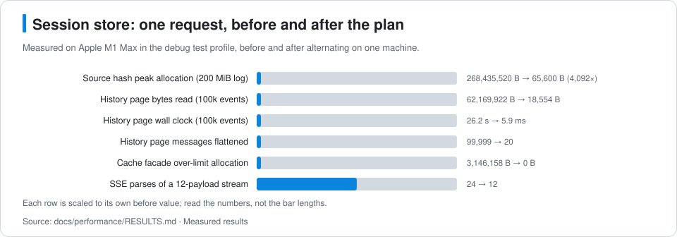
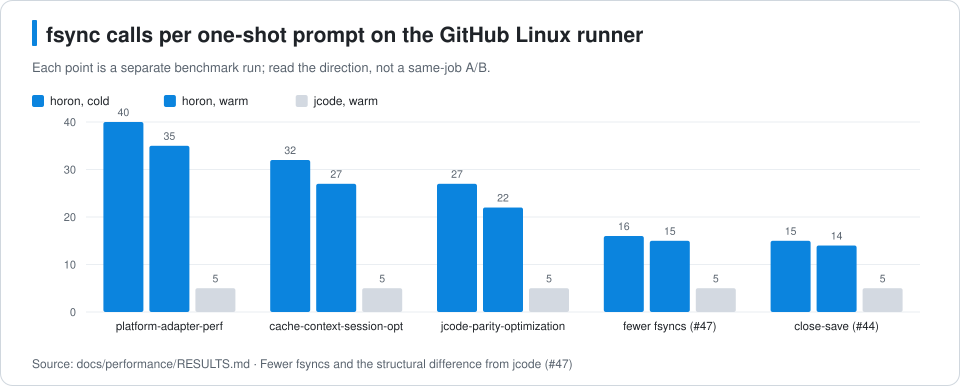
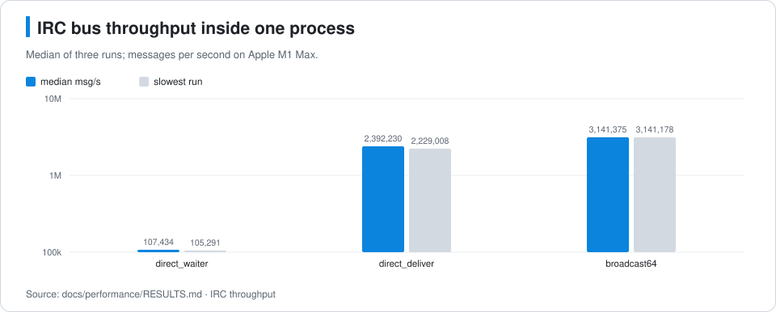
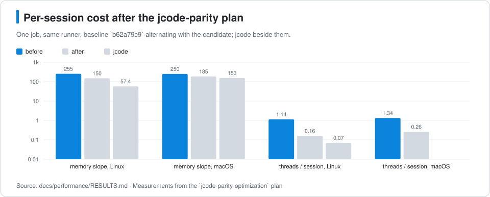
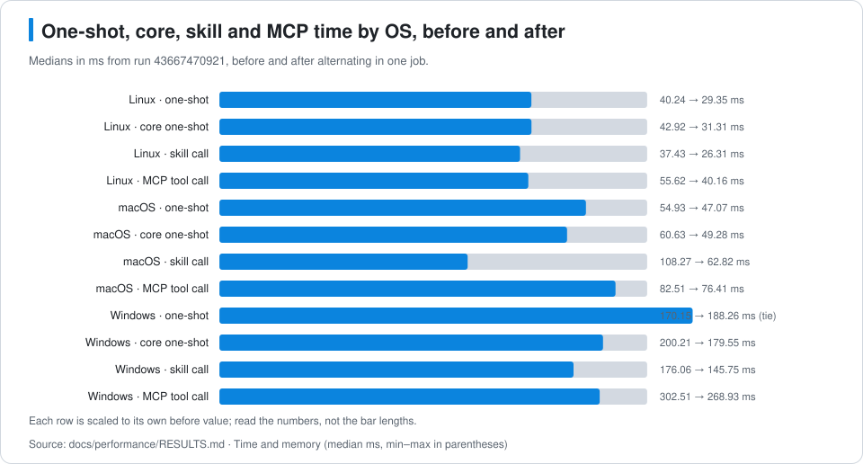

# Performance: measured results and their limits

Language: **English** | [한국어](RESULTS.ko.md)

This document records the measurements the `agent-runtime-performance-2` plan left on baseline B0 (the commit immediately before the plan started). The plan landed 19 performance commits on `dev`, and the same range holds one `fix(cli)` commit unrelated to this plan that has no bearing on the numbers below. The measured surfaces are the session store's hashes and history pages, the SSE parser, replication export, the result cache's threshold decision, and the attach/detach soak. Every measurement was taken on this machine (Apple M1 Max, debug test profile) by alternating before and after on the same machine.

All raw artifacts live under `.omo/evidence/agent-runtime-performance-2/`, a path ignored by `.gitignore:19`. The plan asked for the key numbers to be copied into the PR bodies, but in practice most PR bodies were one line. So anyone who clones this repository today cannot see a single measurement from this work. This page moves that record somewhere tracked; every number is copied verbatim from the evidence files above.

## At a glance

The charts are the reading; every exact number sits in the table of the section it belongs to, folded under a summary line so the tables never stand between the charts.





- One history page from a 100k-event session reads 18,554 B instead of 62,169,922 B and takes 5.9 ms instead of 26.2 s; a 200 MiB source hash peaks at 65,600 B instead of 268,435,520 B. Time and read bytes are the same as before.
- fsync calls per one-shot prompt on the GitHub Linux runner fell from 40 cold and 35 warm to 15 and 14 across the plans below. jcode stays at 5, because it does not commit conversation records; that gap is structural, not a tuning target.
- On macOS, one-shot went from 872.4 ms to 290.4 ms and start→first request from 236.4 ms to 78.7 ms, measured by alternating both builds on one machine. jcode's one-shot on the same runs was 294.8 ms.
- Linux one-shot went from 207.9 ms to 168.0 ms, still behind jcode's 146.3 ms. The gap on Windows is larger and is not claimed as closed.
- Memory per added session after the `jcode-parity-optimization` plan is 149.6 KB on Linux against jcode's 57.4 KB, down from 254.7 KB.
- No wall-clock improvement was established for the loading plan, and its A/A control says why: two runs of the same binary differ by more than any effect the plan could claim.

## Charts: latest automatic measurement

<!-- bench-charts:start -->

`.github/workflows/benchmark-docs.yml` redraws these charts from the competitor comparison of the automatic measurement below. Do not edit this section by hand. Lower is better in every chart, and horon is the blue bar.


| Metric | Chart |
| --- | --- |
| `--version` time | [01-version.svg](charts/01-version.svg) |
| Install size | [02-install-size.svg](charts/02-install-size.svg) |
| One-shot prompt time | [03-oneshot-time.svg](charts/03-oneshot-time.svg) |
| One-shot prompt memory | [04-oneshot-memory.svg](charts/04-oneshot-memory.svg) |
| Skill invocation time | [05-skill-time.svg](charts/05-skill-time.svg) |
| MCP tool call time | [06-mcp-time.svg](charts/06-mcp-time.svg) |
| Memory with the most sessions | [07-sessions-memory.svg](charts/07-sessions-memory.svg) |
| Memory per additional session | [08-per-session-memory.svg](charts/08-per-session-memory.svg) |
| fsync calls per one-shot prompt | [09-fsync-calls.svg](charts/09-fsync-calls.svg) |
| First session memory | [10-first-session-memory.svg](charts/10-first-session-memory.svg) |

The interactive client is a second binary; these charts are drawn from the `tui` suite only and are never mixed with the headless charts above.

| TUI metric | Chart |
| --- | --- |
| TUI latency | [tui-01-latency.svg](charts/tui-01-latency.svg) |
| TUI memory and size | [tui-02-memory.svg](charts/tui-02-memory.svg) |

<!-- bench-charts:end -->

## Versions in the latest automatic measurement

<!-- bench-versions:start -->

Versions recorded by the comparison of `8aa9a859ea48859adc7f41bc740c7dbae57a2b60` at 2026-11-24 20:45 UTC. Each version is listed once across the runner artifacts.

| Tool | Version |
| --- | --- |
| horon | `horon-agent v0.1.0-dev (8aa9a85)` |
| jcode | `jcode v1.0.3 (a0ae514c4)` |
| Claude Code | `2.1.317 (Claude Code)` |
| Codex CLI | `codex-cli 0.166.0` |
| OpenCode | `1.19.5` |
| pi | `1.5.0` |
| oh-my-pi (omp) | `omp/18.18.0` |
| oh-my-openagent (omo) | `omo 5.1.64 (engine: senpi 2026.11.5-1)` |

jcode release identity per runner, from the `jcode-release.json` each job downloaded and verified.

| OS | Tag | Commit | Asset | SHA-256 | Served by |
| --- | --- | --- | --- | --- | --- |
| Linux | `v1.0.3` | `a0ae514c45451f12d5633ed4fa7c71614a9f4a42` | `jcode-linux-x86_64.tar.gz` | `7283a4417fed877229fd89049173a3bb469368a3dec37ca2cc31c4895fb3a6ad` | release-download |
| macOS | `v1.0.3` | `a0ae514c45451f12d5633ed4fa7c71614a9f4a42` | `jcode-macos-aarch64.tar.gz` | `274396799d2c60600ce3e4890abe78439c1882017eedfc272ce30b1730c5b74b` | release-download |
| Windows | `v1.0.3` | `a0ae514c45451f12d5633ed4fa7c71614a9f4a42` | `jcode-windows-x86_64.exe` | `3c929e46b2facc14a21032f845d26c0e2a80a7a9d008cb64c4845fa4434d30dd` | release-download |

[Run](https://github.com/horon-ai/agent/actions/runs/45481956833)

<!-- bench-versions:end -->

## Reading the eight-tool comparison

The latest automatic comparison ([run 45481956833](https://github.com/horon-ai/agent/actions/runs/45481956833), commit `8aa9a85`, measured 2026-11-24 21:25 UTC) covers all eight agents (`horon` plus `jcode`, `Claude Code`, `Codex CLI`, `OpenCode`, `pi`, `omp`, and `omo`) with zero skipped tools on Linux, macOS, and Windows.

- **Where `horon` leads:** Across Linux and macOS, `horon` leads all seven competitors on `--version` (`4.5 ms` Linux, `9.8 ms` macOS, `16.1 ms` Windows), one-shot prompt latency (`44.7 ms` Linux, `89.1 ms` macOS), skill invocation (`38.4 ms` Linux, `72.3 ms` macOS, `183.9 ms` Windows), MCP tool call latency (`64.6 ms` Linux, `95.7 ms` macOS, `226.9 ms` Windows), and first-session post-turn memory (`49.4 MB` Linux, `37.5 MB` macOS). Under concurrent sessions, `horon`, `jcode`, and `OpenCode` keep `0.00` extra processes per session inside one daemon (`54.2 MB` for 10 Linux sessions), whereas per-process peers (`Claude Code`, `pi`, `omp`, `omo`) add `1.00+` processes per session and reach `1.3 GB` to `5.6 GB`. With the default `core` tool surface (`oneshot_core`), the first Linux model request sends `11,032 B` (`9,033 B` for 8 eager tools + `toolbox`) in `47.3 ms`, far below peers whose initial tool catalogs exceed `17 KB`–`33 KB`.
- **Where `horon` trails or ties, and structural reasons:** On Linux, `horon` issues `10` `fsync` calls per one-shot prompt under power-loss durable `[storage] sync = "full"`, while `Claude Code` (`-p`) and `pi` (`--no-session`) issue `0`, `OpenCode` issues `4`, `jcode` issues `5`, `Codex CLI` issues `6`, `omo` issues `36`, and `omp` issues `67`; horon never trades original durability flushes for speed (`AGENTS.md`). On Windows, `jcode v1.0.3` slightly leads on one-shot time (`179.8 ms` vs. `185.3 ms`, overlapping min–max ranges `168.3–265.0 ms` vs. `177.6–247.7 ms`), peak one-shot RSS (`32.3 MB` vs. `34.8 MB`), and first-session RSS (`28.0 MB` vs. `30.9 MB`), and holds a lower per-additional-session RSS slope across all three OSes (`204.8 KB` vs. `544.9 KB` Linux, `349.8 KB` vs. `462.4 KB` macOS, `256.8 KB` vs. `610.2 KB` Windows). For install size on Linux (`109.0 MB` vs. `124.9 MB`), `pi` excludes the preinstalled Node.js runtime (`>=22.19`) from its npm directory size; on macOS and Windows `horon` is smallest overall (`105.0 MB` and `107.1 MB`).
- **Measurement limits:** Every run talks to the local mock server (`scripts/perf/mock_llm_server.py`) rather than live LLM endpoints, isolating harness startup, IPC, persistence, sandbox setup, and MCP initialization without API latency or token pricing. Each competitor uses its own native skill/MCP mechanism (`mcp-call` for `horon`, `mcp` action for `jcode`, `ToolSearch` for `Claude Code`, namespaced Responses for `Codex CLI`, `mcp-tool` for `OpenCode` and `pi`, `xd://` route for `omp`, and background MCP + `tool_search` when cold for `omo`). Because runners and OS memory metrics differ (`PSS`/`RSS` vs. `Working Set`), read ratios only within a single OS.

## Measured results

Dimension labels follow this rule. `MEMORY` is allocation and memory, `TIME` is wall-clock time, `WORK` is iteration counts and byte volumes, and `RESOURCES` is file descriptor, thread and task counts. Dimensions are listed separately so that an improvement in one is not read as an improvement in another.

<details>
<summary>Exact numbers</summary>

| Change | Dimension | Before | After |
| --- | --- | --- | --- |
| Streaming source hash, peak allocation (200 MiB log) | `MEMORY` | 268,435,520 B | 65,600 B (4,092×) |
| Streaming source hash, bytes read | no change | 209,715,200 B | 209,715,200 B |
| Streaming source hash, wall clock | `TIME` (no improvement) | 6,434 ms | 6,404 ms |
| History page, flattened messages (100k events, 20-item page) | `WORK` | 99,999 | 20 |
| History page, bytes read | `WORK` | 62,169,922 B | 18,554 B |
| History page, wall clock | `TIME` | 26.2 s | 5.9 ms |
| SSE, parses of a 12-payload stream | `WORK` | 24 | 12 |
| Replication export, serialization count (64 → 256 event pages) | `WORK` | 129 | 513 (4× the events, 4.0× the serializations) |
| Replication export, bytes against the reference implementation (same 64 → 256) | `WORK` | 8,445,218 → 138,506,722 B (16.4×) | 102,903 → 411,795 B (4.0×) |
| Cache facade, over-limit path (temporary allocation · canonical serialization) | `MEMORY` | 3,146,158 B, 1 time | 0 B, 0 times |
| Cache facade, wall clock | `TIME` (no improvement) | about 19 ms per MiB | about 19 ms per MiB |
| Attach/detach soak, resources after 200 cycles | `RESOURCES` | fd 14, threads 25, tasks 2,141 | fd 14, threads 22, tasks 2,141 |

</details>

A few points are easy to misread from the table alone, so they are set out here.

- The source hash digest is the same as before on all five fixtures (61 KB, 618 KB, 6.2 MB, 62 MB, 200 MiB). The only thing that changed is peak allocation; the bytes read and the time taken are unchanged.
- The history page's `WORK` and `TIME` are two faces of the same request. Fetching one 20-item page from a 100k-event session used to replay the whole session, flatten 99,999 messages and read 62 MB; it now reads only the 20 records the index points at.
- In replication export, a 4× larger page made the old reference implementation grow bytes 16.4×, while the current implementation grows them 4.0×. So the cost is proportional to page length, not log length. Page bytes are byte-identical to B0, and the fixed digests `135cf07d...` (length 240,882) and `4a4855d4...` (length 26,979) reproduce unchanged.
- The cache facade no longer serializes canonical JSON once just to decide whether the cap is exceeded. The 1 MiB boundary is byte-exact (1,048,575 B is cached, 1,048,577 B is skipped). The path that actually caches still serializes once.
- The soak ran 200 cycles, 10 windows, 588.99 s. It measures the increment per window, and the failed rounds, quiescence misses (`quiescence_misses`) and non-returned resources (`non_returning`) are all empty.

### Is one page fetched at the same cost as the log grows?

With an index in place, fetching a 20-item page grew bytes read by only 0.5% when the log grew 100×. Replayed messages are 0 at all three sizes.


<details>
<summary>Exact numbers</summary>

| Events | Log size | Bytes the page read | Wall clock |
| --- | --- | --- | --- |
| 1,000 | 514,853 B | 15,375 B | 4.28 ms |
| 10,000 | 5,168,853 B | 15,415 B | 4.68 ms |
| 100,000 | 51,888,853 B | 15,455 B | 4.80 ms |

</details>

The log sizes in this table come from sessions the growth test builds itself, so they differ from the 100k-event fixture in the previous table (62,155,848 B). It is not the same measurement.

### Commits the table does not cover

The remaining commits changed bounds, the measurement surface or a decision rather than forming a before/after pair. There is a commit that makes NDJSON framing safe at UTF-8 boundaries and adds a frame limit, a commit that moves the hook's stdin write inside its deadline, and a commit that widens tool latency from execute to the whole dispatch. There is also a commit that adds count and byte caps plus a visible overflow to the event stream, a commit that removes the context copy taken before the compression decision, and a commit that moves bridge writes into a bounded queue outside the select loop. The measurement surface changed with a commit that fixes benchmark scripts that never ran because of syntax errors and adds a fixed fixture generator, a commit that adds step counters, allocation probes and a same-machine A/B runner, and a commit that makes the p99 key mandatory. The rest are the decision record rejecting four structural items on measurement, two commits adding the structural gate, the report template and the A/B guide, and a follow-up that cleans up a duplicate closure in the index header check.

## Measured but not adopted

Six items were measured and then rejected. Each item carries the numbers a later attempt would have to beat to overturn that decision.

| Item | Decision | Numbers behind it |
| --- | --- | --- |
| Idle session eviction policy | not adopted | 0.999 fds and 0.998 threads per session, 0.41 MB RSS. The slope does not bend from 1 to 1,000 sessions. The `job_count` that `server:memory` reports is 0 at all five population counts, and the soak returns the session count to 0 |
| `globalEvents` multiplexing | not adopted (protocol change) | 7.4 consumer-side fds and 3.0 threads per watched session. The daemon's own share is 1.0 connection per session, and the bridge attaches one session per connection |
| Narrowing the session map lock scope | not adopted | Removing an unrelated session waits for the whole import. 861 / 5,561 / 11,255 / 24,499 ms at 1 / 20 / 60 / 150 events, ratio 1.00 |
| Replacing the 25 ms interrupt poll timer with notification | not adopted | It would save a worst case of 29.7 ms (27.6 ms on average) at the cost of restructuring a wakeup once per watch-group round |
| Overlapping the `run.stopped` journal write with the close-save (#144, #129) | not adopted (slower) | Windows last request → exit, median against `dev` in the same job: 39.8 → 56.4 ms over 5 samples (run 42759006826) and 35.2 → 42.8 ms over 20 samples (run 42764256757; IQR 33.0–40.9 vs 40.7–45.5). Linux and macOS were ties. #146 later removed the close-save flush itself, which brought the same span to 32.5 ms |
| Resolving the fixed Windows shell environment once per process (#124, #122) | not adopted (tie) | Tool round-trip span on Windows, 20 samples: 74.3 → 73.5 ms (run 42735692366), inside the min–max range. Nearly all of the round trip is the `cmd.exe` start, not the per-call env table or PATH search |

Rejecting something on numbers is not a failure. The plan defined success as "when no improvement shows up, the item ends as not adopted with its reasoning attached. That counts as success too." The last column above is that reasoning.

## What these numbers do not say

This section is the point of this page. Leave out any one of the statements below and the page leads the reader to the wrong conclusion.

- **The source hash improvement covers the hashing stage only, and the store path streams its validation.** `crates/base/src/session/event_commit.rs:120-133` hashes the captured prefix through one 64 KiB buffer and `:148-166` compares the reserved tail in a buffer of the same size, so saving a large log no longer allocates a copy of it. The plan recorded 156,518 B for a 7 KB log and 8,293,580 B for a 553 KB log from a save whose peak did follow the log size; those figures do not describe this path any more.
- **The history page improvement covers repeated paging while the head does not move.** The index is tied to the log's identity stamp (device, inode, length, mtime, ctime), so a single append, import or reset invalidates it. A session that keeps growing therefore pays the old cost once more and rebuilds the index. That rebuild cost was not measured. A single page fetch from a new head is not faster.
- **The cache improvement is allocation, not throughput.** Wall clock is about 19 ms per MiB on both sides. Escaping cost dominates either way.
- **The soak asserts fds, threads, queues, pending requests and tasks. Not RSS.** RSS rose from 68.4 MB to 79.5 MB and then stayed flat (peak 83.7 MB), and is recorded as an observation only.
- **The 200-cycle soak resolves one leaked resource per 20 cycles.** The plan asked for 1,000 cycles; that form now runs weekly in `Attach/Detach Soak` (`.github/workflows/soak.yml`) and its first run was clean, while the pull-request form is the same test at 20 cycles inside the structural gate (`scripts/perf/check_structural.py:136-146`).
- **The structural gate did not assert the frame limit when this plan closed.** The counters the gate read then included no frame count, and the frame limit was held by `crates/harness-api-server/src/framing_tests.rs` alone. The gate now has a `frame` section (`scripts/perf/check_structural.py`): the bridge reader and the SDK reader each report `max_frame_bytes`, `accepted_frame_bytes` and `rejected_frame_bytes`, and the gate requires the cap to equal `frame_max_bytes` (64 MiB) and the smallest refused frame to be exactly one byte above the largest accepted one. It still counts no frames.
- **The `shared_context` map these numbers once covered no longer exists.** It was removed with the rest of the topic-channel store (#299), so the soak no longer samples it and the table above carries no figure for it. The historical reading stands as recorded: 0 at every population count, which meant "nobody used it" rather than "nothing leaks". What survives in the `server:memory` payload is the swarm block beside it — `member_count`, `status_counts`, `swarm_count`, `swarm_membership_count`, `plan_count`, `plan_item_count` and their byte estimates (`crates/app-core/src/server/debug_server_state.rs`) — and that block is what a future soak would sample.
- **The replication export's serialization factor is fixed per page.** It is 513 at the 256-event cap, but export time still grows with the log (278.2 ms for 1,000 events, 2,657.2 ms for 10,000). Bytes are flat within a page, not across the whole export.
- **The cache facade's warm-restore time is a single-shot measurement.** It includes page cache variance, and in the same case the range covers 108.6 / 901.8 ms on the lane and 108.9 / 499.7 ms for the lead's re-run. Only the byte-exact boundary decision is reproducible.
- **The absolute milliseconds of the four not-adopted decisions are not release numbers.** They were taken in the debug test profile in a scratch home; what transfers is the ratio (wait time equals import time, session creation about 1.2 s).
- **The 7.4 fds and 3.0 threads for `globalEvents` are consumer-side costs.** The SDK and the daemon ran in the same process, so both ends were counted together. The 100-session and 1,000-session numbers are arithmetic on this per-session value, not a second measurement.

## How to reproduce

Give each measurement its own `CARGO_TARGET_DIR` and run them one at a time. Two test binaries on one target directory produce a different failure every time, and that failure says nothing about the code.

```bash
export CARGO_TARGET_DIR="$PWD/.target-measure"
```

Measurement logs come from the repository's generator. Below are the 200 MiB log and the 100k-event log.

```bash
python3 scripts/perf/fixtures/gen_event_log.py --bytes 209715200 --seed 20261021 --out /tmp/event-log-200mib/
python3 scripts/perf/fixtures/gen_event_log.py --events 100000 --seed 20261021 --out /tmp/event-log-100000/
```

For the source hash, the probe example prints a full read and a streaming digest side by side.

```bash
cargo build --locked -p horon-agent-base --example source_hash_probe
"$CARGO_TARGET_DIR/debug/examples/source_hash_probe" hash /tmp/event-log-200mib/events.jsonl
```

For the history page, the 100k-event fixture is passed in through an environment variable, and a separate test checks equality with the committed 500-record baseline.

```bash
HISTORY_PAGE_PERF_FIXTURE=/tmp/event-log-100000/events.jsonl \
  cargo test --locked -p horon-agent-harness-api-server --lib history_page_perf -- --nocapture --test-threads=1
cargo test --locked -p horon-agent-harness-api-server --lib pages_match_the_committed_pre_change_baseline -- --nocapture
```

For the SSE parser, the same event sequence and parse count are printed at four chunk sizes.

```bash
cargo test --locked -p horon-agent-provider-openai --lib stream::stream_tool_tests::chunked_replay_yields_the_same_events_at_every_chunk_size -- --nocapture
```

For replication export, tests in the repository check page byte equality and the cap. The QA harness that printed the serialization counts in the table (129 / 513) lives in `.omo/evidence/agent-runtime-performance-2/qa_task14.py` and is untracked, so a reader who clones the repository cannot reproduce those counts directly. The digests and lengths do reproduce.

```bash
cargo test --locked -p horon-agent-session-store replication -- --nocapture
```

For the cache facade, a test prints the serialization counts on both sides of the boundary and an example prints the allocation peak.

```bash
cargo test --locked -p horon-agent-base --lib event_cache -- --nocapture
cargo build --locked -p horon-agent-base --example facade_cache_probe
```

The soak has a 200-cycle default form and a 1,000-cycle variant behind `#[ignore]`. The 1,000-cycle form is what the scheduled `Attach/Detach Soak` workflow (`.github/workflows/soak.yml`) runs weekly; it is not part of `CI Required`, so a retention failure never blocks a pull request, and it opens or updates one tracking issue instead of failing a review.

```bash
HORON_AGENT_WORKSPACE_TRUST=trust \
  cargo test --locked -p horon-agent --test e2e soak_attach_detach::soak_attach_detach_returns_every_counter_to_baseline -- --exact --nocapture
HORON_AGENT_WORKSPACE_TRUST=trust \
  cargo test -p horon-agent --test e2e soak_attach_detach_1000_cycles -- --ignored --exact --nocapture
```

The scheduled run is reproducible by hand: `gh workflow run soak.yml --ref dev -f cycles=1000`. Its report is the `soak-attach-detach-report` artifact, and `python3 scripts/perf/check_soak.py <captured log>` renders the same Markdown from a local run.

### The 1,000-cycle baseline on a hosted runner

The first run was the `dev` push after the workflow merged ([run 43600180217](https://github.com/horon-ai/agent/actions/runs/43600180217), commit `af41e0b7`), on `ubuntu-24.04` with `HORON_AGENT_PERF_COUNTERS=1`.

| Measure | Value |
| --- | --- |
| Cycles | 1,000, in 10 windows of 100 |
| Cycle time | 7 min 38 s (13:34:30Z → 13:42:08Z), about 0.46 s per cycle |
| Whole job | 10 min 56 s including the cold build |
| Verdict | `STRUCTURAL_PERF section=soak cycles=1000 fd_retention=0 thread_retention=0 non_returning=0` |
| Report | **Clean.** Every counter returned to its baseline |

| Counter | Baseline → final | Slope per 100 cycles |
| --- | --- | --- |
| `fd_count` | 16 → 16 | +0.000 |
| `thread_count` | 16 → 16 | +0.000 |
| `queue_depth_high_water` | 0 → 1 | +0.100 |
| `pending_requests`, `interrupt_poll_wakeups`, `background_tasks`, `live_sessions`, `connected_clients` | 0 → 0 | +0.000 |

`queue_depth_high_water` is a high-water mark, not a final value: it records the deepest queue seen at any point, so a transient 1 is not retention. The 180-minute job timeout leaves more than an order of magnitude of headroom over the measured run.

How to use the structural gate and the A/B runner, the required keys of the report template, and the procedure for raising a bound are in [`docs/performance/BENCHMARK.md`](BENCHMARK.md). The gate command is `python3 scripts/perf/check_structural.py` and the A/B runner is `scripts/perf/ab_perf.py`.

## Status

The plan has 17 items: 14 are done and 3 are partially done (`[~]`). Partially done means the following.

| Item | Status | Meaning |
| --- | --- | --- |
| 7. NDJSON framing caps for both SDKs | `[~]` | The code and tests are on `dev` and verified. The evidence file this item pointed at disappeared with a worktree and was not reconstructed. The behavior is proven, the evidence trail is not |
| 12. Auxiliary and result cache byte accounting | `[~]` | The code is on `dev`, and the lead re-ran the decisive lines and reproduced them. The lane's raw evidence file is gone, and the file now in its place is a reconstruction that labels itself `recovered` |
| 15. Attach/detach soak | `[x]` | The 1,000-cycle plan item now runs: `.github/workflows/soak.yml` runs it weekly and on demand, and the first run completed 1,000 cycles clean in 7 min 38 s (`fd_retention=0`, `thread_retention=0`, `non_returning=0`, run 43600180217). The 200-cycle form stays the pull-request gate, run at 20 cycles by the structural gate (`scripts/perf/check_structural.py:136-146`) |
| 17. CI structural gate and report template | `[~]` | The gate really runs (42 bounds in `scripts/perf/structural_budget.json`, `EXIT=0`, `EXIT=1` on violation, `EXIT=2` when a measurement is missing, 84 contract tests in `scripts/perf/test_check_structural.py`). Two conditions from the plan remain. There is no frame count counter, and "passes at B0" is structurally impossible (the code that prints the `STRUCTURAL_PERF` line landed after B0). The gate now asserts the frame cap itself in its `frame` section for both readers, and still reads no frame count |

The other 13 items are done.

## Measurements from the `agent-rust-loading-durable-runtime` plan (separate plan, separate baseline)

The table above records the `agent-runtime-performance-2` plan. Below is what the
`agent-rust-loading-durable-runtime` plan, which ran later, left behind; both its baseline commit
and its measurement tools are different. Numbers from the two plans are not compared in one table.

The raw artifacts for this plan are under `.omo/evidence/agent-rust-loading-durable-runtime/`.

### Time improvement: not established

The measurement tools (`scripts/perf/bench_loading.py` and `crates/base/examples/loading_probe.rs`)
are outputs of this plan, so the baseline commit immediately before it does not contain the same
tools. Instead of comparing two different measurement programs, the plan used a control (A/A) that
alternately measured two configurations of the same binary 30 times each
(`aa_control: true`). The result is `improvement_claim: false`.

| Segment | A p50 / p95 (ms) | B p50 / p95 (ms) |
| --- | --- | --- |
| attach_history | 671.2 / 1579.2 | 691.7 / 2047.0 |
| provider_dispatch | 12.0 / 26.5 | 13.3 / 66.2 |
| resume_ready | 309.9 / 733.9 | 299.2 / 675.1 |
| session_save | 906.8 / 1271.5 | 993.2 / 1412.7 |
| skill_catalog | 0.2 / 0.2 | 0.2 / 1.4 |

The spread between two runs of the same binary is larger than any effect this plan could claim, and
it does not lean in one direction. So **no wall-clock improvement is claimed.**

### Structural counters: measured, and the bounds hold

These items are judged by counters instead of time. There are two kinds of evidence, and they
measure different things.

- `python3 scripts/perf/check_structural.py` exited 0, **passing all 45 bounds** (0 failures, 0
  missing). The counters this gate actually reads come in six groups: queue depth, pending
  requests, history page cost, hash buffer, frame limit, and the attach/detach soak.
- The items in the table below are **not** read by that gate. A named test per item asserts each
  one directly.

| Item | Dimension | What changed | Test that pins it |
| --- | --- | --- | --- |
| Store validation | `MEMORY` | Commit validation streams through a fixed 64 KiB buffer instead of allocating the whole file. Source length only adds passes | `hash_stream` |
| Request snapshot | `WORK` | Deep-copying messages in the same request no longer grows with history length | `request_snapshot_reuse` |
| Skill list | `WORK` | At most one overlay scan per request, section cap 49,152 B (UTF-8) | `skill_snapshot_budget` |
| Connection setup | `WORK` | Zero built-in tool constructors called outside core, and the start path does not wait for prewarm networking | `loading_deferred_setup` |
| Session resume | `WORK` | Live session reload and duplicate save during resume removed | `loading_live_resume` |

`MEMORY` and `TIME` are not mixed. None of the items above claims a wall-clock improvement.

### What this plan did not measure

- Release profile numbers. Every measurement is in the debug profile.
- Throughput at multi-device or production scale.
- Provider call speed. Provider network time is outside this plan's scope.

## Measurements from the `agent-irc-bus` plan

These are measurements from the `agent-irc-bus` plan, run separately from the two records above. That plan added the mailbox bus between agents and the `irc` tool; baseline B0 is `50eed12` (the commit immediately before the plan started on `dev`) and the candidate is `c9d9d8c` (wave 3 merge). Numbers in this record are not compared with the two earlier records.

The raw artifacts are in `.hyper/qa/agent-irc-bus/11-happy.txt` (the A/B report JSON, three throughput runs, and the structural gate's `irc` area) and `.hyper/qa/agent-irc-bus/11-failure.txt` (the A/A control). `.hyper/` is ignored by the repository, so this section is the tracked record.

### Measurement conditions

| Item | Value |
| --- | --- |
| Machine | Apple M1 Max, 10 cores, 64 GiB memory |
| Kernel | `Darwin Alpoxs-MacBook.local 25.4.0 ... RELEASE_ARM64_T6000 arm64` |
| Toolchain | `rustc 1.99.1`, `cargo 1.99.1` |
| Build profile | release, no feature set (both sides `cargo build --locked --release -p horon-agent-base --example perf_counters_surface`) |
| Workload | One run of `perf_counters_surface` (a fresh process per run) |
| Load during measurement | Load averages 50.10 / 44.73 / 44.59 (1 / 5 / 15 minutes), 4 `rustc` and `cargo` processes |
| Repetitions | 3 warmups, 10 runs per side, the two sides alternating |
| B0 binary | `48c69b5c...`, commit `50eed12` |
| Candidate binary | `a82fb191...`, commit `c9d9d8c` |

Compilations unrelated to this plan were running in several repositories during the measurement. The observed load averages over that period ranged from 36 to 64, and the `rustc` and `cargo` process count was observed between 4 and 17. So the absolute times in this section are not values from a quiet machine.

### A/B: no regression

`scripts/perf/ab_perf.py` exited 0 and the adoption decision is `not-adopted-no-measurable-change`. It is not `reject-regression`, which would mean a regression; the median difference is inside the noise band, so the value claims neither improvement nor regression.

| Item | B0 | Candidate | Difference |
| --- | --- | --- | --- |
| Median | 5.23 ms | 5.39 ms | +0.16 ms (+3.09%) |
| p95 | 7.06 ms | 7.10 ms | +0.05 ms |
| Noise band (`max(3*1.4826*MAD, 1% of the median)`) | | | ±1.35 ms, inside the band |
| `cpu_user_ms` median | 2.22 ms | 2.18 ms | -0.04 ms |
| `cpu_system_ms` median | 1.55 ms | 1.60 ms | +0.05 ms |
| `peak_rss_bytes` median | 6,045,696 B | 6,029,312 B | -16,384 B |
| `fd_count` / `thread_count` median | 3 / 1 | 3 / 1 | same |
| Failures / timeouts | 0 / 0 | 0 / 0 | |
| `read_bytes` median | 0 B | 0 B | same |

For `allocated_bytes`, `pss_bytes` and `retained_bytes`, which the workload did not report, the runner leaves `null` rather than 0 and lists the three names in `counts.missing`. p99 was refused because there were 10 samples, with the reason that it needs at least 20.

### A/A control: no false regression

The control run, with the same candidate binary on both sides, ended as `control-no-change`. Medians were 6.48 ms and 6.70 ms, a 0.22 ms (3.43%) difference, but inside the ±1.58 ms noise band. So the 0.16 ms difference in the A/B above is smaller than this instrument can resolve, which is evidence that the runner does not invent regressions.

### IRC throughput

`cargo run --locked --release -p horon-agent-irc-core --example irc_throughput` was run 3 times. The message count is the default 100,000 and `broadcast64` rounds down to a multiple of 64, giving 99,968.



<details>
<summary>Exact numbers</summary>

| Scenario | Run 1 | Run 2 | Run 3 | Median | Range |
| --- | --- | --- | --- | --- | --- |
| `direct_waiter` (msg/s) | 105,291 | 107,434 | 111,523 | 107,434 | 105,291 ~ 111,523 |
| `direct_deliver` (msg/s) | 2,410,858 | 2,229,008 | 2,392,230 | 2,392,230 | 2,229,008 ~ 2,410,858 |
| `broadcast64` (msg/s) | 3,237,934 | 3,141,178 | 3,141,375 | 3,141,375 | 3,141,178 ~ 3,237,934 |

</details>

`direct_waiter` uses 64 receiver task pairs (`WAITER_PAIRS = 64`) waiting in `wait` at the same time. From the second round on, each receiver task sends one message to its peer that creates a reply obligation and then enters `wait`, and the driver confirms all 64 waiters are registered before sending one message per live pair. Round trips within a pair are ordered, but the 64 pairs run concurrently. `direct_deliver` is a fake delivery path that returns the injection immediately, and `broadcast64` is the path that sends one body to 64 recipients.

todo 6 first measured `direct_waiter` at 39,128 msg/s (`6-happy.txt`, 100,000 messages in 2,555,678 us); after todo 12 removed the timer round trip that every `wait` call carried, this measurement gives 107,434 msg/s. That is about 2.75×. todo 12's own measurement is 124,071 msg/s (`12-happy.txt`), and this value is lower. That looks like a load difference at measurement time, since the code path is the same.

### Structural gate `irc`

`python3 scripts/perf/check_structural.py --only irc` exited 0, passing all five bounds.

| Counter | Observed | Bound |
| --- | --- | --- |
| `mailbox_high_water` | 100 | at most 100 |
| `mailbox_dropped` | 900 | equal to 900 |
| `broadcast_body_allocations` | 1 | equal to 1 |
| `waiters_live_after_churn` | 0 | equal to 0 |
| `broadcast_inflight_high_water` | 16 | at most 16 |

### What these numbers do not say

- **The A/B workload measures process start and counter printing, not the bus.** `perf_counters_surface` does not start a daemon; it prints a counter snapshot once. The IRC bus is off in the default configuration and never reaches this path, so all this A/B says is "no regression in shared code". The throughput table answers for the bus itself.
- **Throughput is measured inside one process.** The example puts `IrcBus` with a fake directory and a fake deliverer in one process. It does not include daemon transport, serialization, session state transitions or model calls. Response time for a real agent conversation cannot be predicted from these numbers.
- **The `direct_waiter` number is sensitive to machine load.** The three runs here range from 105,291 to 111,523, and against todo 6's 39,128 (`6-happy.txt`) that is about 2.75×. The difference between todo 12's 124,071 (`12-happy.txt`) and this value looks like a load difference at measurement time, so the value worth carrying over is the ratio, not the absolute throughput.
- **The A/B absolute times are not values from a quiet machine.** Observed load averages during the measurement ranged from 36 to 64, with `cargo test`, `cargo clippy` and `cargo build` running in unrelated repositories. Because the A/B alternates the two sides and the A/A confirms the noise band, the direction of the comparison holds, but the single-digit millisecond absolute values do not reproduce under other conditions.
- **There is no p99.** With 10 samples the runner refused it, citing fewer than 20.
- **Three metrics were not measured.** `allocated_bytes`, `pss_bytes` and `retained_bytes` are `null` and listed in `counts.missing` because the workload did not report them. Do not read them as 0.
- **The structural gate does not measure time.** The five values above say only that shapes are inside their bounds, not that anything is fast.

## Measurements from the `platform-adapter-perf` plan

These are measurements from the `platform-adapter-perf` plan, run separately from the three records above. That plan gathered OS-specific code into five `crates/platform-*` crates, removed fsyncs for derived caches that can be rebuilt from session storage, built the HTTPS client's TLS configuration once per process, and turned price-list refresh off by default. Baseline B0 is `738712a` (the commit immediately before the plan started on `dev`) and the candidate is `215bfdb` (the work branch). Numbers in this record are not compared with the three earlier records.

The raw artifacts are under `.hyper/qa/platform-adapter-perf/after/`. `.hyper/` is ignored by the repository, so this section is the tracked record.

| File | Contents |
| --- | --- |
| `compare-macos.json`, `compare-linux.json`, `compare-linux-times.json` | Three-line comparison (horon B0, horon candidate, jcode). Linux `compare-linux.json` uses `--syscalls`; time numbers are from `compare-linux-times.json` |
| `fsync-linux.txt` | fsync and fdatasync call counts for one one-shot, cold and warm |
| `ab-*.json` | Same-machine A/B reports (the runner's output JSON as is) |
| `github-baseline/`, `github-candidate/` | Artifacts of GitHub `benchmark.yml` runs 42294971747 (`--ref dev`) and 42294976581 (branch) |
| `structural.log` | Full `check_structural.py` output |

### Measurement conditions

| Item | macOS | Linux | GitHub runner |
| --- | --- | --- | --- |
| Machine | Apple M1 Max, 10 cores | Docker `rust:1-trixie`, linux/aarch64, 10 cores | `ubuntu-latest`, linux/x86_64, 4 cores |
| Toolchain | `rustc 1.99.1` | the container's distro rustc | `stable` (at run time) |
| Profile | release | release | release |
| The two binaries within one measurement | same machine, alternating | same | different runs, different runner instances |
| Competing tool | jcode v0.99.1 (`7206efd0c`) | same | same |

Every line within one measurement talks to the same mock model server, so no API fees or secrets are involved. macOS and Linux measured the B0 binary and the candidate binary within one run; for GitHub, the `dev` run and the branch run were started separately. So in the table below the GitHub column is "two runs", not "before and after".

### Before and after across three environments

one-shot is the median of a single `run` question (startup, one `ls` tool round trip, final response). start→first request runs from connecting to the api-bridge socket to the first `list_sessions` response. fsync is the number of fsync and fdatasync calls a single one-shot makes. Memory is the idle RSS of the daemon process tree.


<details>
<summary>Exact numbers</summary>

| Metric | Environment | B0 `738712a` | Candidate `215bfdb` | Change | jcode | Candidate / jcode |
| --- | --- | --- | --- | --- | --- | --- |
| one-shot median | macOS | 872.4 ms | 290.4 ms | -66.7% | 294.8 ms | 0.99× |
| one-shot median | Linux (Docker) | 207.9 ms | 168.0 ms | -19.2% | 146.3 ms | 1.15× |
| one-shot median | GitHub runner | 185.3 ms | 499.8 ms | separate runs, not comparable | 145.5 ms / 357.8 ms | not comparable |
| start→first request | macOS | 236.4 ms | 78.7 ms | -66.7% | not applicable | not applicable |
| start→first request | Linux (Docker) | 57.0 ms | 57.0 ms | -0.03% | not applicable | not applicable |
| start→first request | GitHub runner | 23.7 ms | 25.3 ms | separate runs | not applicable | not applicable |
| fsync and fdatasync calls | Linux (Docker) | 175 cold / 170 warm | 40 cold / 35 warm | -77% | 19 cold / 5 warm | 7.0× |
| fsync and fdatasync calls | GitHub runner | cannot measure | 40 cold / 35 warm | cannot measure | 19 / 10 / 5 calls | 3.5× |
| First-session idle RSS | macOS | 32.73 MiB | 29.52 MiB | -9.8% | 37.34 MiB | 0.79× |
| First-session idle RSS | Linux (Docker) | 32.05 MiB | 33.37 MiB | +4.1% | 40.29 MiB | 0.83× |
| Increment per session | macOS | 592 KiB | 320 KiB | -46% | 544 KiB | 0.59× |
| Increment per session | Linux (Docker) | 1396 KiB | 944 KiB | -32% | 144 KiB | 6.6× |
| First-session idle RSS | GitHub runner | cannot measure | 39.9 MiB | cannot measure | 43.0 MiB | 0.93× |
| Increment per session | GitHub runner | cannot measure | 319 KiB | cannot measure | 38 KiB | 8.3× |

</details>

The candidate column in this table was measured with the `215bfdb` binary. Of the changes that later landed on the branch, only one touched the start path, the deferred HTTP client (`b6dcfc0`); the time and memory re-measurements are in the "Memory" section below. The 11 fixes from the F2 quality review also left these numbers unchanged, and re-measuring with the same runner gives Linux fsync cold 40 · warm 35 again ("fsync" in `F2-review.md`).

The decision to hold fsync at 40 or below uses the values from the `bench_compare.py --syscalls` runner (cold 40 · warm 35). todo 6's own driver used a different HOME and prompt shape and measured cold 45 · warm 40 on the same candidate binary, and in that run only warm meets the 40 bound ("result against the plan" in `6-linux-fsync.txt`).

Absolute values on hosted runners differ per machine and mean nothing, so the GitHub column says only that "the workflow runs on the branch as-is and fsync counts are recorded too". All three session measurements in the GitHub B0 run failed with `daemon socket not ready`. That run uses `dev`'s `bench_compare.py`, and the fix for the removal of `serve --debug-socket` (todo 13) is still only on the branch. So the session values from GitHub B0 are not 0.

### Same-machine A/B: no regression on the time paths

`scripts/perf/ab_perf.py` runs the two binaries alternately in blocks and reports the noise band `max(3*1.4826*MAD, 1% of the median)` alongside. Only differences outside the band are called an improvement or a regression.

One row is one path. one-shot, start→first request and the session paths go through a small probe that does the setup for them (scratch HOME, mock model address, daemon start), so the absolute values here are larger than in the environment table above by the probe's own startup. Both sides use the same probe, so the direction of the comparison is unchanged.

<details>
<summary>Exact numbers</summary>

| Path | Environment | B0 | Candidate | Difference | Noise band | Verdict |
| --- | --- | --- | --- | --- | --- | --- |
| one-shot | macOS | 1121.85 ms | 435.79 ms | -61.2% | ±93.95 ms | improved |
| start→first request | macOS | 236.36 ms | 78.72 ms | -66.7% | ±10.36 ms | improved |
| Two session paths | macOS | 3295.26 ms | 2259.88 ms | -31.4% | ±131.13 ms | improved |
| `--version` load | macOS | 7.76 ms | 7.52 ms | -3.0% | ±1.36 ms | inside the band |
| `perf_counters_surface` | macOS | 4.74 ms | 4.80 ms | +1.3% | ±1.41 ms | inside the band |
| one-shot | Linux | 265.02 ms | 217.62 ms | -17.9% | ±14.61 ms | improved |
| `--version` load | Linux | 2.60 ms | 2.63 ms | +1.2% | ±0.39 ms | inside the band |
| `perf_counters_surface` | Linux | 0.46 ms | 0.47 ms | +1.6% | ±0.08 ms | inside the band |
| start→first request | Linux | 57.03 ms | 57.02 ms | -0.03% | ±2.93 ms | inside the band |
| One session path | Linux | 14882 ms | 14836 ms | -0.3% | ±148.82 ms | inside the band |
| Two session paths | Linux | 14936 ms | 14858 ms | -0.5% | ±149.36 ms | inside the band |

</details>

Tool latency and startup steps were checked separately on the same machine. Alternating the 14 cases in `bench_tools.py` three times each gives median differences between -15.7% and +5.4%, and the cases that grew are `ls` (+5.4%), `agentgrep` (+1.1%) and `read (repo Cargo.toml)` (+0.9%). For `ls`, B0's three runs are 2.21 / 2.46 / 3.57 ms and the candidate's are 2.58 / 2.59 / 2.64 ms, which falls inside B0's own run-to-run spread. `bench_startup.py` gives a server-ready median of 10.8–10.9 ms (B0) and 11.0 ms (candidate), and a total bridge time of 18.1–18.6 ms and 17.9–18.6 ms, which overlap. The 20–40% spread across tool cases unrelated to the change in the GitHub candidate run is a runner instance difference and does not reproduce on the same machine.

macOS dropped sharply because the two costs this plan targeted existed only on macOS. The path that took `F_FULLFSYNC` on every save, derived caches included, now syncs the source only, and the path that read a keychain certificate per reqwest client became one construction per process. As a control, `--version` load and `perf_counters_surface` are inside the band in both environments. Neither path touches storage or TLS, so they are exactly where a regression in shared code would have shown up first.

### Memory: the first Linux daemon RSS numbers, and what re-measuring showed

The time paths got slower nowhere. Memory was first recorded as an increase in Linux daemon RSS (`rss`), and only later was it established that the measurement method itself cannot compare two builds. The first numbers come first, then the re-measurement and the fix below them.

<details>
<summary>Exact numbers</summary>

| Measurement | Environment | B0 | Candidate | Difference |
| --- | --- | --- | --- | --- |
| Daemon idle, 0 sessions | macOS | 27.82 MiB | 24.09 MiB | -3.73 MiB (-13.4%) |
| Daemon idle, 1 session | macOS | 32.34 MiB | 28.95 MiB | -3.39 MiB (-10.5%) |
| Daemon idle, 0 sessions | Linux | 27.88 MiB | 29.01 MiB | +1.13 MiB (+4.1%) |
| Daemon idle, 1 session | Linux | 31.74 MiB | 32.75 MiB | +1.01 MiB (+3.2%) |
| one-shot peak RSS (8 runs) | Linux | 32.46 MiB | 32.87 MiB | +0.41 MiB (+1.3%, ranges overlap) |
| Same-binary control (A/A) | Linux | 27.83 MiB | 27.87 MiB | +0.03 MiB (+0.1%) |

</details>

The Linux difference is in the executable's resident pages, not the heap. Summing `/proc/<pid>/smaps` by mapping type for the 1-session state gives the following.

| Mapping | B0 | Candidate | Difference |
| --- | --- | --- | --- |
| Executable `r-xp` | 26176 KiB | 27136 KiB | +960 KiB |
| Executable `r--p` | 1508 KiB | 1508 KiB | 0 |
| Anonymous `rw-p` | 1796 KiB | 1730 KiB | -66 KiB |
| Everything else | 1784 KiB | 1784 KiB | 0 |

Running the same measurement once more gives an `r-xp` difference between +960 and +1472 KiB and an anonymous difference between -66 and +156 KiB. The direction is the same both times and the size is overwhelmingly on the executable side. With no sessions the direction is the same, `r-xp` +1152 KiB and anonymous +10 KiB. Minor page fault medians are 1574 and 1584, effectively equal, and major page faults are 0 on both sides. The binary grew 276,928 B and `.text` grew 100,576 B, so the added residency is larger than the file size. That means more code pages are actually touched. The per-session increment, by contrast, fell from 1396 KiB (B0) to 944 KiB.

#### Re-measured: the difference was page cache, not code

The first numbers came from an A/A control that writes the same file on both sides, so they only guarantee "this one binary measures repeatedly". Building the same source twice independently and measuring with the same method moves more than that difference.

| Control | rss median | `r-xp` median |
| --- | --- | --- |
| Same commit, build 1 vs build 2 | 22.22 vs 21.63 MiB | 22068 vs 22028 KiB |
| Same commit, build 1 vs build 3 | 22.22 vs 26.33 MiB | 22068 vs 21948 KiB |
| Candidate commit, build 1 vs build 2 | 27.00 vs 23.17 MiB | 22576 vs 22716 KiB |
| Same bytes, different path | 14.39 vs 26.85 MiB | 11276 vs 24076 KiB |

The cause is that resident `r-xp` pages are not executed code but page cache folios the kernel faulted in alongside it. The median length of a resident run is 32–48 pages (64 KiB folios) while the executed run is 1–2 pages. Two builds of the same source therefore differ by up to 8 MiB in residency.

The measurement was changed to values the cache cannot move. It counts the 4 KiB code pages executed in a callgrind instruction dump (`--dump-instr=yes`), and `rss` was measured after dropping the page cache with `posix_fadvise(DONTNEED)` before every start and pinning `fault_around_bytes` to 4096.

| Build | Executed code pages | `rss` median (controlled) |
| --- | --- | --- |
| Baseline 738712a #1 | 1765 | 26.42 MiB |
| Baseline #2 | 1765 | 26.37 MiB |
| Candidate f5f5868 #1 | 1771 | 26.92 MiB |
| Candidate #2 | 1778 | - |
| Candidate #3 | 1771 | - |

The build-to-build spread within one side (baseline 1759–1765) equals or exceeds the difference between the sides (1765 vs 1771). So the "+1.0–1.3 MiB of resident executable code" recorded first is not a regression attributable to this change.

#### What was actually fixed: building the TLS trust store at startup

`serve` builds the tool registry at startup. At that point `WebFetchTool::new`, `WebSearchTool::new`, `DiscoverToolsTool::new` and `NotificationDispatcher::new` each held `shared_http_client()`, and building that client means parsing all 449 trust-store anchors.

    shared_http_client -> ClientBuilder::build -> openssl_probe::probe
      -> rustls_native_certs::load_pem_certs
      = 83% of startup instructions, 194 of 878 executed code pages

The four constructors no longer hold the client. `shared_http_client()` is already a process-wide `OnceLock`, so calling it at the point where a request is sent is enough.

| Side | Executed code pages | `rss` median | `r-xp` median |
| --- | --- | --- | --- |
| Baseline | 1765 | 26.42 MiB | 22068 KiB |
| Candidate before the fix | 1771 | 26.92 MiB | 22576 KiB |
| Candidate after the fix | 1755 | 26.59 MiB | 22208 KiB |

After the fix the executed code pages are below the baseline (1755 vs 1765). The remaining `rss` difference of +0.17 MiB is inside the same-source build-to-build spread seen above (up to 8 MiB in the controlled measurement, 0.6 MiB within the same pair) and does not appear as an executed-code difference.

The rest of the start path is the same on both sides. System calls up to idle are 5416 vs 5428 (46 of 53 kinds identical) and files opened are 364 vs 365.

### Structural gate

`python3 scripts/perf/check_structural.py` exited 0, passing all 55 bounds (0 failures, 0 missing). This gate does not read wall-clock time, so it holds a different axis from the time numbers above.

### What these numbers do not say

- **The two runs on GitHub runners are not a before and after comparison.** They are different hosted runner instances, and only the branch workflow turns on `--syscalls`, so only the candidate run has strace attached. In the candidate run even binaries unrelated to this change got uniformly slower: jcode 145.5 → 357.8 ms, Claude Code 452.1 → 913.9 ms, Codex CLI 369.4 → 2273.1 ms, OpenCode 2.98 → 5.81 s, pi 928.4 → 2109.5 ms. Unchanged executables got more than twice as slow, so the difference between the two runs comes from the runner and the instrumentation, not from this plan. The strace cost measured on the same Docker machine was +255 to +259 ms per one-shot, and tool latency in the candidate run is uniformly higher even for unchanged cases (`bash (true)` 2.2 → 3.1 ms, `read (tiny file)` 0.5 → 0.6 ms). This plan's regression verdict uses the two environments measured on the same machine, macOS and Docker Linux.
- **macOS's -66.7% covers only this plan's two costs.** `--version` load and `perf_counters_surface`, which go through neither the store path nor the client construction path, are inside the band. Model latency, tool execution time and prompt assembly time are not part of this number.
- **fsync call counts are only counted in a Linux container.** macOS has no `strace`, and this plan did not change macOS's default syncing (a plain fsync, only with the setting `[storage] sync = "fast"`).
- **The first Linux daemon RSS reading of +1.0–1.3 MiB was not a regression.** It was measuring page cache folios the kernel faulted in alongside the code, not the code that ran. Two builds of the same source vary more than that, so the number cannot decide this change. Re-measured with executed code pages, which cache cannot move, the candidate is below the baseline (1755 vs 1765 after the fix) and the controlled `rss` difference is inside the same-source build spread. The path that built the TLS trust store at startup was found and removed instead (see "What was actually fixed" above).
- **First-session RSS and the per-session increment are different axes.** The Linux candidate is +1.3 MiB higher on the first session while the per-session increment is -452 KiB lower. The two values are not merged into one "memory" figure.
- **`perf_counters_surface` does not start a daemon.** All this workload says is that there is no regression in shared code; the cost of the store path or the TLS path is answered by the one-shot table.
- **There is no p99.** With 12 or fewer samples the runner refused it, citing fewer than 20.

## Measurements from the `cache-context-session-opt` plan

This plan puts a `prompt_cache_key` and a retention period on OpenAI-compatible requests (`ee9f46bc`), stops recomputing that key for the same input (`263ab39e`), brings the compression tail into the recovery band (0.8 of the baseline) (`6e7f5052`), and merges a batch save's log syncs into one at the end of the batch (`626eebb3`). Performance is measured only on GitHub Actions. The candidate is `dev`'s `e95b8773`, and the measurement is the 2026-11-07 `benchmark.yml` run 42371020359 (`--ref dev`, linux, macos and windows all succeeding) plus the `structural-perf.yml` run 42371014382 (succeeding). The comparison baseline is the same-runner values recorded in the `platform-adapter-perf` section above.

| Metric | Environment | Earlier record | Candidate `e95b8773` | Change |
| --- | --- | --- | --- | --- |
| one-shot fsync and fdatasync calls (3 samples) | GitHub Linux runner | 40 cold / 35 warm | 32 cold / 27 warm | -20% cold, -23% warm |
| Of which fsync / fdatasync (cold) | GitHub Linux runner | not applicable | 16 / 16 | not applicable |
| Multiple against jcode (warm) | GitHub Linux runner | 7.0× (35 / 5) | 5.4× (27 / 5) | gap narrowed |
| one-shot time median | GitHub macOS runner | not applicable | 175.52 ms (jcode 341.8 ms) | not applicable |
| one-shot time median | GitHub Windows runner | not applicable | 269.02 ms (jcode 175.37 ms) | not applicable |
| Structural performance gate | GitHub Linux runner | passes | passes | no regression |

The calls that went away are log-line fdatasyncs. That a 3-message batch save's `LogFileSync` dropped from 3 to 1 is pinned by `crates/session-store/tests/batch_sync.rs`.

### What these numbers do not say

- **The one-shot time has 3 samples.** This section only records the current value per OS; it is not an A/B against earlier time values on the same runner. The automatic measurement section below keeps re-measuring the same suites on `main`.
- **The effect of the cache key is not here.** The benchmark uses a mock model server, so no cache hits occur. Hits show up only as `cached_tokens` from a real model vendor. Key computation cost is memoized so that it costs one comparison as long as the input does not change within a session (`crates/provider-openai/src/chat/prompt_cache_memo.rs`).
- **The compression recovery band is not a time metric.** Unit tests confirm that the tail left by a 24k window drops from 10,800 to 3,625 tokens while the 200k window stays at 140,000 / 20,000.

## Measurements from the `jcode-parity-optimization` plan

This plan skips the price-list read and the second config parse on default runs (`76a510fd`), replaces the per-session store thread with a shared writer pool of at most 4 (`c75dd149`), commits the dirty marker with a single directory fsync (`af13232d`), and drops the derived cache of sessions idle for more than 30 minutes (`1266059d`). Performance is measured only on GitHub Actions. The `benchmark.yml` `baseline_ref` input measured the `main` baseline (`b62a79c9`) and the candidate **inside one job, on the same runner, against the same mock model server, alternating**, so before/after below is a same-machine A/B. The runs are 42388003895 from 2026-11-08 (linux and macos, sessions 1·10·100, 3 turns, one-shot 3 samples) and 42389421614 (macos, one-shot 20 samples).



<details>
<summary>Exact numbers</summary>

| Metric | Environment | Before `b62a79c9` | After | jcode v0.99.1 |
| --- | --- | --- | --- | --- |
| Memory slope per added session | GitHub Linux runner | 254.7 KB | 149.6 KB | 57.4 KB |
| Memory slope per added session | GitHub macOS runner | 249.6 KB | 185.1 KB | 153.4 KB |
| Threads per session | GitHub Linux runner | 1.14 | 0.16 | 0.07 |
| Threads per session | GitHub macOS runner | 1.34 | 0.26 | not measurable |
| Tree RSS after a 100-session turn | GitHub Linux runner | 96.2 MB | 79.2 MB | 65.5 MB |
| Tree RSS after a 100-session turn | GitHub macOS runner | 84.5 MB | 75.4 MB | 70.1 MB |
| one-shot fsync and fdatasync calls (cold, first sample) | GitHub Linux runner | 32 | 27 | 19 |
| one-shot fsync and fdatasync calls (warm, last sample) | GitHub Linux runner | 27 | 22 | 5 |
| one-shot time median (3 samples) | GitHub Linux runner | 367.0 ms | 363.9 ms | 288.7 ms |
| one-shot time median (20 samples) | GitHub macOS runner | 219.3 ms | 215.8 ms | 312.9 ms |

</details>

Fds per session are 1.00 before and after in both environments.

### What these numbers do not say

- **The 3-sample macOS median looked like a regression.** In 42388003895 the after value was 384.3 ms and the before value 254.4 ms, but the samples were spread across 616·384·245 ms (after) and 594·254·235 ms (before). Repeating the same comparison with 20 samples in 42389421614 gave medians of 215.8 against 219.3 ms and minima of 174.7 against 173.5 ms, with no difference. That is why `benchmark.yml` gained the `oneshot_runs` input.
- **The gap with jcode still exists.** On Linux, memory per added session is about 2.6× jcode's and one-shot is 1.26× slower. This plan narrowed the gap rather than removing it.
- **The per-session thread target (slope below 0.1) was met only on Linux.** The slope across the 1·10·100 session points was 0.16 on Linux and 0.26 on macOS. In 42397804493, which adds session 500 (same-runner A/B, one-shot 20 samples), Linux is 0.05 (was 1.04, jcode 0.02) and macOS is 0.40 (was 1.45). On Linux the three-point value was noise from runtime threads at low session counts, but macOS stays above 0.1 even at 500 sessions. The writer pool is at most 4, so the remaining macOS slope comes from somewhere else (it looks like the daemon's blocking worker threads); the cause was not confirmed. Tree RSS after a 500-session turn is Linux 289.2 → 189.9 MB (jcode 159.9 MB) and macOS 226.8 → 161.7 MB (jcode 156.8 MB).
- **macOS one-shot medians point in opposite directions across two measurements.** With 20 samples, 42389421614 gives 215.8 after against 219.3 ms before, and 42397804493 gives 199.4 against 188.7 ms (+5.7%); the minima were the same both times (174.7 against 173.5, 168.7 against 168.6 ms). Linux in the same run is 410.6 against 407.6 ms. It was not judged a regression, but it does mean the hosted runner's noise band is about ±6%.
- **The per-path A/B in `ab_perf.py` was not run.** This plan's time non-regression verdict rests on the one-shot table above (same runner, alternating) and the structural performance gate; per-path A/B for `perf_counters_surface` or start→first request is not in the record.
- **The effect of hibernation is not in the table above.** The benchmark rests briefly right after a turn and then measures, so the 30-minute window never passes. Whether release actually happens is checked by `crates/app-core/src/server/idle_hibernation_tests.rs`.

## Measurements from the `skill-mcp-loading-omp` plan

This plan changed how the skill list, work-folder skills and MCP user config load. The verdict comes from a single run of `.github/workflows/loading-ab.yml`. Numbers measured on a development machine were not used for the verdict.

### Measurement conditions

- Run: [run 42461323656](https://github.com/horon-ai/agent/actions/runs/42461323656), 2026-11-08, both sides built in release and alternated within one `ubuntu-24.04` job.
- Baseline `23007c9b` (the commit where the loading counters first landed), candidate `83f2b6c7`. Toolchain `rustc 1.99.1`.
- `bench_loading.py --mode warm --events 0 --skills 0,200,1000`, 3 warmups, 30 measurements each. Two conditions: an 8 KiB body with a 300 KB `~/.claude.json`, and both at 0. The fixture turns on `[mcp] claude_user = true`, so both sides read the same file.
- One measurement step is 9 requests (`REPEAT_REQUESTS`).

### Counters: all three conditions hold

| Fixture (8 KiB body, 300 KB MCP) | Counter | Baseline | Candidate |
| --- | --- | --- | --- |
| 200 skills | `skill_catalog` `skill_bytes_read` | 1,656,290 | 819,200 |
| 1000 skills | `skill_catalog` `skill_bytes_read` | 8,281,890 | 4,096,000 |
| 0, 200 and 1000 skills | `mcp_config_load` `mcp_config_reads` | 9 | 0 |
| 0, 200 and 1000 skills | `skill_request_overlay` `skill_file_reads` | 0 | 0 |

The `skill_bytes_read` values for the 0-body condition (23,490 / 117,890) are the same on both sides. The files have only a front matter and no body to save. `skill_request_overlay` file reads are 0 on the baseline too. The baseline rewrites the same list within the request scope and instead rescans the folder on every request. That cost shows up in the times below.

### Time (p50, p95 in parentheses, ms)


<details>
<summary>Exact numbers</summary>

| Step | Condition | Baseline | Candidate |
| --- | --- | --- | --- |
| `skill_request_overlay` | 200 skills, 8 KiB body | 28.30 (29.09) | 4.79 (4.96) |
| `skill_request_overlay` | 1000 skills, 8 KiB body | 149.03 (153.92) | 26.46 (27.83) |
| `skill_catalog` | 200 skills, 8 KiB body | 4.41 (4.53) | 3.00 (3.11) |
| `skill_catalog` | 1000 skills, 8 KiB body | 21.88 (22.64) | 15.00 (15.32) |
| `skill_catalog` | 1000 skills, 0 body | 15.71 (15.98) | 14.82 (15.28) |
| `mcp_config_load` | 300 KB MCP | 3.46 (3.71) | 0.22 (0.26) |

</details>

The candidate medians for all 14 cases in `bench_tools.py` equal or beat the baseline (5 samples each, same job).

### Fixed during measurement

- In the first run ([run 42458666340](https://github.com/horon-ai/agent/actions/runs/42458666340)) `skill_catalog` in the 0-body condition exceeded the baseline's p95 (1000 skills 9.65 → 13.52 ms). The cause was name-collision handling walking the earlier list from the start for every skill, and building a namespace string and comparison key per skill even with no collision. `abd7618e` and `83f2b6c7` added the name index, compute the namespace only on collision, drop one thread, and parse front matter within the first 4 KiB without a heap buffer; the table above is the result after those fixes.
- The benchmark script's MCP fixture check changed from "was the file read again during the measurement step" to "was the server from that file loaded" (`b3a053b3`). Not re-reading a file the parse cache already holds is the point of this change.

### What these numbers do not say

- The runner differs per run, so the same baseline moved by several ms between runs (0 body, 1000 skills `skill_catalog` baseline 9.65 / 15.62 / 15.71 ms). Comparisons were only made between the two sides within the same run.
- Cold start (an empty page cache) was not measured.
- Windows has no ctime, so a skill file edited to the same size with its modification time restored may not show up on the next request (`docs/runtime/PROMPT.md`).

## Fewer fsyncs and the structural difference from jcode (#47)

Three changes landed. A session that has never made an explicit choice no longer writes `false` to `local-head-explicit.json` (A), and the session writer no longer re-flushes the parent of the already existing `sessions/` root on every open (B). The durable runtime journal, in the other direction, now commits a newly created folder's entry to its parent (C). Before C, `runtime.jsonl` could vanish along with its folder after a power loss even though it had already returned `Ok`. The contract is in [`../protocol/SESSION_STORE.md`](../protocol/SESSION_STORE.md). The measurement is `benchmark.yml` run 42531992327 on 2026-11-09, with baseline `dev` (`c3e3ceeb`) and candidate (`d9d2c836`) alternating within one job on the same runner. one-shot has 5 samples. The fsync counts across plans are the second chart under "At a glance".

<details>
<summary>Exact numbers</summary>

| Metric | Environment | Before `c3e3ceeb` | After `d9d2c836` | jcode v0.99.1 |
| --- | --- | --- | --- | --- |
| one-shot fsync and fdatasync calls (warm) | GitHub Linux runner | 16 | 15 | 5 |
| one-shot time median (min–max) | GitHub Linux runner | 60.5 ms (54.2–133.1) | 57.7 ms (54.3–111.4) | 146.9 ms |
| one-shot time median (min–max) | GitHub macOS runner | 98.3 ms (90.3–389.4) | 115.1 ms (96.1–393.0) | 362.4 ms |
| one-shot time median (min–max) | GitHub Windows runner | 257.5 ms (235.0–562.6) | 284.8 ms (225.8–468.6) | 146.9 ms |
| Skill call time median (min–max) | GitHub Windows runner | 243.3 ms (220.2–260.9) | 264.6 ms (235.0–366.3) | 205.9 ms |
| MCP call time median (min–max) | GitHub Linux runner | 72.3 ms (70.2–144.0) | 101.8 ms (72.3–288.0) | 169.0 ms |
| MCP call time median (min–max) | GitHub Windows runner | 287.5 ms (276.9–302.2) | 299.3 ms (277.5–350.7) | 317.8 ms |
| Memory per added session, after a turn | GitHub Linux runner | 516.7 KB | 404.2 KB | 218.0 KB |
| Memory per added session, after a turn | GitHub Windows runner | 378.5 KB | 353.8 KB | 324.9 KB |

</details>

Every before/after difference in the time cells is inside its min–max range, so it is read as a tie. This change never adds a flush to the time path; it only removes them (C's flush happens only when the journal folder is first created and is not paid per append).

Windows one-shot and skill calls are slower than jcode regardless of this change (#44, #45). This table does not claim to have narrowed that.

### The remaining gap of 10 calls is structural

- jcode's one-shot fsyncs all come from its usage-statistics SQLite (`model-usage-v1.sqlite3`, WAL). Conversation records (the session journal and snapshots) are written with `append_json_line_fast` and `write_json_fast` and are not flushed. So jcode is safe against process crashes but loses conversations still in the kernel on a power cut.
- All 15 of horon's calls are commits of source data. One per event log commit, the folder entry at session creation, the local state file (`local-runtime.json`) and its folder, and the durable runtime journal and its folder.
- Per the AGENTS.md policy, the following were not added. Group commit that flushes once at the end of a turn (tool result records would stay uncommitted), an async flush thread (it commits after `Ok`, which weakens the contract), and `sync_file_range` with `O_DSYNC` (either not durable or more calls).
- Going lower requires a storage format change that merges the local state file and the event log into one record. That is a separate design task.

### What these numbers do not say

- **fsync call counts are only counted on Linux.** macOS has no `strace`. The three changes apply at the same ratio to macOS `F_FULLFSYNC` and Windows `FlushFileBuffers`, but those counts were not measured.
- **A cold first run may add one call.** C also commits the home folder entry the first time it creates `durable-runtime/`, so it costs one more per home directory.

## Close-save and per-session memory: cause diagnosis and structural difference (#44, #45, #47, #48)

After splitting the lag in Windows single-shot runs and skill calls, and the per-session memory growth, into diagnostic records, only one fix landed that does not weaken data safety. Closing at the end of a run only changes state, yet the auxiliary record (`AuxiliaryRecorded`) also carried the state, pid and last activity time (`runtime_history`), so every close did an event log commit, a binding commit and a derived cache rewrite. Nothing reads these values and the source is `local-runtime.json`, so they were removed from the auxiliary record ([`../protocol/SESSION_STORE.md`](../protocol/SESSION_STORE.md)). The measurement is `benchmark.yml` run 42572765871 on 2026-11-09, with baseline `dev` (`fca59cd6`) and candidate (`1dd5cd2d`) alternating within one job on the same runner. There are 5 samples.

| Metric | Environment | Before | After | jcode v0.99.1 |
| --- | --- | --- | --- | --- |
| one-shot fsync and fdatasync calls (warm) | GitHub Linux runner | 15 | 14 | 5 |
| one-shot last request → exit (median) | GitHub Linux runner | 11.5 ms | 8.2 ms | 4.4 ms |
| one-shot last request → exit (median) | GitHub Windows runner | 61.8 ms | 46.5 ms | 11.9 ms |
| one-shot time median (min–max) | GitHub Linux runner | 61.5 ms (60–63) | 58.7 ms (57–100) | 144.9 ms |
| one-shot time median (min–max) | GitHub Windows runner | 255.8 ms (224–303) | 224.3 ms (220–305) | 151.7 ms |
| Skill call time median (min–max) | GitHub Linux runner | 57.0 ms (55–60) | 53.4 ms (52–54) | 56.3 ms (55–58) |
| Skill call time median (min–max) | GitHub Windows runner | 260.5 ms (256–306) | 250.6 ms (233–263) | 232.7 ms (211–256) |
| MCP call time median (min–max) | GitHub Windows runner | 301.6 ms (281–363) | 269.8 ms (255–279) | 337.2 ms |

Linux skill calls no longer overlap jcode's range and are now faster. The Windows time cells overlap before and after, so they are read only for direction.

### What remains in the Windows shutdown phase

The Windows one-shot shutdown phase, split with a diagnostic build (run 42568847961, per-phase timing logs), was 15 ms saving the final response (about 8 ms event log commit, about 4.5 ms derived cache rewrite), 10 ms recording the `run.stopped` journal, 18 ms close-save, and about 4 ms process cleanup. This fix reduced only close-save, to a single binding commit. The remaining shares were not reduced, for the reasons below.

- The event log and the `run.stopped` journal are source data. Windows `FlushFileBuffers` costs several ms per call, but removing it would lose conversation and run state on a power cut. jcode does not commit conversation records, so this difference is structural.
- The derived cache rewritten on every commit (about 4.3 ms, no flush) is read by other clients that attach mid-turn, so its write cadence was not changed.
- The bash run in the tool round trip (about 23 ms on Windows) is the cost of running the benchmark's `ls` through `cmd.exe /D /S /C`. It cannot be reduced without changing the shell.
- The first HTTP client construction in the startup phase costs 5 ms, and the guess that reading the certificate store was the cause was rejected by measurement.

### Per-session memory (#48)

In run 42568289247 (Linux, right after a turn, the 1·5·10 session slope), of the 477 KB RSS per added session, anonymous memory was 440 KB, data the allocator reported as live was 234 KB, and RSS after `allocator:purge` was 417 KB. Comparing 1 and 10 sessions with heaptrack (diagnostic run 42571121373), the live heap grows about 247 KB per session, and the largest growth points are session creation 29 KB, the locked tool list 10 KB and the event position index 8 KB, all data a session actually uses. There is no leak.

- Returning memory only freed 60 KB, so the other roughly 200 KB is fragmentation inside the allocator's arena. Returning more often would have little effect.
- On macOS the live data growth is 140 KB for horon against 191 KB for jcode, and the after-turn growth in this run's Windows measurement is 310 KB for horon against 396 KB for jcode. The Linux difference comes from allocator (glibc) fragmentation, and changing the allocator carries a high regression risk on other paths, so it was not done here.

## Measurements from the `perf-bench-harness-prompt` plan

This plan measured the request bytes and prompt surface a turn pays for, cut them, and bounded them in the structural gate (#324). It also changes one behaviour: an edit to `.horon/prompt-overlay.md`, `preferred-tools.md` or `system-prompt.md` during a session now takes effect at the next session boundary (new session, `/clear`, working-directory change, restore), the rule AGENTS.md already followed.

### Measurement conditions

- Three-OS A/B: [run 43667470921](https://github.com/horon-ai/agent/actions/runs/43667470921), candidate `f5993e9d`, baseline `horon-base` built from `dev` `5285d2a4` in the same job. `suites=compare`, `oneshot_runs=5`, median with min–max. A difference inside the min–max overlap is a tie.
- Linux A/B with `compare,startup,tools`: [run 43670649131](https://github.com/horon-ai/agent/actions/runs/43670649131).
- macOS re-measurement of `compare`: [run 43672354272](https://github.com/horon-ai/agent/actions/runs/43672354272), taken because the first macOS `--version` sample did not overlap.
- Byte and counter values: structural gate [run 43666931419](https://github.com/horon-ai/agent/actions/runs/43666931419) and ci.yml [run 43662099986](https://github.com/horon-ai/agent/actions/runs/43662099986), identical on ubuntu and macOS. The before values come from wave 1 on the same branch (`308f6c5e`, equal to `dev` for these surfaces).

### Prompt surface and session context


<details>
<summary>Exact numbers</summary>

| Surface | Before | After |
| --- | --- | --- |
| Eager core tool catalog (8 schemas) | 9,714 B | 9,151 B |
| Core one-shot first request `tools` (mock server) | 9,818 B | 9,255 B |
| Static prompt (core, no prompt files) | 1,367 B, 319 tokens | 1,322 B, 305 tokens |
| `# Additional tools` index | 629 B, 5 rows cut mid-sentence | 585 B, 1 row (`todo`) |
| Prompt source probes over 9 unchanged requests | 54 | 0 |
| Session-context `git` processes, outside a repository / in a work tree | 1 / 3 | 0 / 1 |
| GPU probe processes without a PCI display controller | 1 | 0 |

</details>

PR #332 set the tool catalog ceiling to 9,151 B. Shortening the shared `intent` description in `1dfdd06a` brought the eight schemas to 8,975 B, the current ceiling. The static prompt measured 1,322 B and nine unchanged requests made zero prompt-source reads. On the same Linux runner, the first request's `tools` field fell from 9,255 B at `83da1c39` to 9,079 B. This puts the catalog 25 B below the 9,000 B target and the first request 739 B below the original 9,818 B. [Structural measurements](https://github.com/horon-ai/agent/actions/runs/44190404248/job/134418534689) · [First requests sent to the mock server](https://github.com/horon-ai/agent/actions/runs/44190400494/artifacts/14378517143)

### Time and memory (median ms, min–max in parentheses)



<details>
<summary>Exact numbers</summary>

| OS | Scenario | `horon-base` (dev) | Candidate |
| --- | --- | --- | --- |
| Linux | one-shot | 40.24 (39.92–179.35) | 29.35 (28.39–44.31) |
| Linux | core one-shot | 42.92 (41.29–49.03) | 31.31 (30.72–45.41) |
| Linux | skill call | 37.43 (36.77–38.08) | 26.31 (25.22–26.45) |
| Linux | MCP tool call | 55.62 (50.58–57.65) | 40.16 (39.54–44.96) |
| macOS | one-shot | 54.93 (53.10–495.17) | 47.07 (44.89–265.97) |
| macOS | core one-shot | 60.63 (55.86–88.40) | 49.28 (48.89–127.21) |
| macOS | skill call | 108.27 (85.84–128.53) | 62.82 (51.71–87.13) |
| macOS | MCP tool call | 82.51 (80.09–191.23) | 76.41 (73.10–206.67) |
| Windows | one-shot | 170.15 (158.82–229.05) | 188.26 (142.17–370.69) |
| Windows | core one-shot | 200.21 (171.71–436.16) | 179.55 (149.18–427.49) |
| Windows | skill call | 176.06 (158.48–180.42) | 145.75 (139.41–231.53) |
| Windows | MCP tool call | 302.51 (201.68–494.52) | 268.93 (172.28–412.46) |

</details>

- One-shot peak RSS: Linux 46.6 → 39.4 MB, macOS 31.6 → 24.0 MB, Windows 33.9 → 33.6 MB. One-shot fsync calls stay at 10 on Linux for both sides.
- The Linux run 43670649131 agrees: one-shot 48.69 → 34.59 ms, skill call 43.12 → 30.72 ms, MCP tool call 78.07 → 49.12 ms, peak RSS 40.0 → 38.3 MB, fsync 10 and 10.
- No scenario got slower with non-overlapping ranges. Windows one-shot (170.15 → 188.26) and macOS MCP tool call in run 43672354272 (101.94 → 107.63) have a worse median inside overlapping ranges, which is a tie.
- `--version`: the first macOS sample was 7.36 (6.99–7.50) → 7.89 (7.79–8.18) ms, which does not overlap. The re-measurement gave 9.27 (8.96–10.48) → 8.29 (7.99–8.43) ms, non-overlapping the other way, and Linux and Windows overlap in both runs. The `--version` path has no code change on this branch, so the first sample is runner noise.
- Startup and tools suites have no same-job baseline and are reported only: `serve` socket ready 20.39 ms (20.57 ms in the dev baseline run 43612646876), bridge no-op reply 21.59 ms (21.89 ms).

### What these numbers do not say

- The time cut is not attributed. Fewer `git` processes per session context and less per-request prompt work both run on the measured paths, but no run splits the difference between them.
- `[features] foreign_rules` (off by default) still reads its rule files on every request and is not counted by the prompt source reads.
- Both Windows benchmark builds print the same two `linker stdout` lines for the baseline and the candidate. They come from the benchmark's Windows release link, not from this change; the ci.yml runs of this branch have no warning.

## Automatic measurement: latest measured commit on `main`

When a commit on `main` passes both CI and the structural performance gate, and the agent code (`src`, `crates`, `Cargo.toml`, `Cargo.lock`, `.cargo`, `rust-toolchain.toml`, `scripts/perf`) has changed since the previous measurement, `.github/workflows/benchmark-docs.yml` runs the full benchmark suite separately per OS on Linux, macOS and Windows and rewrites the section below on both `main` and `dev`. There is one section per OS, and one run writes both this file and `RESULTS.ko.md`, so the English and Korean blocks always name the same commit. `suites=all` covers every regular suite and never `install`, so no row below times an installation; install times come from a dispatch of the install suite, which measures a pinned published release rather than the measured commit. How the measurement works and what each suite means are in "Automatic measurement" in [`BENCHMARK.md`](BENCHMARK.md).

<!-- bench-auto:start commit=8aa9a859ea48859adc7f41bc740c7dbae57a2b60 -->

## Headless (`horon-agent`)

`.github/workflows/benchmark-docs.yml` rewrites this section automatically. Do not edit it by hand.

- Commit: `8aa9a859ea48859adc7f41bc740c7dbae57a2b60`
- Measured at: 2026-11-24 21:25 UTC
- Run: <https://github.com/horon-ai/agent/actions/runs/45481956833> (raw JSON is in the per-OS `benchmark-<os>-<run_id>` artifacts)

Each OS is measured separately on a different GitHub-hosted runner. The machines differ, so do not compare absolute values across OSes; read only the relative comparison within one OS (multiples of horon) and the trend between commits.

| OS | Runner | Binary | Status |
| --- | --- | --- | --- |
| Linux | `ubuntu-24.04` | `horon-agent v0.1.0-dev (8aa9a85)` | Success |
| macOS | `macos-latest` | `horon-agent v0.1.0-dev (8aa9a85)` | Success |
| Windows | `windows-latest` | `horon-agent v0.1.0-dev (8aa9a85)` | Success |

### Linux

#### Coding agent comparison (headless, mock model)

Host: linux/x86_64, 4 CPUs, Python 3.12.16. Baseline: **horon**. Samples per one-shot, skill and MCP cell: 5.

| Tool | Version | `--version` (median) | Install size |
|---|---|---|---|
| horon | horon-agent v0.1.0-dev (8aa9a85) | 4.5 ms | 124.9 MB |
| jcode | jcode v1.0.3 (a0ae514c4) | 11.0 ms | 147.1 MB |
| Claude Code | 2.1.317 (Claude Code) | 12.7 ms | 632.2 MB |
| Codex CLI | codex-cli 0.166.0 | 44.9 ms | 435.0 MB |
| OpenCode | 1.19.5 | 481.6 ms | 613.4 MB |
| pi | 1.5.0 | 250.7 ms | 109.0 MB |
| oh-my-pi (omp) | omp/18.18.0 | 687.6 ms | 414.1 MB |
| oh-my-openagent (omo) | omo 5.1.64 (engine: senpi 2026.11.5-1) | 128.3 ms | 520.2 MB |

**One-shot headless prompt** (includes startup, one `ls` tool call, final answer)

| Tool | Time (median) | Min–max | vs horon | Peak tree RSS | vs horon | Tool round-trip | fsync calls | request bytes | Note |
|---|---|---|---|---|---|---|---|---|---|
| horon | 44.7 ms | 43.8 ms–108.2 ms | baseline | 43.0 MB | baseline | yes | 10 | 3,699 / 2,358 (1 tools) | — |
| jcode | 148.1 ms | 145.4 ms–224.3 ms | 3.31× more | 47.6 MB | 1.11× more | yes | 5 | 2,888 / 1,100 (1 tools) | — |
| Claude Code | 469.1 ms | 455.4 ms–478.4 ms | 10.50× more | 207.0 MB | 4.81× more | yes | 0 | 45,782 / 29,653 (12 tools) | — |
| Codex CLI | 503.6 ms | 480.5 ms–527.4 ms | 11.27× more | 190.4 MB | 4.43× more | yes | 6 | 39,432 / 17,271 (9 tools) | — |
| OpenCode | 3.13 s | 2.77 s–3.19 s | 70.11× more | 576.6 MB | 13.40× more | yes | 4 | 2,659 / 0 (0 tools) | — |
| pi | 420.9 ms | 413.8 ms–438.9 ms | 9.42× more | 114.3 MB | 2.66× more | yes | 0 | 5,502 / 2,841 (4 tools) | — |
| oh-my-pi (omp) | 2.19 s | 2.16 s–2.27 s | 49.12× more | 398.3 MB | 9.26× more | yes | 67 | 29,860 / 18,533 (11 tools) | — |
| oh-my-openagent (omo) | 6.11 s | 6.04 s–6.67 s | 136.71× more | 683.3 MB | 15.88× more | yes | 36 | 27,452 / 2,424 (2 tools) | — |

`request bytes` is the first model request of the first run as the mock server received it: JSON body bytes / tool catalog bytes (tools offered).

**Core-profile one-shot** (the one-shot turn without `--tools`, so the request carries the default core surface: the eager tools, `toolbox` and the listed-tool index)

| Tool | Time (median) | Min–max | vs horon | Peak tree RSS | vs horon | Via | Tool round-trip | Note | request bytes |
|---|---|---|---|---|---|---|---|---|---|
| horon | 47.3 ms | 46.6 ms–127.6 ms | baseline | 44.5 MB | baseline | — | yes | — | 11,032 / 9,033 (8 tools) |
| jcode | — | — | — | — | — | — | — | skipped: jcode has no core tool profile | — |
| Claude Code | — | — | — | — | — | — | — | skipped: Claude Code has no core tool profile | — |
| Codex CLI | — | — | — | — | — | — | — | skipped: Codex CLI has no core tool profile | — |
| OpenCode | — | — | — | — | — | — | — | skipped: OpenCode has no core tool profile | — |
| pi | — | — | — | — | — | — | — | skipped: pi has no core tool profile | — |
| oh-my-pi (omp) | — | — | — | — | — | — | — | skipped: oh-my-pi (omp) has no core tool profile | — |
| oh-my-openagent (omo) | — | — | — | — | — | — | — | skipped: oh-my-openagent (omo) has no core tool profile | — |

**Skill invocation** (process start to final answer, including skill discovery and one load of the fixture skill)

| Tool | Time (median) | Min–max | vs horon | Peak tree RSS | vs horon | Via | Tool round-trip | Note |
|---|---|---|---|---|---|---|---|---|
| horon | 38.4 ms | 37.4 ms–41.8 ms | baseline | 16.1 MB | baseline | skill-uri | yes | — |
| jcode | 55.4 ms | 54.8 ms–57.8 ms | 1.45× more | 46.5 MB | 2.89× more | skill-tool | yes | — |
| Claude Code | 463.8 ms | 450.5 ms–468.8 ms | 12.09× more | 207.2 MB | 12.87× more | skill-tool | yes | — |
| Codex CLI | 613.9 ms | 529.1 ms–634.0 ms | 16.01× more | 197.1 MB | 12.24× more | file-read | yes | — |
| OpenCode | 3.47 s | 3.42 s–3.48 s | 90.41× more | 591.5 MB | 36.73× more | skill-tool | yes | — |
| pi | 544.6 ms | 534.7 ms–578.4 ms | 14.20× more | 125.8 MB | 7.81× more | file-read | yes | — |
| oh-my-pi (omp) | 2.02 s | 1.85 s–2.14 s | 52.65× more | 393.7 MB | 24.44× more | file-read | yes | — |
| oh-my-openagent (omo) | 6.89 s | 6.68 s–6.99 s | 179.72× more | 692.2 MB | 42.98× more | file-read | yes | — |

**MCP tool call** (process start to final answer, including starting the fixture stdio MCP server and one `bench_echo` call)

| Tool | Time (median) | Min–max | vs horon | Peak tree RSS | vs horon | Via | Tool round-trip | MCP ready | Note |
|---|---|---|---|---|---|---|---|---|---|
| horon | 64.6 ms | 62.8 ms–65.0 ms | baseline | 46.7 MB | baseline | mcp-call | yes | 48.1 ms | — |
| jcode | 158.9 ms | 158.4 ms–162.4 ms | 2.46× more | 61.4 MB | 1.32× more | mcp-action | yes | 143.5 ms | — |
| Claude Code | 562.2 ms | 548.5 ms–570.4 ms | 8.70× more | 226.7 MB | 4.86× more | mcp-tool | yes | 413.9 ms | — |
| Codex CLI | 532.4 ms | 500.6 ms–586.5 ms | 8.24× more | 194.3 MB | 4.16× more | mcp-tool | yes | 353.0 ms | — |
| OpenCode | 3.15 s | 3.11 s–3.32 s | 48.73× more | 601.5 MB | 12.89× more | mcp-tool | yes | 2.83 s | — |
| pi | 601.2 ms | 588.8 ms–631.4 ms | 9.31× more | 139.3 MB | 2.98× more | mcp-tool | yes | 535.2 ms | — |
| oh-my-pi (omp) | 2.13 s | 1.89 s–2.19 s | 33.01× more | 398.7 MB | 8.54× more | mcp-route | yes | 1.77 s | — |
| oh-my-openagent (omo) | 6.89 s | 6.82 s–6.99 s | 106.71× more | 683.0 MB | 14.63× more | mcp-tool | yes | 3.47 s | — |

**Session memory** (idle after 3 turn(s) per session; sizes are process-tree sums, RSS; PSS also recorded on Linux). "Each additional" is the least-squares slope across the measured session counts; 0 B means growth stayed below RSS sampling noise. Threads and descriptors come from the daemon's own `server:memory` after the turns. Processes are counted in the same tree walk as the RSS sample (PSS shares it on Linux), so the count and the bytes describe one observation; a PID shared by two session roots counts once, a root that already exited is counted as neither bytes nor process, and a cell that could not be read is —, never 0.

| Tool | First session | Each additional | vs horon (additional) | Threads/session | FDs/session | Processes (idle) | Processes/session | First (post-turn) | Each additional (post-turn) |
|---|---|---|---|---|---|---|---|---|---|
| horon | 40.9 MB | 119.8 KB | baseline | 0.55 | 1.00 | 1 | 0.00 | 49.4 MB | 544.9 KB |
| jcode | 52.2 MB | 114.4 KB | 1.05× less | 0.00 | — | 1 | 0.00 | 55.3 MB | 204.8 KB |
| Claude Code | 150.6 MB | 150.6 MB | 1,287× more | — | — | 1 | 1.00 | 187.3 MB | 181.2 MB |
| Codex CLI | 128.6 MB | 132.7 MB | 1,134× more | — | — | 1 | 1.00 | 161.8 MB | 163.8 MB |
| OpenCode | 247.6 MB | 34.7 KB | 3.45× less | — | — | 1 | 0.00 | 450.9 MB | 4.6 MB |
| pi | 108.9 MB | 107.3 MB | 916.78× more | — | — | 1 | 1.00 | 131.2 MB | 128.0 MB |
| oh-my-pi (omp) | 340.3 MB | 66.9 MB | 571.93× more | — | — | 1 | 1.00 | 370.9 MB | 360.7 MB |
| oh-my-openagent (omo) | 265.7 MB | 50.6 MB | 432.46× more | — | — | 1 | 1.00 | 612.7 MB | 572.8 MB |

Threads/descriptors unavailable: jcode (server:memory did not report fd_count)

**Post-turn tree RSS per session count**

| Tool | 1 session(s) | 5 session(s) | 10 session(s) |
|---|---|---|---|
| horon | 49.4 MB | 51.8 MB | 54.2 MB |
| jcode | 55.3 MB | 55.6 MB | 57.1 MB |
| Claude Code | 187.3 MB | 918.2 MB | 1.8 GB |
| Codex CLI | 161.8 MB | 811.6 MB | 1.6 GB |
| OpenCode | 450.9 MB | 485.2 MB | 493.2 MB |
| pi | 131.2 MB | 652.3 MB | 1.3 GB |
| oh-my-pi (omp) | 370.9 MB | 1.8 GB | 3.5 GB |
| oh-my-openagent (omo) | 612.7 MB | 3.0 GB | 5.6 GB |

**Live processes per session count** (idle / post-turn)

| Tool | 1 session(s) | 5 session(s) | 10 session(s) |
|---|---|---|---|
| horon | 1 / 1 | 1 / 1 | 1 / 1 |
| jcode | 1 / 1 | 1 / 1 | 1 / 1 |
| Claude Code | 1 / 1 | 5 / 5 | 10 / 10 |
| Codex CLI | 1 / 1 | 5 / 5 | 10 / 10 |
| OpenCode | 1 / 1 | 1 / 1 | 1 / 1 |
| pi | 1 / 1 | 5 / 5 | 10 / 10 |
| oh-my-pi (omp) | 1 / 1 | 5 / 5 | 10 / 10 |
| oh-my-openagent (omo) | 1 / 4 | 5 / 20 | 10 / 40 |

#### User-installed package cost (headless, mock model)

Host: linux/x86_64, 4 CPUs, Python 3.12.16. One turn per sample; samples per scenario: 5. Cells are measured per OS; never compare absolute values across OSes.

| Build | Scenario | Turn (median) | Min–max | First request | Peak tree RSS | Tool round trip | Tools called | vs baseline | Status |
|---|---|---|---|---|---|---|---|---|---|
| candidate | empty | 31.0 ms | 30.4 ms–197.4 ms | 27.0 ms | 53.7 MB | no | – | – | ok |
| candidate | installed | 33.0 ms | 31.6 ms–38.5 ms | 29.0 ms | 39.0 MB | no | – | – | ok |
| candidate | called | 69.4 ms | 63.6 ms–69.9 ms | 34.0 ms | 46.6 MB | yes | ext__hello__greet | – | ok |

**Installed size** (absolute: a size does not need a median)

| Build | Scenario | Package area | Files | Package binary | Agent binary |
|---|---|---|---|---|---|
| candidate | empty | 0.0 B | 0 | 1.6 MB | 124.9 MB |
| candidate | installed | 1.6 MB | 4 | 1.6 MB | 124.9 MB |
| candidate | called | 1.6 MB | 4 | 1.6 MB | 124.9 MB |

#### Startup

```text
Benchmarking: /home/runner/work/agent/agent/bench-bin/horon-agent
============================================================

--help (binary load):
  Min:    2.54 ms
  Max:    3.23 ms
  Mean:   2.66 ms
  Median: 2.59 ms
  Stdev:  0.22 ms

--version:
  Min:    2.36 ms
  Max:    2.92 ms
  Mean:   2.47 ms
  Median: 2.42 ms
  Stdev:  0.17 ms

Measuring isolated server startup (10 runs)...

Server ready (isolated socket connectable):
  Min:    20.42 ms
  Max:    20.48 ms
  Mean:   20.45 ms
  Median: 20.44 ms
  Stdev:  0.03 ms

Server startup stages (one extra run with HORON_AGENT_STARTUP_PROFILE=1, not timed):
  stage             at ms  delta ms   share
  panic_hook          0.0       0.0    0.4%
  logging_init        0.1       0.1   18.3%
  nofile_limit        0.3       0.2   31.4%
  perm_harden         0.3       0.0    1.0%
  args_parse          0.3       0.0    0.1%
  config_loaded       0.4       0.1   16.5%
  server_new          0.6       0.1   22.9%
  socket_bound        0.6       0.1    9.4%

Measuring harness bridge readiness (10 runs)...

Bridge stage: api socket connectable:
  Min:    20.50 ms
  Max:    20.83 ms
  Mean:   20.68 ms
  Median: 20.68 ms
  Stdev:  0.11 ms

Bridge stage: hello_ok:
  Min:    21.00 ms
  Max:    21.58 ms
  Mean:   21.24 ms
  Median: 21.25 ms
  Stdev:  0.16 ms

Bridge stage: no-op reply:
  Min:    21.31 ms
  Max:    21.86 ms
  Mean:   21.54 ms
  Median: 21.56 ms
  Stdev:  0.16 ms

Bridge total (socket -> no-op):
  Min:    21.31 ms
  Max:    21.86 ms
  Mean:   21.54 ms
  Median: 21.56 ms
  Stdev:  0.16 ms

============================================================
Summary:
  Binary load median:      ~2.6 ms
  Server ready median:     ~20.4 ms
  Bridge total median:     ~21.6 ms
```

#### Session loading (COLD)

```text
binary   /home/runner/work/agent/agent/bench-bin/examples/loading_probe (b0907253407d)
stages   /home/runner/work/agent/agent/bench-bin/examples/resume_stage_probe (9b0c9f9900d6, 3 cold pass(es) per session fixture)
mode     cold
protocol COLD: every measured run gets its own freshly copied HOME; no derived cache from an earlier run exists, so each sample is a first load of the fixture.
fixtures /tmp/horon-loading-bench-zf08w43a
note     --warmup 3 is ignored in cold mode: every sample gets a fresh HOME
fixture events=0 skills=0 body=0 mcp=0 mode=cold -> measured (fixture-stage counters stable: True, criterion within 1% of the median - vacuous, this fixture has no session)
  skill_catalog     p50    0.007/0.007    p95    0.008/0.007    delta  -0.001 ms  control-no-change
  skill_request_overlay p50    0.041/0.041    p95    0.042/0.041    delta  -0.000 ms  control-no-change
  mcp_config_load   p50    0.053/0.053    p95    0.054/0.055    delta  +0.000 ms  control-no-change
  attach_history    p50    0.000/0.000    p95    0.000/0.000    delta  +0.000 ms  control-no-change
  resume_ready      p50    0.000/0.000    p95    0.000/0.000    delta  +0.000 ms  control-no-change
  provider_dispatch p50    0.000/0.000    p95    0.000/0.000    delta  +0.000 ms  control-no-change
  session_save      p50    4.537/4.505    p95    6.344/4.705    delta  -0.032 ms  control-no-change
  total store_read_bytes p50 23074  full_source_hashes p50 1  skill_dir_reads p50 1
  decomposition not_applicable: this fixture has no session log
  total skill_file_reads p50 0  skill_bytes_read p50 0  mcp_config_reads p50 0  mcp_config_bytes p50 0
  SPREAD   a session_save store_read_bytes 23068..23084 (5 distinct values)
  SPREAD   b session_save store_read_bytes 23068..23088 (5 distinct values)
fixture events=0 skills=200 body=0 mcp=0 mode=cold -> measured (fixture-stage counters stable: True, criterion within 1% of the median - vacuous, this fixture has no session)
  skill_catalog     p50    1.180/1.184    p95    1.190/1.206    delta  +0.005 ms  control-no-change
  skill_request_overlay p50    1.834/1.820    p95    1.862/1.867    delta  -0.014 ms  control-no-change
  mcp_config_load   p50    0.057/0.057    p95    0.058/0.064    delta  +0.000 ms  control-no-change
  attach_history    p50    0.000/0.000    p95    0.000/0.000    delta  +0.000 ms  control-no-change
  resume_ready      p50    0.000/0.000    p95    0.000/0.000    delta  +0.000 ms  control-no-change
  provider_dispatch p50    0.000/0.000    p95    0.000/0.000    delta  +0.000 ms  control-no-change
  session_save      p50    5.702/5.701    p95    6.722/6.937    delta  -0.001 ms  control-no-change
  total store_read_bytes p50 23074  full_source_hashes p50 1  skill_dir_reads p50 1
  decomposition not_applicable: this fixture has no session log
  total skill_file_reads p50 200  skill_bytes_read p50 23490  mcp_config_reads p50 0  mcp_config_bytes p50 0
  SPREAD   a session_save store_read_bytes 23056..23088 (8 distinct values)
  SPREAD   b session_save store_read_bytes 23068..23080 (4 distinct values)
fixture events=1000 skills=0 body=0 mcp=0 mode=cold -> measured (fixture-stage counters stable: True, criterion within 1% of the median)
  skill_catalog     p50    0.006/0.006    p95    0.008/0.007    delta  -0.000 ms  control-no-change
  skill_request_overlay p50    0.041/0.041    p95    0.048/0.041    delta  +0.000 ms  control-no-change
  mcp_config_load   p50    0.053/0.053    p95    0.059/0.068    delta  -0.000 ms  control-no-change
  attach_history    p50  149.646/149.803  p95  151.470/150.910  delta  +0.157 ms  control-no-change
  resume_ready      p50   26.999/27.102   p95   27.171/27.841   delta  +0.103 ms  control-no-change
  provider_dispatch p50    0.987/0.981    p95    1.004/0.991    delta  -0.007 ms  control-no-change
  session_save      p50    4.099/4.070    p95    4.490/4.474    delta  -0.029 ms  control-no-change
  total store_read_bytes p50 5311409  full_source_hashes p50 2  skill_dir_reads p50 1
  decomposition 3/3 cold pass(es); anchor attach_history p50 149.646 ms (load 122.703 + history 26.987)
    selection          p50     0.016 ms  min     0.016  max     0.019  ratio 0.0% of anchor
    checkpoint_recent  p50    95.831 ms  min    95.655  max    96.812  ratio 64.0% of anchor
    log_read           p50     0.043 ms  min     0.043  max     0.045  ratio 0.0% of anchor
    full_scan          p50    15.015 ms  min    14.954  max    15.047  ratio 10.0% of anchor
    blob_read          p50     0.003 ms  min     0.003  max     0.004  ratio 0.0% of anchor
    graph_replay       p50    10.557 ms  min    10.450  max    10.594  ratio 7.1% of anchor
    metadata_json      p50     0.006 ms  min     0.005  max     0.007  ratio 0.0% of anchor
    messages_json      p50     0.704 ms  min     0.679  max     0.729  ratio 0.5% of anchor
    messages_decode    p50     0.676 ms  min     0.667  max     0.704  ratio 0.5% of anchor
    source_hash        p50     0.380 ms  min     0.366  max     0.387  ratio 0.3% of anchor
    history_rescan     p50    28.705 ms  min    28.634  max    28.709  ratio 19.2% of anchor
    page_index         p50    31.060 ms  min    31.022  max    31.166  ratio 20.8% of anchor
  total skill_file_reads p50 0  skill_bytes_read p50 0  mcp_config_reads p50 0  mcp_config_bytes p50 0
  SPREAD   a attach_history store_read_bytes 4189193..4189195 (2 distinct values)
  SPREAD   a resume_ready store_read_bytes 1099135..1099136 (2 distinct values)
  SPREAD   a session_save store_read_bytes 23070..23090 (7 distinct values)
  SPREAD   b attach_history store_read_bytes 4189189..4189195 (4 distinct values)
  SPREAD   b resume_ready store_read_bytes 1099131..1099136 (4 distinct values)
  SPREAD   b session_save store_read_bytes 23069..23082 (7 distinct values)
fixture events=1000 skills=200 body=0 mcp=0 mode=cold -> measured (fixture-stage counters stable: True, criterion within 1% of the median)
  skill_catalog     p50    1.178/1.190    p95    1.219/1.207    delta  +0.012 ms  control-no-change
  skill_request_overlay p50    1.839/1.832    p95    1.862/1.857    delta  -0.007 ms  control-no-change
  mcp_config_load   p50    0.057/0.057    p95    0.058/0.072    delta  +0.000 ms  control-no-change
  attach_history    p50  150.968/151.051  p95  151.471/151.827  delta  +0.083 ms  control-no-change
  resume_ready      p50   27.117/27.061   p95   27.267/27.233   delta  -0.056 ms  control-no-change
  provider_dispatch p50    0.987/0.982    p95    1.011/1.002    delta  -0.005 ms  control-no-change
  session_save      p50    4.166/4.152    p95    4.516/4.372    delta  -0.014 ms  control-no-change
  total store_read_bytes p50 5311399  full_source_hashes p50 2  skill_dir_reads p50 1
  decomposition 3/3 cold pass(es); anchor attach_history p50 150.968 ms (load 124.034 + history 26.968)
    selection          p50     0.019 ms  min     0.017  max     0.021  ratio 0.0% of anchor
    checkpoint_recent  p50    96.503 ms  min    95.315  max    97.614  ratio 63.9% of anchor
    log_read           p50     0.044 ms  min     0.044  max     0.045  ratio 0.0% of anchor
    full_scan          p50    15.019 ms  min    14.962  max    15.022  ratio 9.9% of anchor
    blob_read          p50     0.004 ms  min     0.004  max     0.005  ratio 0.0% of anchor
    graph_replay       p50    10.623 ms  min    10.302  max    10.636  ratio 7.0% of anchor
    metadata_json      p50     0.006 ms  min     0.005  max     0.006  ratio 0.0% of anchor
    messages_json      p50     0.701 ms  min     0.698  max     0.708  ratio 0.5% of anchor
    messages_decode    p50     0.681 ms  min     0.662  max     0.686  ratio 0.5% of anchor
    source_hash        p50     0.362 ms  min     0.361  max     0.379  ratio 0.2% of anchor
    history_rescan     p50    28.884 ms  min    28.116  max    28.930  ratio 19.1% of anchor
    page_index         p50    30.914 ms  min    30.685  max    31.278  ratio 20.5% of anchor
  total skill_file_reads p50 200  skill_bytes_read p50 23490  mcp_config_reads p50 0  mcp_config_bytes p50 0
  SPREAD   a attach_history store_read_bytes 4189187..4189193 (3 distinct values)
  SPREAD   a resume_ready store_read_bytes 1099130..1099135 (3 distinct values)
  SPREAD   a session_save store_read_bytes 23057..23081 (7 distinct values)
  SPREAD   b attach_history store_read_bytes 4189191..4189193 (2 distinct values)
  SPREAD   b resume_ready store_read_bytes 1099134..1099135 (2 distinct values)
  SPREAD   b session_save store_read_bytes 23057..23085 (7 distinct values)
fixture events=10000 skills=0 body=0 mcp=0 mode=cold -> measured (fixture-stage counters stable: True, criterion within 1% of the median)
  skill_catalog     p50    0.006/0.007    p95    0.007/0.008    delta  +0.001 ms  control-drift
  skill_request_overlay p50    0.041/0.040    p95    0.041/0.041    delta  -0.000 ms  control-no-change
  mcp_config_load   p50    0.053/0.053    p95    0.054/0.054    delta  -0.001 ms  control-drift
  attach_history    p50 1820.462/1818.914 p95 1843.460/1841.780 delta  -1.548 ms  control-no-change
  resume_ready      p50  313.566/310.944  p95  318.038/316.158  delta  -2.621 ms  control-no-change
  provider_dispatch p50   11.498/11.396   p95   11.682/11.588   delta  -0.102 ms  control-no-change
  session_save      p50    4.763/4.761    p95    4.952/4.799    delta  -0.002 ms  control-no-change
  total store_read_bytes p50 53417616  full_source_hashes p50 2  skill_dir_reads p50 1
  decomposition 3/3 cold pass(es); anchor attach_history p50 1820.462 ms (load 1513.395 + history 307.316)
    selection          p50     0.029 ms  min     0.022  max     0.039  ratio 0.0% of anchor
    checkpoint_recent  p50  1207.421 ms  min  1200.763  max  1211.120  ratio 66.3% of anchor
    log_read           p50     0.687 ms  min     0.672  max     0.810  ratio 0.0% of anchor
    full_scan          p50   164.909 ms  min   163.808  max   165.775  ratio 9.1% of anchor
    blob_read          p50     0.040 ms  min     0.039  max     0.054  ratio 0.0% of anchor
    graph_replay       p50   140.403 ms  min   136.130  max   144.065  ratio 7.7% of anchor
    metadata_json      p50     0.005 ms  min     0.005  max     0.006  ratio 0.0% of anchor
    messages_json      p50     6.400 ms  min     6.380  max     6.579  ratio 0.4% of anchor
    messages_decode    p50     9.964 ms  min     9.768  max    10.169  ratio 0.5% of anchor
    source_hash        p50     3.863 ms  min     3.781  max     3.942  ratio 0.2% of anchor
    history_rescan     p50   334.438 ms  min   333.901  max   335.825  ratio 18.4% of anchor
    page_index         p50   341.675 ms  min   338.658  max   360.095  ratio 18.8% of anchor
  total skill_file_reads p50 0  skill_bytes_read p50 0  mcp_config_reads p50 0  mcp_config_bytes p50 0
  SPREAD   a attach_history store_read_bytes 42184289..42184293 (3 distinct values)
  SPREAD   a resume_ready store_read_bytes 11210244..11210246 (3 distinct values)
  SPREAD   a session_save store_read_bytes 23065..23085 (7 distinct values)
  SPREAD   b attach_history store_read_bytes 42184289..42184293 (2 distinct values)
  SPREAD   b resume_ready store_read_bytes 11210242..11210246 (2 distinct values)
  SPREAD   b session_save store_read_bytes 23077..23085 (4 distinct values)
fixture events=10000 skills=200 body=0 mcp=0 mode=cold -> measured (fixture-stage counters stable: True, criterion within 1% of the median)
  skill_catalog     p50    1.187/1.205    p95    1.203/1.213    delta  +0.017 ms  control-no-change
  skill_request_overlay p50    1.825/1.802    p95    1.836/1.848    delta  -0.023 ms  control-no-change
  mcp_config_load   p50    0.057/0.057    p95    0.059/0.063    delta  +0.000 ms  control-no-change
  attach_history    p50 1848.734/1860.094 p95 1956.686/1944.104 delta +11.359 ms  control-no-change
  resume_ready      p50  314.541/321.345  p95  329.593/326.928  delta  +6.804 ms  control-no-change
  provider_dispatch p50   11.439/11.607   p95   11.793/11.852   delta  +0.168 ms  control-no-change
  session_save      p50    4.647/4.736    p95    4.939/5.045    delta  +0.089 ms  control-no-change
  total store_read_bytes p50 53417618  full_source_hashes p50 2  skill_dir_reads p50 1
  decomposition 3/3 cold pass(es); anchor attach_history p50 1848.734 ms (load 1537.083 + history 315.988)
    selection          p50     0.025 ms  min     0.023  max     0.025  ratio 0.0% of anchor
    checkpoint_recent  p50  1270.148 ms  min  1239.366  max  1271.123  ratio 68.7% of anchor
    log_read           p50     0.862 ms  min     0.857  max     0.876  ratio 0.0% of anchor
    full_scan          p50   164.368 ms  min   164.146  max   166.608  ratio 8.9% of anchor
    blob_read          p50     0.082 ms  min     0.079  max     0.090  ratio 0.0% of anchor
    graph_replay       p50   159.037 ms  min   155.451  max   159.852  ratio 8.6% of anchor
    metadata_json      p50     0.006 ms  min     0.006  max     0.007  ratio 0.0% of anchor
    messages_json      p50     6.838 ms  min     6.658  max     6.955  ratio 0.4% of anchor
    messages_decode    p50    10.981 ms  min    10.560  max    11.259  ratio 0.6% of anchor
    source_hash        p50     3.960 ms  min     3.951  max     3.973  ratio 0.2% of anchor
    history_rescan     p50   357.815 ms  min   357.355  max   358.700  ratio 19.4% of anchor
    page_index         p50   370.359 ms  min   367.605  max   371.367  ratio 20.0% of anchor
  total skill_file_reads p50 200  skill_bytes_read p50 23490  mcp_config_reads p50 0  mcp_config_bytes p50 0
  SPREAD   a attach_history store_read_bytes 42184289..42184293 (3 distinct values)
  SPREAD   a resume_ready store_read_bytes 11210242..11210246 (3 distinct values)
  SPREAD   a session_save store_read_bytes 23073..23089 (7 distinct values)
  SPREAD   b attach_history store_read_bytes 42184289..42184293 (3 distinct values)
  SPREAD   b resume_ready store_read_bytes 11210242..11210246 (3 distinct values)
  SPREAD   b session_save store_read_bytes 23057..23088 (6 distinct values)
report   bench-results/loading-cold.json
mode cold, fixtures 6, measurement failures 0, unstable fixtures 0, verdict control-no-change
```

#### Session loading (WARM)

```text
binary   /home/runner/work/agent/agent/bench-bin/examples/loading_probe (b0907253407d)
stages   /home/runner/work/agent/agent/bench-bin/examples/resume_stage_probe (9b0c9f9900d6, 0 cold pass(es) per session fixture)
mode     warm
protocol WARM: one HOME per side, --warmup discarded runs per side, then measured runs alternate between the two sides on those same HOMEs.
fixtures /tmp/horon-loading-bench-diq_lsz4
fixture events=0 skills=0 body=0 mcp=0 mode=warm -> measured (fixture-stage counters stable: True, criterion identical - vacuous, this fixture has no session)
  skill_catalog     p50    0.007/0.007    p95    0.008/0.007    delta  +0.000 ms  control-no-change
  skill_request_overlay p50    0.040/0.040    p95    0.063/0.042    delta  +0.000 ms  control-no-change
  mcp_config_load   p50    0.054/0.053    p95    0.057/0.055    delta  -0.001 ms  control-no-change
  attach_history    p50    0.000/0.000    p95    0.000/0.000    delta  +0.000 ms  control-no-change
  resume_ready      p50    0.000/0.000    p95    0.000/0.000    delta  +0.000 ms  control-no-change
  provider_dispatch p50    0.000/0.000    p95    0.000/0.000    delta  +0.000 ms  control-no-change
  session_save      p50    4.796/4.747    p95    5.129/5.740    delta  -0.049 ms  control-no-change
  total store_read_bytes p50 23808  full_source_hashes p50 1  skill_dir_reads p50 1
  decomposition not_applicable: this fixture has no session log
  total skill_file_reads p50 0  skill_bytes_read p50 0  mcp_config_reads p50 0  mcp_config_bytes p50 0
  DRIFT    a session_save {'store_read_bytes': [23069, 23073, 23077, 23788, 23808, 24503, 24515, 24527]} (outside the stability claim)
  DRIFT    b session_save {'store_read_bytes': [23065, 23073, 23796, 23804, 24515, 24519, 24523, 24527]} (outside the stability claim)
  SPREAD   a session_save store_read_bytes 23069..24527 (8 distinct values)
  SPREAD   b session_save store_read_bytes 23065..24527 (8 distinct values)
fixture events=0 skills=200 body=0 mcp=0 mode=warm -> measured (fixture-stage counters stable: True, criterion identical - vacuous, this fixture has no session)
  skill_catalog     p50    1.166/1.169    p95    1.189/1.204    delta  +0.002 ms  control-no-change
  skill_request_overlay p50    1.829/1.825    p95    1.923/1.911    delta  -0.005 ms  control-no-change
  mcp_config_load   p50    0.057/0.057    p95    0.066/0.067    delta  +0.000 ms  control-no-change
  attach_history    p50    0.000/0.000    p95    0.000/0.000    delta  +0.000 ms  control-no-change
  resume_ready      p50    0.000/0.000    p95    0.000/0.000    delta  -0.000 ms  control-no-change
  provider_dispatch p50    0.000/0.000    p95    0.000/0.000    delta  +0.000 ms  control-no-change
  session_save      p50    5.633/5.501    p95    7.009/5.870    delta  -0.132 ms  control-no-change
  total store_read_bytes p50 23800  full_source_hashes p50 1  skill_dir_reads p50 1
  decomposition not_applicable: this fixture has no session log
  total skill_file_reads p50 200  skill_bytes_read p50 23490  mcp_config_reads p50 0  mcp_config_bytes p50 0
  DRIFT    a session_save {'store_read_bytes': [23065, 23077, 23081, 23788, 23796, 23804, 24499, 24511, 24523, 24525]} (outside the stability claim)
  DRIFT    b session_save {'store_read_bytes': [23073, 23077, 23081, 23085, 23782, 23788, 23790, 24505, 24511, 24523]} (outside the stability claim)
  SPREAD   a session_save store_read_bytes 23065..24525 (10 distinct values)
  SPREAD   b session_save store_read_bytes 23073..24523 (10 distinct values)
fixture events=1000 skills=0 body=0 mcp=0 mode=warm -> measured (fixture-stage counters stable: True, criterion identical)
  skill_catalog     p50    0.006/0.006    p95    0.007/0.018    delta  +0.000 ms  control-no-change
  skill_request_overlay p50    0.040/0.040    p95    0.041/0.048    delta  -0.000 ms  control-no-change
  mcp_config_load   p50    0.053/0.053    p95    0.065/0.059    delta  +0.000 ms  control-no-change
  attach_history    p50   57.293/57.626   p95   58.570/58.454   delta  +0.333 ms  control-no-change
  resume_ready      p50   26.815/26.805   p95   27.379/26.947   delta  -0.009 ms  control-no-change
  provider_dispatch p50    0.971/0.979    p95    0.995/0.993    delta  +0.008 ms  control-no-change
  session_save      p50    5.183/4.837    p95    5.698/7.028    delta  -0.346 ms  control-no-change
  total store_read_bytes p50 2841370  full_source_hashes p50 1  skill_dir_reads p50 1
  decomposition skipped: --stage-probe-samples is 0
  total skill_file_reads p50 0  skill_bytes_read p50 0  mcp_config_reads p50 0  mcp_config_bytes p50 0
  DRIFT    a session_save {'store_read_bytes': [23783, 23791, 24514, 24518, 25225, 25235, 25948, 25958, 26671, 26681]} (outside the stability claim)
  DRIFT    b session_save {'store_read_bytes': [23801, 23805, 24520, 24524, 25235, 25958, 26669, 26681]} (outside the stability claim)
  SPREAD   a session_save store_read_bytes 23783..26681 (10 distinct values)
  SPREAD   b session_save store_read_bytes 23801..26681 (8 distinct values)
fixture events=1000 skills=200 body=0 mcp=0 mode=warm -> measured (fixture-stage counters stable: True, criterion identical)
  skill_catalog     p50    1.311/1.306    p95    1.465/1.442    delta  -0.005 ms  control-no-change
  skill_request_overlay p50    1.845/1.814    p95    1.999/1.922    delta  -0.031 ms  control-no-change
  mcp_config_load   p50    0.057/0.057    p95    0.058/0.166    delta  +0.001 ms  control-no-change
  attach_history    p50   57.576/57.471   p95   58.304/58.791   delta  -0.104 ms  control-no-change
  resume_ready      p50   26.813/26.826   p95   27.043/27.005   delta  +0.012 ms  control-no-change
  provider_dispatch p50    0.976/0.967    p95    0.997/0.992    delta  -0.009 ms  control-no-change
  session_save      p50    5.153/5.144    p95    5.264/5.425    delta  -0.009 ms  control-no-change
  total store_read_bytes p50 2841372  full_source_hashes p50 1  skill_dir_reads p50 1
  decomposition skipped: --stage-probe-samples is 0
  total skill_file_reads p50 200  skill_bytes_read p50 23490  mcp_config_reads p50 0  mcp_config_bytes p50 0
  DRIFT    a session_save {'store_read_bytes': [23787, 23797, 24510, 24516, 25227, 25237, 25956, 25958, 26675, 26677]} (outside the stability claim)
  DRIFT    b session_save {'store_read_bytes': [23793, 24512, 25223, 25241, 25962, 25964, 26659, 26669]} (outside the stability claim)
  SPREAD   a session_save store_read_bytes 23787..26677 (10 distinct values)
  SPREAD   b session_save store_read_bytes 23793..26669 (8 distinct values)
fixture events=10000 skills=0 body=0 mcp=0 mode=warm -> measured (fixture-stage counters stable: True, criterion identical)
  skill_catalog     p50    0.006/0.006    p95    0.008/0.008    delta  -0.000 ms  control-no-change
  skill_request_overlay p50    0.041/0.040    p95    0.053/0.041    delta  -0.000 ms  control-no-change
  mcp_config_load   p50    0.053/0.053    p95    0.065/0.054    delta  -0.000 ms  control-no-change
  attach_history    p50  654.328/653.955  p95  662.625/668.387  delta  -0.372 ms  control-no-change
  resume_ready      p50  318.504/320.058  p95  321.515/325.141  delta  +1.554 ms  control-no-change
  provider_dispatch p50   11.334/11.360   p95   11.494/11.511   delta  +0.025 ms  control-no-change
  session_save      p50    4.777/4.838    p95    5.092/5.308    delta  +0.061 ms  control-no-change
  total store_read_bytes p50 28640397  full_source_hashes p50 1  skill_dir_reads p50 1
  decomposition skipped: --stage-probe-samples is 0
  total skill_file_reads p50 0  skill_bytes_read p50 0  mcp_config_reads p50 0  mcp_config_bytes p50 0
  DRIFT    a session_save {'store_read_bytes': [23792, 23808, 24515, 24519, 25238, 25242, 25961, 25973, 26684]} (outside the stability claim)
  DRIFT    b session_save {'store_read_bytes': [23804, 24519, 25234, 25238, 25949, 25969, 26672, 26676]} (outside the stability claim)
  SPREAD   a session_save store_read_bytes 23792..26684 (9 distinct values)
  SPREAD   b session_save store_read_bytes 23804..26676 (8 distinct values)
fixture events=10000 skills=200 body=0 mcp=0 mode=warm -> measured (fixture-stage counters stable: True, criterion identical)
  skill_catalog     p50    1.281/1.285    p95    1.422/1.449    delta  +0.004 ms  control-no-change
  skill_request_overlay p50    1.816/1.827    p95    1.975/1.843    delta  +0.012 ms  control-no-change
  mcp_config_load   p50    0.057/0.057    p95    0.171/0.058    delta  +0.000 ms  control-no-change
  attach_history    p50  642.298/648.118  p95  650.224/652.361  delta  +5.820 ms  control-no-change
  resume_ready      p50  321.608/321.334  p95  326.840/325.748  delta  -0.274 ms  control-no-change
  provider_dispatch p50   11.299/11.341   p95   11.489/11.512   delta  +0.042 ms  control-no-change
  session_save      p50    5.231/5.344    p95    5.553/5.513    delta  +0.113 ms  control-no-change
  total store_read_bytes p50 28640392  full_source_hashes p50 1  skill_dir_reads p50 1
  decomposition skipped: --stage-probe-samples is 0
  total skill_file_reads p50 200  skill_bytes_read p50 23490  mcp_config_reads p50 0  mcp_config_bytes p50 0
  DRIFT    a session_save {'store_read_bytes': [23800, 23812, 24523, 24531, 25230, 25240, 25963, 25969, 26676, 26678]} (outside the stability claim)
  DRIFT    b session_save {'store_read_bytes': [23800, 23804, 24507, 24515, 25234, 25238, 25953, 25957, 26672]} (outside the stability claim)
  SPREAD   a session_save store_read_bytes 23800..26678 (10 distinct values)
  SPREAD   b session_save store_read_bytes 23800..26672 (9 distinct values)
report   bench-results/loading-warm.json
mode warm, fixtures 6, measurement failures 0, unstable fixtures 0, verdict control-no-change
```

#### Tool latency

| Tool case | median | p95 | min | max | samples |
|---|---|---|---|---|---|
| read (tiny file) | 0.2 ms | 0.2 ms | 0.1 ms | 0.2 ms | 5 |
| read (1000 lines) | 0.2 ms | 0.3 ms | 0.2 ms | 0.3 ms | 5 |
| read (10 lines @ offset) | 0.2 ms | 0.3 ms | 0.2 ms | 0.3 ms | 5 |
| read (repo Cargo.toml) | 0.2 ms | 0.2 ms | 0.2 ms | 0.2 ms | 5 |
| write (small) | 0.6 ms | 0.7 ms | 0.5 ms | 0.7 ms | 5 |
| write (10KB) | 0.7 ms | 0.8 ms | 0.7 ms | 0.8 ms | 5 |
| edit (simple replace) | 0.6 ms | 0.6 ms | 0.5 ms | 0.6 ms | 5 |
| ls (scripts dir) | 0.5 ms | 0.5 ms | 0.4 ms | 0.5 ms | 5 |
| agentgrep (grep in tree) | 1.2 ms | 1.2 ms | 1.1 ms | 1.2 ms | 5 |
| agentgrep (find **/*.rs) | 0.9 ms | 0.9 ms | 0.8 ms | 0.9 ms | 5 |
| bash (true) | 1.3 ms | 1.5 ms | 1.2 ms | 1.5 ms | 5 |
| bash (echo hello) | 1.3 ms | 1.4 ms | 1.3 ms | 1.4 ms | 5 |
| bash (ls fixture tree) | 2.2 ms | 2.3 ms | 2.2 ms | 2.3 ms | 5 |
| invalid tool (dispatch only) | 0.0 ms | 0.1 ms | 0.0 ms | 0.1 ms | 5 |

#### Tool CPU per call

| Tool case | daemon cpu median | min | max | child cpu median | voluntary switches | involuntary switches | windows × calls | source |
|---|---|---|---|---|---|---|---|---|
| read (tiny file) | 0.119 ms | 0.114 ms | 0.120 ms | 0.000 ms | 5.18 | 0.00 | 5 × 50 | schedstat |
| read (1000 lines) | 0.215 ms | 0.212 ms | 0.222 ms | 0.000 ms | 5.28 | 0.00 | 5 × 50 | schedstat |
| read (10 lines @ offset) | 0.209 ms | 0.200 ms | 0.213 ms | 0.000 ms | 5.36 | 0.00 | 5 × 50 | schedstat |
| read (repo Cargo.toml) | 0.154 ms | 0.142 ms | 0.159 ms | 0.000 ms | 5.30 | 0.00 | 5 × 50 | schedstat |
| write (small) | 0.429 ms | 0.413 ms | 0.438 ms | 0.000 ms | 17.10 | 0.92 | 5 × 50 | schedstat |
| write (10KB) | 0.564 ms | 0.542 ms | 0.575 ms | 0.000 ms | 17.60 | 0.02 | 5 × 50 | schedstat |
| edit (simple replace) | 0.409 ms | 0.379 ms | 0.463 ms | 0.000 ms | 17.08 | 0.00 | 5 × 50 | schedstat |
| ls (scripts dir) | 0.464 ms | 0.426 ms | 0.472 ms | 0.000 ms | 5.42 | 0.00 | 5 × 50 | schedstat |
| agentgrep (grep in tree) | 0.814 ms | 0.802 ms | 0.901 ms | 0.000 ms | 9.84 | 0.10 | 5 × 50 | schedstat |
| agentgrep (find **/*.rs) | 0.836 ms | 0.807 ms | 0.881 ms | 0.000 ms | 5.20 | 0.00 | 5 × 50 | schedstat |
| bash (true) | 0.412 ms | 0.406 ms | 0.421 ms | 1.000 ms | 7.82 | 0.00 | 5 × 50 | schedstat |
| bash (echo hello) | 0.446 ms | 0.432 ms | 0.460 ms | 1.000 ms | 8.40 | 0.00 | 5 × 50 | schedstat |
| bash (ls fixture tree) | 0.523 ms | 0.516 ms | 0.526 ms | 2.000 ms | 8.82 | 0.00 | 5 × 50 | schedstat |
| invalid tool (dispatch only) | 0.031 ms | 0.023 ms | 0.033 ms | 0.000 ms | 2.38 | 0.00 | 5 × 50 | schedstat |

#### Reload storm

1 resume(s) per level; each level resumes sessions no other level has opened, from a freshly started daemon.

| Concurrent resumes | history median | p95 | max | storm wall | failures |
|---|---|---|---|---|---|
| 1 | 37.8 ms | 37.8 ms | 37.8 ms | 37.9 ms | 0 |
| 10 | 114.6 ms | 135.1 ms | 135.1 ms | 135.5 ms | 0 |
| 40 | 512.6 ms | 577.0 ms | 579.9 ms | 580.5 ms | 0 |

#### Compile loop

| Checkpoint | Touched | median | min | max | samples |
|---|---|---|---|---|---|
| warm_noop | — | 260.5 ms | 260.5 ms | 260.5 ms | 1 |
| leaf_touch | src/main.rs | 390.9 ms | 390.9 ms | 390.9 ms | 1 |
| core_touch | crates/app-core/src/lib.rs | 24.91 s | 24.91 s | 24.91 s | 1 |
| build_meta_touch | crates/build-meta/src/lib.rs | 35.66 s | 35.66 s | 35.66 s | 1 |

### macOS

#### Coding agent comparison (headless, mock model)

Host: darwin/arm64, 3 CPUs, Python 3.12.10. Baseline: **horon**. Samples per one-shot, skill and MCP cell: 5.

Skipped: syscalls (strace not available)

| Tool | Version | `--version` (median) | Install size |
|---|---|---|---|
| horon | horon-agent v0.1.0-dev (8aa9a85) | 9.8 ms | 105.0 MB |
| jcode | jcode v1.0.3 (a0ae514c4) | 10.9 ms | 154.9 MB |
| Claude Code | 2.1.317 (Claude Code) | 33.9 ms | 596.8 MB |
| Codex CLI | codex-cli 0.166.0 | 63.7 ms | 346.5 MB |
| OpenCode | 1.19.5 | 452.7 ms | 344.6 MB |
| pi | 1.5.0 | 268.7 ms | 109.0 MB |
| oh-my-pi (omp) | omp/18.18.0 | 643.6 ms | 274.5 MB |
| oh-my-openagent (omo) | omo 5.1.64 (engine: senpi 2026.11.5-1) | 169.4 ms | 501.9 MB |

**One-shot headless prompt** (includes startup, one `ls` tool call, final answer)

| Tool | Time (median) | Min–max | vs horon | Peak tree RSS | vs horon | Tool round-trip | request bytes | Note |
|---|---|---|---|---|---|---|---|---|
| horon | 89.1 ms | 81.6 ms–499.1 ms | baseline | 32.1 MB | baseline | yes | 3,587 / 2,358 (1 tools) | — |
| jcode | 386.9 ms | 363.1 ms–632.0 ms | 4.34× more | 36.0 MB | 1.12× more | yes | 2,776 / 1,100 (1 tools) | — |
| Claude Code | 500.9 ms | 493.0 ms–1.06 s | 5.62× more | 198.5 MB | 6.18× more | yes | 45,798 / 29,653 (12 tools) | — |
| Codex CLI | 877.5 ms | 782.1 ms–1.49 s | 9.85× more | 129.7 MB | 4.04× more | yes | 39,453 / 17,271 (9 tools) | — |
| OpenCode | 3.32 s | 2.81 s–4.98 s | 37.23× more | 724.2 MB | 22.54× more | yes | 2,659 / 0 (0 tools) | — |
| pi | 467.5 ms | 435.2 ms–502.0 ms | 5.25× more | 122.7 MB | 3.82× more | yes | 5,513 / 2,841 (4 tools) | — |
| oh-my-pi (omp) | 1.88 s | 1.61 s–2.27 s | 21.09× more | 420.9 MB | 13.10× more | yes | 29,853 / 18,533 (11 tools) | — |
| oh-my-openagent (omo) | 9.31 s | 8.87 s–10.81 s | 104.52× more | 879.9 MB | 27.39× more | yes | 27,493 / 2,424 (2 tools) | — |

`request bytes` is the first model request of the first run as the mock server received it: JSON body bytes / tool catalog bytes (tools offered).

**Core-profile one-shot** (the one-shot turn without `--tools`, so the request carries the default core surface: the eager tools, `toolbox` and the listed-tool index)

| Tool | Time (median) | Min–max | vs horon | Peak tree RSS | vs horon | Via | Tool round-trip | Note | request bytes |
|---|---|---|---|---|---|---|---|---|---|
| horon | 87.9 ms | 71.4 ms–137.1 ms | baseline | 30.2 MB | baseline | — | yes | — | 10,920 / 9,033 (8 tools) |
| jcode | — | — | — | — | — | — | — | skipped: jcode has no core tool profile | — |
| Claude Code | — | — | — | — | — | — | — | skipped: Claude Code has no core tool profile | — |
| Codex CLI | — | — | — | — | — | — | — | skipped: Codex CLI has no core tool profile | — |
| OpenCode | — | — | — | — | — | — | — | skipped: OpenCode has no core tool profile | — |
| pi | — | — | — | — | — | — | — | skipped: pi has no core tool profile | — |
| oh-my-pi (omp) | — | — | — | — | — | — | — | skipped: oh-my-pi (omp) has no core tool profile | — |
| oh-my-openagent (omo) | — | — | — | — | — | — | — | skipped: oh-my-openagent (omo) has no core tool profile | — |

**Skill invocation** (process start to final answer, including skill discovery and one load of the fixture skill)

| Tool | Time (median) | Min–max | vs horon | Peak tree RSS | vs horon | Via | Tool round-trip | Note |
|---|---|---|---|---|---|---|---|---|
| horon | 72.3 ms | 59.9 ms–131.4 ms | baseline | 25.5 MB | baseline | skill-uri | yes | — |
| jcode | 326.6 ms | 262.6 ms–501.8 ms | 4.52× more | 38.5 MB | 1.51× more | skill-tool | yes | — |
| Claude Code | 607.0 ms | 509.9 ms–746.9 ms | 8.40× more | 201.7 MB | 7.91× more | skill-tool | yes | — |
| Codex CLI | 703.6 ms | 680.9 ms–743.0 ms | 9.73× more | 137.8 MB | 5.40× more | file-read | yes | — |
| OpenCode | 4.88 s | 4.33 s–7.03 s | 67.48× more | 782.8 MB | 30.70× more | skill-tool | yes | — |
| pi | 666.2 ms | 566.7 ms–693.6 ms | 9.22× more | 150.7 MB | 5.91× more | file-read | yes | — |
| oh-my-pi (omp) | 1.97 s | 1.60 s–2.29 s | 27.31× more | 423.5 MB | 16.61× more | file-read | yes | — |
| oh-my-openagent (omo) | 9.84 s | 9.12 s–12.44 s | 136.12× more | 919.7 MB | 36.07× more | file-read | yes | — |

**MCP tool call** (process start to final answer, including starting the fixture stdio MCP server and one `bench_echo` call)

| Tool | Time (median) | Min–max | vs horon | Peak tree RSS | vs horon | Via | Tool round-trip | MCP ready | Note |
|---|---|---|---|---|---|---|---|---|---|
| horon | 95.7 ms | 87.6 ms–141.6 ms | baseline | 36.1 MB | baseline | mcp-call | yes | 72.9 ms | — |
| jcode | 379.6 ms | 350.8 ms–431.4 ms | 3.96× more | 44.5 MB | 1.23× more | mcp-action | yes | 363.3 ms | — |
| Claude Code | 591.6 ms | 544.6 ms–751.4 ms | 6.18× more | 224.3 MB | 6.22× more | mcp-tool | yes | 436.3 ms | — |
| Codex CLI | 737.7 ms | 494.6 ms–853.8 ms | 7.71× more | 137.6 MB | 3.81× more | mcp-tool | yes | 454.0 ms | — |
| OpenCode | 3.66 s | 3.51 s–4.32 s | 38.19× more | 720.5 MB | 19.97× more | mcp-tool | yes | 3.19 s | — |
| pi | 611.1 ms | 594.7 ms–619.4 ms | 6.38× more | 153.8 MB | 4.26× more | mcp-tool | yes | 526.0 ms | — |
| oh-my-pi (omp) | 1.94 s | 1.79 s–2.09 s | 20.23× more | 413.2 MB | 11.45× more | mcp-route | yes | 1.82 s | — |
| oh-my-openagent (omo) | 9.79 s | 9.10 s–10.66 s | 102.29× more | 923.6 MB | 25.60× more | mcp-tool | yes | 6.34 s | — |

**Session memory** (idle after 3 turn(s) per session; sizes are process-tree sums, RSS; PSS also recorded on Linux). "Each additional" is the least-squares slope across the measured session counts; 0 B means growth stayed below RSS sampling noise. Threads and descriptors come from the daemon's own `server:memory` after the turns. Processes are counted in the same tree walk as the RSS sample (PSS shares it on Linux), so the count and the bytes describe one observation; a PID shared by two session roots counts once, a root that already exited is counted as neither bytes nor process, and a cell that could not be read is —, never 0.

| Tool | First session | Each additional | vs horon (additional) | Threads/session | FDs/session | Processes (idle) | Processes/session | First (post-turn) | Each additional (post-turn) |
|---|---|---|---|---|---|---|---|---|---|
| horon | 31.1 MB | 103.2 KB | baseline | 0.34 | 1.00 | 1 | 0.00 | 37.5 MB | 462.4 KB |
| jcode | 38.1 MB | 203.9 KB | 1.98× more | — | — | 1 | 0.00 | 41.6 MB | 349.8 KB |
| Claude Code | 157.5 MB | 146.6 MB | 1,454× more | — | — | 1 | 1.00 | 190.1 MB | 181.4 MB |
| Codex CLI | 118.2 MB | 78.0 MB | 773.47× more | — | — | 5 | 0.57 | 107.0 MB | 107.6 MB |
| OpenCode | 264.7 MB | 0.0 B | — | — | — | 1 | 0.00 | 544.8 MB | 14.6 MB |
| pi | 119.7 MB | 113.8 MB | 1,129× more | — | — | 1 | 1.00 | 148.9 MB | 147.6 MB |
| oh-my-pi (omp) | 391.4 MB | 110.0 MB | 1,092× more | — | — | 1 | 1.00 | 480.5 MB | 323.7 MB |
| oh-my-openagent (omo) | 63.5 MB | 53.4 MB | 529.96× more | — | — | 1 | 1.00 | 824.4 MB | 343.2 MB |

Threads/descriptors unavailable: jcode (server:memory did not report thread_count, fd_count)

**Post-turn tree RSS per session count**

| Tool | 1 session(s) | 5 session(s) | 10 session(s) |
|---|---|---|---|
| horon | 37.5 MB | 39.3 MB | 41.6 MB |
| jcode | 41.6 MB | 42.8 MB | 44.6 MB |
| Claude Code | 190.1 MB | 932.2 MB | 1.8 GB |
| Codex CLI | 107.0 MB | 536.2 MB | 1.0 GB |
| OpenCode | 544.8 MB | 614.3 MB | 677.1 MB |
| pi | 148.9 MB | 738.1 MB | 1.4 GB |
| oh-my-pi (omp) | 480.5 MB | 1.8 GB | 3.3 GB |
| oh-my-openagent (omo) | 824.4 MB | 3.1 GB | 3.9 GB |

**Live processes per session count** (idle / post-turn)

| Tool | 1 session(s) | 5 session(s) | 10 session(s) |
|---|---|---|---|
| horon | 1 / 1 | 1 / 1 | 1 / 1 |
| jcode | 1 / 1 | 1 / 1 | 1 / 1 |
| Claude Code | 1 / 1 | 5 / 5 | 10 / 10 |
| Codex CLI | 5 / 1 | 5 / 5 | 10 / 10 |
| OpenCode | 1 / 1 | 1 / 1 | 1 / 1 |
| pi | 1 / 1 | 5 / 5 | 10 / 10 |
| oh-my-pi (omp) | 1 / 1 | 5 / 5 | 10 / 10 |
| oh-my-openagent (omo) | 1 / 4 | 5 / 20 | 10 / 40 |

#### User-installed package cost (headless, mock model)

Host: darwin/arm64, 3 CPUs, Python 3.12.10. One turn per sample; samples per scenario: 5. Cells are measured per OS; never compare absolute values across OSes.

| Build | Scenario | Turn (median) | Min–max | First request | Peak tree RSS | Tool round trip | Tools called | vs baseline | Status |
|---|---|---|---|---|---|---|---|---|---|
| candidate | empty | 43.1 ms | 41.7 ms–681.9 ms | 34.4 ms | 28.8 MB | no | – | – | ok |
| candidate | installed | 67.3 ms | 56.7 ms–96.7 ms | 54.1 ms | 25.3 MB | no | – | – | ok |
| candidate | called | 134.9 ms | 93.1 ms–181.5 ms | 54.5 ms | 34.4 MB | yes | ext__hello__greet | – | ok |

**Installed size** (absolute: a size does not need a median)

| Build | Scenario | Package area | Files | Package binary | Agent binary |
|---|---|---|---|---|---|
| candidate | empty | 0.0 B | 0 | 1.4 MB | 105.0 MB |
| candidate | installed | 1.4 MB | 4 | 1.4 MB | 105.0 MB |
| candidate | called | 1.4 MB | 4 | 1.4 MB | 105.0 MB |

#### Startup

```text
Benchmarking: /Users/runner/work/agent/agent/bench-bin/horon-agent
============================================================

--help (binary load):
  Min:    13.78 ms
  Max:    24.29 ms
  Mean:   17.80 ms
  Median: 17.65 ms
  Stdev:  3.46 ms

--version:
  Min:    14.41 ms
  Max:    24.49 ms
  Mean:   19.04 ms
  Median: 19.76 ms
  Stdev:  3.25 ms

Measuring isolated server startup (10 runs)...

Server ready (isolated socket connectable):
  Min:    29.53 ms
  Max:    103.11 ms
  Mean:   60.05 ms
  Median: 46.82 ms
  Stdev:  28.69 ms

Server startup stages (one extra run with HORON_AGENT_STARTUP_PROFILE=1, not timed):
  stage             at ms  delta ms   share
  panic_hook          0.0       0.0    0.0%
  logging_init        1.2       1.2   13.9%
  nofile_limit        1.7       0.5    5.5%
  perm_harden         1.8       0.1    1.1%
  args_parse          1.8       0.0    0.0%
  config_loaded       7.2       5.5   64.2%
  server_new          7.8       0.6    6.5%
  socket_bound        8.5       0.8    8.8%

Measuring harness bridge readiness (10 runs)...

Bridge stage: api socket connectable:
  Min:    39.22 ms
  Max:    125.01 ms
  Mean:   87.31 ms
  Median: 94.74 ms
  Stdev:  29.69 ms

Bridge stage: hello_ok:
  Min:    40.75 ms
  Max:    125.99 ms
  Mean:   88.80 ms
  Median: 96.81 ms
  Stdev:  29.65 ms

Bridge stage: no-op reply:
  Min:    41.81 ms
  Max:    126.74 ms
  Mean:   89.87 ms
  Median: 98.14 ms
  Stdev:  29.54 ms

Bridge total (socket -> no-op):
  Min:    41.81 ms
  Max:    126.74 ms
  Mean:   89.87 ms
  Median: 98.14 ms
  Stdev:  29.54 ms

============================================================
Summary:
  Binary load median:      ~17.6 ms
  Server ready median:     ~46.8 ms
  Bridge total median:     ~98.1 ms
```

#### Session loading (COLD)

```text
binary   /Users/runner/work/agent/agent/bench-bin/examples/loading_probe (5566b9afaf49)
stages   /Users/runner/work/agent/agent/bench-bin/examples/resume_stage_probe (62ac6c4d160e, 3 cold pass(es) per session fixture)
mode     cold
protocol COLD: every measured run gets its own freshly copied HOME; no derived cache from an earlier run exists, so each sample is a first load of the fixture.
fixtures /var/folders/q2/p1t6rgxj5fj32g1dc7dmd49r0000gn/T/horon-loading-bench-gr_faeor
note     --warmup 3 is ignored in cold mode: every sample gets a fresh HOME
fixture events=0 skills=0 body=0 mcp=0 mode=cold -> measured (fixture-stage counters stable: True, criterion within 1% of the median - vacuous, this fixture has no session)
  skill_catalog     p50    0.031/0.031    p95    0.055/0.464    delta  +0.001 ms  control-no-change
  skill_request_overlay p50    0.270/0.259    p95    0.387/0.702    delta  -0.012 ms  control-no-change
  mcp_config_load   p50    0.285/0.400    p95    0.629/0.772    delta  +0.115 ms  control-drift
  attach_history    p50    0.000/0.001    p95    0.000/0.001    delta  +0.000 ms  control-no-change
  resume_ready      p50    0.000/0.000    p95    0.000/0.001    delta  +0.000 ms  control-no-change
  provider_dispatch p50    0.000/0.000    p95    0.000/0.001    delta  +0.000 ms  control-no-change
  session_save      p50   18.844/20.858   p95   34.830/109.895  delta  +2.014 ms  control-no-change
  total store_read_bytes p50 22944  full_source_hashes p50 1  skill_dir_reads p50 1
  decomposition not_applicable: this fixture has no session log
  total skill_file_reads p50 0  skill_bytes_read p50 0  mcp_config_reads p50 0  mcp_config_bytes p50 0
  SPREAD   a session_save store_read_bytes 22942..22958 (5 distinct values)
  SPREAD   b session_save store_read_bytes 22926..22954 (6 distinct values)
fixture events=0 skills=200 body=0 mcp=0 mode=cold -> measured (fixture-stage counters stable: True, criterion within 1% of the median - vacuous, this fixture has no session)
  skill_catalog     p50    4.992/5.080    p95   10.959/9.129    delta  +0.088 ms  control-no-change
  skill_request_overlay p50    5.795/5.781    p95    7.647/14.785   delta  -0.014 ms  control-no-change
  mcp_config_load   p50    0.286/0.284    p95    0.708/0.792    delta  -0.002 ms  control-no-change
  attach_history    p50    0.000/0.000    p95    0.001/0.000    delta  +0.000 ms  control-no-change
  resume_ready      p50    0.000/0.000    p95    0.000/0.001    delta  +0.000 ms  control-no-change
  provider_dispatch p50    0.000/0.000    p95    0.000/0.000    delta  -0.000 ms  control-no-change
  session_save      p50   23.664/25.441   p95   43.472/46.010   delta  +1.776 ms  control-no-change
  total store_read_bytes p50 22946  full_source_hashes p50 1  skill_dir_reads p50 1
  decomposition not_applicable: this fixture has no session log
  total skill_file_reads p50 200  skill_bytes_read p50 23490  mcp_config_reads p50 0  mcp_config_bytes p50 0
  SPREAD   a session_save store_read_bytes 22926..22958 (6 distinct values)
  SPREAD   b session_save store_read_bytes 22934..22958 (7 distinct values)
fixture events=1000 skills=0 body=0 mcp=0 mode=cold -> measured (fixture-stage counters stable: True, criterion within 1% of the median)
  skill_catalog     p50    0.037/0.033    p95    0.298/0.130    delta  -0.004 ms  control-no-change
  skill_request_overlay p50    0.731/0.322    p95    0.987/0.851    delta  -0.409 ms  control-no-change
  mcp_config_load   p50    0.634/0.302    p95    2.480/0.794    delta  -0.332 ms  control-no-change
  attach_history    p50  425.435/471.932  p95  999.869/578.816  delta +46.497 ms  control-no-change
  resume_ready      p50  115.778/141.980  p95  170.779/275.381  delta +26.202 ms  control-no-change
  provider_dispatch p50    1.585/1.452    p95    3.046/3.471    delta  -0.133 ms  control-no-change
  session_save      p50   39.919/62.462   p95  131.883/209.621  delta +22.543 ms  control-no-change
  total store_read_bytes p50 5311310  full_source_hashes p50 2  skill_dir_reads p50 1
  decomposition 3/3 cold pass(es); anchor attach_history p50 425.435 ms (load 360.827 + history 61.804)
    selection          p50     0.160 ms  min     0.107  max    18.077  ratio 0.0% of anchor
    checkpoint_recent  p50   339.856 ms  min   299.122  max   353.414  ratio 79.9% of anchor
    log_read           p50     0.219 ms  min     0.159  max     0.243  ratio 0.1% of anchor
    full_scan          p50    51.146 ms  min    36.966  max    57.551  ratio 12.0% of anchor
    blob_read          p50     0.010 ms  min     0.009  max     0.049  ratio 0.0% of anchor
    graph_replay       p50    34.001 ms  min    26.474  max    39.557  ratio 8.0% of anchor
    metadata_json      p50     0.026 ms  min     0.024  max     0.057  ratio 0.0% of anchor
    messages_json      p50     0.811 ms  min     0.660  max     1.455  ratio 0.2% of anchor
    messages_decode    p50     0.578 ms  min     0.562  max     1.321  ratio 0.1% of anchor
    source_hash        p50     2.294 ms  min     2.068  max     6.949  ratio 0.5% of anchor
    history_rescan     p50    84.040 ms  min    66.778  max    85.657  ratio 19.8% of anchor
    page_index         p50    95.804 ms  min    82.944  max   114.759  ratio 22.5% of anchor
  total skill_file_reads p50 0  skill_bytes_read p50 0  mcp_config_reads p50 0  mcp_config_bytes p50 0
  SPREAD   a attach_history store_read_bytes 4189203..4189207 (3 distinct values)
  SPREAD   a resume_ready store_read_bytes 1099141..1099145 (3 distinct values)
  SPREAD   a session_save store_read_bytes 22952..22968 (8 distinct values)
  SPREAD   b session_save store_read_bytes 22948..22964 (5 distinct values)
fixture events=1000 skills=200 body=0 mcp=0 mode=cold -> measured (fixture-stage counters stable: True, criterion within 1% of the median)
  skill_catalog     p50    5.700/6.035    p95   11.456/9.384    delta  +0.335 ms  control-no-change
  skill_request_overlay p50    6.801/8.762    p95    9.684/11.590   delta  +1.961 ms  control-no-change
  mcp_config_load   p50    0.293/0.527    p95    0.369/1.051    delta  +0.233 ms  control-drift
  attach_history    p50  384.287/395.086  p95  441.357/627.734  delta +10.799 ms  control-no-change
  resume_ready      p50  112.054/129.165  p95  278.705/139.147  delta +17.111 ms  control-no-change
  provider_dispatch p50    2.288/1.927    p95    3.795/2.877    delta  -0.361 ms  control-no-change
  session_save      p50   28.937/29.930   p95   44.136/59.758   delta  +0.993 ms  control-no-change
  total store_read_bytes p50 5311306  full_source_hashes p50 2  skill_dir_reads p50 1
  decomposition 3/3 cold pass(es); anchor attach_history p50 384.287 ms (load 321.982 + history 63.641)
    selection          p50     0.114 ms  min     0.083  max     0.961  ratio 0.0% of anchor
    checkpoint_recent  p50   301.215 ms  min   283.651  max   327.715  ratio 78.4% of anchor
    log_read           p50     0.114 ms  min     0.086  max     0.122  ratio 0.0% of anchor
    full_scan          p50    35.693 ms  min    30.944  max    59.734  ratio 9.3% of anchor
    blob_read          p50     0.014 ms  min     0.008  max     0.017  ratio 0.0% of anchor
    graph_replay       p50    32.227 ms  min    19.835  max    34.525  ratio 8.4% of anchor
    metadata_json      p50     0.055 ms  min     0.042  max     0.067  ratio 0.0% of anchor
    messages_json      p50     0.776 ms  min     0.672  max     1.089  ratio 0.2% of anchor
    messages_decode    p50     0.836 ms  min     0.601  max     1.429  ratio 0.2% of anchor
    source_hash        p50     2.168 ms  min     2.117  max     3.656  ratio 0.6% of anchor
    history_rescan     p50    66.058 ms  min    60.510  max    82.444  ratio 17.2% of anchor
    page_index         p50    84.400 ms  min    80.158  max    98.276  ratio 22.0% of anchor
  total skill_file_reads p50 200  skill_bytes_read p50 23490  mcp_config_reads p50 0  mcp_config_bytes p50 0
  SPREAD   a attach_history store_read_bytes 4189201..4189207 (3 distinct values)
  SPREAD   a resume_ready store_read_bytes 1099139..1099145 (3 distinct values)
  SPREAD   a session_save store_read_bytes 22948..22964 (6 distinct values)
  SPREAD   b attach_history store_read_bytes 4189203..4189207 (3 distinct values)
  SPREAD   b resume_ready store_read_bytes 1099141..1099145 (3 distinct values)
  SPREAD   b session_save store_read_bytes 22942..22956 (5 distinct values)
fixture events=10000 skills=0 body=0 mcp=0 mode=cold -> measured (fixture-stage counters stable: True, criterion within 1% of the median)
  skill_catalog     p50    0.034/0.029    p95    0.073/0.076    delta  -0.005 ms  control-no-change
  skill_request_overlay p50    0.254/0.264    p95    0.483/0.740    delta  +0.010 ms  control-no-change
  mcp_config_load   p50    0.271/0.272    p95    0.743/1.000    delta  +0.001 ms  control-no-change
  attach_history    p50 4402.478/4484.836 p95 4952.907/4993.818 delta +82.358 ms  control-no-change
  resume_ready      p50 1172.498/1074.278 p95 1448.744/1338.965 delta -98.220 ms  control-no-change
  provider_dispatch p50   17.319/16.221   p95   23.610/21.210   delta  -1.098 ms  control-no-change
  session_save      p50   32.853/28.858   p95   61.286/44.520   delta  -3.995 ms  control-no-change
  total store_read_bytes p50 53417519  full_source_hashes p50 2  skill_dir_reads p50 1
  decomposition 3/3 cold pass(es); anchor attach_history p50 4402.478 ms (load 3802.562 + history 633.162)
    selection          p50     0.099 ms  min     0.085  max     0.703  ratio 0.0% of anchor
    checkpoint_recent  p50  3032.251 ms  min  2973.769  max  3098.314  ratio 68.9% of anchor
    log_read           p50     3.505 ms  min     2.773  max     3.785  ratio 0.1% of anchor
    full_scan          p50   393.619 ms  min   331.734  max   535.461  ratio 8.9% of anchor
    blob_read          p50     0.209 ms  min     0.097  max     0.231  ratio 0.0% of anchor
    graph_replay       p50   354.117 ms  min   285.714  max   359.182  ratio 8.0% of anchor
    metadata_json      p50     0.126 ms  min     0.053  max     0.243  ratio 0.0% of anchor
    messages_json      p50    13.333 ms  min    10.662  max    16.109  ratio 0.3% of anchor
    messages_decode    p50    10.755 ms  min     7.668  max    14.491  ratio 0.2% of anchor
    source_hash        p50    33.102 ms  min    32.172  max    33.875  ratio 0.8% of anchor
    history_rescan     p50   701.972 ms  min   595.838  max   772.150  ratio 15.9% of anchor
    page_index         p50   673.871 ms  min   526.307  max   679.869  ratio 15.3% of anchor
  total skill_file_reads p50 0  skill_bytes_read p50 0  mcp_config_reads p50 0  mcp_config_bytes p50 0
  SPREAD   a attach_history store_read_bytes 42184303..42184305 (2 distinct values)
  SPREAD   a resume_ready store_read_bytes 11210254..11210255 (2 distinct values)
  SPREAD   a session_save store_read_bytes 22955..22971 (7 distinct values)
  SPREAD   b attach_history store_read_bytes 42184301..42184305 (3 distinct values)
  SPREAD   b resume_ready store_read_bytes 11210251..11210255 (3 distinct values)
  SPREAD   b session_save store_read_bytes 22951..22967 (7 distinct values)
fixture events=10000 skills=200 body=0 mcp=0 mode=cold -> measured (fixture-stage counters stable: True, criterion within 1% of the median)
  skill_catalog     p50    5.676/5.670    p95    8.765/13.271   delta  -0.006 ms  control-no-change
  skill_request_overlay p50    8.152/7.924    p95   13.400/12.915   delta  -0.227 ms  control-no-change
  mcp_config_load   p50    0.299/0.300    p95    0.589/0.521    delta  +0.001 ms  control-no-change
  attach_history    p50 4173.627/4298.745 p95 5217.034/5654.732 delta +125.118 ms  control-no-change
  resume_ready      p50 1058.840/1216.837 p95 1337.512/1504.238 delta +157.998 ms  control-no-change
  provider_dispatch p50   17.699/18.314   p95   24.980/31.053   delta  +0.615 ms  control-no-change
  session_save      p50   34.953/34.878   p95   72.935/150.947  delta  -0.075 ms  control-no-change
  total store_read_bytes p50 53417517  full_source_hashes p50 2  skill_dir_reads p50 1
  decomposition 3/3 cold pass(es); anchor attach_history p50 4173.627 ms (load 3571.426 + history 589.956)
    selection          p50     0.184 ms  min     0.173  max     0.933  ratio 0.0% of anchor
    checkpoint_recent  p50  3041.941 ms  min  2810.259  max  3254.401  ratio 72.9% of anchor
    log_read           p50     3.513 ms  min     2.013  max     6.235  ratio 0.1% of anchor
    full_scan          p50   308.785 ms  min   282.759  max   383.166  ratio 7.4% of anchor
    blob_read          p50     0.075 ms  min     0.063  max     0.117  ratio 0.0% of anchor
    graph_replay       p50   297.525 ms  min   218.695  max   396.465  ratio 7.1% of anchor
    metadata_json      p50     0.039 ms  min     0.034  max     0.105  ratio 0.0% of anchor
    messages_json      p50    15.825 ms  min     6.678  max    17.232  ratio 0.4% of anchor
    messages_decode    p50     7.615 ms  min     6.094  max    10.707  ratio 0.2% of anchor
    source_hash        p50    34.238 ms  min    20.178  max    37.919  ratio 0.8% of anchor
    history_rescan     p50   523.367 ms  min   522.179  max   708.769  ratio 12.5% of anchor
    page_index         p50   695.250 ms  min   611.457  max   854.456  ratio 16.7% of anchor
  total skill_file_reads p50 200  skill_bytes_read p50 23490  mcp_config_reads p50 0  mcp_config_bytes p50 0
  SPREAD   a attach_history store_read_bytes 42184301..42184305 (2 distinct values)
  SPREAD   a resume_ready store_read_bytes 11210251..11210255 (2 distinct values)
  SPREAD   a session_save store_read_bytes 22951..22971 (6 distinct values)
  SPREAD   b attach_history store_read_bytes 42184303..42184305 (2 distinct values)
  SPREAD   b resume_ready store_read_bytes 11210254..11210255 (2 distinct values)
  SPREAD   b session_save store_read_bytes 22955..22975 (8 distinct values)
report   bench-results/loading-cold.json
mode cold, fixtures 6, measurement failures 0, unstable fixtures 0, verdict control-no-change
```

#### Session loading (WARM)

```text
binary   /Users/runner/work/agent/agent/bench-bin/examples/loading_probe (5566b9afaf49)
stages   /Users/runner/work/agent/agent/bench-bin/examples/resume_stage_probe (62ac6c4d160e, 0 cold pass(es) per session fixture)
mode     warm
protocol WARM: one HOME per side, --warmup discarded runs per side, then measured runs alternate between the two sides on those same HOMEs.
fixtures /var/folders/q2/p1t6rgxj5fj32g1dc7dmd49r0000gn/T/horon-loading-bench-y06g31pm
fixture events=0 skills=0 body=0 mcp=0 mode=warm -> measured (fixture-stage counters stable: True, criterion identical - vacuous, this fixture has no session)
  skill_catalog     p50    0.023/0.023    p95    0.027/0.028    delta  +0.000 ms  control-no-change
  skill_request_overlay p50    0.197/0.197    p95    0.219/0.211    delta  +0.000 ms  control-no-change
  mcp_config_load   p50    0.236/0.226    p95    0.255/0.247    delta  -0.010 ms  control-no-change
  attach_history    p50    0.000/0.000    p95    0.000/0.000    delta  +0.000 ms  control-no-change
  resume_ready      p50    0.000/0.000    p95    0.000/0.000    delta  +0.000 ms  control-no-change
  provider_dispatch p50    0.000/0.000    p95    0.000/0.000    delta  +0.000 ms  control-no-change
  session_save      p50   10.401/9.930    p95   15.716/10.296   delta  -0.471 ms  control-no-change
  total store_read_bytes p50 23669  full_source_hashes p50 1  skill_dir_reads p50 1
  decomposition not_applicable: this fixture has no session log
  total skill_file_reads p50 0  skill_bytes_read p50 0  mcp_config_reads p50 0  mcp_config_bytes p50 0
  DRIFT    a session_save {'store_read_bytes': [22943, 22947, 22955, 23665, 23669, 24367, 24375, 24383, 24387]} (outside the stability claim)
  DRIFT    b session_save {'store_read_bytes': [22931, 22943, 22947, 23649, 23661, 23669, 24367, 24371, 24379]} (outside the stability claim)
  SPREAD   a session_save store_read_bytes 22943..24387 (9 distinct values)
  SPREAD   b session_save store_read_bytes 22931..24379 (9 distinct values)
fixture events=0 skills=200 body=0 mcp=0 mode=warm -> measured (fixture-stage counters stable: True, criterion identical - vacuous, this fixture has no session)
  skill_catalog     p50    3.618/3.521    p95    3.808/3.926    delta  -0.096 ms  control-no-change
  skill_request_overlay p50    4.534/4.533    p95    4.840/5.304    delta  -0.001 ms  control-no-change
  mcp_config_load   p50    0.237/0.237    p95    0.258/0.252    delta  -0.000 ms  control-no-change
  attach_history    p50    0.000/0.000    p95    0.000/0.000    delta  -0.000 ms  control-no-change
  resume_ready      p50    0.000/0.000    p95    0.000/0.000    delta  +0.000 ms  control-no-change
  provider_dispatch p50    0.000/0.000    p95    0.000/0.000    delta  +0.000 ms  control-no-change
  session_save      p50   12.779/12.380   p95   24.843/14.340   delta  -0.399 ms  control-no-change
  total store_read_bytes p50 23668  full_source_hashes p50 1  skill_dir_reads p50 1
  decomposition not_applicable: this fixture has no session log
  total skill_file_reads p50 200  skill_bytes_read p50 23490  mcp_config_reads p50 0  mcp_config_bytes p50 0
  DRIFT    a session_save {'store_read_bytes': [22943, 22945, 22947, 23657, 23663, 23673, 24361, 24367, 24373, 24379]} (outside the stability claim)
  DRIFT    b session_save {'store_read_bytes': [22947, 22949, 22955, 23653, 23661, 23663, 24363, 24365, 24369, 24379]} (outside the stability claim)
  SPREAD   a session_save store_read_bytes 22943..24379 (10 distinct values)
  SPREAD   b session_save store_read_bytes 22947..24379 (10 distinct values)
fixture events=1000 skills=0 body=0 mcp=0 mode=warm -> measured (fixture-stage counters stable: True, criterion identical)
  skill_catalog     p50    0.022/0.022    p95    0.030/0.032    delta  -0.000 ms  control-no-change
  skill_request_overlay p50    0.217/0.201    p95    0.233/0.218    delta  -0.016 ms  control-no-change
  mcp_config_load   p50    0.231/0.228    p95    0.312/0.245    delta  -0.002 ms  control-no-change
  attach_history    p50   87.584/88.353   p95   93.705/90.820   delta  +0.769 ms  control-no-change
  resume_ready      p50   50.555/52.780   p95   54.966/54.625   delta  +2.225 ms  control-no-change
  provider_dispatch p50    1.048/0.983    p95    1.155/1.145    delta  -0.065 ms  control-no-change
  session_save      p50   10.459/10.551   p95   12.731/11.660   delta  +0.092 ms  control-no-change
  total store_read_bytes p50 2841255  full_source_hashes p50 1  skill_dir_reads p50 1
  decomposition skipped: --stage-probe-samples is 0
  total skill_file_reads p50 0  skill_bytes_read p50 0  mcp_config_reads p50 0  mcp_config_bytes p50 0
  DRIFT    a session_save {'store_read_bytes': [23666, 23670, 24374, 24392, 25092, 25102, 25804, 25822, 26524, 26530]} (outside the stability claim)
  DRIFT    b session_save {'store_read_bytes': [23662, 23670, 24372, 24392, 25082, 25102, 25798, 25812, 26524, 26534]} (outside the stability claim)
  SPREAD   a session_save store_read_bytes 23666..26530 (10 distinct values)
  SPREAD   b session_save store_read_bytes 23662..26534 (10 distinct values)
fixture events=1000 skills=200 body=0 mcp=0 mode=warm -> measured (fixture-stage counters stable: True, criterion identical)
  skill_catalog     p50    3.522/3.296    p95    3.786/3.814    delta  -0.227 ms  control-no-change
  skill_request_overlay p50    4.269/4.078    p95    4.424/4.518    delta  -0.191 ms  control-no-change
  mcp_config_load   p50    0.222/0.223    p95    0.274/0.259    delta  +0.001 ms  control-no-change
  attach_history    p50   82.327/81.773   p95   85.932/85.303   delta  -0.554 ms  control-no-change
  resume_ready      p50   49.099/49.237   p95   50.791/51.654   delta  +0.138 ms  control-no-change
  provider_dispatch p50    1.013/0.981    p95    1.060/1.015    delta  -0.032 ms  control-no-change
  session_save      p50   11.286/10.906   p95  307.740/40.897   delta  -0.380 ms  control-no-change
  total store_read_bytes p50 2841260  full_source_hashes p50 1  skill_dir_reads p50 1
  decomposition skipped: --stage-probe-samples is 0
  total skill_file_reads p50 200  skill_bytes_read p50 23490  mcp_config_reads p50 0  mcp_config_bytes p50 0
  DRIFT    a session_save {'store_read_bytes': [23662, 23670, 24376, 24388, 25098, 25106, 25792, 25816, 26522]} (outside the stability claim)
  DRIFT    b session_save {'store_read_bytes': [23655, 23685, 24379, 24385, 25099, 25105, 25809, 25811, 26513, 26527]} (outside the stability claim)
  SPREAD   a session_save store_read_bytes 23662..26522 (9 distinct values)
  SPREAD   b session_save store_read_bytes 23655..26527 (10 distinct values)
fixture events=10000 skills=0 body=0 mcp=0 mode=warm -> measured (fixture-stage counters stable: True, criterion identical)
  skill_catalog     p50    0.031/0.028    p95    0.052/0.048    delta  -0.003 ms  control-no-change
  skill_request_overlay p50    0.218/0.210    p95    0.349/0.556    delta  -0.007 ms  control-no-change
  mcp_config_load   p50    0.260/0.230    p95    0.479/0.516    delta  -0.030 ms  control-no-change
  attach_history    p50 1056.990/1100.050 p95 1154.778/1281.837 delta +43.060 ms  control-no-change
  resume_ready      p50  658.218/680.262  p95  737.121/721.327  delta +22.043 ms  control-no-change
  provider_dispatch p50   10.628/10.904   p95   13.527/20.512   delta  +0.277 ms  control-no-change
  session_save      p50   14.341/14.906   p95   33.571/21.740   delta  +0.566 ms  control-no-change
  total store_read_bytes p50 28640278  full_source_hashes p50 1  skill_dir_reads p50 1
  decomposition skipped: --stage-probe-samples is 0
  total skill_file_reads p50 0  skill_bytes_read p50 0  mcp_config_reads p50 0  mcp_config_bytes p50 0
  DRIFT    a session_save {'store_read_bytes': [23665, 23677, 24371, 24383, 25101, 25105, 25811, 25815, 26511, 26533]} (outside the stability claim)
  DRIFT    b session_save {'store_read_bytes': [23669, 23673, 24387, 24391, 25077, 25093, 25815, 25819, 26521, 26525]} (outside the stability claim)
  SPREAD   a session_save store_read_bytes 23665..26533 (10 distinct values)
  SPREAD   b session_save store_read_bytes 23669..26525 (10 distinct values)
fixture events=10000 skills=200 body=0 mcp=0 mode=warm -> measured (fixture-stage counters stable: True, criterion identical)
  skill_catalog     p50    3.422/3.499    p95    3.931/4.405    delta  +0.077 ms  control-no-change
  skill_request_overlay p50    4.250/4.579    p95    4.691/4.881    delta  +0.329 ms  control-no-change
  mcp_config_load   p50    0.223/0.232    p95    0.256/0.276    delta  +0.009 ms  control-no-change
  attach_history    p50  878.202/912.697  p95  964.932/997.324  delta +34.495 ms  control-no-change
  resume_ready      p50  552.303/545.453  p95  579.298/587.438  delta  -6.850 ms  control-no-change
  provider_dispatch p50    9.312/9.843    p95   10.282/11.147   delta  +0.531 ms  control-no-change
  session_save      p50   13.739/12.589   p95  104.761/54.030   delta  -1.150 ms  control-no-change
  total store_read_bytes p50 28640274  full_source_hashes p50 1  skill_dir_reads p50 1
  decomposition skipped: --stage-probe-samples is 0
  total skill_file_reads p50 200  skill_bytes_read p50 23490  mcp_config_reads p50 0  mcp_config_bytes p50 0
  DRIFT    a session_save {'store_read_bytes': [23674, 23676, 24390, 24396, 25096, 25106, 25806, 25812, 26522, 26528]} (outside the stability claim)
  DRIFT    b session_save {'store_read_bytes': [23664, 23668, 24382, 24394, 25096, 25814, 25818, 26528, 26536]} (outside the stability claim)
  SPREAD   a session_save store_read_bytes 23674..26528 (10 distinct values)
  SPREAD   b session_save store_read_bytes 23664..26536 (9 distinct values)
report   bench-results/loading-warm.json
mode warm, fixtures 6, measurement failures 0, unstable fixtures 0, verdict control-no-change
```

#### Tool latency

| Tool case | median | p95 | min | max | samples |
|---|---|---|---|---|---|
| read (tiny file) | 0.3 ms | 0.4 ms | 0.2 ms | 0.4 ms | 5 |
| read (1000 lines) | 0.7 ms | 1.0 ms | 0.5 ms | 1.0 ms | 5 |
| read (10 lines @ offset) | 0.6 ms | 0.8 ms | 0.5 ms | 0.8 ms | 5 |
| read (repo Cargo.toml) | 0.3 ms | 0.5 ms | 0.2 ms | 0.5 ms | 5 |
| write (small) | 2.1 ms | 3.0 ms | 1.9 ms | 3.0 ms | 5 |
| write (10KB) | 2.5 ms | 2.6 ms | 2.3 ms | 2.6 ms | 5 |
| edit (simple replace) | 2.5 ms | 2.9 ms | 2.3 ms | 2.9 ms | 5 |
| ls (scripts dir) | 1.3 ms | 2.5 ms | 0.9 ms | 2.5 ms | 5 |
| agentgrep (grep in tree) | 5.2 ms | 6.4 ms | 4.6 ms | 6.4 ms | 5 |
| agentgrep (find **/*.rs) | 1.5 ms | 2.2 ms | 1.5 ms | 2.2 ms | 5 |
| bash (true) | 5.2 ms | 5.7 ms | 4.7 ms | 5.7 ms | 5 |
| bash (echo hello) | 7.7 ms | 9.0 ms | 4.8 ms | 9.0 ms | 5 |
| bash (ls fixture tree) | 12.2 ms | 14.4 ms | 9.1 ms | 14.4 ms | 5 |
| invalid tool (dispatch only) | 0.1 ms | 0.2 ms | 0.1 ms | 0.2 ms | 5 |

#### Tool CPU per call

| Tool case | daemon cpu median | min | max | child cpu median | voluntary switches | involuntary switches | windows × calls | source |
|---|---|---|---|---|---|---|---|---|
| read (tiny file) | — | — | — | — | — | — | 0 | — |
| read (1000 lines) | — | — | — | — | — | — | 0 | — |
| read (10 lines @ offset) | — | — | — | — | — | — | 0 | — |
| read (repo Cargo.toml) | — | — | — | — | — | — | 0 | — |
| write (small) | — | — | — | — | — | — | 0 | — |
| write (10KB) | — | — | — | — | — | — | 0 | — |
| edit (simple replace) | — | — | — | — | — | — | 0 | — |
| ls (scripts dir) | — | — | — | — | — | — | 0 | — |
| agentgrep (grep in tree) | — | — | — | — | — | — | 0 | — |
| agentgrep (find **/*.rs) | — | — | — | — | — | — | 0 | — |
| bash (true) | — | — | — | — | — | — | 0 | — |
| bash (echo hello) | — | — | — | — | — | — | 0 | — |
| bash (ls fixture tree) | — | — | — | — | — | — | 0 | — |
| invalid tool (dispatch only) | — | — | — | — | — | — | 0 | — |

CPU unmeasured: no /proc CPU counters for the daemon on this system

#### Reload storm

1 resume(s) per level; each level resumes sessions no other level has opened, from a freshly started daemon.

| Concurrent resumes | history median | p95 | max | storm wall | failures |
|---|---|---|---|---|---|
| 1 | 60.3 ms | 60.3 ms | 60.3 ms | 60.5 ms | 0 |
| 10 | 203.0 ms | 223.1 ms | 223.1 ms | 224.1 ms | 0 |
| 40 | 961.1 ms | 966.7 ms | 968.2 ms | 968.6 ms | 0 |

#### Compile loop

| Checkpoint | Touched | median | min | max | samples |
|---|---|---|---|---|---|
| warm_noop | — | 1.93 s | 1.93 s | 1.93 s | 1 |
| leaf_touch | src/main.rs | 983.1 ms | 983.1 ms | 983.1 ms | 1 |
| core_touch | crates/app-core/src/lib.rs | 40.28 s | 40.28 s | 40.28 s | 1 |
| build_meta_touch | crates/build-meta/src/lib.rs | 39.37 s | 39.37 s | 39.37 s | 1 |

### Windows

#### Coding agent comparison (headless, mock model)

Host: windows/AMD64, 4 CPUs, Python 3.12.10. Baseline: **horon**. Samples per one-shot, skill and MCP cell: 5.

Skipped: syscalls (strace not available)

| Tool | Version | `--version` (median) | Install size |
|---|---|---|---|
| horon | horon-agent v0.1.0-dev (8aa9a85) | 16.1 ms | 107.1 MB |
| jcode | jcode v1.0.3 (a0ae514c4) | 19.4 ms | 147.2 MB |
| Claude Code | 2.1.317 (Claude Code) | 51.3 ms | 645.2 MB |
| Codex CLI | codex-cli 0.166.0 | 113.1 ms | 479.4 MB |
| OpenCode | 1.19.5 | 602.9 ms | 605.3 MB |
| pi | 1.5.0 | 316.9 ms | 109.0 MB |
| oh-my-pi (omp) | omp/18.18.0 | 746.1 ms | 292.7 MB |
| oh-my-openagent (omo) | omo 5.1.64 (engine: senpi 2026.11.5-1) | 212.8 ms | 514.4 MB |

**One-shot headless prompt** (includes startup, one `ls` tool call, final answer)

| Tool | Time (median) | Min–max | vs horon | Peak tree RSS | vs horon | Tool round-trip | request bytes | Note |
|---|---|---|---|---|---|---|---|---|
| horon | 185.3 ms | 177.6 ms–247.7 ms | baseline | 34.8 MB | baseline | yes | 3,654 / 2,358 (1 tools) | — |
| jcode | 179.8 ms | 168.3 ms–265.0 ms | 1.03× less | 32.3 MB | 1.08× less | yes | 2,878 / 1,111 (1 tools) | — |
| Claude Code | 1.52 s | 1.47 s–2.45 s | 8.19× more | 276.6 MB | 7.94× more | yes | 50,067 / 33,795 (14 tools) | — |
| Codex CLI | 1.61 s | 1.57 s–1.95 s | 8.68× more | 355.4 MB | 10.21× more | yes | 41,028 / 18,342 (9 tools) | — |
| OpenCode | 5.74 s | 5.59 s–9.34 s | 30.99× more | 907.6 MB | 26.07× more | yes | 2,659 / 0 (0 tools) | — |
| pi | 554.1 ms | 549.3 ms–623.6 ms | 2.99× more | 120.4 MB | 3.46× more | yes | 5,522 / 2,841 (4 tools) | — |
| oh-my-pi (omp) | 3.23 s | 3.11 s–3.36 s | 17.41× more | 424.5 MB | 12.19× more | yes | 29,889 / 18,533 (11 tools) | — |
| oh-my-openagent (omo) | 19.71 s | 18.55 s–20.86 s | 106.33× more | 547.6 MB | 15.73× more | yes | 28,693 / 2,424 (2 tools) | — |

`request bytes` is the first model request of the first run as the mock server received it: JSON body bytes / tool catalog bytes (tools offered).

**Core-profile one-shot** (the one-shot turn without `--tools`, so the request carries the default core surface: the eager tools, `toolbox` and the listed-tool index)

| Tool | Time (median) | Min–max | vs horon | Peak tree RSS | vs horon | Via | Tool round-trip | Note | request bytes |
|---|---|---|---|---|---|---|---|---|---|
| horon | 200.2 ms | 187.2 ms–218.3 ms | baseline | 36.3 MB | baseline | — | yes | — | 10,987 / 9,033 (8 tools) |
| jcode | — | — | — | — | — | — | — | skipped: jcode has no core tool profile | — |
| Claude Code | — | — | — | — | — | — | — | skipped: Claude Code has no core tool profile | — |
| Codex CLI | — | — | — | — | — | — | — | skipped: Codex CLI has no core tool profile | — |
| OpenCode | — | — | — | — | — | — | — | skipped: OpenCode has no core tool profile | — |
| pi | — | — | — | — | — | — | — | skipped: pi has no core tool profile | — |
| oh-my-pi (omp) | — | — | — | — | — | — | — | skipped: oh-my-pi (omp) has no core tool profile | — |
| oh-my-openagent (omo) | — | — | — | — | — | — | — | skipped: oh-my-openagent (omo) has no core tool profile | — |

**Skill invocation** (process start to final answer, including skill discovery and one load of the fixture skill)

| Tool | Time (median) | Min–max | vs horon | Peak tree RSS | vs horon | Via | Tool round-trip | Note |
|---|---|---|---|---|---|---|---|---|
| horon | 183.9 ms | 173.5 ms–205.7 ms | baseline | 25.1 MB | baseline | skill-uri | yes | — |
| jcode | 208.4 ms | 199.1 ms–216.0 ms | 1.13× more | 23.2 MB | 1.08× less | skill-tool | yes | — |
| Claude Code | 1.21 s | 1.06 s–1.34 s | 6.58× more | 235.8 MB | 9.40× more | skill-tool | yes | — |
| Codex CLI | 2.14 s | 1.93 s–8.14 s | 11.66× more | 264.6 MB | 10.55× more | file-read | yes | — |
| OpenCode | 8.76 s | 8.62 s–9.09 s | 47.65× more | 742.1 MB | 29.57× more | skill-tool | yes | — |
| pi | 712.4 ms | 704.1 ms–720.2 ms | 3.87× more | 97.6 MB | 3.89× more | file-read | yes | — |
| oh-my-pi (omp) | 8.38 s | 4.59 s–15.76 s | 45.59× more | 419.6 MB | 16.72× more | file-read | yes | — |
| oh-my-openagent (omo) | 20.92 s | 18.76 s–22.64 s | 113.79× more | 541.8 MB | 21.59× more | file-read | yes | — |

**MCP tool call** (process start to final answer, including starting the fixture stdio MCP server and one `bench_echo` call)

| Tool | Time (median) | Min–max | vs horon | Peak tree RSS | vs horon | Via | Tool round-trip | MCP ready | Note |
|---|---|---|---|---|---|---|---|---|---|
| horon | 226.9 ms | 213.4 ms–240.5 ms | baseline | 37.9 MB | baseline | mcp-call | yes | 138.3 ms | — |
| jcode | 321.3 ms | 311.2 ms–331.9 ms | 1.42× more | 36.0 MB | 1.05× less | mcp-action | yes | 237.6 ms | — |
| Claude Code | 1.26 s | 1.25 s–1.28 s | 5.56× more | 279.5 MB | 7.38× more | mcp-tool | yes | 1.05 s | — |
| Codex CLI | 1.83 s | 815.1 ms–1.85 s | 8.05× more | 178.4 MB | 4.71× more | mcp-tool | yes | 656.4 ms | — |
| OpenCode | 8.27 s | 8.17 s–8.44 s | 36.44× more | 789.6 MB | 20.85× more | mcp-tool | yes | 6.63 s | — |
| pi | 778.3 ms | 776.5 ms–781.5 ms | 3.43× more | 117.7 MB | 3.11× more | mcp-tool | yes | 656.4 ms | — |
| oh-my-pi (omp) | 3.41 s | 3.41 s–3.43 s | 15.04× more | 390.1 MB | 10.30× more | mcp-route | yes | 2.84 s | — |
| oh-my-openagent (omo) | 22.92 s | 19.19 s–23.74 s | 101.01× more | 564.6 MB | 14.91× more | mcp-tool | yes | 19.80 s | — |

**Session memory** (idle after 3 turn(s) per session; sizes are process-tree sums, RSS; PSS also recorded on Linux). "Each additional" is the least-squares slope across the measured session counts; 0 B means growth stayed below RSS sampling noise. Threads and descriptors come from the daemon's own `server:memory` after the turns. Processes are counted in the same tree walk as the RSS sample (PSS shares it on Linux), so the count and the bytes describe one observation; a PID shared by two session roots counts once, a root that already exited is counted as neither bytes nor process, and a cell that could not be read is —, never 0.

| Tool | First session | Each additional | vs horon (additional) | Threads/session | FDs/session | Processes (idle) | Processes/session | First (post-turn) | Each additional (post-turn) |
|---|---|---|---|---|---|---|---|---|---|
| horon | 23.1 MB | 124.9 KB | baseline | — | — | 1 | 0.00 | 30.9 MB | 610.2 KB |
| jcode | 23.0 MB | 77.9 KB | 1.60× less | — | — | 1 | 0.00 | 28.0 MB | 256.8 KB |
| Claude Code | 154.4 MB | 151.7 MB | 1,244× more | — | — | 2 | 3.72 | 187.7 MB | 191.5 MB |
| Codex CLI | 125.2 MB | 98.5 MB | 808.12× more | — | — | 6 | 3.00 | 166.4 MB | 118.0 MB |
| OpenCode | 245.6 MB | 0.0 B | — | — | — | 2 | 0.00 | 423.7 MB | 5.8 MB |
| pi | 90.9 MB | 90.8 MB | 744.79× more | — | — | 2 | 2.00 | 100.8 MB | 101.2 MB |
| oh-my-pi (omp) | 299.9 MB | 107.2 MB | 879.26× more | — | — | 2 | 2.00 | 336.1 MB | 342.1 MB |
| oh-my-openagent (omo) | 149.2 MB | 129.5 MB | 1,062× more | — | — | 4 | 4.00 | 417.3 MB | 404.6 MB |

Threads/descriptors unavailable: horon (server:memory did not report thread_count, fd_count), jcode (server:memory did not report thread_count, fd_count)

**Post-turn tree RSS per session count**

| Tool | 1 session(s) | 5 session(s) | 10 session(s) |
|---|---|---|---|
| horon | 30.9 MB | 34.1 MB | 36.4 MB |
| jcode | 28.0 MB | 29.4 MB | 30.3 MB |
| Claude Code | 187.7 MB | 945.4 MB | 1.9 GB |
| Codex CLI | 166.4 MB | 606.1 MB | 1.2 GB |
| OpenCode | 423.7 MB | 555.0 MB | 483.3 MB |
| pi | 100.8 MB | 506.2 MB | 1011.9 MB |
| oh-my-pi (omp) | 336.1 MB | 1.7 GB | 3.3 GB |
| oh-my-openagent (omo) | 417.3 MB | 2.1 GB | 4.0 GB |

**Live processes per session count** (idle / post-turn)

| Tool | 1 session(s) | 5 session(s) | 10 session(s) |
|---|---|---|---|
| horon | 1 / 1 | 1 / 1 | 1 / 1 |
| jcode | 1 / 1 | 1 / 1 | 1 / 1 |
| Claude Code | 2 / 2 | 10 / 10 | 35 / 20 |
| Codex CLI | 6 / 6 | 18 / 15 | 33 / 30 |
| OpenCode | 2 / 2 | 2 / 2 | 2 / 2 |
| pi | 2 / 2 | 10 / 10 | 20 / 20 |
| oh-my-pi (omp) | 2 / 2 | 10 / 10 | 20 / 20 |
| oh-my-openagent (omo) | 4 / 6 | 20 / 46 | 40 / 67 |

#### User-installed package cost (headless, mock model)

Host: windows/AMD64, 4 CPUs, Python 3.12.10. One turn per sample; samples per scenario: 5. Cells are measured per OS; never compare absolute values across OSes.

| Build | Scenario | Turn (median) | Min–max | First request | Peak tree RSS | Tool round trip | Tools called | vs baseline | Status |
|---|---|---|---|---|---|---|---|---|---|
| candidate | empty | 125.2 ms | 121.5 ms–177.0 ms | 87.2 ms | 22.5 MB | no | – | – | ok |
| candidate | installed | 197.2 ms | 190.6 ms–218.9 ms | 157.3 ms | 23.5 MB | no | – | – | ok |
| candidate | called | 316.3 ms | 293.5 ms–375.0 ms | 158.5 ms | 38.6 MB | yes | ext__hello__greet | – | ok |

**Installed size** (absolute: a size does not need a median)

| Build | Scenario | Package area | Files | Package binary | Agent binary |
|---|---|---|---|---|---|
| candidate | empty | 0.0 B | 0 | 1.1 MB | 107.1 MB |
| candidate | installed | 1.1 MB | 4 | 1.1 MB | 107.1 MB |
| candidate | called | 1.1 MB | 4 | 1.1 MB | 107.1 MB |

#### Startup

```text
Benchmarking: D:/a/agent/agent/bench-bin/horon-agent.exe
============================================================

--help (binary load):
  Min:    11.01 ms
  Max:    11.44 ms
  Mean:   11.18 ms
  Median: 11.16 ms
  Stdev:  0.12 ms

--version:
  Min:    10.64 ms
  Max:    11.74 ms
  Mean:   10.99 ms
  Median: 10.94 ms
  Stdev:  0.33 ms

Measuring isolated server startup (10 runs)...

Server ready (isolated socket connectable):
  Min:    18.80 ms
  Max:    22.48 ms
  Mean:   21.80 ms
  Median: 22.17 ms
  Stdev:  1.08 ms

Server startup stages (one extra run with HORON_AGENT_STARTUP_PROFILE=1, not timed):
  stage             at ms  delta ms   share
  panic_hook          0.0       0.0    0.1%
  logging_init        1.0       1.0   18.9%
  nofile_limit        1.4       0.4    8.5%
  perm_harden         3.2       1.8   35.6%
  args_parse          3.2       0.0    0.0%
  config_loaded       4.0       0.7   14.5%
  server_new          4.7       0.8   15.3%
  socket_bound        5.1       0.4    7.2%

Measuring harness bridge readiness (10 runs)...
  skipped: api-bridge is Unix-only, so Windows has no harness bridge to time

Bridge stage: api socket connectable: No successful runs

Bridge stage: hello_ok: No successful runs

Bridge stage: no-op reply: No successful runs

Bridge total (socket -> no-op): No successful runs

============================================================
Summary:
  Binary load median:      ~11.2 ms
  Server ready median:     ~22.2 ms
  Bridge total median:     n/a
```

#### Session loading (COLD)

```text
binary   D:\a\agent\agent\bench-bin\examples\loading_probe.exe (25af4db8408b)
stages   D:\a\agent\agent\bench-bin\examples\resume_stage_probe.exe (f0ac6af42584, 3 cold pass(es) per session fixture)
mode     cold
protocol COLD: every measured run gets its own freshly copied HOME; no derived cache from an earlier run exists, so each sample is a first load of the fixture.
fixtures C:\Users\RUNNER~1\AppData\Local\Temp\horon-loading-bench-jjfzslli
note     --warmup 3 is ignored in cold mode: every sample gets a fresh HOME
fixture events=0 skills=0 body=0 mcp=0 mode=cold -> measured (fixture-stage counters stable: True, criterion within 1% of the median - vacuous, this fixture has no session)
  skill_catalog     p50    0.080/0.078    p95    0.084/0.082    delta  -0.001 ms  control-no-change
  skill_request_overlay p50    0.599/0.599    p95    0.653/0.651    delta  -0.000 ms  control-no-change
  mcp_config_load   p50    0.782/0.760    p95    0.891/0.845    delta  -0.023 ms  control-no-change
  attach_history    p50    0.002/0.002    p95    0.002/0.002    delta  +0.000 ms  control-no-change
  resume_ready      p50    0.000/0.000    p95    0.001/0.001    delta  +0.000 ms  control-no-change
  provider_dispatch p50    0.000/0.000    p95    0.000/0.000    delta  +0.000 ms  control-no-change
  session_save      p50   39.173/39.662   p95   42.344/68.511   delta  +0.489 ms  control-no-change
  total store_read_bytes p50 22938  full_source_hashes p50 1  skill_dir_reads p50 1
  decomposition not_applicable: this fixture has no session log
  total skill_file_reads p50 0  skill_bytes_read p50 0  mcp_config_reads p50 0  mcp_config_bytes p50 0
  SPREAD   a session_save store_read_bytes 22910..22960 (8 distinct values)
  SPREAD   b session_save store_read_bytes 22908..22952 (7 distinct values)
fixture events=0 skills=200 body=0 mcp=0 mode=cold -> measured (fixture-stage counters stable: True, criterion within 1% of the median - vacuous, this fixture has no session)
  skill_catalog     p50   11.637/11.685   p95   12.088/12.205   delta  +0.048 ms  control-no-change
  skill_request_overlay p50   31.612/31.774   p95   34.340/34.037   delta  +0.162 ms  control-no-change
  mcp_config_load   p50    0.845/0.824    p95    1.072/1.017    delta  -0.022 ms  control-no-change
  attach_history    p50    0.002/0.002    p95    0.002/0.002    delta  +0.000 ms  control-no-change
  resume_ready      p50    0.001/0.001    p95    0.001/0.001    delta  +0.000 ms  control-no-change
  provider_dispatch p50    0.000/0.000    p95    0.001/0.001    delta  +0.000 ms  control-no-change
  session_save      p50   45.252/57.289   p95   59.883/68.133   delta +12.037 ms  control-no-change
  total store_read_bytes p50 22936  full_source_hashes p50 1  skill_dir_reads p50 1
  decomposition not_applicable: this fixture has no session log
  total skill_file_reads p50 200  skill_bytes_read p50 24690  mcp_config_reads p50 0  mcp_config_bytes p50 0
  SPREAD   a session_save store_read_bytes 22924..22968 (7 distinct values)
  SPREAD   b session_save store_read_bytes 22912..22956 (7 distinct values)
fixture events=1000 skills=0 body=0 mcp=0 mode=cold -> measured (fixture-stage counters stable: True, criterion within 1% of the median)
  skill_catalog     p50    0.080/0.080    p95    0.087/0.126    delta  +0.000 ms  control-no-change
  skill_request_overlay p50    0.603/0.602    p95    0.669/0.664    delta  -0.001 ms  control-no-change
  mcp_config_load   p50    0.781/0.788    p95    0.835/0.831    delta  +0.007 ms  control-no-change
  attach_history    p50  336.907/337.360  p95  352.981/344.021  delta  +0.452 ms  control-no-change
  resume_ready      p50  122.325/121.821  p95  133.070/128.390  delta  -0.504 ms  control-no-change
  provider_dispatch p50    1.494/1.449    p95    1.973/1.556    delta  -0.044 ms  control-no-change
  session_save      p50   36.177/36.489   p95   45.715/41.416   delta  +0.312 ms  control-no-change
  total store_read_bytes p50 5311197  full_source_hashes p50 2  skill_dir_reads p50 1
  decomposition 3/3 cold pass(es); anchor attach_history p50 336.907 ms (load 291.064 + history 46.361)
    selection          p50     0.159 ms  min     0.120  max     0.166  ratio 0.0% of anchor
    checkpoint_recent  p50   238.061 ms  min   236.761  max   242.874  ratio 70.7% of anchor
    log_read           p50     0.284 ms  min     0.270  max     0.299  ratio 0.1% of anchor
    full_scan          p50    26.053 ms  min    26.003  max    26.121  ratio 7.7% of anchor
    blob_read          p50     0.006 ms  min     0.006  max     0.008  ratio 0.0% of anchor
    graph_replay       p50    19.253 ms  min    19.081  max    19.593  ratio 5.7% of anchor
    metadata_json      p50     0.009 ms  min     0.009  max     0.019  ratio 0.0% of anchor
    messages_json      p50     1.451 ms  min     1.441  max     1.519  ratio 0.4% of anchor
    messages_decode    p50     0.980 ms  min     0.936  max     0.987  ratio 0.3% of anchor
    source_hash        p50     0.527 ms  min     0.499  max     0.544  ratio 0.2% of anchor
    history_rescan     p50    45.572 ms  min    45.221  max    45.616  ratio 13.5% of anchor
    page_index         p50    66.326 ms  min    65.574  max    72.907  ratio 19.7% of anchor
  total skill_file_reads p50 0  skill_bytes_read p50 0  mcp_config_reads p50 0  mcp_config_bytes p50 0
  SPREAD   a attach_history store_read_bytes 4189153..4189155 (2 distinct values)
  SPREAD   a resume_ready store_read_bytes 1099105..1099106 (2 distinct values)
  SPREAD   a session_save store_read_bytes 22924..22968 (8 distinct values)
  SPREAD   b attach_history store_read_bytes 4189151..4189155 (3 distinct values)
  SPREAD   b resume_ready store_read_bytes 1099102..1099106 (3 distinct values)
  SPREAD   b session_save store_read_bytes 22940..22972 (9 distinct values)
fixture events=1000 skills=200 body=0 mcp=0 mode=cold -> measured (fixture-stage counters stable: True, criterion within 1% of the median)
  skill_catalog     p50   11.608/12.089   p95   12.631/14.248   delta  +0.481 ms  control-no-change
  skill_request_overlay p50   31.689/32.278   p95   39.757/38.650   delta  +0.589 ms  control-no-change
  mcp_config_load   p50    0.813/0.856    p95    0.861/0.909    delta  +0.043 ms  control-no-change
  attach_history    p50  341.949/339.972  p95  365.757/372.013  delta  -1.977 ms  control-no-change
  resume_ready      p50  123.966/123.510  p95  133.213/130.343  delta  -0.457 ms  control-no-change
  provider_dispatch p50    1.475/1.453    p95    1.508/1.759    delta  -0.022 ms  control-no-change
  session_save      p50   45.868/40.995   p95   74.194/75.627   delta  -4.874 ms  control-no-change
  total store_read_bytes p50 5311218  full_source_hashes p50 2  skill_dir_reads p50 1
  decomposition 3/3 cold pass(es); anchor attach_history p50 341.949 ms (load 295.110 + history 46.179)
    selection          p50     0.173 ms  min     0.113  max     0.187  ratio 0.1% of anchor
    checkpoint_recent  p50   252.040 ms  min   236.566  max   260.438  ratio 73.7% of anchor
    log_read           p50     0.289 ms  min     0.266  max     0.331  ratio 0.1% of anchor
    full_scan          p50    25.861 ms  min    25.663  max    25.924  ratio 7.6% of anchor
    blob_read          p50     0.006 ms  min     0.006  max     0.007  ratio 0.0% of anchor
    graph_replay       p50    19.217 ms  min    18.922  max    19.830  ratio 5.6% of anchor
    metadata_json      p50     0.009 ms  min     0.009  max     0.010  ratio 0.0% of anchor
    messages_json      p50     1.484 ms  min     1.457  max     1.500  ratio 0.4% of anchor
    messages_decode    p50     0.991 ms  min     0.956  max     0.999  ratio 0.3% of anchor
    source_hash        p50     0.515 ms  min     0.482  max     0.517  ratio 0.2% of anchor
    history_rescan     p50    45.359 ms  min    44.839  max    45.361  ratio 13.3% of anchor
    page_index         p50    67.180 ms  min    63.648  max    73.865  ratio 19.6% of anchor
  total skill_file_reads p50 200  skill_bytes_read p50 24690  mcp_config_reads p50 0  mcp_config_bytes p50 0
  SPREAD   a attach_history store_read_bytes 4189153..4189155 (2 distinct values)
  SPREAD   a resume_ready store_read_bytes 1099105..1099106 (2 distinct values)
  SPREAD   a session_save store_read_bytes 22928..22968 (9 distinct values)
  SPREAD   b attach_history store_read_bytes 4189150..4189155 (4 distinct values)
  SPREAD   b resume_ready store_read_bytes 1099101..1099106 (4 distinct values)
  SPREAD   b session_save store_read_bytes 22928..22972 (9 distinct values)
fixture events=10000 skills=0 body=0 mcp=0 mode=cold -> measured (fixture-stage counters stable: True, criterion within 1% of the median)
  skill_catalog     p50    0.084/0.080    p95    0.123/0.088    delta  -0.004 ms  control-no-change
  skill_request_overlay p50    0.655/0.612    p95    0.752/0.705    delta  -0.043 ms  control-no-change
  mcp_config_load   p50    0.790/0.768    p95    0.883/0.872    delta  -0.022 ms  control-no-change
  attach_history    p50 3814.546/3804.201 p95 3879.000/3882.463 delta -10.345 ms  control-no-change
  resume_ready      p50 1296.933/1295.839 p95 1324.446/1345.040 delta  -1.094 ms  control-no-change
  provider_dispatch p50   16.079/16.171   p95   19.218/18.710   delta  +0.092 ms  control-no-change
  session_save      p50   35.828/35.545   p95   37.959/39.180   delta  -0.283 ms  control-no-change
  total store_read_bytes p50 53417432  full_source_hashes p50 2  skill_dir_reads p50 1
  decomposition 3/3 cold pass(es); anchor attach_history p50 3814.546 ms (load 3292.895 + history 519.274)
    selection          p50     0.139 ms  min     0.137  max     0.145  ratio 0.0% of anchor
    checkpoint_recent  p50  2745.878 ms  min  2745.345  max  2778.541  ratio 72.0% of anchor
    log_read           p50     3.130 ms  min     3.122  max     3.294  ratio 0.1% of anchor
    full_scan          p50   268.361 ms  min   262.212  max   270.048  ratio 7.0% of anchor
    blob_read          p50     0.063 ms  min     0.062  max     0.064  ratio 0.0% of anchor
    graph_replay       p50   235.693 ms  min   232.976  max   235.960  ratio 6.2% of anchor
    metadata_json      p50     0.012 ms  min     0.010  max     0.012  ratio 0.0% of anchor
    messages_json      p50    17.295 ms  min    17.107  max    17.509  ratio 0.5% of anchor
    messages_decode    p50    11.808 ms  min    11.684  max    12.145  ratio 0.3% of anchor
    source_hash        p50     5.107 ms  min     5.046  max     5.119  ratio 0.1% of anchor
    history_rescan     p50   509.899 ms  min   509.085  max   511.216  ratio 13.4% of anchor
    page_index         p50   554.076 ms  min   552.650  max   557.009  ratio 14.5% of anchor
  total skill_file_reads p50 0  skill_bytes_read p50 0  mcp_config_reads p50 0  mcp_config_bytes p50 0
  SPREAD   a attach_history store_read_bytes 42184247..42184251 (2 distinct values)
  SPREAD   a resume_ready store_read_bytes 11210211..11210215 (2 distinct values)
  SPREAD   a session_save store_read_bytes 22913..22978 (8 distinct values)
  SPREAD   b attach_history store_read_bytes 42184247..42184251 (3 distinct values)
  SPREAD   b resume_ready store_read_bytes 11210211..11210215 (3 distinct values)
  SPREAD   b session_save store_read_bytes 22918..22974 (10 distinct values)
fixture events=10000 skills=200 body=0 mcp=0 mode=cold -> measured (fixture-stage counters stable: True, criterion within 1% of the median)
  skill_catalog     p50   11.629/11.616   p95   14.006/12.843   delta  -0.013 ms  control-no-change
  skill_request_overlay p50   31.869/31.775   p95   33.049/35.316   delta  -0.094 ms  control-no-change
  mcp_config_load   p50    0.843/0.847    p95    0.955/1.089    delta  +0.005 ms  control-no-change
  attach_history    p50 3790.255/3774.582 p95 3877.949/3834.262 delta -15.673 ms  control-no-change
  resume_ready      p50 1287.262/1291.226 p95 1350.142/1342.012 delta  +3.964 ms  control-no-change
  provider_dispatch p50   15.913/15.981   p95   16.940/16.204   delta  +0.068 ms  control-no-change
  session_save      p50   36.161/35.302   p95   40.044/39.892   delta  -0.860 ms  control-no-change
  total store_read_bytes p50 53417426  full_source_hashes p50 2  skill_dir_reads p50 1
  decomposition 3/3 cold pass(es); anchor attach_history p50 3790.255 ms (load 3276.624 + history 511.727)
    selection          p50     0.160 ms  min     0.135  max     0.164  ratio 0.0% of anchor
    checkpoint_recent  p50  2805.467 ms  min  2778.442  max  2969.337  ratio 74.0% of anchor
    log_read           p50     3.155 ms  min     3.094  max     3.175  ratio 0.1% of anchor
    full_scan          p50   270.028 ms  min   264.692  max   275.181  ratio 7.1% of anchor
    blob_read          p50     0.062 ms  min     0.062  max     0.064  ratio 0.0% of anchor
    graph_replay       p50   239.068 ms  min   238.734  max   245.295  ratio 6.3% of anchor
    metadata_json      p50     0.011 ms  min     0.011  max     0.015  ratio 0.0% of anchor
    messages_json      p50    17.488 ms  min    17.107  max    17.821  ratio 0.5% of anchor
    messages_decode    p50    12.029 ms  min    11.857  max    12.351  ratio 0.3% of anchor
    source_hash        p50     5.058 ms  min     4.997  max     5.310  ratio 0.1% of anchor
    history_rescan     p50   523.655 ms  min   523.257  max   527.418  ratio 13.8% of anchor
    page_index         p50   569.976 ms  min   566.514  max   855.331  ratio 15.0% of anchor
  total skill_file_reads p50 200  skill_bytes_read p50 24690  mcp_config_reads p50 0  mcp_config_bytes p50 0
  SPREAD   a attach_history store_read_bytes 42184249..42184253 (2 distinct values)
  SPREAD   a resume_ready store_read_bytes 11210212..11210216 (2 distinct values)
  SPREAD   a session_save store_read_bytes 22919..22969 (7 distinct values)
  SPREAD   b attach_history store_read_bytes 42184251..42184253 (2 distinct values)
  SPREAD   b resume_ready store_read_bytes 11210215..11210216 (2 distinct values)
  SPREAD   b session_save store_read_bytes 22910..22979 (8 distinct values)
report   bench-results\loading-cold.json
mode cold, fixtures 6, measurement failures 0, unstable fixtures 0, verdict control-no-change
```

#### Session loading (WARM)

```text
binary   D:\a\agent\agent\bench-bin\examples\loading_probe.exe (25af4db8408b)
stages   D:\a\agent\agent\bench-bin\examples\resume_stage_probe.exe (f0ac6af42584, 0 cold pass(es) per session fixture)
mode     warm
protocol WARM: one HOME per side, --warmup discarded runs per side, then measured runs alternate between the two sides on those same HOMEs.
fixtures C:\Users\RUNNER~1\AppData\Local\Temp\horon-loading-bench-5qf_jizk
fixture events=0 skills=0 body=0 mcp=0 mode=warm -> measured (fixture-stage counters stable: True, criterion identical - vacuous, this fixture has no session)
  skill_catalog     p50    0.155/0.149    p95    0.210/0.156    delta  -0.006 ms  control-no-change
  skill_request_overlay p50    1.243/1.235    p95    1.578/1.284    delta  -0.007 ms  control-no-change
  mcp_config_load   p50    1.436/1.324    p95    1.661/1.435    delta  -0.113 ms  control-no-change
  attach_history    p50    0.002/0.002    p95    0.002/0.002    delta  +0.000 ms  control-no-change
  resume_ready      p50    0.000/0.000    p95    0.001/0.000    delta  +0.000 ms  control-no-change
  provider_dispatch p50    0.000/0.000    p95    0.001/0.001    delta  +0.000 ms  control-no-change
  session_save      p50   50.355/47.799   p95   53.683/84.543   delta  -2.556 ms  control-no-change
  total store_read_bytes p50 23652  full_source_hashes p50 1  skill_dir_reads p50 1
  decomposition not_applicable: this fixture has no session log
  total skill_file_reads p50 0  skill_bytes_read p50 0  mcp_config_reads p50 0  mcp_config_bytes p50 0
  DRIFT    a session_save {'store_read_bytes': [22929, 22937, 23644, 23648, 23656, 24325, 24343, 24347]} (outside the stability claim)
  DRIFT    b session_save {'store_read_bytes': [22914, 22933, 22961, 23630, 23633, 23636, 24330, 24331, 24339, 24348]} (outside the stability claim)
  SPREAD   a session_save store_read_bytes 22929..24347 (8 distinct values)
  SPREAD   b session_save store_read_bytes 22914..24348 (10 distinct values)
fixture events=0 skills=200 body=0 mcp=0 mode=warm -> measured (fixture-stage counters stable: True, criterion identical - vacuous, this fixture has no session)
  skill_catalog     p50   24.491/24.262   p95   33.128/27.924   delta  -0.229 ms  control-no-change
  skill_request_overlay p50   54.194/53.830   p95   63.507/55.728   delta  -0.364 ms  control-no-change
  mcp_config_load   p50    1.447/1.425    p95    1.507/1.552    delta  -0.022 ms  control-no-change
  attach_history    p50    0.002/0.002    p95    0.005/0.006    delta  +0.000 ms  control-no-change
  resume_ready      p50    0.000/0.000    p95    0.001/0.001    delta  +0.000 ms  control-no-change
  provider_dispatch p50    0.000/0.000    p95    0.001/0.001    delta  -0.000 ms  control-no-change
  session_save      p50   50.665/50.502   p95   67.013/58.713   delta  -0.163 ms  control-no-change
  total store_read_bytes p50 23644  full_source_hashes p50 1  skill_dir_reads p50 1
  decomposition not_applicable: this fixture has no session log
  total skill_file_reads p50 200  skill_bytes_read p50 24690  mcp_config_reads p50 0  mcp_config_bytes p50 0
  DRIFT    a session_save {'store_read_bytes': [22925, 22928, 22955, 23633, 23638, 23650, 24307, 24328, 24345]} (outside the stability claim)
  DRIFT    b session_save {'store_read_bytes': [22941, 22950, 22961, 22965, 23603, 23635, 23656, 23660, 24320, 24335]} (outside the stability claim)
  SPREAD   a session_save store_read_bytes 22925..24345 (9 distinct values)
  SPREAD   b session_save store_read_bytes 22941..24335 (10 distinct values)
fixture events=1000 skills=0 body=0 mcp=0 mode=warm -> measured (fixture-stage counters stable: True, criterion identical)
  skill_catalog     p50    0.157/0.155    p95    0.160/0.236    delta  -0.002 ms  control-no-change
  skill_request_overlay p50    1.255/1.233    p95    1.312/1.275    delta  -0.023 ms  control-no-change
  mcp_config_load   p50    1.382/1.394    p95    1.500/1.440    delta  +0.011 ms  control-no-change
  attach_history    p50  292.384/290.447  p95  299.014/297.161  delta  -1.938 ms  control-no-change
  resume_ready      p50  232.238/234.706  p95  233.426/238.510  delta  +2.468 ms  control-no-change
  provider_dispatch p50    1.937/1.955    p95    2.207/2.033    delta  +0.018 ms  control-no-change
  session_save      p50   45.888/46.580   p95   66.193/57.345   delta  +0.692 ms  control-no-change
  total store_read_bytes p50 2841122  full_source_hashes p50 1  skill_dir_reads p50 1
  decomposition skipped: --stage-probe-samples is 0
  total skill_file_reads p50 0  skill_bytes_read p50 0  mcp_config_reads p50 0  mcp_config_bytes p50 0
  DRIFT    a session_save {'store_read_bytes': [23651, 23679, 24370, 24378, 25024, 25061, 25747, 25760, 26450, 26471]} (outside the stability claim)
  DRIFT    b session_save {'store_read_bytes': [23642, 23663, 24349, 24359, 25058, 25069, 25764, 25773, 26440, 26459]} (outside the stability claim)
  SPREAD   a session_save store_read_bytes 23651..26471 (10 distinct values)
  SPREAD   b session_save store_read_bytes 23642..26459 (10 distinct values)
fixture events=1000 skills=200 body=0 mcp=0 mode=warm -> measured (fixture-stage counters stable: True, criterion identical)
  skill_catalog     p50   24.684/24.310   p95   27.130/29.018   delta  -0.374 ms  control-no-change
  skill_request_overlay p50   54.513/54.512   p95   59.200/57.682   delta  -0.000 ms  control-no-change
  mcp_config_load   p50    1.434/1.443    p95    1.505/1.558    delta  +0.009 ms  control-no-change
  attach_history    p50  289.952/290.536  p95  302.980/295.019  delta  +0.583 ms  control-no-change
  resume_ready      p50  231.275/228.896  p95  237.928/235.429  delta  -2.379 ms  control-no-change
  provider_dispatch p50    1.928/1.915    p95    2.045/1.991    delta  -0.014 ms  control-no-change
  session_save      p50   45.498/48.586   p95   53.876/54.198   delta  +3.088 ms  control-no-change
  total store_read_bytes p50 2841126  full_source_hashes p50 1  skill_dir_reads p50 1
  decomposition skipped: --stage-probe-samples is 0
  total skill_file_reads p50 200  skill_bytes_read p50 24690  mcp_config_reads p50 0  mcp_config_bytes p50 0
  DRIFT    a session_save {'store_read_bytes': [23659, 23663, 24354, 24362, 25053, 25055, 25734, 25768, 26455, 26461]} (outside the stability claim)
  DRIFT    b session_save {'store_read_bytes': [23655, 23671, 24330, 24350, 25037, 25051, 25758, 25760, 26437, 26443]} (outside the stability claim)
  SPREAD   a session_save store_read_bytes 23659..26461 (10 distinct values)
  SPREAD   b session_save store_read_bytes 23655..26443 (10 distinct values)
fixture events=10000 skills=0 body=0 mcp=0 mode=warm -> measured (fixture-stage counters stable: True, criterion identical)
  skill_catalog     p50    0.155/0.158    p95    0.209/0.214    delta  +0.003 ms  control-no-change
  skill_request_overlay p50    1.280/1.263    p95    1.576/1.641    delta  -0.017 ms  control-no-change
  mcp_config_load   p50    1.430/1.471    p95    1.937/2.013    delta  +0.040 ms  control-no-change
  attach_history    p50 3022.595/3032.800 p95 3085.697/3088.010 delta +10.205 ms  control-no-change
  resume_ready      p50 2405.745/2405.195 p95 2449.674/2478.730 delta  -0.551 ms  control-no-change
  provider_dispatch p50   21.329/20.993   p95   21.821/22.829   delta  -0.335 ms  control-no-change
  session_save      p50   48.908/46.186   p95   52.324/49.509   delta  -2.721 ms  control-no-change
  total store_read_bytes p50 28640138  full_source_hashes p50 1  skill_dir_reads p50 1
  decomposition skipped: --stage-probe-samples is 0
  total skill_file_reads p50 0  skill_bytes_read p50 0  mcp_config_reads p50 0  mcp_config_bytes p50 0
  DRIFT    a session_save {'store_read_bytes': [23665, 23679, 24354, 24360, 25037, 25050, 25753, 25758, 26438, 26453]} (outside the stability claim)
  DRIFT    b session_save {'store_read_bytes': [23645, 23655, 24338, 24366, 25061, 25069, 25760, 26443, 26467]} (outside the stability claim)
  SPREAD   a session_save store_read_bytes 23665..26453 (10 distinct values)
  SPREAD   b session_save store_read_bytes 23645..26467 (9 distinct values)
fixture events=10000 skills=200 body=0 mcp=0 mode=warm -> measured (fixture-stage counters stable: True, criterion identical)
  skill_catalog     p50   23.335/23.260   p95   24.355/25.040   delta  -0.075 ms  control-no-change
  skill_request_overlay p50   53.973/53.793   p95   60.431/54.863   delta  -0.181 ms  control-no-change
  mcp_config_load   p50    1.418/1.460    p95    1.511/1.718    delta  +0.042 ms  control-no-change
  attach_history    p50 3029.048/3015.734 p95 3061.377/3050.449 delta -13.314 ms  control-no-change
  resume_ready      p50 2414.048/2399.723 p95 2446.368/2431.139 delta -14.324 ms  control-no-change
  provider_dispatch p50   20.530/20.299   p95   26.925/21.720   delta  -0.230 ms  control-no-change
  session_save      p50   46.397/46.370   p95   58.205/55.764   delta  -0.027 ms  control-no-change
  total store_read_bytes p50 28640162  full_source_hashes p50 1  skill_dir_reads p50 1
  decomposition skipped: --stage-probe-samples is 0
  total skill_file_reads p50 200  skill_bytes_read p50 24690  mcp_config_reads p50 0  mcp_config_bytes p50 0
  DRIFT    a session_save {'store_read_bytes': [23640, 23641, 24341, 24354, 25065, 25069, 25734, 25764, 26449, 26466]} (outside the stability claim)
  DRIFT    b session_save {'store_read_bytes': [23617, 23670, 24373, 24376, 25032, 25035, 25760, 25769, 26404, 26440]} (outside the stability claim)
  SPREAD   a session_save store_read_bytes 23640..26466 (10 distinct values)
  SPREAD   b session_save store_read_bytes 23617..26440 (10 distinct values)
report   bench-results\loading-warm.json
mode warm, fixtures 6, measurement failures 0, unstable fixtures 0, verdict control-no-change
```

#### Tool latency

| Tool case | median | p95 | min | max | samples |
|---|---|---|---|---|---|
| read (tiny file) | 2.8 ms | 2.8 ms | 2.3 ms | 2.8 ms | 5 |
| read (1000 lines) | 2.3 ms | 2.9 ms | 2.3 ms | 2.9 ms | 5 |
| read (10 lines @ offset) | 2.8 ms | 2.9 ms | 2.3 ms | 2.9 ms | 5 |
| read (repo Cargo.toml) | 2.7 ms | 2.8 ms | 2.2 ms | 2.8 ms | 5 |
| write (small) | 7.8 ms | 13.0 ms | 7.4 ms | 13.0 ms | 5 |
| write (10KB) | 7.9 ms | 15.1 ms | 7.4 ms | 15.1 ms | 5 |
| edit (simple replace) | 7.4 ms | 9.9 ms | 7.4 ms | 9.9 ms | 5 |
| ls (scripts dir) | 2.7 ms | 2.7 ms | 2.2 ms | 2.7 ms | 5 |
| agentgrep (grep in tree) | 8.0 ms | 10.0 ms | 7.4 ms | 10.0 ms | 5 |
| agentgrep (find **/*.rs) | 7.5 ms | 8.0 ms | 5.3 ms | 8.0 ms | 5 |
| bash (true) | 10.5 ms | 12.7 ms | 10.0 ms | 12.7 ms | 5 |
| bash (echo hello) | 10.6 ms | 12.7 ms | 10.0 ms | 12.7 ms | 5 |
| bash (ls fixture tree) | 15.8 ms | 18.1 ms | 15.2 ms | 18.1 ms | 5 |
| invalid tool (dispatch only) | 2.7 ms | 2.9 ms | 2.2 ms | 2.9 ms | 5 |

#### Tool CPU per call

| Tool case | daemon cpu median | min | max | child cpu median | voluntary switches | involuntary switches | windows × calls | source |
|---|---|---|---|---|---|---|---|---|
| read (tiny file) | — | — | — | — | — | — | 0 | — |
| read (1000 lines) | — | — | — | — | — | — | 0 | — |
| read (10 lines @ offset) | — | — | — | — | — | — | 0 | — |
| read (repo Cargo.toml) | — | — | — | — | — | — | 0 | — |
| write (small) | — | — | — | — | — | — | 0 | — |
| write (10KB) | — | — | — | — | — | — | 0 | — |
| edit (simple replace) | — | — | — | — | — | — | 0 | — |
| ls (scripts dir) | — | — | — | — | — | — | 0 | — |
| agentgrep (grep in tree) | — | — | — | — | — | — | 0 | — |
| agentgrep (find **/*.rs) | — | — | — | — | — | — | 0 | — |
| bash (true) | — | — | — | — | — | — | 0 | — |
| bash (echo hello) | — | — | — | — | — | — | 0 | — |
| bash (ls fixture tree) | — | — | — | — | — | — | 0 | — |
| invalid tool (dispatch only) | — | — | — | — | — | — | 0 | — |

CPU unmeasured: no /proc CPU counters for the daemon on this system

#### Reload storm

1 resume(s) per level; each level resumes sessions no other level has opened, from a freshly started daemon.

| Concurrent resumes | history median | p95 | max | storm wall | failures |
|---|---|---|---|---|---|
| 1 | 305.8 ms | 305.8 ms | 305.8 ms | 305.9 ms | 0 |
| 10 | 832.6 ms | 839.4 ms | 839.4 ms | 839.5 ms | 0 |
| 40 | 2.08 s | 2.77 s | 2.86 s | 2.87 s | 0 |

#### Compile loop

| Checkpoint | Touched | median | min | max | samples |
|---|---|---|---|---|---|
| warm_noop | — | 766.3 ms | 766.3 ms | 766.3 ms | 1 |
| leaf_touch | src\main.rs | 959.3 ms | 959.3 ms | 959.3 ms | 1 |
| core_touch | crates\app-core\src\lib.rs | 34.28 s | 34.28 s | 34.28 s | 1 |
| build_meta_touch | crates\build-meta\src\lib.rs | 49.36 s | 49.36 s | 49.36 s | 1 |

## TUI (`horon-tui`)

The interactive client is a second binary and is measured on its own. These numbers come from the `tui` suite and are never compared with the headless tables above: `first_frame_ms` and `direct_first_frame_ms` are two launches of two different programs, and the handoff is the difference between them.


### Linux

#### TUI (`horon-tui`)

Measured version: the interactive client `horon-tui`. The headless `horon-agent` numbers are in the suites above and are never compared with these: the two binaries are timed against themselves.

| Metric | Median | Min–max | Samples |
| --- | --- | --- | --- |
| First frame (bare `horon-agent`) | 35.4 ms | 34.6 ms–52.6 ms | 5 |
| First frame (direct `horon-tui`) | 30.0 ms | 28.5 ms–33.9 ms | 5 |
| TTY handoff cost | 6.7 ms | 3.8 ms–18.7 ms | 5 |
| Key press to echo (p95) | 0.3 ms | 0.1 ms–1.0 ms | 50 |
| Idle RSS after 5 s | 7.7 MB | 7.6 MB–7.8 MB | 5 |
| RSS after one turn | 7.8 MB | 7.8 MB–7.9 MB | 5 |
| Frame draw time (p50) | 1.0 ms | 1.0 ms–1.0 ms | 5 |
| Frame draw time (p95) | 1.1 ms | 1.0 ms–1.1 ms | 5 |
| Install size (`horon-tui`) | 10.1 MB | — | 1 |

Handoff: median first-frame time of a bare `horon-agent` launch (no arguments, on a PTY) minus the median first-frame time of a direct `horon-tui` launch against an already-running daemon, both on the same machine and build. The bare path also starts the daemon, so the number covers that startup, the sibling lookup and the `exec`; it is the extra cost of the handoff over launching the client itself.

Render bench: 200 frames on a 120×40 terminal.

Scroll bench (a separate measurement, not the frame cells above): 120 one-row scroll steps and 20 no-input redraws over a 2,081-row transcript (72 items, 148.4 KB of tool output, expanded) on a 120×40 terminal. Every scroll step moved the expanded output.

| Scroll metric | Median | Min–max | Samples |
| --- | --- | --- | --- |
| Held frame draw (p50) | 0.5 ms | 0.5 ms–0.5 ms | 5 |
| Held frame draw (p95) | 0.5 ms | 0.5 ms–0.8 ms | 5 |
| Scroll key handling (p50) | 0.7 µs | 0.7 µs–0.8 µs | 5 |
| Scroll key handling (p95) | 1.0 µs | 0.9 µs–1.9 µs | 5 |
| First held frame after scrolling | 0.7 ms | 0.7 ms–0.7 ms | 5 |
| Key dispatch through completed draw (p50) | 0.5 ms | 0.5 ms–0.5 ms | 5 |
| Key dispatch through completed draw (p95) | 0.5 ms | 0.5 ms–0.8 ms | 5 |
| First key dispatch through completed draw | 0.7 ms | 0.7 ms–0.7 ms | 5 |
| Held frame redraw without input (p50) | 0.5 ms | 0.5 ms–0.5 ms | 5 |
| Held frame redraw without input (p95) | 0.5 ms | 0.5 ms–0.5 ms | 5 |

### macOS

#### TUI (`horon-tui`)

Measured version: the interactive client `horon-tui`. The headless `horon-agent` numbers are in the suites above and are never compared with these: the two binaries are timed against themselves.

| Metric | Median | Min–max | Samples |
| --- | --- | --- | --- |
| First frame (bare `horon-agent`) | 59.2 ms | 49.0 ms–414.9 ms | 5 |
| First frame (direct `horon-tui`) | 60.2 ms | 49.5 ms–79.0 ms | 5 |
| TTY handoff cost | 0.7 ms | -21.3 ms–354.8 ms | 5 |
| Key press to echo (p95) | 0.2 ms | 0.1 ms–0.6 ms | 50 |
| Idle RSS after 5 s | 10.4 MB | 10.3 MB–10.5 MB | 5 |
| RSS after one turn | 10.6 MB | 10.6 MB–10.7 MB | 5 |
| Frame draw time (p50) | 0.8 ms | 0.8 ms–0.9 ms | 5 |
| Frame draw time (p95) | 1.1 ms | 1.0 ms–2.2 ms | 5 |
| Install size (`horon-tui`) | 7.4 MB | — | 1 |

Handoff: median first-frame time of a bare `horon-agent` launch (no arguments, on a PTY) minus the median first-frame time of a direct `horon-tui` launch against an already-running daemon, both on the same machine and build. The bare path also starts the daemon, so the number covers that startup, the sibling lookup and the `exec`; it is the extra cost of the handoff over launching the client itself.

Render bench: 200 frames on a 120×40 terminal.

Scroll bench (a separate measurement, not the frame cells above): 120 one-row scroll steps and 20 no-input redraws over a 2,081-row transcript (72 items, 148.4 KB of tool output, expanded) on a 120×40 terminal. Every scroll step moved the expanded output.

| Scroll metric | Median | Min–max | Samples |
| --- | --- | --- | --- |
| Held frame draw (p50) | 0.4 ms | 0.4 ms–0.4 ms | 5 |
| Held frame draw (p95) | 0.5 ms | 0.4 ms–0.7 ms | 5 |
| Scroll key handling (p50) | 0.5 µs | 0.5 µs–0.8 µs | 5 |
| Scroll key handling (p95) | 2.4 µs | 2.0 µs–3.4 µs | 5 |
| First held frame after scrolling | 0.6 ms | 0.6 ms–0.8 ms | 5 |
| Key dispatch through completed draw (p50) | 0.4 ms | 0.4 ms–0.4 ms | 5 |
| Key dispatch through completed draw (p95) | 0.5 ms | 0.4 ms–0.7 ms | 5 |
| First key dispatch through completed draw | 0.6 ms | 0.6 ms–0.8 ms | 5 |
| Held frame redraw without input (p50) | 0.4 ms | 0.4 ms–0.4 ms | 5 |
| Held frame redraw without input (p95) | 0.4 ms | 0.4 ms–0.6 ms | 5 |

### Windows

#### TUI (`horon-tui`)

Measured version: the interactive client `horon-tui`. The headless `horon-agent` numbers are in the suites above and are never compared with these: the two binaries are timed against themselves.

| Metric | Median | Min–max | Samples |
| --- | --- | --- | --- |
| First frame (bare `horon-agent`) | — | — | — |
| First frame (direct `horon-tui`) | — | — | — |
| TTY handoff cost | — | — | — |
| Key press to echo (p95) | — | — | — |
| Idle RSS after 5 s | — | — | — |
| RSS after one turn | — | — | — |
| Frame draw time (p50) | 1.8 ms | 1.8 ms–1.9 ms | 5 |
| Frame draw time (p95) | 2.0 ms | 1.9 ms–2.1 ms | 5 |
| Install size (`horon-tui`) | 9.0 MB | — | 1 |

Handoff: median first-frame time of a bare `horon-agent` launch (no arguments, on a PTY) minus the median first-frame time of a direct `horon-tui` launch against an already-running daemon, both on the same machine and build. The bare path also starts the daemon, so the number covers that startup, the sibling lookup and the `exec`; it is the extra cost of the handoff over launching the client itself.

Render bench: 200 frames on a 120×40 terminal.

Scroll bench (a separate measurement, not the frame cells above): 120 one-row scroll steps and 20 no-input redraws over a 2,081-row transcript (72 items, 148.4 KB of tool output, expanded) on a 120×40 terminal. Every scroll step moved the expanded output.

| Scroll metric | Median | Min–max | Samples |
| --- | --- | --- | --- |
| Held frame draw (p50) | 0.5 ms | 0.5 ms–0.5 ms | 5 |
| Held frame draw (p95) | 0.5 ms | 0.5 ms–0.9 ms | 5 |
| Scroll key handling (p50) | 1.2 µs | 1.0 µs–1.2 µs | 5 |
| Scroll key handling (p95) | 1.6 µs | 1.5 µs–1.9 µs | 5 |
| First held frame after scrolling | 0.8 ms | 0.8 ms–0.9 ms | 5 |
| Key dispatch through completed draw (p50) | 0.5 ms | 0.5 ms–0.5 ms | 5 |
| Key dispatch through completed draw (p95) | 0.5 ms | 0.5 ms–0.9 ms | 5 |
| First key dispatch through completed draw | 0.8 ms | 0.8 ms–0.9 ms | 5 |
| Held frame redraw without input (p50) | 0.5 ms | 0.5 ms–0.9 ms | 5 |
| Held frame redraw without input (p95) | 0.5 ms | 0.5 ms–1.0 ms | 5 |

Skipped: pty unavailable on Windows

<!-- bench-auto:end -->
