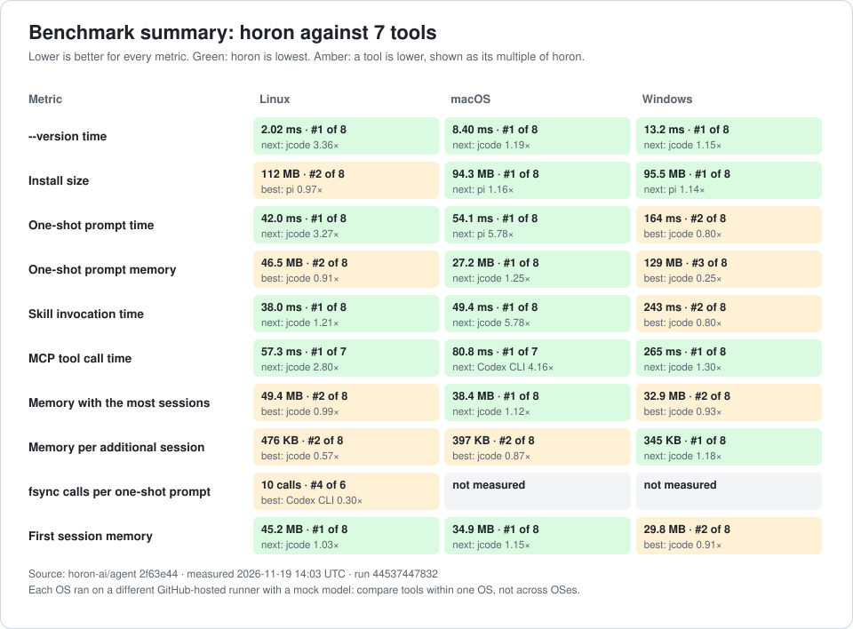

# Performance: measured results and their limits

Language: **English** | [한국어](RESULTS.ko.md)

This document records the measurements the `agent-runtime-performance-2` plan left on baseline B0 (the commit immediately before the plan started). The plan landed 19 performance commits on `dev`, and the same range holds one `fix(cli)` commit unrelated to this plan that has no bearing on the numbers below. The measured surfaces are the session store's hashes and history pages, the SSE parser, replication export, the result cache's threshold decision, and the attach/detach soak. Every measurement was taken on this machine (Apple M1 Max, debug test profile) by alternating before and after on the same machine.

All raw artifacts live under `.omo/evidence/agent-runtime-performance-2/`, a path ignored by `.gitignore:19`. The plan asked for the key numbers to be copied into the PR bodies, but in practice most PR bodies were one line. So anyone who clones this repository today cannot see a single measurement from this work. This page moves that record somewhere tracked; every number is copied verbatim from the evidence files above.

## Charts: latest automatic measurement

<!-- bench-charts:start -->

`.github/workflows/benchmark-docs.yml` redraws these charts from the competitor comparison of the automatic measurement below. Do not edit this section by hand. Lower is better in every chart, and horon is the blue bar.



| Metric | Chart |
| --- | --- |
| `--version` time | [01-version.svg](charts/01-version.svg) |
| Install size | [02-install-size.svg](charts/02-install-size.svg) |
| One-shot prompt time | [03-oneshot-time.svg](charts/03-oneshot-time.svg) |
| One-shot prompt memory | [04-oneshot-memory.svg](charts/04-oneshot-memory.svg) |
| Skill invocation time | [05-skill-time.svg](charts/05-skill-time.svg) |
| MCP tool call time | [06-mcp-time.svg](charts/06-mcp-time.svg) |
| Memory with the most sessions | [07-sessions-memory.svg](charts/07-sessions-memory.svg) |
| Memory per additional session | [08-per-session-memory.svg](charts/08-per-session-memory.svg) |
| fsync calls per one-shot prompt | [09-fsync-calls.svg](charts/09-fsync-calls.svg) |
| First session memory | [10-first-session-memory.svg](charts/10-first-session-memory.svg) |

The interactive client is a second binary; these charts are drawn from the `tui` suite only and are never mixed with the headless charts above.

| TUI metric | Chart |
| --- | --- |
| TUI latency | [tui-01-latency.svg](charts/tui-01-latency.svg) |
| TUI memory and size | [tui-02-memory.svg](charts/tui-02-memory.svg) |

<!-- bench-charts:end -->

## Measured results

Dimension labels follow this rule. `MEMORY` is allocation and memory, `TIME` is wall-clock time, `WORK` is iteration counts and byte volumes, and `RESOURCES` is file descriptor, thread and task counts. Dimensions are listed separately so that an improvement in one is not read as an improvement in another.

| Change | Dimension | Before | After |
| --- | --- | --- | --- |
| Streaming source hash, peak allocation (200 MiB log) | `MEMORY` | 268,435,520 B | 65,600 B (4,092×) |
| Streaming source hash, bytes read | no change | 209,715,200 B | 209,715,200 B |
| Streaming source hash, wall clock | `TIME` (no improvement) | 6,434 ms | 6,404 ms |
| History page, flattened messages (100k events, 20-item page) | `WORK` | 99,999 | 20 |
| History page, bytes read | `WORK` | 62,169,922 B | 18,554 B |
| History page, wall clock | `TIME` | 26.2 s | 5.9 ms |
| SSE, parses of a 12-payload stream | `WORK` | 24 | 12 |
| Replication export, serialization count (64 → 256 event pages) | `WORK` | 129 | 513 (4× the events, 4.0× the serializations) |
| Replication export, bytes against the reference implementation (same 64 → 256) | `WORK` | 8,445,218 → 138,506,722 B (16.4×) | 102,903 → 411,795 B (4.0×) |
| Cache facade, over-limit path (temporary allocation · canonical serialization) | `MEMORY` | 3,146,158 B, 1 time | 0 B, 0 times |
| Cache facade, wall clock | `TIME` (no improvement) | about 19 ms per MiB | about 19 ms per MiB |
| Attach/detach soak, resources after 200 cycles | `RESOURCES` | fd 14, threads 25, tasks 2,141 | fd 14, threads 22, tasks 2,141 |

A few points are easy to misread from the table alone, so they are set out here.

- The source hash digest is the same as before on all five fixtures (61 KB, 618 KB, 6.2 MB, 62 MB, 200 MiB). The only thing that changed is peak allocation; the bytes read and the time taken are unchanged.
- The history page's `WORK` and `TIME` are two faces of the same request. Fetching one 20-item page from a 100k-event session used to replay the whole session, flatten 99,999 messages and read 62 MB; it now reads only the 20 records the index points at.
- In replication export, a 4× larger page made the old reference implementation grow bytes 16.4×, while the current implementation grows them 4.0×. So the cost is proportional to page length, not log length. Page bytes are byte-identical to B0, and the fixed digests `135cf07d...` (length 240,882) and `4a4855d4...` (length 26,979) reproduce unchanged.
- The cache facade no longer serializes canonical JSON once just to decide whether the cap is exceeded. The 1 MiB boundary is byte-exact (1,048,575 B is cached, 1,048,577 B is skipped). The path that actually caches still serializes once.
- The soak ran 200 cycles, 10 windows, 588.99 s. It measures the increment per window, and the failed rounds, quiescence misses (`quiescence_misses`) and non-returned resources (`non_returning`) are all empty.

### Is one page fetched at the same cost as the log grows?

With an index in place, fetching a 20-item page grew bytes read by only 0.5% when the log grew 100×. Replayed messages are 0 at all three sizes.

| Events | Log size | Bytes the page read | Wall clock |
| --- | --- | --- | --- |
| 1,000 | 514,853 B | 15,375 B | 4.28 ms |
| 10,000 | 5,168,853 B | 15,415 B | 4.68 ms |
| 100,000 | 51,888,853 B | 15,455 B | 4.80 ms |

The log sizes in this table come from sessions the growth test builds itself, so they differ from the 100k-event fixture in the previous table (62,155,848 B). It is not the same measurement.

### Commits the table does not cover

The remaining commits changed bounds, the measurement surface or a decision rather than forming a before/after pair. There is a commit that makes NDJSON framing safe at UTF-8 boundaries and adds a frame limit, a commit that moves the hook's stdin write inside its deadline, and a commit that widens tool latency from execute to the whole dispatch. There is also a commit that adds count and byte caps plus a visible overflow to the event stream, a commit that removes the context copy taken before the compression decision, and a commit that moves bridge writes into a bounded queue outside the select loop. The measurement surface changed with a commit that fixes benchmark scripts that never ran because of syntax errors and adds a fixed fixture generator, a commit that adds step counters, allocation probes and a same-machine A/B runner, and a commit that makes the p99 key mandatory. The rest are the decision record rejecting four structural items on measurement, two commits adding the structural gate, the report template and the A/B guide, and a follow-up that cleans up a duplicate closure in the index header check.

## Measured but not adopted

Six items were measured and then rejected. Each item carries the numbers a later attempt would have to beat to overturn that decision.

| Item | Decision | Numbers behind it |
| --- | --- | --- |
| Idle session eviction policy | not adopted | 0.999 fds and 0.998 threads per session, 0.41 MB RSS. The slope does not bend from 1 to 1,000 sessions. The `job_count` that `server:memory` reports is 0 at all five population counts, and the soak returns the session count to 0 |
| `globalEvents` multiplexing | not adopted (protocol change) | 7.4 consumer-side fds and 3.0 threads per watched session. The daemon's own share is 1.0 connection per session, and the bridge attaches one session per connection |
| Narrowing the session map lock scope | not adopted | Removing an unrelated session waits for the whole import. 861 / 5,561 / 11,255 / 24,499 ms at 1 / 20 / 60 / 150 events, ratio 1.00 |
| Replacing the 25 ms interrupt poll timer with notification | not adopted | It would save a worst case of 29.7 ms (27.6 ms on average) at the cost of restructuring a wakeup once per watch-group round |
| Overlapping the `run.stopped` journal write with the close-save (#144, #129) | not adopted (slower) | Windows last request → exit, median against `dev` in the same job: 39.8 → 56.4 ms over 5 samples (run 42759006826) and 35.2 → 42.8 ms over 20 samples (run 42764256757; IQR 33.0–40.9 vs 40.7–45.5). Linux and macOS were ties. #146 later removed the close-save flush itself, which brought the same span to 32.5 ms |
| Resolving the fixed Windows shell environment once per process (#124, #122) | not adopted (tie) | Tool round-trip span on Windows, 20 samples: 74.3 → 73.5 ms (run 42735692366), inside the min–max range. Nearly all of the round trip is the `cmd.exe` start, not the per-call env table or PATH search |

Rejecting something on numbers is not a failure. The plan defined success as "when no improvement shows up, the item ends as not adopted with its reasoning attached. That counts as success too." The last column above is that reasoning.

## What these numbers do not say

This section is the point of this page. Leave out any one of the statements below and the page leads the reader to the wrong conclusion.

- **The source hash improvement covers the hashing stage only, and the store path streams its validation.** `crates/base/src/session/event_commit.rs:120-133` hashes the captured prefix through one 64 KiB buffer and `:148-166` compares the reserved tail in a buffer of the same size, so saving a large log no longer allocates a copy of it. The plan recorded 156,518 B for a 7 KB log and 8,293,580 B for a 553 KB log from a save whose peak did follow the log size; those figures do not describe this path any more.
- **The history page improvement covers repeated paging while the head does not move.** The index is tied to the log's identity stamp (device, inode, length, mtime, ctime), so a single append, import or reset invalidates it. A session that keeps growing therefore pays the old cost once more and rebuilds the index. That rebuild cost was not measured. A single page fetch from a new head is not faster.
- **The cache improvement is allocation, not throughput.** Wall clock is about 19 ms per MiB on both sides. Escaping cost dominates either way.
- **The soak asserts fds, threads, queues, pending requests and tasks. Not RSS.** RSS rose from 68.4 MB to 79.5 MB and then stayed flat (peak 83.7 MB), and is recorded as an observation only.
- **The 200-cycle soak resolves one leaked resource per 20 cycles.** The plan asked for 1,000 cycles; that form now runs weekly in `Attach/Detach Soak` (`.github/workflows/soak.yml`) and its first run was clean, while the pull-request form is the same test at 20 cycles inside the structural gate (`scripts/perf/check_structural.py:136-146`).
- **The structural gate did not assert the frame limit when this plan closed.** The counters the gate read then included no frame count, and the frame limit was held by `crates/harness-api-server/src/framing_tests.rs` alone. The gate now has a `frame` section (`scripts/perf/check_structural.py`): the bridge reader and the SDK reader each report `max_frame_bytes`, `accepted_frame_bytes` and `rejected_frame_bytes`, and the gate requires the cap to equal `frame_max_bytes` (64 MiB) and the smallest refused frame to be exactly one byte above the largest accepted one. It still counts no frames.
- **The `shared_context` map these numbers once covered no longer exists.** It was removed with the rest of the topic-channel store (#299), so the soak no longer samples it and the table above carries no figure for it. The historical reading stands as recorded: 0 at every population count, which meant "nobody used it" rather than "nothing leaks". What survives in the `server:memory` payload is the swarm block beside it — `member_count`, `status_counts`, `swarm_count`, `swarm_membership_count`, `plan_count`, `plan_item_count` and their byte estimates (`crates/app-core/src/server/debug_server_state.rs`) — and that block is what a future soak would sample.
- **The replication export's serialization factor is fixed per page.** It is 513 at the 256-event cap, but export time still grows with the log (278.2 ms for 1,000 events, 2,657.2 ms for 10,000). Bytes are flat within a page, not across the whole export.
- **The cache facade's warm-restore time is a single-shot measurement.** It includes page cache variance, and in the same case the range covers 108.6 / 901.8 ms on the lane and 108.9 / 499.7 ms for the lead's re-run. Only the byte-exact boundary decision is reproducible.
- **The absolute milliseconds of the four not-adopted decisions are not release numbers.** They were taken in the debug test profile in a scratch home; what transfers is the ratio (wait time equals import time, session creation about 1.2 s).
- **The 7.4 fds and 3.0 threads for `globalEvents` are consumer-side costs.** The SDK and the daemon ran in the same process, so both ends were counted together. The 100-session and 1,000-session numbers are arithmetic on this per-session value, not a second measurement.

## How to reproduce

Give each measurement its own `CARGO_TARGET_DIR` and run them one at a time. Two test binaries on one target directory produce a different failure every time, and that failure says nothing about the code.

```bash
export CARGO_TARGET_DIR="$PWD/.target-measure"
```

Measurement logs come from the repository's generator. Below are the 200 MiB log and the 100k-event log.

```bash
python3 scripts/perf/fixtures/gen_event_log.py --bytes 209715200 --seed 20261021 --out /tmp/event-log-200mib/
python3 scripts/perf/fixtures/gen_event_log.py --events 100000 --seed 20261021 --out /tmp/event-log-100000/
```

For the source hash, the probe example prints a full read and a streaming digest side by side.

```bash
cargo build --locked -p horon-agent-base --example source_hash_probe
"$CARGO_TARGET_DIR/debug/examples/source_hash_probe" hash /tmp/event-log-200mib/events.jsonl
```

For the history page, the 100k-event fixture is passed in through an environment variable, and a separate test checks equality with the committed 500-record baseline.

```bash
HISTORY_PAGE_PERF_FIXTURE=/tmp/event-log-100000/events.jsonl \
  cargo test --locked -p horon-agent-harness-api-server --lib history_page_perf -- --nocapture --test-threads=1
cargo test --locked -p horon-agent-harness-api-server --lib pages_match_the_committed_pre_change_baseline -- --nocapture
```

For the SSE parser, the same event sequence and parse count are printed at four chunk sizes.

```bash
cargo test --locked -p horon-agent-provider-openai --lib stream::stream_tool_tests::chunked_replay_yields_the_same_events_at_every_chunk_size -- --nocapture
```

For replication export, tests in the repository check page byte equality and the cap. The QA harness that printed the serialization counts in the table (129 / 513) lives in `.omo/evidence/agent-runtime-performance-2/qa_task14.py` and is untracked, so a reader who clones the repository cannot reproduce those counts directly. The digests and lengths do reproduce.

```bash
cargo test --locked -p horon-agent-session-store replication -- --nocapture
```

For the cache facade, a test prints the serialization counts on both sides of the boundary and an example prints the allocation peak.

```bash
cargo test --locked -p horon-agent-base --lib event_cache -- --nocapture
cargo build --locked -p horon-agent-base --example facade_cache_probe
```

The soak has a 200-cycle default form and a 1,000-cycle variant behind `#[ignore]`. The 1,000-cycle form is what the scheduled `Attach/Detach Soak` workflow (`.github/workflows/soak.yml`) runs weekly; it is not part of `CI Required`, so a retention failure never blocks a pull request, and it opens or updates one tracking issue instead of failing a review.

```bash
HORON_AGENT_WORKSPACE_TRUST=trust \
  cargo test --locked -p horon-agent --test e2e soak_attach_detach::soak_attach_detach_returns_every_counter_to_baseline -- --exact --nocapture
HORON_AGENT_WORKSPACE_TRUST=trust \
  cargo test -p horon-agent --test e2e soak_attach_detach_1000_cycles -- --ignored --exact --nocapture
```

The scheduled run is reproducible by hand: `gh workflow run soak.yml --ref dev -f cycles=1000`. Its report is the `soak-attach-detach-report` artifact, and `python3 scripts/perf/check_soak.py <captured log>` renders the same Markdown from a local run.

### The 1,000-cycle baseline on a hosted runner

The first run was the `dev` push after the workflow merged ([run 43600180217](https://github.com/horon-ai/agent/actions/runs/43600180217), commit `af41e0b7`), on `ubuntu-24.04` with `HORON_AGENT_PERF_COUNTERS=1`.

| Measure | Value |
| --- | --- |
| Cycles | 1,000, in 10 windows of 100 |
| Cycle time | 7 min 38 s (13:34:30Z → 13:42:08Z), about 0.46 s per cycle |
| Whole job | 10 min 56 s including the cold build |
| Verdict | `STRUCTURAL_PERF section=soak cycles=1000 fd_retention=0 thread_retention=0 non_returning=0` |
| Report | **Clean.** Every counter returned to its baseline |

| Counter | Baseline → final | Slope per 100 cycles |
| --- | --- | --- |
| `fd_count` | 16 → 16 | +0.000 |
| `thread_count` | 16 → 16 | +0.000 |
| `queue_depth_high_water` | 0 → 1 | +0.100 |
| `pending_requests`, `interrupt_poll_wakeups`, `background_tasks`, `live_sessions`, `connected_clients` | 0 → 0 | +0.000 |

`queue_depth_high_water` is a high-water mark, not a final value: it records the deepest queue seen at any point, so a transient 1 is not retention. The 180-minute job timeout leaves more than an order of magnitude of headroom over the measured run.

How to use the structural gate and the A/B runner, the required keys of the report template, and the procedure for raising a bound are in [`docs/performance/BENCHMARK.md`](BENCHMARK.md). The gate command is `python3 scripts/perf/check_structural.py` and the A/B runner is `scripts/perf/ab_perf.py`.

## Status

The plan has 17 items: 14 are done and 3 are partially done (`[~]`). Partially done means the following.

| Item | Status | Meaning |
| --- | --- | --- |
| 7. NDJSON framing caps for both SDKs | `[~]` | The code and tests are on `dev` and verified. The evidence file this item pointed at disappeared with a worktree and was not reconstructed. The behavior is proven, the evidence trail is not |
| 12. Auxiliary and result cache byte accounting | `[~]` | The code is on `dev`, and the lead re-ran the decisive lines and reproduced them. The lane's raw evidence file is gone, and the file now in its place is a reconstruction that labels itself `recovered` |
| 15. Attach/detach soak | `[x]` | The 1,000-cycle plan item now runs: `.github/workflows/soak.yml` runs it weekly and on demand, and the first run completed 1,000 cycles clean in 7 min 38 s (`fd_retention=0`, `thread_retention=0`, `non_returning=0`, run 43600180217). The 200-cycle form stays the pull-request gate, run at 20 cycles by the structural gate (`scripts/perf/check_structural.py:136-146`) |
| 17. CI structural gate and report template | `[~]` | The gate really runs (42 bounds in `scripts/perf/structural_budget.json`, `EXIT=0`, `EXIT=1` on violation, `EXIT=2` when a measurement is missing, 84 contract tests in `scripts/perf/test_check_structural.py`). Two conditions from the plan remain. There is no frame count counter, and "passes at B0" is structurally impossible (the code that prints the `STRUCTURAL_PERF` line landed after B0). The gate now asserts the frame cap itself in its `frame` section for both readers, and still reads no frame count |

The other 13 items are done.

## Measurements from the `agent-rust-loading-durable-runtime` plan (separate plan, separate baseline)

The table above records the `agent-runtime-performance-2` plan. Below is what the
`agent-rust-loading-durable-runtime` plan, which ran later, left behind; both its baseline commit
and its measurement tools are different. Numbers from the two plans are not compared in one table.

The raw artifacts for this plan are under `.omo/evidence/agent-rust-loading-durable-runtime/`.

### Time improvement: not established

The measurement tools (`scripts/perf/bench_loading.py` and `crates/base/examples/loading_probe.rs`)
are outputs of this plan, so the baseline commit immediately before it does not contain the same
tools. Instead of comparing two different measurement programs, the plan used a control (A/A) that
alternately measured two configurations of the same binary 30 times each
(`aa_control: true`). The result is `improvement_claim: false`.

| Segment | A p50 / p95 (ms) | B p50 / p95 (ms) |
| --- | --- | --- |
| attach_history | 671.2 / 1579.2 | 691.7 / 2047.0 |
| provider_dispatch | 12.0 / 26.5 | 13.3 / 66.2 |
| resume_ready | 309.9 / 733.9 | 299.2 / 675.1 |
| session_save | 906.8 / 1271.5 | 993.2 / 1412.7 |
| skill_catalog | 0.2 / 0.2 | 0.2 / 1.4 |

The spread between two runs of the same binary is larger than any effect this plan could claim, and
it does not lean in one direction. So **no wall-clock improvement is claimed.**

### Structural counters: measured, and the bounds hold

These items are judged by counters instead of time. There are two kinds of evidence, and they
measure different things.

- `python3 scripts/perf/check_structural.py` exited 0, **passing all 45 bounds** (0 failures, 0
  missing). The counters this gate actually reads come in six groups: queue depth, pending
  requests, history page cost, hash buffer, frame limit, and the attach/detach soak.
- The items in the table below are **not** read by that gate. A named test per item asserts each
  one directly.

| Item | Dimension | What changed | Test that pins it |
| --- | --- | --- | --- |
| Store validation | `MEMORY` | Commit validation streams through a fixed 64 KiB buffer instead of allocating the whole file. Source length only adds passes | `hash_stream` |
| Request snapshot | `WORK` | Deep-copying messages in the same request no longer grows with history length | `request_snapshot_reuse` |
| Skill list | `WORK` | At most one overlay scan per request, section cap 49,152 B (UTF-8) | `skill_snapshot_budget` |
| Connection setup | `WORK` | Zero built-in tool constructors called outside core, and the start path does not wait for prewarm networking | `loading_deferred_setup` |
| Session resume | `WORK` | Live session reload and duplicate save during resume removed | `loading_live_resume` |

`MEMORY` and `TIME` are not mixed. None of the items above claims a wall-clock improvement.

### What this plan did not measure

- Release profile numbers. Every measurement is in the debug profile.
- Throughput at multi-device or production scale.
- Provider call speed. Provider network time is outside this plan's scope.

## Measurements from the `agent-irc-bus` plan

These are measurements from the `agent-irc-bus` plan, run separately from the two records above. That plan added the mailbox bus between agents and the `irc` tool; baseline B0 is `50eed12` (the commit immediately before the plan started on `dev`) and the candidate is `c9d9d8c` (wave 3 merge). Numbers in this record are not compared with the two earlier records.

The raw artifacts are in `.hyper/qa/agent-irc-bus/11-happy.txt` (the A/B report JSON, three throughput runs, and the structural gate's `irc` area) and `.hyper/qa/agent-irc-bus/11-failure.txt` (the A/A control). `.hyper/` is ignored by the repository, so this section is the tracked record.

### Measurement conditions

| Item | Value |
| --- | --- |
| Machine | Apple M1 Max, 10 cores, 64 GiB memory |
| Kernel | `Darwin Alpoxs-MacBook.local 25.4.0 ... RELEASE_ARM64_T6000 arm64` |
| Toolchain | `rustc 1.99.1`, `cargo 1.99.1` |
| Build profile | release, no feature set (both sides `cargo build --locked --release -p horon-agent-base --example perf_counters_surface`) |
| Workload | One run of `perf_counters_surface` (a fresh process per run) |
| Load during measurement | Load averages 50.10 / 44.73 / 44.59 (1 / 5 / 15 minutes), 4 `rustc` and `cargo` processes |
| Repetitions | 3 warmups, 10 runs per side, the two sides alternating |
| B0 binary | `48c69b5c...`, commit `50eed12` |
| Candidate binary | `a82fb191...`, commit `c9d9d8c` |

Compilations unrelated to this plan were running in several repositories during the measurement. The observed load averages over that period ranged from 36 to 64, and the `rustc` and `cargo` process count was observed between 4 and 17. So the absolute times in this section are not values from a quiet machine.

### A/B: no regression

`scripts/perf/ab_perf.py` exited 0 and the adoption decision is `not-adopted-no-measurable-change`. It is not `reject-regression`, which would mean a regression; the median difference is inside the noise band, so the value claims neither improvement nor regression.

| Item | B0 | Candidate | Difference |
| --- | --- | --- | --- |
| Median | 5.23 ms | 5.39 ms | +0.16 ms (+3.09%) |
| p95 | 7.06 ms | 7.10 ms | +0.05 ms |
| Noise band (`max(3*1.4826*MAD, 1% of the median)`) | | | ±1.35 ms, inside the band |
| `cpu_user_ms` median | 2.22 ms | 2.18 ms | -0.04 ms |
| `cpu_system_ms` median | 1.55 ms | 1.60 ms | +0.05 ms |
| `peak_rss_bytes` median | 6,045,696 B | 6,029,312 B | -16,384 B |
| `fd_count` / `thread_count` median | 3 / 1 | 3 / 1 | same |
| Failures / timeouts | 0 / 0 | 0 / 0 | |
| `read_bytes` median | 0 B | 0 B | same |

For `allocated_bytes`, `pss_bytes` and `retained_bytes`, which the workload did not report, the runner leaves `null` rather than 0 and lists the three names in `counts.missing`. p99 was refused because there were 10 samples, with the reason that it needs at least 20.

### A/A control: no false regression

The control run, with the same candidate binary on both sides, ended as `control-no-change`. Medians were 6.48 ms and 6.70 ms, a 0.22 ms (3.43%) difference, but inside the ±1.58 ms noise band. So the 0.16 ms difference in the A/B above is smaller than this instrument can resolve, which is evidence that the runner does not invent regressions.

### IRC throughput

`cargo run --locked --release -p horon-agent-irc-core --example irc_throughput` was run 3 times. The message count is the default 100,000 and `broadcast64` rounds down to a multiple of 64, giving 99,968.

| Scenario | Run 1 | Run 2 | Run 3 | Median | Range |
| --- | --- | --- | --- | --- | --- |
| `direct_waiter` (msg/s) | 105,291 | 107,434 | 111,523 | 107,434 | 105,291 ~ 111,523 |
| `direct_deliver` (msg/s) | 2,410,858 | 2,229,008 | 2,392,230 | 2,392,230 | 2,229,008 ~ 2,410,858 |
| `broadcast64` (msg/s) | 3,237,934 | 3,141,178 | 3,141,375 | 3,141,375 | 3,141,178 ~ 3,237,934 |

`direct_waiter` uses 64 receiver task pairs (`WAITER_PAIRS = 64`) waiting in `wait` at the same time. From the second round on, each receiver task sends one message to its peer that creates a reply obligation and then enters `wait`, and the driver confirms all 64 waiters are registered before sending one message per live pair. Round trips within a pair are ordered, but the 64 pairs run concurrently. `direct_deliver` is a fake delivery path that returns the injection immediately, and `broadcast64` is the path that sends one body to 64 recipients.

todo 6 first measured `direct_waiter` at 39,128 msg/s (`6-happy.txt`, 100,000 messages in 2,555,678 us); after todo 12 removed the timer round trip that every `wait` call carried, this measurement gives 107,434 msg/s. That is about 2.75×. todo 12's own measurement is 124,071 msg/s (`12-happy.txt`), and this value is lower. That looks like a load difference at measurement time, since the code path is the same.

### Structural gate `irc`

`python3 scripts/perf/check_structural.py --only irc` exited 0, passing all five bounds.

| Counter | Observed | Bound |
| --- | --- | --- |
| `mailbox_high_water` | 100 | at most 100 |
| `mailbox_dropped` | 900 | equal to 900 |
| `broadcast_body_allocations` | 1 | equal to 1 |
| `waiters_live_after_churn` | 0 | equal to 0 |
| `broadcast_inflight_high_water` | 16 | at most 16 |

### What these numbers do not say

- **The A/B workload measures process start and counter printing, not the bus.** `perf_counters_surface` does not start a daemon; it prints a counter snapshot once. The IRC bus is off in the default configuration and never reaches this path, so all this A/B says is "no regression in shared code". The throughput table answers for the bus itself.
- **Throughput is measured inside one process.** The example puts `IrcBus` with a fake directory and a fake deliverer in one process. It does not include daemon transport, serialization, session state transitions or model calls. Response time for a real agent conversation cannot be predicted from these numbers.
- **The `direct_waiter` number is sensitive to machine load.** The three runs here range from 105,291 to 111,523, and against todo 6's 39,128 (`6-happy.txt`) that is about 2.75×. The difference between todo 12's 124,071 (`12-happy.txt`) and this value looks like a load difference at measurement time, so the value worth carrying over is the ratio, not the absolute throughput.
- **The A/B absolute times are not values from a quiet machine.** Observed load averages during the measurement ranged from 36 to 64, with `cargo test`, `cargo clippy` and `cargo build` running in unrelated repositories. Because the A/B alternates the two sides and the A/A confirms the noise band, the direction of the comparison holds, but the single-digit millisecond absolute values do not reproduce under other conditions.
- **There is no p99.** With 10 samples the runner refused it, citing fewer than 20.
- **Three metrics were not measured.** `allocated_bytes`, `pss_bytes` and `retained_bytes` are `null` and listed in `counts.missing` because the workload did not report them. Do not read them as 0.
- **The structural gate does not measure time.** The five values above say only that shapes are inside their bounds, not that anything is fast.

## Measurements from the `platform-adapter-perf` plan

These are measurements from the `platform-adapter-perf` plan, run separately from the three records above. That plan gathered OS-specific code into five `crates/platform-*` crates, removed fsyncs for derived caches that can be rebuilt from session storage, built the HTTPS client's TLS configuration once per process, and turned price-list refresh off by default. Baseline B0 is `738712a` (the commit immediately before the plan started on `dev`) and the candidate is `215bfdb` (the work branch). Numbers in this record are not compared with the three earlier records.

The raw artifacts are under `.hyper/qa/platform-adapter-perf/after/`. `.hyper/` is ignored by the repository, so this section is the tracked record.

| File | Contents |
| --- | --- |
| `compare-macos.json`, `compare-linux.json`, `compare-linux-times.json` | Three-line comparison (horon B0, horon candidate, jcode). Linux `compare-linux.json` uses `--syscalls`; time numbers are from `compare-linux-times.json` |
| `fsync-linux.txt` | fsync and fdatasync call counts for one one-shot, cold and warm |
| `ab-*.json` | Same-machine A/B reports (the runner's output JSON as is) |
| `github-baseline/`, `github-candidate/` | Artifacts of GitHub `benchmark.yml` runs 42294971747 (`--ref dev`) and 42294976581 (branch) |
| `structural.log` | Full `check_structural.py` output |

### Measurement conditions

| Item | macOS | Linux | GitHub runner |
| --- | --- | --- | --- |
| Machine | Apple M1 Max, 10 cores | Docker `rust:1-trixie`, linux/aarch64, 10 cores | `ubuntu-latest`, linux/x86_64, 4 cores |
| Toolchain | `rustc 1.99.1` | the container's distro rustc | `stable` (at run time) |
| Profile | release | release | release |
| The two binaries within one measurement | same machine, alternating | same | different runs, different runner instances |
| Competing tool | jcode v0.99.1 (`7206efd0c`) | same | same |

Every line within one measurement talks to the same mock model server, so no API fees or secrets are involved. macOS and Linux measured the B0 binary and the candidate binary within one run; for GitHub, the `dev` run and the branch run were started separately. So in the table below the GitHub column is "two runs", not "before and after".

### Before and after across three environments

one-shot is the median of a single `run` question (startup, one `ls` tool round trip, final response). start→first request runs from connecting to the api-bridge socket to the first `list_sessions` response. fsync is the number of fsync and fdatasync calls a single one-shot makes. Memory is the idle RSS of the daemon process tree.

| Metric | Environment | B0 `738712a` | Candidate `215bfdb` | Change | jcode | Candidate / jcode |
| --- | --- | --- | --- | --- | --- | --- |
| one-shot median | macOS | 872.4 ms | 290.4 ms | -66.7% | 294.8 ms | 0.99× |
| one-shot median | Linux (Docker) | 207.9 ms | 168.0 ms | -19.2% | 146.3 ms | 1.15× |
| one-shot median | GitHub runner | 185.3 ms | 499.8 ms | separate runs, not comparable | 145.5 ms / 357.8 ms | not comparable |
| start→first request | macOS | 236.4 ms | 78.7 ms | -66.7% | not applicable | not applicable |
| start→first request | Linux (Docker) | 57.0 ms | 57.0 ms | -0.03% | not applicable | not applicable |
| start→first request | GitHub runner | 23.7 ms | 25.3 ms | separate runs | not applicable | not applicable |
| fsync and fdatasync calls | Linux (Docker) | 175 cold / 170 warm | 40 cold / 35 warm | -77% | 19 cold / 5 warm | 7.0× |
| fsync and fdatasync calls | GitHub runner | cannot measure | 40 cold / 35 warm | cannot measure | 19 / 10 / 5 calls | 3.5× |
| First-session idle RSS | macOS | 32.73 MiB | 29.52 MiB | -9.8% | 37.34 MiB | 0.79× |
| First-session idle RSS | Linux (Docker) | 32.05 MiB | 33.37 MiB | +4.1% | 40.29 MiB | 0.83× |
| Increment per session | macOS | 592 KiB | 320 KiB | -46% | 544 KiB | 0.59× |
| Increment per session | Linux (Docker) | 1396 KiB | 944 KiB | -32% | 144 KiB | 6.6× |
| First-session idle RSS | GitHub runner | cannot measure | 39.9 MiB | cannot measure | 43.0 MiB | 0.93× |
| Increment per session | GitHub runner | cannot measure | 319 KiB | cannot measure | 38 KiB | 8.3× |

The candidate column in this table was measured with the `215bfdb` binary. Of the changes that later landed on the branch, only one touched the start path, the deferred HTTP client (`b6dcfc0`); the time and memory re-measurements are in the "Memory" section below. The 11 fixes from the F2 quality review also left these numbers unchanged, and re-measuring with the same runner gives Linux fsync cold 40 · warm 35 again ("fsync" in `F2-review.md`).

The decision to hold fsync at 40 or below uses the values from the `bench_compare.py --syscalls` runner (cold 40 · warm 35). todo 6's own driver used a different HOME and prompt shape and measured cold 45 · warm 40 on the same candidate binary, and in that run only warm meets the 40 bound ("result against the plan" in `6-linux-fsync.txt`).

Absolute values on hosted runners differ per machine and mean nothing, so the GitHub column says only that "the workflow runs on the branch as-is and fsync counts are recorded too". All three session measurements in the GitHub B0 run failed with `daemon socket not ready`. That run uses `dev`'s `bench_compare.py`, and the fix for the removal of `serve --debug-socket` (todo 13) is still only on the branch. So the session values from GitHub B0 are not 0.

### Same-machine A/B: no regression on the time paths

`scripts/perf/ab_perf.py` runs the two binaries alternately in blocks and reports the noise band `max(3*1.4826*MAD, 1% of the median)` alongside. Only differences outside the band are called an improvement or a regression.

One row is one path. one-shot, start→first request and the session paths go through a small probe that does the setup for them (scratch HOME, mock model address, daemon start), so the absolute values here are larger than in the environment table above by the probe's own startup. Both sides use the same probe, so the direction of the comparison is unchanged.

| Path | Environment | B0 | Candidate | Difference | Noise band | Verdict |
| --- | --- | --- | --- | --- | --- | --- |
| one-shot | macOS | 1121.85 ms | 435.79 ms | -61.2% | ±93.95 ms | improved |
| start→first request | macOS | 236.36 ms | 78.72 ms | -66.7% | ±10.36 ms | improved |
| Two session paths | macOS | 3295.26 ms | 2259.88 ms | -31.4% | ±131.13 ms | improved |
| `--version` load | macOS | 7.76 ms | 7.52 ms | -3.0% | ±1.36 ms | inside the band |
| `perf_counters_surface` | macOS | 4.74 ms | 4.80 ms | +1.3% | ±1.41 ms | inside the band |
| one-shot | Linux | 265.02 ms | 217.62 ms | -17.9% | ±14.61 ms | improved |
| `--version` load | Linux | 2.60 ms | 2.63 ms | +1.2% | ±0.39 ms | inside the band |
| `perf_counters_surface` | Linux | 0.46 ms | 0.47 ms | +1.6% | ±0.08 ms | inside the band |
| start→first request | Linux | 57.03 ms | 57.02 ms | -0.03% | ±2.93 ms | inside the band |
| One session path | Linux | 14882 ms | 14836 ms | -0.3% | ±148.82 ms | inside the band |
| Two session paths | Linux | 14936 ms | 14858 ms | -0.5% | ±149.36 ms | inside the band |

Tool latency and startup steps were checked separately on the same machine. Alternating the 14 cases in `bench_tools.py` three times each gives median differences between -15.7% and +5.4%, and the cases that grew are `ls` (+5.4%), `agentgrep` (+1.1%) and `read (repo Cargo.toml)` (+0.9%). For `ls`, B0's three runs are 2.21 / 2.46 / 3.57 ms and the candidate's are 2.58 / 2.59 / 2.64 ms, which falls inside B0's own run-to-run spread. `bench_startup.py` gives a server-ready median of 10.8–10.9 ms (B0) and 11.0 ms (candidate), and a total bridge time of 18.1–18.6 ms and 17.9–18.6 ms, which overlap. The 20–40% spread across tool cases unrelated to the change in the GitHub candidate run is a runner instance difference and does not reproduce on the same machine.

macOS dropped sharply because the two costs this plan targeted existed only on macOS. The path that took `F_FULLFSYNC` on every save, derived caches included, now syncs the source only, and the path that read a keychain certificate per reqwest client became one construction per process. As a control, `--version` load and `perf_counters_surface` are inside the band in both environments. Neither path touches storage or TLS, so they are exactly where a regression in shared code would have shown up first.

### Memory: the first Linux daemon RSS numbers, and what re-measuring showed

The time paths got slower nowhere. Memory was first recorded as an increase in Linux daemon RSS (`rss`), and only later was it established that the measurement method itself cannot compare two builds. The first numbers come first, then the re-measurement and the fix below them.

| Measurement | Environment | B0 | Candidate | Difference |
| --- | --- | --- | --- | --- |
| Daemon idle, 0 sessions | macOS | 27.82 MiB | 24.09 MiB | -3.73 MiB (-13.4%) |
| Daemon idle, 1 session | macOS | 32.34 MiB | 28.95 MiB | -3.39 MiB (-10.5%) |
| Daemon idle, 0 sessions | Linux | 27.88 MiB | 29.01 MiB | +1.13 MiB (+4.1%) |
| Daemon idle, 1 session | Linux | 31.74 MiB | 32.75 MiB | +1.01 MiB (+3.2%) |
| one-shot peak RSS (8 runs) | Linux | 32.46 MiB | 32.87 MiB | +0.41 MiB (+1.3%, ranges overlap) |
| Same-binary control (A/A) | Linux | 27.83 MiB | 27.87 MiB | +0.03 MiB (+0.1%) |

The Linux difference is in the executable's resident pages, not the heap. Summing `/proc/<pid>/smaps` by mapping type for the 1-session state gives the following.

| Mapping | B0 | Candidate | Difference |
| --- | --- | --- | --- |
| Executable `r-xp` | 26176 KiB | 27136 KiB | +960 KiB |
| Executable `r--p` | 1508 KiB | 1508 KiB | 0 |
| Anonymous `rw-p` | 1796 KiB | 1730 KiB | -66 KiB |
| Everything else | 1784 KiB | 1784 KiB | 0 |

Running the same measurement once more gives an `r-xp` difference between +960 and +1472 KiB and an anonymous difference between -66 and +156 KiB. The direction is the same both times and the size is overwhelmingly on the executable side. With no sessions the direction is the same, `r-xp` +1152 KiB and anonymous +10 KiB. Minor page fault medians are 1574 and 1584, effectively equal, and major page faults are 0 on both sides. The binary grew 276,928 B and `.text` grew 100,576 B, so the added residency is larger than the file size. That means more code pages are actually touched. The per-session increment, by contrast, fell from 1396 KiB (B0) to 944 KiB.

#### Re-measured: the difference was page cache, not code

The first numbers came from an A/A control that writes the same file on both sides, so they only guarantee "this one binary measures repeatedly". Building the same source twice independently and measuring with the same method moves more than that difference.

| Control | rss median | `r-xp` median |
| --- | --- | --- |
| Same commit, build 1 vs build 2 | 22.22 vs 21.63 MiB | 22068 vs 22028 KiB |
| Same commit, build 1 vs build 3 | 22.22 vs 26.33 MiB | 22068 vs 21948 KiB |
| Candidate commit, build 1 vs build 2 | 27.00 vs 23.17 MiB | 22576 vs 22716 KiB |
| Same bytes, different path | 14.39 vs 26.85 MiB | 11276 vs 24076 KiB |

The cause is that resident `r-xp` pages are not executed code but page cache folios the kernel faulted in alongside it. The median length of a resident run is 32–48 pages (64 KiB folios) while the executed run is 1–2 pages. Two builds of the same source therefore differ by up to 8 MiB in residency.

The measurement was changed to values the cache cannot move. It counts the 4 KiB code pages executed in a callgrind instruction dump (`--dump-instr=yes`), and `rss` was measured after dropping the page cache with `posix_fadvise(DONTNEED)` before every start and pinning `fault_around_bytes` to 4096.

| Build | Executed code pages | `rss` median (controlled) |
| --- | --- | --- |
| Baseline 738712a #1 | 1765 | 26.42 MiB |
| Baseline #2 | 1765 | 26.37 MiB |
| Candidate f5f5868 #1 | 1771 | 26.92 MiB |
| Candidate #2 | 1778 | - |
| Candidate #3 | 1771 | - |

The build-to-build spread within one side (baseline 1759–1765) equals or exceeds the difference between the sides (1765 vs 1771). So the "+1.0–1.3 MiB of resident executable code" recorded first is not a regression attributable to this change.

#### What was actually fixed: building the TLS trust store at startup

`serve` builds the tool registry at startup. At that point `WebFetchTool::new`, `WebSearchTool::new`, `DiscoverToolsTool::new` and `NotificationDispatcher::new` each held `shared_http_client()`, and building that client means parsing all 449 trust-store anchors.

    shared_http_client -> ClientBuilder::build -> openssl_probe::probe
      -> rustls_native_certs::load_pem_certs
      = 83% of startup instructions, 194 of 878 executed code pages

The four constructors no longer hold the client. `shared_http_client()` is already a process-wide `OnceLock`, so calling it at the point where a request is sent is enough.

| Side | Executed code pages | `rss` median | `r-xp` median |
| --- | --- | --- | --- |
| Baseline | 1765 | 26.42 MiB | 22068 KiB |
| Candidate before the fix | 1771 | 26.92 MiB | 22576 KiB |
| Candidate after the fix | 1755 | 26.59 MiB | 22208 KiB |

After the fix the executed code pages are below the baseline (1755 vs 1765). The remaining `rss` difference of +0.17 MiB is inside the same-source build-to-build spread seen above (up to 8 MiB in the controlled measurement, 0.6 MiB within the same pair) and does not appear as an executed-code difference.

The rest of the start path is the same on both sides. System calls up to idle are 5416 vs 5428 (46 of 53 kinds identical) and files opened are 364 vs 365.

### Structural gate

`python3 scripts/perf/check_structural.py` exited 0, passing all 55 bounds (0 failures, 0 missing). This gate does not read wall-clock time, so it holds a different axis from the time numbers above.

### What these numbers do not say

- **The two runs on GitHub runners are not a before and after comparison.** They are different hosted runner instances, and only the branch workflow turns on `--syscalls`, so only the candidate run has strace attached. In the candidate run even binaries unrelated to this change got uniformly slower: jcode 145.5 → 357.8 ms, Claude Code 452.1 → 913.9 ms, Codex CLI 369.4 → 2273.1 ms, OpenCode 2.98 → 5.81 s, pi 928.4 → 2109.5 ms. Unchanged executables got more than twice as slow, so the difference between the two runs comes from the runner and the instrumentation, not from this plan. The strace cost measured on the same Docker machine was +255 to +259 ms per one-shot, and tool latency in the candidate run is uniformly higher even for unchanged cases (`bash (true)` 2.2 → 3.1 ms, `read (tiny file)` 0.5 → 0.6 ms). This plan's regression verdict uses the two environments measured on the same machine, macOS and Docker Linux.
- **macOS's -66.7% covers only this plan's two costs.** `--version` load and `perf_counters_surface`, which go through neither the store path nor the client construction path, are inside the band. Model latency, tool execution time and prompt assembly time are not part of this number.
- **fsync call counts are only counted in a Linux container.** macOS has no `strace`, and this plan did not change macOS's default syncing (a plain fsync, only with the setting `[storage] sync = "fast"`).
- **The first Linux daemon RSS reading of +1.0–1.3 MiB was not a regression.** It was measuring page cache folios the kernel faulted in alongside the code, not the code that ran. Two builds of the same source vary more than that, so the number cannot decide this change. Re-measured with executed code pages, which cache cannot move, the candidate is below the baseline (1755 vs 1765 after the fix) and the controlled `rss` difference is inside the same-source build spread. The path that built the TLS trust store at startup was found and removed instead (see "What was actually fixed" above).
- **First-session RSS and the per-session increment are different axes.** The Linux candidate is +1.3 MiB higher on the first session while the per-session increment is -452 KiB lower. The two values are not merged into one "memory" figure.
- **`perf_counters_surface` does not start a daemon.** All this workload says is that there is no regression in shared code; the cost of the store path or the TLS path is answered by the one-shot table.
- **There is no p99.** With 12 or fewer samples the runner refused it, citing fewer than 20.

## Measurements from the `cache-context-session-opt` plan

This plan puts a `prompt_cache_key` and a retention period on OpenAI-compatible requests (`ee9f46bc`), stops recomputing that key for the same input (`263ab39e`), brings the compression tail into the recovery band (0.8 of the baseline) (`6e7f5052`), and merges a batch save's log syncs into one at the end of the batch (`626eebb3`). Performance is measured only on GitHub Actions. The candidate is `dev`'s `e95b8773`, and the measurement is the 2026-11-07 `benchmark.yml` run 42371020359 (`--ref dev`, linux, macos and windows all succeeding) plus the `structural-perf.yml` run 42371014382 (succeeding). The comparison baseline is the same-runner values recorded in the `platform-adapter-perf` section above.

| Metric | Environment | Earlier record | Candidate `e95b8773` | Change |
| --- | --- | --- | --- | --- |
| one-shot fsync and fdatasync calls (3 samples) | GitHub Linux runner | 40 cold / 35 warm | 32 cold / 27 warm | -20% cold, -23% warm |
| Of which fsync / fdatasync (cold) | GitHub Linux runner | not applicable | 16 / 16 | not applicable |
| Multiple against jcode (warm) | GitHub Linux runner | 7.0× (35 / 5) | 5.4× (27 / 5) | gap narrowed |
| one-shot time median | GitHub macOS runner | not applicable | 175.52 ms (jcode 341.8 ms) | not applicable |
| one-shot time median | GitHub Windows runner | not applicable | 269.02 ms (jcode 175.37 ms) | not applicable |
| Structural performance gate | GitHub Linux runner | passes | passes | no regression |

The calls that went away are log-line fdatasyncs. That a 3-message batch save's `LogFileSync` dropped from 3 to 1 is pinned by `crates/session-store/tests/batch_sync.rs`.

### What these numbers do not say

- **The one-shot time has 3 samples.** This section only records the current value per OS; it is not an A/B against earlier time values on the same runner. The automatic measurement section below keeps re-measuring the same suites on `main`.
- **The effect of the cache key is not here.** The benchmark uses a mock model server, so no cache hits occur. Hits show up only as `cached_tokens` from a real model vendor. Key computation cost is memoized so that it costs one comparison as long as the input does not change within a session (`crates/provider-openai/src/chat/prompt_cache_memo.rs`).
- **The compression recovery band is not a time metric.** Unit tests confirm that the tail left by a 24k window drops from 10,800 to 3,625 tokens while the 200k window stays at 140,000 / 20,000.

## Measurements from the `jcode-parity-optimization` plan

This plan skips the price-list read and the second config parse on default runs (`76a510fd`), replaces the per-session store thread with a shared writer pool of at most 4 (`c75dd149`), commits the dirty marker with a single directory fsync (`af13232d`), and drops the derived cache of sessions idle for more than 30 minutes (`1266059d`). Performance is measured only on GitHub Actions. The `benchmark.yml` `baseline_ref` input measured the `main` baseline (`b62a79c9`) and the candidate **inside one job, on the same runner, against the same mock model server, alternating**, so before/after below is a same-machine A/B. The runs are 42388003895 from 2026-11-08 (linux and macos, sessions 1·10·100, 3 turns, one-shot 3 samples) and 42389421614 (macos, one-shot 20 samples).

| Metric | Environment | Before `b62a79c9` | After | jcode v0.99.1 |
| --- | --- | --- | --- | --- |
| Memory slope per added session | GitHub Linux runner | 254.7 KB | 149.6 KB | 57.4 KB |
| Memory slope per added session | GitHub macOS runner | 249.6 KB | 185.1 KB | 153.4 KB |
| Threads per session | GitHub Linux runner | 1.14 | 0.16 | 0.07 |
| Threads per session | GitHub macOS runner | 1.34 | 0.26 | not measurable |
| Tree RSS after a 100-session turn | GitHub Linux runner | 96.2 MB | 79.2 MB | 65.5 MB |
| Tree RSS after a 100-session turn | GitHub macOS runner | 84.5 MB | 75.4 MB | 70.1 MB |
| one-shot fsync and fdatasync calls (cold, first sample) | GitHub Linux runner | 32 | 27 | 19 |
| one-shot fsync and fdatasync calls (warm, last sample) | GitHub Linux runner | 27 | 22 | 5 |
| one-shot time median (3 samples) | GitHub Linux runner | 367.0 ms | 363.9 ms | 288.7 ms |
| one-shot time median (20 samples) | GitHub macOS runner | 219.3 ms | 215.8 ms | 312.9 ms |

Fds per session are 1.00 before and after in both environments.

### What these numbers do not say

- **The 3-sample macOS median looked like a regression.** In 42388003895 the after value was 384.3 ms and the before value 254.4 ms, but the samples were spread across 616·384·245 ms (after) and 594·254·235 ms (before). Repeating the same comparison with 20 samples in 42389421614 gave medians of 215.8 against 219.3 ms and minima of 174.7 against 173.5 ms, with no difference. That is why `benchmark.yml` gained the `oneshot_runs` input.
- **The gap with jcode still exists.** On Linux, memory per added session is about 2.6× jcode's and one-shot is 1.26× slower. This plan narrowed the gap rather than removing it.
- **The per-session thread target (slope below 0.1) was met only on Linux.** The slope across the 1·10·100 session points was 0.16 on Linux and 0.26 on macOS. In 42397804493, which adds session 500 (same-runner A/B, one-shot 20 samples), Linux is 0.05 (was 1.04, jcode 0.02) and macOS is 0.40 (was 1.45). On Linux the three-point value was noise from runtime threads at low session counts, but macOS stays above 0.1 even at 500 sessions. The writer pool is at most 4, so the remaining macOS slope comes from somewhere else (it looks like the daemon's blocking worker threads); the cause was not confirmed. Tree RSS after a 500-session turn is Linux 289.2 → 189.9 MB (jcode 159.9 MB) and macOS 226.8 → 161.7 MB (jcode 156.8 MB).
- **macOS one-shot medians point in opposite directions across two measurements.** With 20 samples, 42389421614 gives 215.8 after against 219.3 ms before, and 42397804493 gives 199.4 against 188.7 ms (+5.7%); the minima were the same both times (174.7 against 173.5, 168.7 against 168.6 ms). Linux in the same run is 410.6 against 407.6 ms. It was not judged a regression, but it does mean the hosted runner's noise band is about ±6%.
- **The per-path A/B in `ab_perf.py` was not run.** This plan's time non-regression verdict rests on the one-shot table above (same runner, alternating) and the structural performance gate; per-path A/B for `perf_counters_surface` or start→first request is not in the record.
- **The effect of hibernation is not in the table above.** The benchmark rests briefly right after a turn and then measures, so the 30-minute window never passes. Whether release actually happens is checked by `crates/app-core/src/server/idle_hibernation_tests.rs`.

## Measurements from the `skill-mcp-loading-omp` plan

This plan changed how the skill list, work-folder skills and MCP user config load. The verdict comes from a single run of `.github/workflows/loading-ab.yml`. Numbers measured on a development machine were not used for the verdict.

### Measurement conditions

- Run: [run 42461323656](https://github.com/horon-ai/agent/actions/runs/42461323656), 2026-11-08, both sides built in release and alternated within one `ubuntu-24.04` job.
- Baseline `23007c9b` (the commit where the loading counters first landed), candidate `83f2b6c7`. Toolchain `rustc 1.99.1`.
- `bench_loading.py --mode warm --events 0 --skills 0,200,1000`, 3 warmups, 30 measurements each. Two conditions: an 8 KiB body with a 300 KB `~/.claude.json`, and both at 0. The fixture turns on `[mcp] claude_user = true`, so both sides read the same file.
- One measurement step is 9 requests (`REPEAT_REQUESTS`).

### Counters: all three conditions hold

| Fixture (8 KiB body, 300 KB MCP) | Counter | Baseline | Candidate |
| --- | --- | --- | --- |
| 200 skills | `skill_catalog` `skill_bytes_read` | 1,656,290 | 819,200 |
| 1000 skills | `skill_catalog` `skill_bytes_read` | 8,281,890 | 4,096,000 |
| 0, 200 and 1000 skills | `mcp_config_load` `mcp_config_reads` | 9 | 0 |
| 0, 200 and 1000 skills | `skill_request_overlay` `skill_file_reads` | 0 | 0 |

The `skill_bytes_read` values for the 0-body condition (23,490 / 117,890) are the same on both sides. The files have only a front matter and no body to save. `skill_request_overlay` file reads are 0 on the baseline too. The baseline rewrites the same list within the request scope and instead rescans the folder on every request. That cost shows up in the times below.

### Time (p50, p95 in parentheses, ms)

| Step | Condition | Baseline | Candidate |
| --- | --- | --- | --- |
| `skill_request_overlay` | 200 skills, 8 KiB body | 28.30 (29.09) | 4.79 (4.96) |
| `skill_request_overlay` | 1000 skills, 8 KiB body | 149.03 (153.92) | 26.46 (27.83) |
| `skill_catalog` | 200 skills, 8 KiB body | 4.41 (4.53) | 3.00 (3.11) |
| `skill_catalog` | 1000 skills, 8 KiB body | 21.88 (22.64) | 15.00 (15.32) |
| `skill_catalog` | 1000 skills, 0 body | 15.71 (15.98) | 14.82 (15.28) |
| `mcp_config_load` | 300 KB MCP | 3.46 (3.71) | 0.22 (0.26) |

The candidate medians for all 14 cases in `bench_tools.py` equal or beat the baseline (5 samples each, same job).

### Fixed during measurement

- In the first run ([run 42458666340](https://github.com/horon-ai/agent/actions/runs/42458666340)) `skill_catalog` in the 0-body condition exceeded the baseline's p95 (1000 skills 9.65 → 13.52 ms). The cause was name-collision handling walking the earlier list from the start for every skill, and building a namespace string and comparison key per skill even with no collision. `abd7618e` and `83f2b6c7` added the name index, compute the namespace only on collision, drop one thread, and parse front matter within the first 4 KiB without a heap buffer; the table above is the result after those fixes.
- The benchmark script's MCP fixture check changed from "was the file read again during the measurement step" to "was the server from that file loaded" (`b3a053b3`). Not re-reading a file the parse cache already holds is the point of this change.

### What these numbers do not say

- The runner differs per run, so the same baseline moved by several ms between runs (0 body, 1000 skills `skill_catalog` baseline 9.65 / 15.62 / 15.71 ms). Comparisons were only made between the two sides within the same run.
- Cold start (an empty page cache) was not measured.
- Windows has no ctime, so a skill file edited to the same size with its modification time restored may not show up on the next request (`docs/runtime/PROMPT.md`).

## Fewer fsyncs and the structural difference from jcode (#47)

Three changes landed. A session that has never made an explicit choice no longer writes `false` to `local-head-explicit.json` (A), and the session writer no longer re-flushes the parent of the already existing `sessions/` root on every open (B). The durable runtime journal, in the other direction, now commits a newly created folder's entry to its parent (C). Before C, `runtime.jsonl` could vanish along with its folder after a power loss even though it had already returned `Ok`. The contract is in [`../protocol/SESSION_STORE.md`](../protocol/SESSION_STORE.md). The measurement is `benchmark.yml` run 42531992327 on 2026-11-09, with baseline `dev` (`c3e3ceeb`) and candidate (`d9d2c836`) alternating within one job on the same runner. one-shot has 5 samples.

| Metric | Environment | Before `c3e3ceeb` | After `d9d2c836` | jcode v0.99.1 |
| --- | --- | --- | --- | --- |
| one-shot fsync and fdatasync calls (warm) | GitHub Linux runner | 16 | 15 | 5 |
| one-shot time median (min–max) | GitHub Linux runner | 60.5 ms (54.2–133.1) | 57.7 ms (54.3–111.4) | 146.9 ms |
| one-shot time median (min–max) | GitHub macOS runner | 98.3 ms (90.3–389.4) | 115.1 ms (96.1–393.0) | 362.4 ms |
| one-shot time median (min–max) | GitHub Windows runner | 257.5 ms (235.0–562.6) | 284.8 ms (225.8–468.6) | 146.9 ms |
| Skill call time median (min–max) | GitHub Windows runner | 243.3 ms (220.2–260.9) | 264.6 ms (235.0–366.3) | 205.9 ms |
| MCP call time median (min–max) | GitHub Linux runner | 72.3 ms (70.2–144.0) | 101.8 ms (72.3–288.0) | 169.0 ms |
| MCP call time median (min–max) | GitHub Windows runner | 287.5 ms (276.9–302.2) | 299.3 ms (277.5–350.7) | 317.8 ms |
| Memory per added session, after a turn | GitHub Linux runner | 516.7 KB | 404.2 KB | 218.0 KB |
| Memory per added session, after a turn | GitHub Windows runner | 378.5 KB | 353.8 KB | 324.9 KB |

Every before/after difference in the time cells is inside its min–max range, so it is read as a tie. This change never adds a flush to the time path; it only removes them (C's flush happens only when the journal folder is first created and is not paid per append).

Windows one-shot and skill calls are slower than jcode regardless of this change (#44, #45). This table does not claim to have narrowed that.

### The remaining gap of 10 calls is structural

- jcode's one-shot fsyncs all come from its usage-statistics SQLite (`model-usage-v1.sqlite3`, WAL). Conversation records (the session journal and snapshots) are written with `append_json_line_fast` and `write_json_fast` and are not flushed. So jcode is safe against process crashes but loses conversations still in the kernel on a power cut.
- All 15 of horon's calls are commits of source data. One per event log commit, the folder entry at session creation, the local state file (`local-runtime.json`) and its folder, and the durable runtime journal and its folder.
- Per the AGENTS.md policy, the following were not added. Group commit that flushes once at the end of a turn (tool result records would stay uncommitted), an async flush thread (it commits after `Ok`, which weakens the contract), and `sync_file_range` with `O_DSYNC` (either not durable or more calls).
- Going lower requires a storage format change that merges the local state file and the event log into one record. That is a separate design task.

### What these numbers do not say

- **fsync call counts are only counted on Linux.** macOS has no `strace`. The three changes apply at the same ratio to macOS `F_FULLFSYNC` and Windows `FlushFileBuffers`, but those counts were not measured.
- **A cold first run may add one call.** C also commits the home folder entry the first time it creates `durable-runtime/`, so it costs one more per home directory.

## Close-save and per-session memory: cause diagnosis and structural difference (#44, #45, #47, #48)

After splitting the lag in Windows single-shot runs and skill calls, and the per-session memory growth, into diagnostic records, only one fix landed that does not weaken data safety. Closing at the end of a run only changes state, yet the auxiliary record (`AuxiliaryRecorded`) also carried the state, pid and last activity time (`runtime_history`), so every close did an event log commit, a binding commit and a derived cache rewrite. Nothing reads these values and the source is `local-runtime.json`, so they were removed from the auxiliary record ([`../protocol/SESSION_STORE.md`](../protocol/SESSION_STORE.md)). The measurement is `benchmark.yml` run 42572765871 on 2026-11-09, with baseline `dev` (`fca59cd6`) and candidate (`1dd5cd2d`) alternating within one job on the same runner. There are 5 samples.

| Metric | Environment | Before | After | jcode v0.99.1 |
| --- | --- | --- | --- | --- |
| one-shot fsync and fdatasync calls (warm) | GitHub Linux runner | 15 | 14 | 5 |
| one-shot last request → exit (median) | GitHub Linux runner | 11.5 ms | 8.2 ms | 4.4 ms |
| one-shot last request → exit (median) | GitHub Windows runner | 61.8 ms | 46.5 ms | 11.9 ms |
| one-shot time median (min–max) | GitHub Linux runner | 61.5 ms (60–63) | 58.7 ms (57–100) | 144.9 ms |
| one-shot time median (min–max) | GitHub Windows runner | 255.8 ms (224–303) | 224.3 ms (220–305) | 151.7 ms |
| Skill call time median (min–max) | GitHub Linux runner | 57.0 ms (55–60) | 53.4 ms (52–54) | 56.3 ms (55–58) |
| Skill call time median (min–max) | GitHub Windows runner | 260.5 ms (256–306) | 250.6 ms (233–263) | 232.7 ms (211–256) |
| MCP call time median (min–max) | GitHub Windows runner | 301.6 ms (281–363) | 269.8 ms (255–279) | 337.2 ms |

Linux skill calls no longer overlap jcode's range and are now faster. The Windows time cells overlap before and after, so they are read only for direction.

### What remains in the Windows shutdown phase

The Windows one-shot shutdown phase, split with a diagnostic build (run 42568847961, per-phase timing logs), was 15 ms saving the final response (about 8 ms event log commit, about 4.5 ms derived cache rewrite), 10 ms recording the `run.stopped` journal, 18 ms close-save, and about 4 ms process cleanup. This fix reduced only close-save, to a single binding commit. The remaining shares were not reduced, for the reasons below.

- The event log and the `run.stopped` journal are source data. Windows `FlushFileBuffers` costs several ms per call, but removing it would lose conversation and run state on a power cut. jcode does not commit conversation records, so this difference is structural.
- The derived cache rewritten on every commit (about 4.3 ms, no flush) is read by other clients that attach mid-turn, so its write cadence was not changed.
- The bash run in the tool round trip (about 23 ms on Windows) is the cost of running the benchmark's `ls` through `cmd.exe /D /S /C`. It cannot be reduced without changing the shell.
- The first HTTP client construction in the startup phase costs 5 ms, and the guess that reading the certificate store was the cause was rejected by measurement.

### Per-session memory (#48)

In run 42568289247 (Linux, right after a turn, the 1·5·10 session slope), of the 477 KB RSS per added session, anonymous memory was 440 KB, data the allocator reported as live was 234 KB, and RSS after `allocator:purge` was 417 KB. Comparing 1 and 10 sessions with heaptrack (diagnostic run 42571121373), the live heap grows about 247 KB per session, and the largest growth points are session creation 29 KB, the locked tool list 10 KB and the event position index 8 KB, all data a session actually uses. There is no leak.

- Returning memory only freed 60 KB, so the other roughly 200 KB is fragmentation inside the allocator's arena. Returning more often would have little effect.
- On macOS the live data growth is 140 KB for horon against 191 KB for jcode, and the after-turn growth in this run's Windows measurement is 310 KB for horon against 396 KB for jcode. The Linux difference comes from allocator (glibc) fragmentation, and changing the allocator carries a high regression risk on other paths, so it was not done here.

## Measurements from the `perf-bench-harness-prompt` plan

This plan measured the request bytes and prompt surface a turn pays for, cut them, and bounded them in the structural gate (#324). It also changes one behaviour: an edit to `.horon/prompt-overlay.md`, `preferred-tools.md` or `system-prompt.md` during a session now takes effect at the next session boundary (new session, `/clear`, working-directory change, restore), the rule AGENTS.md already followed.

### Measurement conditions

- Three-OS A/B: [run 43667470921](https://github.com/horon-ai/agent/actions/runs/43667470921), candidate `f5993e9d`, baseline `horon-base` built from `dev` `5285d2a4` in the same job. `suites=compare`, `oneshot_runs=5`, median with min–max. A difference inside the min–max overlap is a tie.
- Linux A/B with `compare,startup,tools`: [run 43670649131](https://github.com/horon-ai/agent/actions/runs/43670649131).
- macOS re-measurement of `compare`: [run 43672354272](https://github.com/horon-ai/agent/actions/runs/43672354272), taken because the first macOS `--version` sample did not overlap.
- Byte and counter values: structural gate [run 43666931419](https://github.com/horon-ai/agent/actions/runs/43666931419) and ci.yml [run 43662099986](https://github.com/horon-ai/agent/actions/runs/43662099986), identical on ubuntu and macOS. The before values come from wave 1 on the same branch (`308f6c5e`, equal to `dev` for these surfaces).

### Prompt surface and session context

| Surface | Before | After |
| --- | --- | --- |
| Eager core tool catalog (8 schemas) | 9,714 B | 9,151 B |
| Core one-shot first request `tools` (mock server) | 9,818 B | 9,255 B |
| Static prompt (core, no prompt files) | 1,367 B, 319 tokens | 1,322 B, 305 tokens |
| `# Additional tools` index | 629 B, 5 rows cut mid-sentence | 585 B, 1 row (`todo`) |
| Prompt source probes over 9 unchanged requests | 54 | 0 |
| Session-context `git` processes, outside a repository / in a work tree | 1 / 3 | 0 / 1 |
| GPU probe processes without a PCI display controller | 1 | 0 |

PR #332 set the tool catalog ceiling to 9,151 B. Shortening the shared `intent` description in `1dfdd06a` brought the eight schemas to 8,975 B, the current ceiling. The static prompt measured 1,322 B and nine unchanged requests made zero prompt-source reads. On the same Linux runner, the first request's `tools` field fell from 9,255 B at `83da1c39` to 9,079 B. This puts the catalog 25 B below the 9,000 B target and the first request 739 B below the original 9,818 B. [Structural measurements](https://github.com/horon-ai/agent/actions/runs/44190404248/job/134418534689) · [First requests sent to the mock server](https://github.com/horon-ai/agent/actions/runs/44190400494/artifacts/14378517143)

### Time and memory (median ms, min–max in parentheses)

| OS | Scenario | `horon-base` (dev) | Candidate |
| --- | --- | --- | --- |
| Linux | one-shot | 40.24 (39.92–179.35) | 29.35 (28.39–44.31) |
| Linux | core one-shot | 42.92 (41.29–49.03) | 31.31 (30.72–45.41) |
| Linux | skill call | 37.43 (36.77–38.08) | 26.31 (25.22–26.45) |
| Linux | MCP tool call | 55.62 (50.58–57.65) | 40.16 (39.54–44.96) |
| macOS | one-shot | 54.93 (53.10–495.17) | 47.07 (44.89–265.97) |
| macOS | core one-shot | 60.63 (55.86–88.40) | 49.28 (48.89–127.21) |
| macOS | skill call | 108.27 (85.84–128.53) | 62.82 (51.71–87.13) |
| macOS | MCP tool call | 82.51 (80.09–191.23) | 76.41 (73.10–206.67) |
| Windows | one-shot | 170.15 (158.82–229.05) | 188.26 (142.17–370.69) |
| Windows | core one-shot | 200.21 (171.71–436.16) | 179.55 (149.18–427.49) |
| Windows | skill call | 176.06 (158.48–180.42) | 145.75 (139.41–231.53) |
| Windows | MCP tool call | 302.51 (201.68–494.52) | 268.93 (172.28–412.46) |

- One-shot peak RSS: Linux 46.6 → 39.4 MB, macOS 31.6 → 24.0 MB, Windows 33.9 → 33.6 MB. One-shot fsync calls stay at 10 on Linux for both sides.
- The Linux run 43670649131 agrees: one-shot 48.69 → 34.59 ms, skill call 43.12 → 30.72 ms, MCP tool call 78.07 → 49.12 ms, peak RSS 40.0 → 38.3 MB, fsync 10 and 10.
- No scenario got slower with non-overlapping ranges. Windows one-shot (170.15 → 188.26) and macOS MCP tool call in run 43672354272 (101.94 → 107.63) have a worse median inside overlapping ranges, which is a tie.
- `--version`: the first macOS sample was 7.36 (6.99–7.50) → 7.89 (7.79–8.18) ms, which does not overlap. The re-measurement gave 9.27 (8.96–10.48) → 8.29 (7.99–8.43) ms, non-overlapping the other way, and Linux and Windows overlap in both runs. The `--version` path has no code change on this branch, so the first sample is runner noise.
- Startup and tools suites have no same-job baseline and are reported only: `serve` socket ready 20.39 ms (20.57 ms in the dev baseline run 43612646876), bridge no-op reply 21.59 ms (21.89 ms).

### What these numbers do not say

- The time cut is not attributed. Fewer `git` processes per session context and less per-request prompt work both run on the measured paths, but no run splits the difference between them.
- `[features] foreign_rules` (off by default) still reads its rule files on every request and is not counted by the prompt source reads.
- Both Windows benchmark builds print the same two `linker stdout` lines for the baseline and the candidate. They come from the benchmark's Windows release link, not from this change; the ci.yml runs of this branch have no warning.

## Automatic measurement: latest measured commit on `main`

When a commit on `main` passes both CI and the structural performance gate, and the agent code (`src`, `crates`, `Cargo.toml`, `Cargo.lock`, `.cargo`, `rust-toolchain.toml`, `scripts/perf`) has changed since the previous measurement, `.github/workflows/benchmark-docs.yml` runs the full benchmark suite separately per OS on Linux, macOS and Windows and rewrites the section below on both `main` and `dev`. There is one section per OS, and one run writes both this file and `RESULTS.ko.md`, so the English and Korean blocks always name the same commit. `suites=all` covers every regular suite and never `install`, so no row below times an installation; install times come from a dispatch of the install suite, which measures a pinned published release rather than the measured commit. How the measurement works and what each suite means are in "Automatic measurement" in [`BENCHMARK.md`](BENCHMARK.md).

<!-- bench-auto:start commit=e89422d8d3535d84ecb195251e7a334ebf5aa012 -->

## Headless (`horon-agent`)

`.github/workflows/benchmark-docs.yml` rewrites this section automatically. Do not edit it by hand.

- Commit: `e89422d8d3535d84ecb195251e7a334ebf5aa012`
- Measured at: 2026-11-16 23:18 UTC
- Run: <https://github.com/horon-ai/agent/actions/runs/43970248266> (raw JSON is in the per-OS `benchmark-<os>-<run_id>` artifacts)

Each OS is measured separately on a different GitHub-hosted runner. The machines differ, so do not compare absolute values across OSes; read only the relative comparison within one OS (multiples of horon) and the trend between commits.

| OS | Runner | Binary | Status |
| --- | --- | --- | --- |
| Linux | `ubuntu-24.04` | `horon-agent v0.1.0-dev (e89422d)` | Success |
| macOS | `macos-latest` | `horon-agent v0.1.0-dev (e89422d)` | Success |
| Windows | `windows-latest` | `horon-agent v0.1.0-dev (e89422d)` | Success |

### Linux

#### Coding agent comparison (headless, mock model)

Host: linux/x86_64, 4 CPUs, Python 3.12.16. Baseline: **horon**. Samples per one-shot, skill and MCP cell: 5.

| Tool | Version | `--version` (median) | Install size |
|---|---|---|---|
| horon | horon-agent v0.1.0-dev (e89422d) | 3.6 ms | 115.8 MB |
| jcode | jcode v0.99.1 (7206efd0c) | 8.3 ms | 163.4 MB |
| Claude Code | 2.1.317 (Claude Code) | 7.0 ms | 632.2 MB |
| Codex CLI | codex-cli 0.166.0 | 30.6 ms | 435.0 MB |
| OpenCode | 1.19.5 | 281.3 ms | 613.4 MB |
| pi | 1.5.0 | 138.4 ms | 109.0 MB |
| oh-my-pi (omp) | omp/18.18.0 | 415.8 ms | 413.1 MB |
| oh-my-openagent (omo) | omo 5.1.64 (engine: senpi 2026.11.5-1) | 90.9 ms | 520.6 MB |

**One-shot headless prompt** (includes startup, one `ls` tool call, final answer)

| Tool | Time (median) | Min–max | vs horon | Peak tree RSS | vs horon | Tool round-trip | fsync calls | request bytes | Note |
|---|---|---|---|---|---|---|---|---|---|
| horon | 122.7 ms | 91.2 ms–441.0 ms | baseline | 40.6 MB | baseline | yes | 10 | 3,731 / 2,390 (1 tools) | — |
| jcode | 138.2 ms | 137.5 ms–225.3 ms | 1.13× more | 38.6 MB | 1.05× less | yes | 5 | 3,245 / 1,433 (1 tools) | — |
| Claude Code | 303.4 ms | 288.7 ms–336.0 ms | 2.47× more | 204.3 MB | 5.03× more | yes | — | 45,782 / 29,653 (12 tools) | — |
| Codex CLI | 618.5 ms | 568.1 ms–890.3 ms | 5.04× more | 198.1 MB | 4.88× more | yes | 6 | 39,432 / 17,271 (9 tools) | — |
| OpenCode | 1.69 s | 1.66 s–1.87 s | 13.80× more | 578.7 MB | 14.26× more | yes | 4 | 2,659 / 0 (0 tools) | — |
| pi | 233.9 ms | 228.8 ms–235.6 ms | 1.91× more | 112.7 MB | 2.78× more | yes | — | 5,502 / 2,841 (4 tools) | — |
| oh-my-pi (omp) | 1.09 s | 1.04 s–1.48 s | 8.88× more | 398.5 MB | 9.82× more | yes | 66 | 29,860 / 18,533 (11 tools) | — |
| oh-my-openagent (omo) | 4.68 s | 4.44 s–4.98 s | 38.17× more | 674.3 MB | 16.61× more | yes | 36 | 26,678 / 2,424 (2 tools) | — |

`request bytes` is the first model request of the first run as the mock server received it: JSON body bytes / tool catalog bytes (tools offered).

**Core-profile one-shot** (the one-shot turn without `--tools`, so the request carries the default core surface: the eager tools, `toolbox` and the listed-tool index)

| Tool | Time (median) | Min–max | vs horon | Peak tree RSS | vs horon | Via | Tool round-trip | Note | request bytes |
|---|---|---|---|---|---|---|---|---|---|
| horon | 32.6 ms | 32.5 ms–82.2 ms | baseline | 40.7 MB | baseline | — | yes | — | 11,254 / 9,255 (8 tools) |
| jcode | — | — | — | — | — | — | — | skipped: jcode has no core tool profile | — |
| Claude Code | — | — | — | — | — | — | — | skipped: Claude Code has no core tool profile | — |
| Codex CLI | — | — | — | — | — | — | — | skipped: Codex CLI has no core tool profile | — |
| OpenCode | — | — | — | — | — | — | — | skipped: OpenCode has no core tool profile | — |
| pi | — | — | — | — | — | — | — | skipped: pi has no core tool profile | — |
| oh-my-pi (omp) | — | — | — | — | — | — | — | skipped: oh-my-pi (omp) has no core tool profile | — |
| oh-my-openagent (omo) | — | — | — | — | — | — | — | skipped: oh-my-openagent (omo) has no core tool profile | — |

**Skill invocation** (process start to final answer, including skill discovery and one load of the fixture skill)

| Tool | Time (median) | Min–max | vs horon | Peak tree RSS | vs horon | Via | Tool round-trip | Note |
|---|---|---|---|---|---|---|---|---|
| horon | 26.7 ms | 26.5 ms–27.6 ms | baseline | 11.9 MB | baseline | skill-uri | yes | — |
| jcode | 45.2 ms | 44.2 ms–48.6 ms | 1.69× more | 41.2 MB | 3.46× more | skill-tool | yes | — |
| Claude Code | 304.5 ms | 300.1 ms–313.2 ms | 11.39× more | 203.8 MB | 17.11× more | skill-tool | yes | — |
| Codex CLI | 739.2 ms | 628.5 ms–1.58 s | 27.66× more | 202.0 MB | 16.96× more | file-read | yes | — |
| OpenCode | 2.21 s | 2.12 s–2.42 s | 82.75× more | 609.0 MB | 51.13× more | skill-tool | yes | — |
| pi | 321.1 ms | 312.2 ms–353.9 ms | 12.01× more | 125.2 MB | 10.51× more | file-read | yes | — |
| oh-my-pi (omp) | 1.35 s | 1.32 s–1.44 s | 50.54× more | 341.4 MB | 28.66× more | file-read | yes | — |
| oh-my-openagent (omo) | 4.32 s | 4.02 s–4.38 s | 161.55× more | 674.4 MB | 56.62× more | file-read | yes | — |

**MCP tool call** (process start to final answer, including starting the fixture stdio MCP server and one `bench_echo` call)

| Tool | Time (median) | Min–max | vs horon | Peak tree RSS | vs horon | Via | Tool round-trip | MCP ready | Note |
|---|---|---|---|---|---|---|---|---|---|
| horon | 47.6 ms | 46.8 ms–50.5 ms | baseline | 50.0 MB | baseline | mcp-call | yes | 34.8 ms | — |
| jcode | 156.9 ms | 156.2 ms–157.2 ms | 3.29× more | 56.0 MB | 1.12× more | mcp-action | yes | 135.1 ms | — |
| Claude Code | 392.3 ms | 382.3 ms–438.7 ms | 8.24× more | 227.2 MB | 4.54× more | mcp-tool | yes | 274.5 ms | — |
| Codex CLI | 597.0 ms | 530.1 ms–961.7 ms | 12.53× more | 202.5 MB | 4.05× more | mcp-tool | yes | 214.1 ms | — |
| OpenCode | 1.84 s | 1.79 s–1.89 s | 38.58× more | 569.1 MB | 11.38× more | mcp-tool | yes | 1.65 s | — |
| pi | 333.4 ms | 327.4 ms–348.3 ms | 7.00× more | 138.3 MB | 2.77× more | mcp-tool | yes | 291.4 ms | — |
| oh-my-pi (omp) | 1.34 s | 1.31 s–1.47 s | 28.19× more | 349.9 MB | 7.00× more | mcp-route | yes | 1.26 s | — |
| oh-my-openagent (omo) | 4.59 s | 4.42 s–4.79 s | 96.38× more | 670.8 MB | 13.41× more | mcp-tool | yes | 2.39 s | — |

**Session memory** (idle after 3 turn(s) per session; sizes are process-tree sums, RSS; PSS also recorded on Linux). "Each additional" is the least-squares slope across the measured session counts; 0 B means growth stayed below RSS sampling noise. Threads and descriptors come from the daemon's own `server:memory` after the turns.

| Tool | First session | Each additional | vs horon (additional) | Threads/session | FDs/session | First (post-turn) | Each additional (post-turn) |
|---|---|---|---|---|---|---|---|
| horon | 37.6 MB | 133.9 KB | baseline | 0.57 | 1.00 | 45.6 MB | 423.7 KB |
| jcode | 43.2 MB | 90.9 KB | 1.47× less | 0.22 | — | 46.6 MB | 224.6 KB |
| Claude Code | 151.4 MB | 149.5 MB | 1,144× more | — | — | 188.1 MB | 180.8 MB |
| Codex CLI | 129.4 MB | 133.0 MB | 1,017× more | — | — | 162.9 MB | 164.6 MB |
| OpenCode | 245.0 MB | 0.0 B | — | — | — | 446.0 MB | 7.2 MB |
| pi | 108.9 MB | 110.0 MB | 841.14× more | — | — | 132.0 MB | 130.1 MB |
| oh-my-pi (omp) | 308.4 MB | 155.0 MB | 1,185× more | — | — | 373.1 MB | 357.2 MB |
| oh-my-openagent (omo) | 311.8 MB | 32.6 MB | 249.12× more | — | — | 582.3 MB | 586.6 MB |

Threads/descriptors unavailable: jcode (server:memory did not report fd_count)

**Post-turn tree RSS per session count**

| Tool | 1 session(s) | 5 session(s) | 10 session(s) |
|---|---|---|---|
| horon | 45.6 MB | 48.0 MB | 49.3 MB |
| jcode | 46.6 MB | 47.2 MB | 48.6 MB |
| Claude Code | 188.1 MB | 921.6 MB | 1.8 GB |
| Codex CLI | 162.9 MB | 813.2 MB | 1.6 GB |
| OpenCode | 446.0 MB | 522.0 MB | 514.1 MB |
| pi | 132.0 MB | 623.7 MB | 1.3 GB |
| oh-my-pi (omp) | 373.1 MB | 1.8 GB | 3.5 GB |
| oh-my-openagent (omo) | 582.3 MB | 2.9 GB | 5.7 GB |

#### Startup

```text
Benchmarking: /home/runner/work/agent/agent/bench-bin/horon-agent
============================================================

--help (binary load):
  Min:    3.86 ms
  Max:    4.05 ms
  Mean:   3.96 ms
  Median: 3.97 ms
  Stdev:  0.07 ms

--version:
  Min:    3.69 ms
  Max:    3.89 ms
  Mean:   3.79 ms
  Median: 3.80 ms
  Stdev:  0.07 ms

Measuring isolated server startup (10 runs)...

Server ready (isolated socket connectable):
  Min:    20.47 ms
  Max:    20.54 ms
  Mean:   20.51 ms
  Median: 20.51 ms
  Stdev:  0.02 ms

Server startup stages (one extra run with HORON_AGENT_STARTUP_PROFILE=1, not timed):
  stage             at ms  delta ms   share
  panic_hook          0.0       0.0    0.0%
  logging_init        0.2       0.2   16.4%
  nofile_limit        0.5       0.3   21.2%
  perm_harden         0.5       0.0    1.4%
  args_parse          0.5       0.0    0.1%
  config_loaded       0.6       0.1   12.0%
  server_new          1.1       0.5   40.8%
  socket_bound        1.2       0.1    8.0%

Measuring harness bridge readiness (10 runs)...

Bridge stage: api socket connectable:
  Min:    20.57 ms
  Max:    20.80 ms
  Mean:   20.69 ms
  Median: 20.69 ms
  Stdev:  0.06 ms

Bridge stage: hello_ok:
  Min:    21.24 ms
  Max:    21.56 ms
  Mean:   21.36 ms
  Median: 21.36 ms
  Stdev:  0.09 ms

Bridge stage: no-op reply:
  Min:    21.66 ms
  Max:    21.98 ms
  Mean:   21.80 ms
  Median: 21.80 ms
  Stdev:  0.09 ms

Bridge total (socket -> no-op):
  Min:    21.66 ms
  Max:    21.98 ms
  Mean:   21.80 ms
  Median: 21.80 ms
  Stdev:  0.09 ms

============================================================
Summary:
  Binary load median:      ~4.0 ms
  Server ready median:     ~20.5 ms
  Bridge total median:     ~21.8 ms
```

#### Session loading (COLD)

```text
binary   /home/runner/work/agent/agent/bench-bin/examples/loading_probe (8f380641c66a)
mode     cold
protocol COLD: every measured run gets its own freshly copied HOME; no derived cache from an earlier run exists, so each sample is a first load of the fixture.
fixtures /tmp/horon-loading-bench-himert9l
note     --warmup 3 is ignored in cold mode: every sample gets a fresh HOME
fixture events=0 skills=0 body=0 mcp=0 mode=cold -> measured (fixture-stage counters stable: True, criterion within 1% of the median - vacuous, this fixture has no session)
  skill_catalog     p50    0.008/0.008    p95    0.014/0.011    delta  -0.000 ms  control-no-change
  skill_request_overlay p50    0.052/0.051    p95    0.083/0.052    delta  -0.000 ms  control-no-change
  mcp_config_load   p50    0.071/0.071    p95    0.105/0.071    delta  -0.001 ms  control-no-change
  attach_history    p50    0.000/0.000    p95    0.000/0.001    delta  -0.000 ms  control-no-change
  resume_ready      p50    0.000/0.000    p95    0.000/0.000    delta  +0.000 ms  control-no-change
  provider_dispatch p50    0.000/0.000    p95    0.000/0.001    delta  +0.000 ms  control-no-change
  session_save      p50    7.936/8.067    p95   18.555/9.347    delta  +0.131 ms  control-no-change
  total store_read_bytes p50 23072  full_source_hashes p50 1  skill_dir_reads p50 1
  total skill_file_reads p50 0  skill_bytes_read p50 0  mcp_config_reads p50 0  mcp_config_bytes p50 0
  SPREAD   a session_save store_read_bytes 23056..23076 (5 distinct values)
  SPREAD   b session_save store_read_bytes 23060..23084 (6 distinct values)
fixture events=0 skills=200 body=0 mcp=0 mode=cold -> measured (fixture-stage counters stable: True, criterion within 1% of the median - vacuous, this fixture has no session)
  skill_catalog     p50    1.609/1.613    p95    1.634/1.668    delta  +0.004 ms  control-no-change
  skill_request_overlay p50    2.352/2.326    p95    2.398/2.453    delta  -0.026 ms  control-no-change
  mcp_config_load   p50    0.077/0.076    p95    0.086/0.099    delta  -0.001 ms  control-no-change
  attach_history    p50    0.000/0.000    p95    0.001/0.001    delta  +0.000 ms  control-no-change
  resume_ready      p50    0.000/0.000    p95    0.000/0.000    delta  +0.000 ms  control-no-change
  provider_dispatch p50    0.000/0.000    p95    0.001/0.001    delta  -0.000 ms  control-no-change
  session_save      p50   19.179/20.015   p95   22.224/69.141   delta  +0.835 ms  control-no-change
  total store_read_bytes p50 23072  full_source_hashes p50 1  skill_dir_reads p50 1
  total skill_file_reads p50 200  skill_bytes_read p50 23490  mcp_config_reads p50 0  mcp_config_bytes p50 0
  SPREAD   a session_save store_read_bytes 23060..23080 (6 distinct values)
  SPREAD   b session_save store_read_bytes 23060..23080 (5 distinct values)
fixture events=1000 skills=0 body=0 mcp=0 mode=cold -> measured (fixture-stage counters stable: True, criterion within 1% of the median)
  skill_catalog     p50    0.008/0.008    p95    0.012/0.009    delta  -0.001 ms  control-no-change
  skill_request_overlay p50    0.050/0.050    p95    0.066/0.052    delta  +0.000 ms  control-no-change
  mcp_config_load   p50    0.070/0.070    p95    0.071/0.073    delta  +0.000 ms  control-no-change
  attach_history    p50  257.157/255.958  p95  269.970/263.268  delta  -1.199 ms  control-no-change
  resume_ready      p50   36.183/36.216   p95   36.758/37.050   delta  +0.033 ms  control-no-change
  provider_dispatch p50    1.226/1.232    p95    1.265/1.266    delta  +0.005 ms  control-no-change
  session_save      p50    7.040/7.132    p95    7.318/7.303    delta  +0.092 ms  control-no-change
  total store_read_bytes p50 5311402  full_source_hashes p50 2  skill_dir_reads p50 1
  total skill_file_reads p50 0  skill_bytes_read p50 0  mcp_config_reads p50 0  mcp_config_bytes p50 0
  SPREAD   a attach_history store_read_bytes 4189187..4189191 (3 distinct values)
  SPREAD   a resume_ready store_read_bytes 1099129..1099133 (3 distinct values)
  SPREAD   a session_save store_read_bytes 23060..23086 (6 distinct values)
  SPREAD   b attach_history store_read_bytes 4189189..4189191 (2 distinct values)
  SPREAD   b resume_ready store_read_bytes 1099132..1099133 (2 distinct values)
  SPREAD   b session_save store_read_bytes 23070..23082 (6 distinct values)
fixture events=1000 skills=200 body=0 mcp=0 mode=cold -> measured (fixture-stage counters stable: True, criterion within 1% of the median)
  skill_catalog     p50    1.607/1.612    p95    1.632/1.760    delta  +0.005 ms  control-no-change
  skill_request_overlay p50    2.333/2.363    p95    2.372/2.427    delta  +0.031 ms  control-no-change
  mcp_config_load   p50    0.075/0.077    p95    0.081/0.083    delta  +0.002 ms  control-no-change
  attach_history    p50  263.189/262.236  p95  268.936/264.822  delta  -0.953 ms  control-no-change
  resume_ready      p50   36.228/36.398   p95   38.203/36.806   delta  +0.171 ms  control-no-change
  provider_dispatch p50    1.227/1.225    p95    1.252/1.316    delta  -0.002 ms  control-no-change
  session_save      p50    7.166/7.013    p95    7.538/7.323    delta  -0.153 ms  control-no-change
  total store_read_bytes p50 5311398  full_source_hashes p50 2  skill_dir_reads p50 1
  total skill_file_reads p50 200  skill_bytes_read p50 23490  mcp_config_reads p50 0  mcp_config_bytes p50 0
  SPREAD   a attach_history store_read_bytes 4189187..4189191 (2 distinct values)
  SPREAD   a resume_ready store_read_bytes 1099129..1099133 (2 distinct values)
  SPREAD   a session_save store_read_bytes 23066..23086 (7 distinct values)
  SPREAD   b attach_history store_read_bytes 4189187..4189191 (3 distinct values)
  SPREAD   b resume_ready store_read_bytes 1099129..1099133 (4 distinct values)
  SPREAD   b session_save store_read_bytes 23062..23086 (9 distinct values)
fixture events=10000 skills=0 body=0 mcp=0 mode=cold -> measured (fixture-stage counters stable: True, criterion within 1% of the median)
  skill_catalog     p50    0.008/0.008    p95    0.009/0.009    delta  -0.000 ms  control-no-change
  skill_request_overlay p50    0.050/0.050    p95    0.058/0.052    delta  -0.000 ms  control-no-change
  mcp_config_load   p50    0.070/0.071    p95    0.092/0.075    delta  +0.000 ms  control-no-change
  attach_history    p50 3278.420/3267.825 p95 3304.171/3284.683 delta -10.595 ms  control-no-change
  resume_ready      p50  426.819/426.459  p95  430.177/429.366  delta  -0.360 ms  control-no-change
  provider_dispatch p50   15.050/15.243   p95   15.402/15.804   delta  +0.193 ms  control-no-change
  session_save      p50    7.404/7.364    p95    9.537/7.973    delta  -0.040 ms  control-no-change
  total store_read_bytes p50 53417607  full_source_hashes p50 2  skill_dir_reads p50 1
  total skill_file_reads p50 0  skill_bytes_read p50 0  mcp_config_reads p50 0  mcp_config_bytes p50 0
  SPREAD   a attach_history store_read_bytes 42184283..42184289 (2 distinct values)
  SPREAD   a resume_ready store_read_bytes 11210238..11210243 (2 distinct values)
  SPREAD   a session_save store_read_bytes 23065..23093 (7 distinct values)
  SPREAD   b attach_history store_read_bytes 42184283..42184289 (3 distinct values)
  SPREAD   b resume_ready store_read_bytes 11210238..11210243 (3 distinct values)
  SPREAD   b session_save store_read_bytes 23061..23084 (8 distinct values)
fixture events=10000 skills=200 body=0 mcp=0 mode=cold -> measured (fixture-stage counters stable: True, criterion within 1% of the median)
  skill_catalog     p50    1.649/1.635    p95    1.671/1.690    delta  -0.014 ms  control-no-change
  skill_request_overlay p50    2.311/2.287    p95    2.332/2.353    delta  -0.024 ms  control-no-change
  mcp_config_load   p50    0.076/0.076    p95    0.077/0.082    delta  -0.001 ms  control-no-change
  attach_history    p50 3278.375/3278.928 p95 3302.858/3292.536 delta  +0.553 ms  control-no-change
  resume_ready      p50  428.117/425.951  p95  432.026/428.723  delta  -2.167 ms  control-no-change
  provider_dispatch p50   15.219/15.028   p95   15.651/15.883   delta  -0.192 ms  control-no-change
  session_save      p50    7.275/7.288    p95    9.945/7.883    delta  +0.013 ms  control-no-change
  total store_read_bytes p50 53417603  full_source_hashes p50 2  skill_dir_reads p50 1
  total skill_file_reads p50 200  skill_bytes_read p50 23490  mcp_config_reads p50 0  mcp_config_bytes p50 0
  SPREAD   a attach_history store_read_bytes 42184279..42184289 (4 distinct values)
  SPREAD   a resume_ready store_read_bytes 11210234..11210243 (4 distinct values)
  SPREAD   a session_save store_read_bytes 23064..23093 (7 distinct values)
  SPREAD   b session_save store_read_bytes 23073..23089 (5 distinct values)
report   bench-results/loading-cold.json
mode cold, fixtures 6, measurement failures 0, unstable fixtures 0, verdict control-no-change
```

#### Session loading (WARM)

```text
binary   /home/runner/work/agent/agent/bench-bin/examples/loading_probe (8f380641c66a)
mode     warm
protocol WARM: one HOME per side, --warmup discarded runs per side, then measured runs alternate between the two sides on those same HOMEs.
fixtures /tmp/horon-loading-bench-q47hzu2n
fixture events=0 skills=0 body=0 mcp=0 mode=warm -> measured (fixture-stage counters stable: True, criterion identical - vacuous, this fixture has no session)
  skill_catalog     p50    0.007/0.007    p95    0.008/0.008    delta  -0.000 ms  control-no-change
  skill_request_overlay p50    0.038/0.038    p95    0.045/0.039    delta  -0.000 ms  control-no-change
  mcp_config_load   p50    0.052/0.052    p95    0.074/0.054    delta  -0.000 ms  control-no-change
  attach_history    p50    0.000/0.000    p95    0.000/0.000    delta  +0.000 ms  control-no-change
  resume_ready      p50    0.000/0.000    p95    0.000/0.000    delta  -0.000 ms  control-no-change
  provider_dispatch p50    0.000/0.000    p95    0.000/0.000    delta  -0.000 ms  control-no-change
  session_save      p50    4.167/4.128    p95    4.270/4.358    delta  -0.039 ms  control-no-change
  total store_read_bytes p50 23799  full_source_hashes p50 1  skill_dir_reads p50 1
  total skill_file_reads p50 0  skill_bytes_read p50 0  mcp_config_reads p50 0  mcp_config_bytes p50 0
  DRIFT    a session_save {'store_read_bytes': [23063, 23077, 23782, 23796, 23802, 24483, 24497, 24509, 24519]} (outside the stability claim)
  DRIFT    b session_save {'store_read_bytes': [23073, 23077, 23792, 23794, 23800, 24487, 24503]} (outside the stability claim)
  SPREAD   a session_save store_read_bytes 23063..24519 (9 distinct values)
  SPREAD   b session_save store_read_bytes 23073..24503 (7 distinct values)
fixture events=0 skills=200 body=0 mcp=0 mode=warm -> measured (fixture-stage counters stable: True, criterion identical - vacuous, this fixture has no session)
  skill_catalog     p50    1.203/1.191    p95    1.244/1.245    delta  -0.011 ms  control-no-change
  skill_request_overlay p50    1.810/1.822    p95    1.849/1.899    delta  +0.012 ms  control-no-change
  mcp_config_load   p50    0.056/0.057    p95    0.063/0.059    delta  +0.000 ms  control-no-change
  attach_history    p50    0.000/0.000    p95    0.000/0.001    delta  +0.000 ms  control-no-change
  resume_ready      p50    0.000/0.000    p95    0.000/0.000    delta  +0.000 ms  control-no-change
  provider_dispatch p50    0.000/0.000    p95    0.000/0.000    delta  +0.000 ms  control-no-change
  session_save      p50    4.718/4.727    p95    4.816/4.790    delta  +0.010 ms  control-no-change
  total store_read_bytes p50 23802  full_source_hashes p50 1  skill_dir_reads p50 1
  total skill_file_reads p50 200  skill_bytes_read p50 23490  mcp_config_reads p50 0  mcp_config_bytes p50 0
  DRIFT    a session_save {'store_read_bytes': [23069, 23077, 23796, 23800, 23804, 24511, 24515, 24523]} (outside the stability claim)
  DRIFT    b session_save {'store_read_bytes': [23065, 23073, 23077, 23796, 23804, 24515, 24523]} (outside the stability claim)
  SPREAD   a session_save store_read_bytes 23069..24523 (8 distinct values)
  SPREAD   b session_save store_read_bytes 23065..24523 (7 distinct values)
fixture events=1000 skills=0 body=0 mcp=0 mode=warm -> measured (fixture-stage counters stable: True, criterion identical)
  skill_catalog     p50    0.005/0.006    p95    0.007/0.006    delta  +0.000 ms  control-no-change
  skill_request_overlay p50    0.039/0.038    p95    0.058/0.049    delta  -0.001 ms  control-no-change
  mcp_config_load   p50    0.054/0.054    p95    0.055/0.055    delta  -0.000 ms  control-no-change
  attach_history    p50   57.748/57.621   p95   58.375/58.192   delta  -0.127 ms  control-no-change
  resume_ready      p50   27.077/27.053   p95   27.211/27.268   delta  -0.024 ms  control-no-change
  provider_dispatch p50    0.887/0.889    p95    0.906/0.930    delta  +0.002 ms  control-no-change
  session_save      p50    4.359/4.262    p95    4.831/5.653    delta  -0.097 ms  control-no-change
  total store_read_bytes p50 2841368  full_source_hashes p50 1  skill_dir_reads p50 1
  total skill_file_reads p50 0  skill_bytes_read p50 0  mcp_config_reads p50 0  mcp_config_bytes p50 0
  DRIFT    a session_save {'store_read_bytes': [23787, 23789, 24518, 24524, 25229, 25235, 25237, 25948, 25960, 25962]} (outside the stability claim)
  DRIFT    b session_save {'store_read_bytes': [23791, 23799, 24510, 24522, 25223, 25233, 25237, 25930, 25944, 26665]} (outside the stability claim)
  SPREAD   a session_save store_read_bytes 23787..25962 (10 distinct values)
  SPREAD   b session_save store_read_bytes 23791..26665 (10 distinct values)
fixture events=1000 skills=200 body=0 mcp=0 mode=warm -> measured (fixture-stage counters stable: True, criterion identical)
  skill_catalog     p50    1.289/1.296    p95    1.314/1.428    delta  +0.007 ms  control-no-change
  skill_request_overlay p50    1.842/1.868    p95    2.010/1.923    delta  +0.027 ms  control-no-change
  mcp_config_load   p50    0.057/0.057    p95    0.064/0.065    delta  +0.000 ms  control-no-change
  attach_history    p50   57.628/57.645   p95   57.985/57.941   delta  +0.017 ms  control-no-change
  resume_ready      p50   27.058/27.076   p95   27.202/27.229   delta  +0.018 ms  control-no-change
  provider_dispatch p50    0.877/0.889    p95    0.920/0.917    delta  +0.012 ms  control-no-change
  session_save      p50    4.755/4.665    p95    5.138/5.073    delta  -0.090 ms  control-no-change
  total store_read_bytes p50 2841367  full_source_hashes p50 1  skill_dir_reads p50 1
  total skill_file_reads p50 200  skill_bytes_read p50 23490  mcp_config_reads p50 0  mcp_config_bytes p50 0
  DRIFT    a session_save {'store_read_bytes': [23793, 23805, 24504, 24520, 25235, 25962, 25966, 26661, 26665]} (outside the stability claim)
  DRIFT    b session_save {'store_read_bytes': [23797, 23805, 24520, 25217, 25229, 25948, 25952, 26667]} (outside the stability claim)
  SPREAD   a session_save store_read_bytes 23793..26665 (9 distinct values)
  SPREAD   b session_save store_read_bytes 23797..26667 (8 distinct values)
fixture events=10000 skills=0 body=0 mcp=0 mode=warm -> measured (fixture-stage counters stable: True, criterion identical)
  skill_catalog     p50    0.005/0.006    p95    0.006/0.007    delta  +0.000 ms  control-no-change
  skill_request_overlay p50    0.038/0.038    p95    0.039/0.038    delta  -0.000 ms  control-no-change
  mcp_config_load   p50    0.052/0.052    p95    0.061/0.053    delta  -0.000 ms  control-no-change
  attach_history    p50  665.000/661.896  p95  672.922/678.969  delta  -3.104 ms  control-no-change
  resume_ready      p50  322.001/322.743  p95  327.080/329.879  delta  +0.743 ms  control-no-change
  provider_dispatch p50   10.668/10.658   p95   10.859/10.900   delta  -0.011 ms  control-no-change
  session_save      p50    4.789/4.564    p95    5.015/5.045    delta  -0.226 ms  control-no-change
  total store_read_bytes p50 28640395  full_source_hashes p50 1  skill_dir_reads p50 1
  total skill_file_reads p50 0  skill_bytes_read p50 0  mcp_config_reads p50 0  mcp_config_bytes p50 0
  DRIFT    a session_save {'store_read_bytes': [23788, 23804, 24523, 24527, 25238, 25953, 25965, 26664, 26676]} (outside the stability claim)
  DRIFT    b session_save {'store_read_bytes': [23796, 23804, 24511, 24519, 25230, 25238, 25961, 25969, 26672, 26680]} (outside the stability claim)
  SPREAD   a session_save store_read_bytes 23788..26676 (9 distinct values)
  SPREAD   b session_save store_read_bytes 23796..26680 (10 distinct values)
fixture events=10000 skills=200 body=0 mcp=0 mode=warm -> measured (fixture-stage counters stable: True, criterion identical)
  skill_catalog     p50    1.282/1.309    p95    1.401/1.468    delta  +0.027 ms  control-no-change
  skill_request_overlay p50    1.835/1.824    p95    2.037/1.979    delta  -0.011 ms  control-no-change
  mcp_config_load   p50    0.057/0.057    p95    0.067/0.066    delta  -0.000 ms  control-no-change
  attach_history    p50  668.909/666.264  p95  675.138/673.431  delta  -2.644 ms  control-no-change
  resume_ready      p50  329.068/328.707  p95  333.621/334.037  delta  -0.361 ms  control-no-change
  provider_dispatch p50   10.639/10.694   p95   11.103/11.037   delta  +0.055 ms  control-no-change
  session_save      p50    5.180/5.267    p95    5.520/5.756    delta  +0.087 ms  control-no-change
  total store_read_bytes p50 28640393  full_source_hashes p50 1  skill_dir_reads p50 1
  total skill_file_reads p50 200  skill_bytes_read p50 23490  mcp_config_reads p50 0  mcp_config_bytes p50 0
  DRIFT    a session_save {'store_read_bytes': [23792, 23802, 24513, 24523, 25242, 25246, 25937, 25953, 26670, 26676]} (outside the stability claim)
  DRIFT    b session_save {'store_read_bytes': [23800, 23802, 24497, 24523, 25226, 25242, 25961, 25969, 26662, 26676]} (outside the stability claim)
  SPREAD   a session_save store_read_bytes 23792..26676 (10 distinct values)
  SPREAD   b session_save store_read_bytes 23800..26676 (10 distinct values)
report   bench-results/loading-warm.json
mode warm, fixtures 6, measurement failures 0, unstable fixtures 0, verdict control-no-change
```

#### Tool latency

| Tool case | median | p95 | min | max | samples |
|---|---|---|---|---|---|
| read (tiny file) | 0.3 ms | 0.3 ms | 0.2 ms | 0.3 ms | 5 |
| read (1000 lines) | 0.3 ms | 0.4 ms | 0.3 ms | 0.4 ms | 5 |
| read (10 lines @ offset) | 0.3 ms | 0.4 ms | 0.3 ms | 0.4 ms | 5 |
| read (repo Cargo.toml) | 0.3 ms | 0.3 ms | 0.2 ms | 0.3 ms | 5 |
| write (small) | 1.2 ms | 3.7 ms | 1.1 ms | 3.7 ms | 5 |
| write (10KB) | 1.3 ms | 2.0 ms | 1.3 ms | 2.0 ms | 5 |
| edit (simple replace) | 1.1 ms | 1.1 ms | 1.1 ms | 1.1 ms | 5 |
| ls (scripts dir) | 0.6 ms | 0.7 ms | 0.6 ms | 0.7 ms | 5 |
| agentgrep (grep in tree) | 1.9 ms | 1.9 ms | 1.9 ms | 1.9 ms | 5 |
| agentgrep (find **/*.rs) | 1.6 ms | 1.7 ms | 1.6 ms | 1.7 ms | 5 |
| bash (true) | 1.7 ms | 1.8 ms | 1.7 ms | 1.8 ms | 5 |
| bash (echo hello) | 1.7 ms | 1.8 ms | 1.7 ms | 1.8 ms | 5 |
| bash (ls fixture tree) | 2.8 ms | 3.0 ms | 2.8 ms | 3.0 ms | 5 |
| invalid tool (dispatch only) | 0.1 ms | 0.1 ms | 0.1 ms | 0.1 ms | 5 |

#### Tool CPU per call

| Tool case | daemon cpu median | min | max | child cpu median | voluntary switches | involuntary switches | windows × calls | source |
|---|---|---|---|---|---|---|---|---|
| read (tiny file) | 0.175 ms | 0.172 ms | 0.181 ms | 0.000 ms | 5.98 | 0.00 | 5 × 50 | schedstat |
| read (1000 lines) | 0.259 ms | 0.257 ms | 0.262 ms | 0.000 ms | 6.00 | 0.00 | 5 × 50 | schedstat |
| read (10 lines @ offset) | 0.243 ms | 0.242 ms | 0.254 ms | 0.000 ms | 5.98 | 0.00 | 5 × 50 | schedstat |
| read (repo Cargo.toml) | 0.199 ms | 0.194 ms | 0.202 ms | 0.000 ms | 5.98 | 0.00 | 5 × 50 | schedstat |
| write (small) | 0.542 ms | 0.537 ms | 0.593 ms | 0.000 ms | 19.00 | 0.02 | 5 × 50 | schedstat |
| write (10KB) | 0.716 ms | 0.700 ms | 0.753 ms | 0.000 ms | 20.04 | 0.00 | 5 × 50 | schedstat |
| edit (simple replace) | 0.563 ms | 0.547 ms | 0.621 ms | 0.000 ms | 19.12 | 0.00 | 5 × 50 | schedstat |
| ls (scripts dir) | 0.502 ms | 0.481 ms | 0.517 ms | 0.000 ms | 6.00 | 0.00 | 5 × 50 | schedstat |
| agentgrep (grep in tree) | 0.885 ms | 0.878 ms | 0.897 ms | 0.000 ms | 11.08 | 0.08 | 5 × 50 | schedstat |
| agentgrep (find **/*.rs) | 1.125 ms | 1.097 ms | 1.127 ms | 0.000 ms | 6.00 | 0.00 | 5 × 50 | schedstat |
| bash (true) | 0.439 ms | 0.438 ms | 0.448 ms | 1.200 ms | 7.30 | 0.00 | 5 × 50 | schedstat |
| bash (echo hello) | 0.445 ms | 0.442 ms | 0.451 ms | 1.200 ms | 8.16 | 0.00 | 5 × 50 | schedstat |
| bash (ls fixture tree) | 0.516 ms | 0.505 ms | 0.522 ms | 2.400 ms | 8.32 | 0.00 | 5 × 50 | schedstat |
| invalid tool (dispatch only) | 0.042 ms | 0.042 ms | 0.044 ms | 0.000 ms | 3.00 | 0.00 | 5 × 50 | schedstat |

#### Reload storm

1 resume(s) per level; each level resumes sessions no other level has opened, from a freshly started daemon.

| Concurrent resumes | history median | p95 | max | storm wall | failures |
|---|---|---|---|---|---|
| 1 | 105.0 ms | 105.0 ms | 105.0 ms | 105.1 ms | 0 |
| 10 | 169.5 ms | 219.2 ms | 219.2 ms | 219.4 ms | 0 |
| 40 | 819.5 ms | 901.0 ms | 906.0 ms | 907.5 ms | 0 |

#### Compile loop

| Checkpoint | Touched | median | min | max | samples |
|---|---|---|---|---|---|
| warm_noop | — | 212.3 ms | 212.3 ms | 212.3 ms | 1 |
| leaf_touch | src/main.rs | 322.4 ms | 322.4 ms | 322.4 ms | 1 |
| core_touch | crates/app-core/src/lib.rs | 17.44 s | 17.44 s | 17.44 s | 1 |
| build_meta_touch | crates/build-meta/src/lib.rs | 24.33 s | 24.33 s | 24.33 s | 1 |

### macOS

#### Coding agent comparison (headless, mock model)

Host: darwin/arm64, 3 CPUs, Python 3.12.10. Baseline: **horon**. Samples per one-shot, skill and MCP cell: 5.

Skipped: syscalls (strace not available)

| Tool | Version | `--version` (median) | Install size |
|---|---|---|---|
| horon | horon-agent v0.1.0-dev (e89422d) | 11.7 ms | 97.3 MB |
| jcode | jcode v0.99.1 (7206efd0c) | 23.8 ms | 136.3 MB |
| Claude Code | 2.1.317 (Claude Code) | 33.9 ms | 596.8 MB |
| Codex CLI | codex-cli 0.166.0 | 130.7 ms | 346.5 MB |
| OpenCode | 1.19.5 | 603.6 ms | 344.6 MB |
| pi | 1.5.0 | 350.2 ms | 109.0 MB |
| oh-my-pi (omp) | omp/18.18.0 | 1.07 s | 273.5 MB |
| oh-my-openagent (omo) | omo 5.1.64 (engine: senpi 2026.11.5-1) | 241.3 ms | 502.3 MB |

**One-shot headless prompt** (includes startup, one `ls` tool call, final answer)

| Tool | Time (median) | Min–max | vs horon | Peak tree RSS | vs horon | Tool round-trip | request bytes | Note |
|---|---|---|---|---|---|---|---|---|
| horon | 83.4 ms | 78.6 ms–394.7 ms | baseline | 29.8 MB | baseline | yes | 3,619 / 2,390 (1 tools) | — |
| jcode | 459.5 ms | 450.2 ms–854.6 ms | 5.51× more | 33.9 MB | 1.14× more | yes | 3,133 / 1,433 (1 tools) | — |
| Claude Code | 645.3 ms | 623.9 ms–1.19 s | 7.73× more | 198.5 MB | 6.65× more | yes | 45,798 / 29,653 (12 tools) | — |
| Codex CLI | 1.05 s | 612.4 ms–2.67 s | 12.57× more | 138.5 MB | 4.64× more | yes | 39,453 / 17,271 (9 tools) | — |
| OpenCode | 5.03 s | 4.04 s–10.48 s | 60.31× more | 787.8 MB | 26.40× more | yes | 2,659 / 0 (0 tools) | — |
| pi | 932.2 ms | 871.9 ms–1.27 s | 11.17× more | 123.1 MB | 4.12× more | yes | 5,513 / 2,841 (4 tools) | — |
| oh-my-pi (omp) | 3.39 s | 2.55 s–3.83 s | 40.62× more | 463.1 MB | 15.52× more | yes | 29,853 / 18,533 (11 tools) | — |
| oh-my-openagent (omo) | 13.36 s | 12.32 s–16.78 s | 160.08× more | 911.6 MB | 30.55× more | yes | 27,493 / 2,424 (2 tools) | — |

`request bytes` is the first model request of the first run as the mock server received it: JSON body bytes / tool catalog bytes (tools offered).

**Core-profile one-shot** (the one-shot turn without `--tools`, so the request carries the default core surface: the eager tools, `toolbox` and the listed-tool index)

| Tool | Time (median) | Min–max | vs horon | Peak tree RSS | vs horon | Via | Tool round-trip | Note | request bytes |
|---|---|---|---|---|---|---|---|---|---|
| horon | 90.2 ms | 77.4 ms–150.6 ms | baseline | 32.8 MB | baseline | — | yes | — | 11,142 / 9,255 (8 tools) |
| jcode | — | — | — | — | — | — | — | skipped: jcode has no core tool profile | — |
| Claude Code | — | — | — | — | — | — | — | skipped: Claude Code has no core tool profile | — |
| Codex CLI | — | — | — | — | — | — | — | skipped: Codex CLI has no core tool profile | — |
| OpenCode | — | — | — | — | — | — | — | skipped: OpenCode has no core tool profile | — |
| pi | — | — | — | — | — | — | — | skipped: pi has no core tool profile | — |
| oh-my-pi (omp) | — | — | — | — | — | — | — | skipped: oh-my-pi (omp) has no core tool profile | — |
| oh-my-openagent (omo) | — | — | — | — | — | — | — | skipped: oh-my-openagent (omo) has no core tool profile | — |

**Skill invocation** (process start to final answer, including skill discovery and one load of the fixture skill)

| Tool | Time (median) | Min–max | vs horon | Peak tree RSS | vs horon | Via | Tool round-trip | Note |
|---|---|---|---|---|---|---|---|---|
| horon | 86.8 ms | 83.0 ms–308.6 ms | baseline | 31.0 MB | baseline | skill-uri | yes | — |
| jcode | 411.5 ms | 362.8 ms–442.5 ms | 4.74× more | 36.6 MB | 1.18× more | skill-tool | yes | — |
| Claude Code | 1.21 s | 1.01 s–1.24 s | 13.96× more | 200.3 MB | 6.47× more | skill-tool | yes | — |
| Codex CLI | 730.2 ms | 653.6 ms–921.3 ms | 8.42× more | 139.2 MB | 4.50× more | file-read | yes | — |
| OpenCode | 6.52 s | 5.65 s–7.59 s | 75.11× more | 783.9 MB | 25.33× more | skill-tool | yes | — |
| pi | 1.03 s | 805.3 ms–1.14 s | 11.91× more | 135.0 MB | 4.36× more | file-read | yes | — |
| oh-my-pi (omp) | 3.07 s | 2.59 s–3.47 s | 35.34× more | 437.4 MB | 14.13× more | file-read | yes | — |
| oh-my-openagent (omo) | 13.85 s | 12.49 s–17.68 s | 159.62× more | 896.9 MB | 28.98× more | file-read | yes | — |

**MCP tool call** (process start to final answer, including starting the fixture stdio MCP server and one `bench_echo` call)

| Tool | Time (median) | Min–max | vs horon | Peak tree RSS | vs horon | Via | Tool round-trip | MCP ready | Note |
|---|---|---|---|---|---|---|---|---|---|
| horon | 166.3 ms | 148.7 ms–292.6 ms | baseline | 46.1 MB | baseline | mcp-call | yes | 118.8 ms | — |
| jcode | 526.5 ms | 475.8 ms–575.9 ms | 3.17× more | 53.6 MB | 1.16× more | mcp-action | yes | 480.1 ms | — |
| Claude Code | 1.12 s | 969.1 ms–1.57 s | 6.73× more | 216.5 MB | 4.70× more | mcp-tool | yes | 876.9 ms | — |
| Codex CLI | 708.7 ms | 598.0 ms–997.0 ms | 4.26× more | 137.1 MB | 2.97× more | mcp-tool | yes | 501.9 ms | — |
| OpenCode | 6.79 s | 6.56 s–7.23 s | 40.81× more | 782.2 MB | 16.97× more | mcp-tool | yes | 5.56 s | — |
| pi | 1.04 s | 963.4 ms–1.21 s | 6.26× more | 141.3 MB | 3.07× more | mcp-tool | yes | 892.1 ms | — |
| oh-my-pi (omp) | 3.46 s | 3.17 s–4.49 s | 20.82× more | 459.1 MB | 9.96× more | mcp-route | yes | 2.81 s | — |
| oh-my-openagent (omo) | — | — | — | — | — | mcp-tool | no | — | failed: the fixture sentinel never came back |

**Session memory** (idle after 3 turn(s) per session; sizes are process-tree sums, RSS; PSS also recorded on Linux). "Each additional" is the least-squares slope across the measured session counts; 0 B means growth stayed below RSS sampling noise. Threads and descriptors come from the daemon's own `server:memory` after the turns.

| Tool | First session | Each additional | vs horon (additional) | Threads/session | FDs/session | First (post-turn) | Each additional (post-turn) |
|---|---|---|---|---|---|---|---|
| horon | 29.0 MB | 118.4 KB | baseline | 0.32 | 1.00 | 35.1 MB | 345.6 KB |
| jcode | 36.4 MB | 200.9 KB | 1.70× more | — | — | 40.0 MB | 334.6 KB |
| Claude Code | 157.5 MB | 146.2 MB | 1,264× more | — | — | 188.3 MB | 181.2 MB |
| Codex CLI | 80.6 MB | 82.1 MB | 710.06× more | — | — | 107.1 MB | 107.9 MB |
| OpenCode | 259.6 MB | 1.2 MB | 10.26× more | — | — | 549.2 MB | 14.3 MB |
| pi | 121.0 MB | 114.0 MB | 985.50× more | — | — | 148.8 MB | 147.7 MB |
| oh-my-pi (omp) | 388.4 MB | 90.6 MB | 783.08× more | — | — | 471.5 MB | 336.2 MB |
| oh-my-openagent (omo) | 57.0 MB | 41.1 MB | 355.12× more | — | — | 856.1 MB | 328.4 MB |

Threads/descriptors unavailable: jcode (server:memory did not report thread_count, fd_count)

**Post-turn tree RSS per session count**

| Tool | 1 session(s) | 5 session(s) | 10 session(s) |
|---|---|---|---|
| horon | 35.1 MB | 36.3 MB | 38.1 MB |
| jcode | 40.0 MB | 41.3 MB | 42.9 MB |
| Claude Code | 188.3 MB | 908.5 MB | 1.8 GB |
| Codex CLI | 107.1 MB | 536.3 MB | 1.1 GB |
| OpenCode | 549.2 MB | 627.2 MB | 679.4 MB |
| pi | 148.8 MB | 737.8 MB | 1.4 GB |
| oh-my-pi (omp) | 471.5 MB | 1.8 GB | 3.4 GB |
| oh-my-openagent (omo) | 856.1 MB | 3.1 GB | 3.8 GB |

#### Startup

```text
Benchmarking: /Users/runner/work/agent/agent/bench-bin/horon-agent
============================================================

--help (binary load):
  Min:    9.43 ms
  Max:    22.55 ms
  Mean:   15.81 ms
  Median: 15.18 ms
  Stdev:  3.93 ms

--version:
  Min:    12.41 ms
  Max:    19.80 ms
  Mean:   15.98 ms
  Median: 15.76 ms
  Stdev:  2.69 ms

Measuring isolated server startup (10 runs)...

Server ready (isolated socket connectable):
  Min:    23.90 ms
  Max:    115.58 ms
  Mean:   66.74 ms
  Median: 54.62 ms
  Stdev:  33.86 ms

Server startup stages (one extra run with HORON_AGENT_STARTUP_PROFILE=1, not timed):
  stage             at ms  delta ms   share
  panic_hook          0.0       0.0    0.0%
  logging_init        1.0       1.0   11.8%
  nofile_limit        1.7       0.7    8.0%
  perm_harden         1.9       0.3    3.1%
  args_parse          1.9       0.0    0.0%
  config_loaded       6.9       4.9   58.8%
  server_new          7.6       0.7    8.5%
  socket_bound        8.4       0.8    9.8%

Measuring harness bridge readiness (10 runs)...

Bridge stage: api socket connectable:
  Min:    30.09 ms
  Max:    106.50 ms
  Mean:   73.81 ms
  Median: 74.93 ms
  Stdev:  21.88 ms

Bridge stage: hello_ok:
  Min:    32.15 ms
  Max:    108.76 ms
  Mean:   76.09 ms
  Median: 76.92 ms
  Stdev:  21.93 ms

Bridge stage: no-op reply:
  Min:    33.01 ms
  Max:    109.57 ms
  Mean:   77.41 ms
  Median: 78.34 ms
  Stdev:  22.24 ms

Bridge total (socket -> no-op):
  Min:    33.01 ms
  Max:    109.57 ms
  Mean:   77.41 ms
  Median: 78.34 ms
  Stdev:  22.24 ms

============================================================
Summary:
  Binary load median:      ~15.2 ms
  Server ready median:     ~54.6 ms
  Bridge total median:     ~78.3 ms
```

#### Session loading (COLD)

```text
binary   /Users/runner/work/agent/agent/bench-bin/examples/loading_probe (8e9602612f34)
mode     cold
protocol COLD: every measured run gets its own freshly copied HOME; no derived cache from an earlier run exists, so each sample is a first load of the fixture.
fixtures /var/folders/q2/p1t6rgxj5fj32g1dc7dmd49r0000gn/T/horon-loading-bench-zzv9dzte
note     --warmup 3 is ignored in cold mode: every sample gets a fresh HOME
fixture events=0 skills=0 body=0 mcp=0 mode=cold -> measured (fixture-stage counters stable: True, criterion within 1% of the median - vacuous, this fixture has no session)
  skill_catalog     p50    0.023/0.022    p95    0.026/0.030    delta  -0.001 ms  control-no-change
  skill_request_overlay p50    0.234/0.215    p95    0.297/0.230    delta  -0.018 ms  control-no-change
  mcp_config_load   p50    0.250/0.243    p95    0.279/0.257    delta  -0.008 ms  control-no-change
  attach_history    p50    0.000/0.000    p95    0.000/0.001    delta  +0.000 ms  control-no-change
  resume_ready      p50    0.000/0.000    p95    0.000/0.000    delta  +0.000 ms  control-no-change
  provider_dispatch p50    0.000/0.000    p95    0.000/0.000    delta  +0.000 ms  control-no-change
  session_save      p50   15.128/13.338   p95   34.875/33.067   delta  -1.790 ms  control-no-change
  total store_read_bytes p50 22948  full_source_hashes p50 1  skill_dir_reads p50 1
  total skill_file_reads p50 0  skill_bytes_read p50 0  mcp_config_reads p50 0  mcp_config_bytes p50 0
  SPREAD   a session_save store_read_bytes 22938..22958 (6 distinct values)
  SPREAD   b session_save store_read_bytes 22942..22954 (4 distinct values)
fixture events=0 skills=200 body=0 mcp=0 mode=cold -> measured (fixture-stage counters stable: True, criterion within 1% of the median - vacuous, this fixture has no session)
  skill_catalog     p50    4.052/3.885    p95    6.529/5.190    delta  -0.167 ms  control-no-change
  skill_request_overlay p50    5.098/5.267    p95    7.123/7.034    delta  +0.169 ms  control-no-change
  mcp_config_load   p50    0.252/0.259    p95    0.428/0.374    delta  +0.007 ms  control-no-change
  attach_history    p50    0.000/0.000    p95    0.000/0.000    delta  +0.000 ms  control-no-change
  resume_ready      p50    0.000/0.000    p95    0.000/0.000    delta  -0.000 ms  control-no-change
  provider_dispatch p50    0.000/0.000    p95    0.000/0.000    delta  +0.000 ms  control-no-change
  session_save      p50   14.742/13.917   p95   22.680/30.700   delta  -0.825 ms  control-no-change
  total store_read_bytes p50 22946  full_source_hashes p50 1  skill_dir_reads p50 1
  total skill_file_reads p50 200  skill_bytes_read p50 23490  mcp_config_reads p50 0  mcp_config_bytes p50 0
  SPREAD   a session_save store_read_bytes 22934..22958 (7 distinct values)
  SPREAD   b session_save store_read_bytes 22934..22954 (6 distinct values)
fixture events=1000 skills=0 body=0 mcp=0 mode=cold -> measured (fixture-stage counters stable: True, criterion within 1% of the median)
  skill_catalog     p50    0.027/0.025    p95    0.066/0.033    delta  -0.002 ms  control-no-change
  skill_request_overlay p50    0.233/0.231    p95    0.623/0.305    delta  -0.002 ms  control-no-change
  mcp_config_load   p50    0.255/0.272    p95    0.604/0.305    delta  +0.018 ms  control-no-change
  attach_history    p50  320.076/301.313  p95  363.176/380.427  delta -18.762 ms  control-no-change
  resume_ready      p50   59.879/56.750   p95   72.839/74.483   delta  -3.129 ms  control-no-change
  provider_dispatch p50    1.019/0.921    p95    1.103/2.255    delta  -0.098 ms  control-no-change
  session_save      p50   15.361/14.440   p95   29.815/197.847  delta  -0.922 ms  control-no-change
  total store_read_bytes p50 5311312  full_source_hashes p50 2  skill_dir_reads p50 1
  total skill_file_reads p50 0  skill_bytes_read p50 0  mcp_config_reads p50 0  mcp_config_bytes p50 0
  SPREAD   a attach_history store_read_bytes 4189205..4189207 (2 distinct values)
  SPREAD   a resume_ready store_read_bytes 1099144..1099145 (2 distinct values)
  SPREAD   a session_save store_read_bytes 22950..22964 (5 distinct values)
  SPREAD   b attach_history store_read_bytes 4189201..4189207 (4 distinct values)
  SPREAD   b resume_ready store_read_bytes 1099139..1099145 (4 distinct values)
  SPREAD   b session_save store_read_bytes 22944..22960 (6 distinct values)
fixture events=1000 skills=200 body=0 mcp=0 mode=cold -> measured (fixture-stage counters stable: True, criterion within 1% of the median)
  skill_catalog     p50    4.534/4.711    p95    8.891/7.539    delta  +0.177 ms  control-no-change
  skill_request_overlay p50    7.151/5.937    p95   11.488/8.708    delta  -1.214 ms  control-no-change
  mcp_config_load   p50    0.276/0.291    p95    0.392/0.622    delta  +0.015 ms  control-no-change
  attach_history    p50  379.762/411.376  p95  465.162/569.798  delta +31.614 ms  control-no-change
  resume_ready      p50   78.000/70.553   p95  116.067/105.383  delta  -7.447 ms  control-no-change
  provider_dispatch p50    1.062/1.289    p95    1.969/2.029    delta  +0.226 ms  control-no-change
  session_save      p50   19.712/16.447   p95   45.114/50.373   delta  -3.265 ms  control-no-change
  total store_read_bytes p50 5311308  full_source_hashes p50 2  skill_dir_reads p50 1
  total skill_file_reads p50 200  skill_bytes_read p50 23490  mcp_config_reads p50 0  mcp_config_bytes p50 0
  SPREAD   a attach_history store_read_bytes 4189199..4189207 (3 distinct values)
  SPREAD   a resume_ready store_read_bytes 1099137..1099145 (3 distinct values)
  SPREAD   a session_save store_read_bytes 22952..22968 (5 distinct values)
  SPREAD   b attach_history store_read_bytes 4189205..4189207 (2 distinct values)
  SPREAD   b resume_ready store_read_bytes 1099144..1099145 (2 distinct values)
  SPREAD   b session_save store_read_bytes 22948..22967 (6 distinct values)
fixture events=10000 skills=0 body=0 mcp=0 mode=cold -> measured (fixture-stage counters stable: True, criterion within 1% of the median)
  skill_catalog     p50    0.026/0.028    p95    0.033/0.049    delta  +0.002 ms  control-no-change
  skill_request_overlay p50    0.222/0.225    p95    0.283/0.371    delta  +0.003 ms  control-no-change
  mcp_config_load   p50    0.243/0.265    p95    0.303/0.582    delta  +0.022 ms  control-no-change
  attach_history    p50 3545.167/3586.638 p95 4032.866/4121.476 delta +41.470 ms  control-no-change
  resume_ready      p50  669.400/691.751  p95  828.413/789.927  delta +22.351 ms  control-no-change
  provider_dispatch p50   10.164/10.437   p95   11.915/14.769   delta  +0.273 ms  control-no-change
  session_save      p50   20.016/18.445   p95   35.804/53.100   delta  -1.571 ms  control-no-change
  total store_read_bytes p50 53417513  full_source_hashes p50 2  skill_dir_reads p50 1
  total skill_file_reads p50 0  skill_bytes_read p50 0  mcp_config_reads p50 0  mcp_config_bytes p50 0
  SPREAD   a attach_history store_read_bytes 42184301..42184305 (3 distinct values)
  SPREAD   a resume_ready store_read_bytes 11210251..11210255 (3 distinct values)
  SPREAD   a session_save store_read_bytes 22947..22963 (6 distinct values)
  SPREAD   b attach_history store_read_bytes 42184303..42184305 (2 distinct values)
  SPREAD   b resume_ready store_read_bytes 11210254..11210255 (2 distinct values)
  SPREAD   b session_save store_read_bytes 22939..22967 (7 distinct values)
fixture events=10000 skills=200 body=0 mcp=0 mode=cold -> measured (fixture-stage counters stable: True, criterion within 1% of the median)
  skill_catalog     p50    3.757/4.300    p95    5.906/5.256    delta  +0.543 ms  control-no-change
  skill_request_overlay p50    4.864/5.471    p95    7.800/7.122    delta  +0.607 ms  control-no-change
  mcp_config_load   p50    0.245/0.284    p95    0.290/1.129    delta  +0.038 ms  control-drift
  attach_history    p50 3175.339/3076.901 p95 3477.436/4242.809 delta -98.438 ms  control-no-change
  resume_ready      p50  641.696/613.048  p95  846.343/850.409  delta -28.648 ms  control-no-change
  provider_dispatch p50   10.365/9.462    p95   13.139/13.965   delta  -0.903 ms  control-no-change
  session_save      p50   23.166/22.505   p95   30.142/155.728  delta  -0.661 ms  control-no-change
  total store_read_bytes p50 53417517  full_source_hashes p50 2  skill_dir_reads p50 1
  total skill_file_reads p50 200  skill_bytes_read p50 23490  mcp_config_reads p50 0  mcp_config_bytes p50 0
  SPREAD   a attach_history store_read_bytes 42184301..42184305 (3 distinct values)
  SPREAD   a resume_ready store_read_bytes 11210253..11210255 (3 distinct values)
  SPREAD   a session_save store_read_bytes 22945..22975 (8 distinct values)
  SPREAD   b attach_history store_read_bytes 42184303..42184305 (2 distinct values)
  SPREAD   b resume_ready store_read_bytes 11210254..11210255 (2 distinct values)
  SPREAD   b session_save store_read_bytes 22951..22967 (6 distinct values)
report   bench-results/loading-cold.json
mode cold, fixtures 6, measurement failures 0, unstable fixtures 0, verdict control-no-change
```

#### Session loading (WARM)

```text
binary   /Users/runner/work/agent/agent/bench-bin/examples/loading_probe (8e9602612f34)
mode     warm
protocol WARM: one HOME per side, --warmup discarded runs per side, then measured runs alternate between the two sides on those same HOMEs.
fixtures /var/folders/q2/p1t6rgxj5fj32g1dc7dmd49r0000gn/T/horon-loading-bench-49xuswrk
fixture events=0 skills=0 body=0 mcp=0 mode=warm -> measured (fixture-stage counters stable: True, criterion identical - vacuous, this fixture has no session)
  skill_catalog     p50    0.031/0.025    p95    0.049/0.030    delta  -0.005 ms  control-no-change
  skill_request_overlay p50    0.235/0.237    p95    0.336/0.249    delta  +0.001 ms  control-no-change
  mcp_config_load   p50    0.272/0.273    p95    0.288/0.284    delta  +0.000 ms  control-no-change
  attach_history    p50    0.000/0.000    p95    0.000/0.000    delta  -0.000 ms  control-no-change
  resume_ready      p50    0.000/0.000    p95    0.000/0.000    delta  +0.000 ms  control-drift
  provider_dispatch p50    0.000/0.000    p95    0.000/0.000    delta  +0.000 ms  control-no-change
  session_save      p50   12.718/13.786   p95   15.219/29.149   delta  +1.068 ms  control-no-change
  total store_read_bytes p50 23656  full_source_hashes p50 1  skill_dir_reads p50 1
  total skill_file_reads p50 0  skill_bytes_read p50 0  mcp_config_reads p50 0  mcp_config_bytes p50 0
  DRIFT    a session_save {'store_read_bytes': [22943, 22949, 23653, 23659, 23665, 24373, 24375, 24379]} (outside the stability claim)
  DRIFT    b session_save {'store_read_bytes': [22947, 22955, 23653, 23665, 23669, 24363, 24371, 24383, 24387]} (outside the stability claim)
  SPREAD   a session_save store_read_bytes 22943..24379 (8 distinct values)
  SPREAD   b session_save store_read_bytes 22947..24387 (9 distinct values)
fixture events=0 skills=200 body=0 mcp=0 mode=warm -> measured (fixture-stage counters stable: True, criterion identical - vacuous, this fixture has no session)
  skill_catalog     p50    4.117/4.346    p95    5.431/9.786    delta  +0.229 ms  control-no-change
  skill_request_overlay p50    5.682/5.784    p95    8.618/10.045   delta  +0.103 ms  control-no-change
  mcp_config_load   p50    0.274/0.303    p95    0.314/0.458    delta  +0.029 ms  control-no-change
  attach_history    p50    0.000/0.000    p95    0.000/0.001    delta  -0.000 ms  control-no-change
  resume_ready      p50    0.000/0.000    p95    0.000/0.000    delta  -0.000 ms  control-no-change
  provider_dispatch p50    0.000/0.000    p95    0.000/0.000    delta  +0.000 ms  control-no-change
  session_save      p50   14.823/14.545   p95   21.930/68.663   delta  -0.277 ms  control-no-change
  total store_read_bytes p50 23665  full_source_hashes p50 1  skill_dir_reads p50 1
  total skill_file_reads p50 200  skill_bytes_read p50 23490  mcp_config_reads p50 0  mcp_config_bytes p50 0
  DRIFT    a session_save {'store_read_bytes': [22951, 22953, 22955, 23659, 23661, 23669, 24371, 24373, 24381]} (outside the stability claim)
  DRIFT    b session_save {'store_read_bytes': [22935, 22943, 22947, 23649, 23665, 23669, 24371, 24375, 24379, 24383]} (outside the stability claim)
  SPREAD   a session_save store_read_bytes 22951..24381 (9 distinct values)
  SPREAD   b session_save store_read_bytes 22935..24383 (10 distinct values)
fixture events=1000 skills=0 body=0 mcp=0 mode=warm -> measured (fixture-stage counters stable: True, criterion identical)
  skill_catalog     p50    0.035/0.035    p95    0.107/0.080    delta  +0.000 ms  control-no-change
  skill_request_overlay p50    0.286/0.240    p95    1.295/0.509    delta  -0.046 ms  control-no-change
  mcp_config_load   p50    0.300/0.282    p95    0.633/0.429    delta  -0.018 ms  control-no-change
  attach_history    p50  111.926/113.394  p95  136.966/162.493  delta  +1.468 ms  control-no-change
  resume_ready      p50   84.556/79.254   p95  212.283/100.994  delta  -5.303 ms  control-no-change
  provider_dispatch p50    1.182/1.082    p95    1.901/1.542    delta  -0.100 ms  control-no-change
  session_save      p50   20.609/14.842   p95  124.030/107.930  delta  -5.766 ms  control-no-change
  total store_read_bytes p50 2841246  full_source_hashes p50 1  skill_dir_reads p50 1
  total skill_file_reads p50 0  skill_bytes_read p50 0  mcp_config_reads p50 0  mcp_config_bytes p50 0
  DRIFT    a session_save {'store_read_bytes': [23660, 23662, 24378, 24388, 25084, 25092, 25798, 25810, 26514, 26520]} (outside the stability claim)
  DRIFT    b session_save {'store_read_bytes': [23666, 23674, 24384, 24386, 25088, 25090, 25806, 25812, 26524, 26526]} (outside the stability claim)
  SPREAD   a session_save store_read_bytes 23660..26520 (10 distinct values)
  SPREAD   b session_save store_read_bytes 23666..26526 (10 distinct values)
fixture events=1000 skills=200 body=0 mcp=0 mode=warm -> measured (fixture-stage counters stable: True, criterion identical)
  skill_catalog     p50    4.381/4.169    p95   13.474/6.704    delta  -0.212 ms  control-no-change
  skill_request_overlay p50    5.651/5.478    p95   10.827/7.235    delta  -0.173 ms  control-no-change
  mcp_config_load   p50    0.279/0.282    p95    0.567/0.334    delta  +0.003 ms  control-no-change
  attach_history    p50  110.308/110.929  p95  174.521/155.383  delta  +0.621 ms  control-no-change
  resume_ready      p50   72.010/68.150   p95  120.642/86.506   delta  -3.859 ms  control-no-change
  provider_dispatch p50    1.203/1.124    p95    4.431/1.715    delta  -0.079 ms  control-no-change
  session_save      p50   18.057/18.987   p95   35.458/28.773   delta  +0.930 ms  control-no-change
  total store_read_bytes p50 2841258  full_source_hashes p50 1  skill_dir_reads p50 1
  total skill_file_reads p50 200  skill_bytes_read p50 23490  mcp_config_reads p50 0  mcp_config_bytes p50 0
  DRIFT    a session_save {'store_read_bytes': [23666, 24380, 24388, 25098, 25102, 25812, 25820, 26514, 26522]} (outside the stability claim)
  DRIFT    b session_save {'store_read_bytes': [23664, 23670, 24378, 24392, 25092, 25100, 25802, 25814, 26516, 26520]} (outside the stability claim)
  SPREAD   a session_save store_read_bytes 23666..26522 (9 distinct values)
  SPREAD   b session_save store_read_bytes 23664..26520 (10 distinct values)
fixture events=10000 skills=0 body=0 mcp=0 mode=warm -> measured (fixture-stage counters stable: True, criterion identical)
  skill_catalog     p50    0.031/0.033    p95    0.049/0.062    delta  +0.003 ms  control-no-change
  skill_request_overlay p50    0.230/0.233    p95    0.451/6.323    delta  +0.003 ms  control-no-change
  mcp_config_load   p50    0.261/0.266    p95    0.782/0.366    delta  +0.006 ms  control-no-change
  attach_history    p50 1292.340/1318.984 p95 1433.943/1515.234 delta +26.644 ms  control-no-change
  resume_ready      p50  750.595/792.060  p95  877.514/872.545  delta +41.465 ms  control-no-change
  provider_dispatch p50   10.261/11.444   p95   16.274/18.661   delta  +1.183 ms  control-no-change
  session_save      p50   18.106/18.989   p95   27.692/22.706   delta  +0.883 ms  control-no-change
  total store_read_bytes p50 28640266  full_source_hashes p50 1  skill_dir_reads p50 1
  total skill_file_reads p50 0  skill_bytes_read p50 0  mcp_config_reads p50 0  mcp_config_bytes p50 0
  DRIFT    a session_save {'store_read_bytes': [23678, 23692, 24374, 24396, 25080, 25106, 25808, 25810, 26518, 26530]} (outside the stability claim)
  DRIFT    b session_save {'store_read_bytes': [23660, 23676, 24382, 24386, 25090, 25106, 25808, 25812, 26518, 26530]} (outside the stability claim)
  SPREAD   a session_save store_read_bytes 23678..26530 (10 distinct values)
  SPREAD   b session_save store_read_bytes 23660..26530 (10 distinct values)
fixture events=10000 skills=200 body=0 mcp=0 mode=warm -> measured (fixture-stage counters stable: True, criterion identical)
  skill_catalog     p50    4.319/4.131    p95   10.938/8.182    delta  -0.188 ms  control-no-change
  skill_request_overlay p50    5.471/5.627    p95    7.367/6.776    delta  +0.156 ms  control-no-change
  mcp_config_load   p50    0.280/0.268    p95    0.827/0.296    delta  -0.013 ms  control-no-change
  attach_history    p50 1243.395/1320.543 p95 1442.409/1615.080 delta +77.147 ms  control-no-change
  resume_ready      p50  786.601/754.538  p95  891.432/962.524  delta -32.063 ms  control-no-change
  provider_dispatch p50   10.145/10.767   p95   11.439/16.418   delta  +0.622 ms  control-no-change
  session_save      p50   22.443/23.789   p95   37.031/75.172   delta  +1.346 ms  control-no-change
  total store_read_bytes p50 28640278  full_source_hashes p50 1  skill_dir_reads p50 1
  total skill_file_reads p50 200  skill_bytes_read p50 23490  mcp_config_reads p50 0  mcp_config_bytes p50 0
  DRIFT    a session_save {'store_read_bytes': [23677, 23685, 24381, 24391, 25097, 25109, 25811, 25831, 26533, 26537]} (outside the stability claim)
  DRIFT    b session_save {'store_read_bytes': [23661, 23665, 24381, 24399, 25101, 25815, 25819, 26521, 26533]} (outside the stability claim)
  SPREAD   a session_save store_read_bytes 23677..26537 (10 distinct values)
  SPREAD   b session_save store_read_bytes 23661..26533 (9 distinct values)
report   bench-results/loading-warm.json
mode warm, fixtures 6, measurement failures 0, unstable fixtures 0, verdict control-no-change
```

#### Tool latency

| Tool case | median | p95 | min | max | samples |
|---|---|---|---|---|---|
| read (tiny file) | 0.2 ms | 0.2 ms | 0.1 ms | 0.2 ms | 5 |
| read (1000 lines) | 0.4 ms | 0.5 ms | 0.4 ms | 0.5 ms | 5 |
| read (10 lines @ offset) | 0.4 ms | 0.7 ms | 0.4 ms | 0.7 ms | 5 |
| read (repo Cargo.toml) | 0.2 ms | 0.3 ms | 0.2 ms | 0.3 ms | 5 |
| write (small) | 1.2 ms | 1.6 ms | 1.0 ms | 1.6 ms | 5 |
| write (10KB) | 1.4 ms | 1.5 ms | 1.3 ms | 1.5 ms | 5 |
| edit (simple replace) | 1.3 ms | 1.3 ms | 1.2 ms | 1.3 ms | 5 |
| ls (scripts dir) | 0.7 ms | 0.7 ms | 0.6 ms | 0.7 ms | 5 |
| agentgrep (grep in tree) | 2.2 ms | 2.4 ms | 1.9 ms | 2.4 ms | 5 |
| agentgrep (find **/*.rs) | 1.2 ms | 1.2 ms | 1.1 ms | 1.2 ms | 5 |
| bash (true) | 3.3 ms | 3.6 ms | 2.9 ms | 3.6 ms | 5 |
| bash (echo hello) | 3.0 ms | 3.1 ms | 2.9 ms | 3.1 ms | 5 |
| bash (ls fixture tree) | 5.6 ms | 5.8 ms | 5.3 ms | 5.8 ms | 5 |
| invalid tool (dispatch only) | 0.1 ms | 0.1 ms | 0.0 ms | 0.1 ms | 5 |

#### Tool CPU per call

| Tool case | daemon cpu median | min | max | child cpu median | voluntary switches | involuntary switches | windows × calls | source |
|---|---|---|---|---|---|---|---|---|
| read (tiny file) | — | — | — | — | — | — | 0 | — |
| read (1000 lines) | — | — | — | — | — | — | 0 | — |
| read (10 lines @ offset) | — | — | — | — | — | — | 0 | — |
| read (repo Cargo.toml) | — | — | — | — | — | — | 0 | — |
| write (small) | — | — | — | — | — | — | 0 | — |
| write (10KB) | — | — | — | — | — | — | 0 | — |
| edit (simple replace) | — | — | — | — | — | — | 0 | — |
| ls (scripts dir) | — | — | — | — | — | — | 0 | — |
| agentgrep (grep in tree) | — | — | — | — | — | — | 0 | — |
| agentgrep (find **/*.rs) | — | — | — | — | — | — | 0 | — |
| bash (true) | — | — | — | — | — | — | 0 | — |
| bash (echo hello) | — | — | — | — | — | — | 0 | — |
| bash (ls fixture tree) | — | — | — | — | — | — | 0 | — |
| invalid tool (dispatch only) | — | — | — | — | — | — | 0 | — |

CPU unmeasured: no /proc CPU counters for the daemon on this system

#### Reload storm

1 resume(s) per level; each level resumes sessions no other level has opened, from a freshly started daemon.

| Concurrent resumes | history median | p95 | max | storm wall | failures |
|---|---|---|---|---|---|
| 1 | 65.9 ms | 65.9 ms | 65.9 ms | 66.0 ms | 0 |
| 10 | 204.4 ms | 208.1 ms | 208.1 ms | 208.2 ms | 0 |
| 40 | 1.24 s | 1.24 s | 1.24 s | 1.24 s | 0 |

#### Compile loop

| Checkpoint | Touched | median | min | max | samples |
|---|---|---|---|---|---|
| warm_noop | — | 1.71 s | 1.71 s | 1.71 s | 1 |
| leaf_touch | src/main.rs | 1.05 s | 1.05 s | 1.05 s | 1 |
| core_touch | crates/app-core/src/lib.rs | 36.53 s | 36.53 s | 36.53 s | 1 |
| build_meta_touch | crates/build-meta/src/lib.rs | 55.40 s | 55.40 s | 55.40 s | 1 |

### Windows

#### Coding agent comparison (headless, mock model)

Host: windows/AMD64, 4 CPUs, Python 3.12.10. Baseline: **horon**. Samples per one-shot, skill and MCP cell: 5.

Skipped: syscalls (strace not available)

| Tool | Version | `--version` (median) | Install size |
|---|---|---|---|
| horon | horon-agent v0.1.0-dev (e89422d) | 12.0 ms | 97.0 MB |
| jcode | jcode v0.99.1 (7206efd0c) | 14.7 ms | 128.4 MB |
| Claude Code | 2.1.317 (Claude Code) | 35.2 ms | 645.2 MB |
| Codex CLI | codex-cli 0.166.0 | 89.5 ms | 479.4 MB |
| OpenCode | 1.19.5 | 474.2 ms | 605.3 MB |
| pi | 1.5.0 | 239.8 ms | 109.0 MB |
| oh-my-pi (omp) | omp/18.18.0 | 584.6 ms | 291.7 MB |
| oh-my-openagent (omo) | omo 5.1.64 (engine: senpi 2026.11.5-1) | 169.4 ms | 514.9 MB |

**One-shot headless prompt** (includes startup, one `ls` tool call, final answer)

| Tool | Time (median) | Min–max | vs horon | Peak tree RSS | vs horon | Tool round-trip | request bytes | Note |
|---|---|---|---|---|---|---|---|---|
| horon | 153.1 ms | 146.6 ms–226.1 ms | baseline | 35.6 MB | baseline | yes | 3,686 / 2,390 (1 tools) | — |
| jcode | 168.3 ms | 129.3 ms–233.8 ms | 1.10× more | 32.2 MB | 1.10× less | yes | 3,105 / 1,312 (1 tools) | — |
| Claude Code | 1.16 s | 1.15 s–1.87 s | 7.61× more | 277.3 MB | 7.80× more | yes | 50,067 / 33,795 (14 tools) | — |
| Codex CLI | 1.86 s | 1.83 s–139.09 s | 12.17× more | 265.7 MB | 7.47× more | yes | 41,028 / 18,342 (9 tools) | — |
| OpenCode | 4.74 s | 4.58 s–7.19 s | 30.96× more | 857.1 MB | 24.10× more | yes | 2,659 / 0 (0 tools) | — |
| pi | 418.7 ms | 409.4 ms–451.3 ms | 2.73× more | 119.7 MB | 3.37× more | yes | 5,522 / 2,841 (4 tools) | — |
| oh-my-pi (omp) | 2.22 s | 1.83 s–2.73 s | 14.50× more | 419.1 MB | 11.79× more | yes | 29,889 / 18,533 (11 tools) | — |
| oh-my-openagent (omo) | 17.03 s | 15.17 s–21.11 s | 111.21× more | 560.5 MB | 15.76× more | yes | 29,467 / 2,424 (2 tools) | — |

`request bytes` is the first model request of the first run as the mock server received it: JSON body bytes / tool catalog bytes (tools offered).

**Core-profile one-shot** (the one-shot turn without `--tools`, so the request carries the default core surface: the eager tools, `toolbox` and the listed-tool index)

| Tool | Time (median) | Min–max | vs horon | Peak tree RSS | vs horon | Via | Tool round-trip | Note | request bytes |
|---|---|---|---|---|---|---|---|---|---|
| horon | 155.9 ms | 145.3 ms–185.4 ms | baseline | 35.1 MB | baseline | — | yes | — | 11,209 / 9,255 (8 tools) |
| jcode | — | — | — | — | — | — | — | skipped: jcode has no core tool profile | — |
| Claude Code | — | — | — | — | — | — | — | skipped: Claude Code has no core tool profile | — |
| Codex CLI | — | — | — | — | — | — | — | skipped: Codex CLI has no core tool profile | — |
| OpenCode | — | — | — | — | — | — | — | skipped: OpenCode has no core tool profile | — |
| pi | — | — | — | — | — | — | — | skipped: pi has no core tool profile | — |
| oh-my-pi (omp) | — | — | — | — | — | — | — | skipped: oh-my-pi (omp) has no core tool profile | — |
| oh-my-openagent (omo) | — | — | — | — | — | — | — | skipped: oh-my-openagent (omo) has no core tool profile | — |

**Skill invocation** (process start to final answer, including skill discovery and one load of the fixture skill)

| Tool | Time (median) | Min–max | vs horon | Peak tree RSS | vs horon | Via | Tool round-trip | Note |
|---|---|---|---|---|---|---|---|---|
| horon | 164.3 ms | 157.5 ms–227.1 ms | baseline | 24.9 MB | baseline | skill-uri | yes | — |
| jcode | 199.6 ms | 189.1 ms–261.2 ms | 1.21× more | 24.1 MB | 1.03× less | skill-tool | yes | — |
| Claude Code | 1.02 s | 835.0 ms–1.21 s | 6.18× more | 237.1 MB | 9.54× more | skill-tool | yes | — |
| Codex CLI | 1.92 s | 1.83 s–2.11 s | 11.69× more | 265.2 MB | 10.67× more | file-read | yes | — |
| OpenCode | 7.16 s | 6.97 s–7.66 s | 43.58× more | 737.1 MB | 29.66× more | skill-tool | yes | — |
| pi | 551.2 ms | 547.0 ms–576.7 ms | 3.35× more | 98.2 MB | 3.95× more | file-read | yes | — |
| oh-my-pi (omp) | 2.52 s | 2.43 s–2.80 s | 15.31× more | 362.6 MB | 14.59× more | file-read | yes | — |
| oh-my-openagent (omo) | 19.44 s | 16.16 s–32.59 s | 118.28× more | 535.1 MB | 21.53× more | file-read | yes | — |

**MCP tool call** (process start to final answer, including starting the fixture stdio MCP server and one `bench_echo` call)

| Tool | Time (median) | Min–max | vs horon | Peak tree RSS | vs horon | Via | Tool round-trip | MCP ready | Note |
|---|---|---|---|---|---|---|---|---|---|
| horon | 195.6 ms | 191.7 ms–220.2 ms | baseline | 37.7 MB | baseline | mcp-call | yes | 124.5 ms | — |
| jcode | 307.2 ms | 299.8 ms–373.9 ms | 1.57× more | 36.6 MB | 1.03× less | mcp-action | yes | 214.0 ms | — |
| Claude Code | 946.8 ms | 884.4 ms–1.28 s | 4.84× more | 276.0 MB | 7.33× more | mcp-tool | yes | 815.4 ms | — |
| Codex CLI | 1.82 s | 820.9 ms–1.93 s | 9.33× more | 177.9 MB | 4.72× more | mcp-tool | yes | 628.6 ms | — |
| OpenCode | 15.04 s | 7.47 s–17.51 s | 76.86× more | 762.0 MB | 20.22× more | mcp-tool | yes | 10.11 s | — |
| pi | 650.2 ms | 622.2 ms–714.6 ms | 3.32× more | 117.7 MB | 3.12× more | mcp-tool | yes | 504.5 ms | — |
| oh-my-pi (omp) | 2.90 s | 2.85 s–2.92 s | 14.80× more | 375.6 MB | 9.97× more | mcp-route | yes | 2.36 s | — |
| oh-my-openagent (omo) | 25.76 s | 16.96 s–31.84 s | 131.66× more | 556.4 MB | 14.77× more | mcp-tool | yes | 23.21 s | — |

**Session memory** (idle after 3 turn(s) per session; sizes are process-tree sums, RSS; PSS also recorded on Linux). "Each additional" is the least-squares slope across the measured session counts; 0 B means growth stayed below RSS sampling noise. Threads and descriptors come from the daemon's own `server:memory` after the turns.

| Tool | First session | Each additional | vs horon (additional) | Threads/session | FDs/session | First (post-turn) | Each additional (post-turn) |
|---|---|---|---|---|---|---|---|
| horon | 22.6 MB | 111.6 KB | baseline | — | — | 30.3 MB | 346.9 KB |
| jcode | 22.1 MB | 69.9 KB | 1.60× less | — | — | 27.2 MB | 390.0 KB |
| Claude Code | 154.3 MB | 172.3 MB | 1,580× more | — | — | 187.4 MB | 190.9 MB |
| Codex CLI | 126.1 MB | 97.0 MB | 890.19× more | — | — | 170.1 MB | 115.9 MB |
| OpenCode | 244.9 MB | 17.7 MB | 162.40× more | — | — | 435.3 MB | 19.5 MB |
| pi | 91.0 MB | 90.5 MB | 830.62× more | — | — | 100.9 MB | 100.9 MB |
| oh-my-pi (omp) | 321.7 MB | 128.1 MB | 1,175× more | — | — | 347.8 MB | 340.0 MB |
| oh-my-openagent (omo) | 145.9 MB | 129.7 MB | 1,190× more | — | — | 410.9 MB | 396.1 MB |

Threads/descriptors unavailable: horon (server:memory did not report thread_count, fd_count), jcode (server:memory did not report thread_count, fd_count)

**Post-turn tree RSS per session count**

| Tool | 1 session(s) | 5 session(s) | 10 session(s) |
|---|---|---|---|
| horon | 30.3 MB | 32.3 MB | 33.4 MB |
| jcode | 27.2 MB | 29.0 MB | 30.6 MB |
| Claude Code | 187.4 MB | 949.9 MB | 1.9 GB |
| Codex CLI | 170.1 MB | 605.3 MB | 1.2 GB |
| OpenCode | 435.3 MB | 482.2 MB | 608.7 MB |
| pi | 100.9 MB | 504.3 MB | 1009.2 MB |
| oh-my-pi (omp) | 347.8 MB | 1.7 GB | 3.3 GB |
| oh-my-openagent (omo) | 410.9 MB | 2.2 GB | 3.9 GB |

#### Startup

```text
Benchmarking: D:/a/agent/agent/bench-bin/horon-agent.exe
============================================================

--help (binary load):
  Min:    14.49 ms
  Max:    17.22 ms
  Mean:   15.21 ms
  Median: 14.70 ms
  Stdev:  0.99 ms

--version:
  Min:    14.08 ms
  Max:    14.74 ms
  Mean:   14.27 ms
  Median: 14.23 ms
  Stdev:  0.18 ms

Measuring isolated server startup (10 runs)...

Server ready (isolated socket connectable):
  Min:    22.28 ms
  Max:    27.54 ms
  Mean:   23.16 ms
  Median: 22.59 ms
  Stdev:  1.57 ms

Server startup stages (one extra run with HORON_AGENT_STARTUP_PROFILE=1, not timed):
  stage             at ms  delta ms   share
  panic_hook          0.0       0.0    0.5%
  logging_init        1.8       1.8   23.3%
  nofile_limit        2.4       0.6    8.3%
  perm_harden         5.0       2.6   34.5%
  args_parse          5.0       0.0    0.0%
  config_loaded       6.2       1.2   15.8%
  server_new          7.2       0.9   12.2%
  socket_bound        7.6       0.4    5.3%

Measuring harness bridge readiness (10 runs)...
  skipped: api-bridge is Unix-only, so Windows has no harness bridge to time

Bridge stage: api socket connectable: No successful runs

Bridge stage: hello_ok: No successful runs

Bridge stage: no-op reply: No successful runs

Bridge total (socket -> no-op): No successful runs

============================================================
Summary:
  Binary load median:      ~14.7 ms
  Server ready median:     ~22.6 ms
  Bridge total median:     n/a
```

#### Session loading (COLD)

```text
binary   D:\a\agent\agent\bench-bin\examples\loading_probe.exe (7304fed1fe2b)
mode     cold
protocol COLD: every measured run gets its own freshly copied HOME; no derived cache from an earlier run exists, so each sample is a first load of the fixture.
fixtures C:\Users\RUNNER~1\AppData\Local\Temp\horon-loading-bench-ip22wkpr
note     --warmup 3 is ignored in cold mode: every sample gets a fresh HOME
fixture events=0 skills=0 body=0 mcp=0 mode=cold -> measured (fixture-stage counters stable: True, criterion within 1% of the median - vacuous, this fixture has no session)
  skill_catalog     p50    0.104/0.104    p95    0.138/0.113    delta  -0.000 ms  control-no-change
  skill_request_overlay p50    0.798/0.773    p95    0.856/0.848    delta  -0.025 ms  control-no-change
  mcp_config_load   p50    0.947/0.965    p95    0.982/1.075    delta  +0.018 ms  control-no-change
  attach_history    p50    0.002/0.002    p95    0.002/0.002    delta  -0.000 ms  control-no-change
  resume_ready      p50    0.002/0.001    p95    0.002/0.002    delta  -0.000 ms  control-no-change
  provider_dispatch p50    0.002/0.001    p95    0.002/0.001    delta  -0.000 ms  control-no-change
  session_save      p50   49.797/59.879   p95   60.390/172.807  delta +10.082 ms  control-no-change
  total store_read_bytes p50 22944  full_source_hashes p50 1  skill_dir_reads p50 1
  total skill_file_reads p50 0  skill_bytes_read p50 0  mcp_config_reads p50 0  mcp_config_bytes p50 0
  SPREAD   a session_save store_read_bytes 22928..22952 (5 distinct values)
  SPREAD   b session_save store_read_bytes 22914..22960 (7 distinct values)
fixture events=0 skills=200 body=0 mcp=0 mode=cold -> measured (fixture-stage counters stable: True, criterion within 1% of the median - vacuous, this fixture has no session)
  skill_catalog     p50   14.779/14.816   p95   15.028/15.396   delta  +0.037 ms  control-no-change
  skill_request_overlay p50   38.886/39.389   p95   48.320/42.606   delta  +0.503 ms  control-no-change
  mcp_config_load   p50    1.051/1.003    p95    1.098/1.201    delta  -0.048 ms  control-no-change
  attach_history    p50    0.002/0.002    p95    0.008/0.002    delta  -0.000 ms  control-no-change
  resume_ready      p50    0.001/0.002    p95    0.002/0.002    delta  +0.000 ms  control-no-change
  provider_dispatch p50    0.002/0.002    p95    0.002/0.002    delta  +0.000 ms  control-no-change
  session_save      p50   63.815/61.674   p95  104.678/164.384  delta  -2.141 ms  control-no-change
  total store_read_bytes p50 22946  full_source_hashes p50 1  skill_dir_reads p50 1
  total skill_file_reads p50 200  skill_bytes_read p50 24690  mcp_config_reads p50 0  mcp_config_bytes p50 0
  SPREAD   a session_save store_read_bytes 22924..22968 (6 distinct values)
  SPREAD   b session_save store_read_bytes 22920..22968 (5 distinct values)
fixture events=1000 skills=0 body=0 mcp=0 mode=cold -> measured (fixture-stage counters stable: True, criterion within 1% of the median)
  skill_catalog     p50    0.100/0.103    p95    0.107/0.225    delta  +0.003 ms  control-no-change
  skill_request_overlay p50    0.784/0.772    p95    0.922/0.857    delta  -0.012 ms  control-no-change
  mcp_config_load   p50    0.932/0.915    p95    0.954/0.953    delta  -0.017 ms  control-no-change
  attach_history    p50  426.333/427.097  p95  446.377/448.629  delta  +0.764 ms  control-no-change
  resume_ready      p50  147.966/150.889  p95  158.404/162.161  delta  +2.924 ms  control-no-change
  provider_dispatch p50    1.488/1.507    p95    1.579/1.619    delta  +0.018 ms  control-no-change
  session_save      p50   47.955/44.421   p95  611.603/64.983   delta  -3.534 ms  control-no-change
  total store_read_bytes p50 5311215  full_source_hashes p50 2  skill_dir_reads p50 1
  total skill_file_reads p50 0  skill_bytes_read p50 0  mcp_config_reads p50 0  mcp_config_bytes p50 0
  SPREAD   a attach_history store_read_bytes 4189153..4189155 (2 distinct values)
  SPREAD   a resume_ready store_read_bytes 1099105..1099106 (2 distinct values)
  SPREAD   a session_save store_read_bytes 22912..22980 (10 distinct values)
  SPREAD   b attach_history store_read_bytes 4189151..4189155 (2 distinct values)
  SPREAD   b resume_ready store_read_bytes 1099102..1099106 (2 distinct values)
  SPREAD   b session_save store_read_bytes 22915..22968 (8 distinct values)
fixture events=1000 skills=200 body=0 mcp=0 mode=cold -> measured (fixture-stage counters stable: True, criterion within 1% of the median)
  skill_catalog     p50   15.274/15.311   p95   15.588/16.285   delta  +0.038 ms  control-no-change
  skill_request_overlay p50   38.058/38.434   p95   40.503/42.183   delta  +0.376 ms  control-no-change
  mcp_config_load   p50    1.007/1.019    p95    1.064/1.097    delta  +0.012 ms  control-no-change
  attach_history    p50  423.774/422.700  p95  516.218/431.254  delta  -1.074 ms  control-no-change
  resume_ready      p50  149.509/148.768  p95  159.325/154.011  delta  -0.741 ms  control-no-change
  provider_dispatch p50    1.422/1.429    p95    1.493/1.527    delta  +0.007 ms  control-no-change
  session_save      p50   49.800/46.589   p95   57.258/92.398   delta  -3.211 ms  control-no-change
  total store_read_bytes p50 5311219  full_source_hashes p50 2  skill_dir_reads p50 1
  total skill_file_reads p50 200  skill_bytes_read p50 24690  mcp_config_reads p50 0  mcp_config_bytes p50 0
  SPREAD   a attach_history store_read_bytes 4189153..4189155 (2 distinct values)
  SPREAD   a resume_ready store_read_bytes 1099105..1099106 (2 distinct values)
  SPREAD   a session_save store_read_bytes 22919..22972 (9 distinct values)
  SPREAD   b attach_history store_read_bytes 4189151..4189155 (2 distinct values)
  SPREAD   b resume_ready store_read_bytes 1099102..1099106 (2 distinct values)
  SPREAD   b session_save store_read_bytes 22923..22972 (8 distinct values)
fixture events=10000 skills=0 body=0 mcp=0 mode=cold -> measured (fixture-stage counters stable: True, criterion within 1% of the median)
  skill_catalog     p50    0.098/0.101    p95    0.132/0.122    delta  +0.004 ms  control-no-change
  skill_request_overlay p50    0.785/0.748    p95    0.807/0.864    delta  -0.037 ms  control-no-change
  mcp_config_load   p50    0.951/0.941    p95    1.037/1.000    delta  -0.010 ms  control-no-change
  attach_history    p50 4904.428/4888.609 p95 4962.519/5532.140 delta -15.820 ms  control-no-change
  resume_ready      p50 1564.148/1561.028 p95 1963.177/1585.760 delta  -3.120 ms  control-no-change
  provider_dispatch p50   16.952/17.149   p95   23.602/19.257   delta  +0.197 ms  control-no-change
  session_save      p50   51.453/42.547   p95  207.968/211.732  delta  -8.907 ms  control-no-change
  total store_read_bytes p50 53417430  full_source_hashes p50 2  skill_dir_reads p50 1
  total skill_file_reads p50 0  skill_bytes_read p50 0  mcp_config_reads p50 0  mcp_config_bytes p50 0
  SPREAD   a attach_history store_read_bytes 42184247..42184251 (3 distinct values)
  SPREAD   a resume_ready store_read_bytes 11210211..11210215 (3 distinct values)
  SPREAD   a session_save store_read_bytes 22954..22978 (6 distinct values)
  SPREAD   b attach_history store_read_bytes 42184249..42184251 (2 distinct values)
  SPREAD   b resume_ready store_read_bytes 11210214..11210215 (2 distinct values)
  SPREAD   b session_save store_read_bytes 22934..22970 (8 distinct values)
fixture events=10000 skills=200 body=0 mcp=0 mode=cold -> measured (fixture-stage counters stable: True, criterion within 1% of the median)
  skill_catalog     p50   14.856/14.979   p95   15.995/18.885   delta  +0.123 ms  control-no-change
  skill_request_overlay p50   37.400/37.413   p95   38.488/42.472   delta  +0.014 ms  control-no-change
  mcp_config_load   p50    0.969/1.007    p95    1.027/1.066    delta  +0.038 ms  control-no-change
  attach_history    p50 4903.951/4840.907 p95 5191.305/5405.403 delta -63.044 ms  control-no-change
  resume_ready      p50 1565.813/1556.153 p95 1616.190/1597.034 delta  -9.660 ms  control-no-change
  provider_dispatch p50   17.108/17.209   p95   19.077/19.797   delta  +0.101 ms  control-no-change
  session_save      p50   43.383/45.698   p95  322.532/115.464  delta  +2.315 ms  control-no-change
  total store_read_bytes p50 53417434  full_source_hashes p50 2  skill_dir_reads p50 1
  total skill_file_reads p50 200  skill_bytes_read p50 24690  mcp_config_reads p50 0  mcp_config_bytes p50 0
  SPREAD   a session_save store_read_bytes 22918..22979 (9 distinct values)
  SPREAD   b attach_history store_read_bytes 42184249..42184253 (3 distinct values)
  SPREAD   b resume_ready store_read_bytes 11210212..11210216 (3 distinct values)
  SPREAD   b session_save store_read_bytes 22915..22983 (10 distinct values)
report   bench-results\loading-cold.json
mode cold, fixtures 6, measurement failures 0, unstable fixtures 0, verdict control-no-change
```

#### Session loading (WARM)

```text
binary   D:\a\agent\agent\bench-bin\examples\loading_probe.exe (7304fed1fe2b)
mode     warm
protocol WARM: one HOME per side, --warmup discarded runs per side, then measured runs alternate between the two sides on those same HOMEs.
fixtures C:\Users\RUNNER~1\AppData\Local\Temp\horon-loading-bench-yp5gk6g7
fixture events=0 skills=0 body=0 mcp=0 mode=warm -> measured (fixture-stage counters stable: True, criterion identical - vacuous, this fixture has no session)
  skill_catalog     p50    0.152/0.156    p95    0.187/0.248    delta  +0.004 ms  control-no-change
  skill_request_overlay p50    1.262/1.187    p95    1.360/1.261    delta  -0.075 ms  control-no-change
  mcp_config_load   p50    1.393/1.441    p95    1.449/1.747    delta  +0.047 ms  control-no-change
  attach_history    p50    0.002/0.002    p95    0.002/0.003    delta  +0.000 ms  control-drift
  resume_ready      p50    0.002/0.002    p95    0.002/0.003    delta  -0.000 ms  control-no-change
  provider_dispatch p50    0.002/0.002    p95    0.002/0.003    delta  +0.000 ms  control-drift
  session_save      p50   47.470/47.124   p95   64.559/54.591   delta  -0.345 ms  control-no-change
  total store_read_bytes p50 23627  full_source_hashes p50 1  skill_dir_reads p50 1
  total skill_file_reads p50 0  skill_bytes_read p50 0  mcp_config_reads p50 0  mcp_config_bytes p50 0
  DRIFT    a session_save {'store_read_bytes': [22919, 22943, 22948, 22953, 23612, 23642, 23648, 24274, 24313, 24337]} (outside the stability claim)
  DRIFT    b session_save {'store_read_bytes': [22925, 22943, 22949, 23630, 23638, 23652, 24329, 24339, 24353, 24359]} (outside the stability claim)
  SPREAD   a session_save store_read_bytes 22919..24337 (10 distinct values)
  SPREAD   b session_save store_read_bytes 22925..24359 (10 distinct values)
fixture events=0 skills=200 body=0 mcp=0 mode=warm -> measured (fixture-stage counters stable: True, criterion identical - vacuous, this fixture has no session)
  skill_catalog     p50   24.329/23.980   p95   26.668/24.558   delta  -0.349 ms  control-no-change
  skill_request_overlay p50   54.033/54.395   p95   59.481/62.203   delta  +0.362 ms  control-no-change
  mcp_config_load   p50    1.445/1.429    p95    1.517/1.489    delta  -0.016 ms  control-no-change
  attach_history    p50    0.002/0.002    p95    0.002/0.008    delta  +0.000 ms  control-drift
  resume_ready      p50    0.002/0.002    p95    0.002/0.002    delta  +0.000 ms  control-no-change
  provider_dispatch p50    0.002/0.002    p95    0.002/0.002    delta  +0.000 ms  control-no-change
  session_save      p50   49.161/49.252   p95   51.717/51.856   delta  +0.091 ms  control-no-change
  total store_read_bytes p50 23648  full_source_hashes p50 1  skill_dir_reads p50 1
  total skill_file_reads p50 200  skill_bytes_read p50 24690  mcp_config_reads p50 0  mcp_config_bytes p50 0
  DRIFT    a session_save {'store_read_bytes': [22917, 22927, 22947, 23634, 23642, 23654, 24324, 24337, 24341, 24349]} (outside the stability claim)
  DRIFT    b session_save {'store_read_bytes': [22941, 22949, 23598, 23636, 23652, 24317, 24325, 24351]} (outside the stability claim)
  SPREAD   a session_save store_read_bytes 22917..24349 (10 distinct values)
  SPREAD   b session_save store_read_bytes 22941..24351 (8 distinct values)
fixture events=1000 skills=0 body=0 mcp=0 mode=warm -> measured (fixture-stage counters stable: True, criterion identical)
  skill_catalog     p50    0.150/0.153    p95    0.177/0.158    delta  +0.003 ms  control-no-change
  skill_request_overlay p50    1.215/1.259    p95    1.281/1.314    delta  +0.044 ms  control-no-change
  mcp_config_load   p50    1.398/1.444    p95    1.510/1.516    delta  +0.046 ms  control-no-change
  attach_history    p50  292.447/298.752  p95  303.329/304.380  delta  +6.305 ms  control-no-change
  resume_ready      p50  235.130/234.158  p95  241.410/240.750  delta  -0.973 ms  control-no-change
  provider_dispatch p50    1.760/1.796    p95    2.077/2.378    delta  +0.036 ms  control-no-change
  session_save      p50   44.823/45.932   p95  100.543/51.551   delta  +1.110 ms  control-no-change
  total store_read_bytes p50 2841133  full_source_hashes p50 1  skill_dir_reads p50 1
  total skill_file_reads p50 0  skill_bytes_read p50 0  mcp_config_reads p50 0  mcp_config_bytes p50 0
  DRIFT    a session_save {'store_read_bytes': [23626, 23651, 24342, 24365, 25033, 25073, 25728, 25744, 26435, 26449]} (outside the stability claim)
  DRIFT    b session_save {'store_read_bytes': [23651, 23667, 24346, 24362, 25046, 25055, 25754, 25757, 26413, 26444]} (outside the stability claim)
  SPREAD   a session_save store_read_bytes 23626..26449 (10 distinct values)
  SPREAD   b session_save store_read_bytes 23651..26444 (10 distinct values)
fixture events=1000 skills=200 body=0 mcp=0 mode=warm -> measured (fixture-stage counters stable: True, criterion identical)
  skill_catalog     p50   25.107/24.731   p95   31.277/25.772   delta  -0.376 ms  control-no-change
  skill_request_overlay p50   54.177/54.343   p95   55.154/59.690   delta  +0.167 ms  control-no-change
  mcp_config_load   p50    1.462/1.454    p95    1.657/1.481    delta  -0.008 ms  control-no-change
  attach_history    p50  289.716/292.215  p95  302.802/304.462  delta  +2.499 ms  control-no-change
  resume_ready      p50  229.869/232.891  p95  238.126/237.582  delta  +3.022 ms  control-no-change
  provider_dispatch p50    1.823/1.766    p95    2.843/1.813    delta  -0.057 ms  control-no-change
  session_save      p50   48.178/43.658   p95   53.711/71.207   delta  -4.521 ms  control-no-change
  total store_read_bytes p50 2841120  full_source_hashes p50 1  skill_dir_reads p50 1
  total skill_file_reads p50 200  skill_bytes_read p50 24690  mcp_config_reads p50 0  mcp_config_bytes p50 0
  DRIFT    a session_save {'store_read_bytes': [23667, 23679, 24358, 24370, 25029, 25052, 25767, 25770, 26429, 26458]} (outside the stability claim)
  DRIFT    b session_save {'store_read_bytes': [23631, 23635, 24352, 24358, 25029, 25053, 25740, 25758, 26449, 26467]} (outside the stability claim)
  SPREAD   a session_save store_read_bytes 23667..26458 (10 distinct values)
  SPREAD   b session_save store_read_bytes 23631..26467 (10 distinct values)
fixture events=10000 skills=0 body=0 mcp=0 mode=warm -> measured (fixture-stage counters stable: True, criterion identical)
  skill_catalog     p50    0.154/0.151    p95    0.179/0.157    delta  -0.003 ms  control-no-change
  skill_request_overlay p50    1.233/1.222    p95    1.450/1.456    delta  -0.011 ms  control-no-change
  mcp_config_load   p50    1.417/1.432    p95    1.728/1.533    delta  +0.015 ms  control-no-change
  attach_history    p50 3064.771/3053.527 p95 3113.111/3106.840 delta -11.244 ms  control-no-change
  resume_ready      p50 2441.804/2436.082 p95 2487.637/2456.451 delta  -5.722 ms  control-no-change
  provider_dispatch p50   18.294/18.483   p95   20.373/20.232   delta  +0.189 ms  control-no-change
  session_save      p50   45.347/46.609   p95   58.370/53.710   delta  +1.263 ms  control-no-change
  total store_read_bytes p50 28640158  full_source_hashes p50 1  skill_dir_reads p50 1
  total skill_file_reads p50 0  skill_bytes_read p50 0  mcp_config_reads p50 0  mcp_config_bytes p50 0
  DRIFT    a session_save {'store_read_bytes': [23674, 23682, 24345, 24365, 25044, 25077, 25752, 25775, 26442, 26459]} (outside the stability claim)
  DRIFT    b session_save {'store_read_bytes': [23648, 23668, 24331, 24357, 25046, 25056, 25733, 25745, 26428, 26440]} (outside the stability claim)
  SPREAD   a session_save store_read_bytes 23674..26459 (10 distinct values)
  SPREAD   b session_save store_read_bytes 23648..26440 (10 distinct values)
fixture events=10000 skills=200 body=0 mcp=0 mode=warm -> measured (fixture-stage counters stable: True, criterion identical)
  skill_catalog     p50   23.759/24.024   p95   25.016/25.077   delta  +0.265 ms  control-no-change
  skill_request_overlay p50   54.391/54.522   p95   57.748/58.983   delta  +0.131 ms  control-no-change
  mcp_config_load   p50    1.427/1.435    p95    1.468/1.768    delta  +0.008 ms  control-no-change
  attach_history    p50 3032.351/3033.330 p95 3058.932/3068.595 delta  +0.979 ms  control-no-change
  resume_ready      p50 2414.814/2419.914 p95 2446.152/2428.561 delta  +5.099 ms  control-no-change
  provider_dispatch p50   18.225/18.002   p95   20.281/19.263   delta  -0.223 ms  control-no-change
  session_save      p50   46.950/44.149   p95   52.675/47.007   delta  -2.801 ms  control-no-change
  total store_read_bytes p50 28640172  full_source_hashes p50 1  skill_dir_reads p50 1
  total skill_file_reads p50 200  skill_bytes_read p50 24690  mcp_config_reads p50 0  mcp_config_bytes p50 0
  DRIFT    a session_save {'store_read_bytes': [23650, 23674, 24317, 24349, 25066, 25084, 25743, 25744, 26448, 26461]} (outside the stability claim)
  DRIFT    b session_save {'store_read_bytes': [23657, 23665, 24344, 24348, 25040, 25063, 25728, 25752, 26437, 26443]} (outside the stability claim)
  SPREAD   a session_save store_read_bytes 23650..26461 (10 distinct values)
  SPREAD   b session_save store_read_bytes 23657..26443 (10 distinct values)
report   bench-results\loading-warm.json
mode warm, fixtures 6, measurement failures 0, unstable fixtures 0, verdict control-no-change
```

#### Tool latency

| Tool case | median | p95 | min | max | samples |
|---|---|---|---|---|---|
| read (tiny file) | 2.7 ms | 2.8 ms | 2.2 ms | 2.8 ms | 5 |
| read (1000 lines) | 2.7 ms | 2.7 ms | 2.2 ms | 2.7 ms | 5 |
| read (10 lines @ offset) | 2.7 ms | 2.8 ms | 2.2 ms | 2.8 ms | 5 |
| read (repo Cargo.toml) | 2.7 ms | 2.8 ms | 2.2 ms | 2.8 ms | 5 |
| write (small) | 10.5 ms | 10.5 ms | 10.0 ms | 10.5 ms | 5 |
| write (10KB) | 10.4 ms | 13.2 ms | 10.0 ms | 13.2 ms | 5 |
| edit (simple replace) | 10.5 ms | 15.0 ms | 10.0 ms | 15.0 ms | 5 |
| ls (scripts dir) | 2.8 ms | 2.8 ms | 2.3 ms | 2.8 ms | 5 |
| agentgrep (grep in tree) | 7.4 ms | 7.9 ms | 7.2 ms | 7.9 ms | 5 |
| agentgrep (find **/*.rs) | 5.3 ms | 7.4 ms | 5.3 ms | 7.4 ms | 5 |
| bash (true) | 10.4 ms | 10.5 ms | 10.0 ms | 10.5 ms | 5 |
| bash (echo hello) | 10.0 ms | 10.6 ms | 9.4 ms | 10.6 ms | 5 |
| bash (ls fixture tree) | 13.0 ms | 13.1 ms | 12.6 ms | 13.1 ms | 5 |
| invalid tool (dispatch only) | 2.7 ms | 2.7 ms | 2.2 ms | 2.7 ms | 5 |

#### Tool CPU per call

| Tool case | daemon cpu median | min | max | child cpu median | voluntary switches | involuntary switches | windows × calls | source |
|---|---|---|---|---|---|---|---|---|
| read (tiny file) | — | — | — | — | — | — | 0 | — |
| read (1000 lines) | — | — | — | — | — | — | 0 | — |
| read (10 lines @ offset) | — | — | — | — | — | — | 0 | — |
| read (repo Cargo.toml) | — | — | — | — | — | — | 0 | — |
| write (small) | — | — | — | — | — | — | 0 | — |
| write (10KB) | — | — | — | — | — | — | 0 | — |
| edit (simple replace) | — | — | — | — | — | — | 0 | — |
| ls (scripts dir) | — | — | — | — | — | — | 0 | — |
| agentgrep (grep in tree) | — | — | — | — | — | — | 0 | — |
| agentgrep (find **/*.rs) | — | — | — | — | — | — | 0 | — |
| bash (true) | — | — | — | — | — | — | 0 | — |
| bash (echo hello) | — | — | — | — | — | — | 0 | — |
| bash (ls fixture tree) | — | — | — | — | — | — | 0 | — |
| invalid tool (dispatch only) | — | — | — | — | — | — | 0 | — |

CPU unmeasured: no /proc CPU counters for the daemon on this system

#### Reload storm

1 resume(s) per level; each level resumes sessions no other level has opened, from a freshly started daemon.

| Concurrent resumes | history median | p95 | max | storm wall | failures |
|---|---|---|---|---|---|
| 1 | 206.4 ms | 206.4 ms | 206.4 ms | 206.5 ms | 0 |
| 10 | 563.1 ms | 651.1 ms | 651.1 ms | 651.5 ms | 0 |
| 40 | 3.25 s | 3.26 s | 3.26 s | 3.26 s | 0 |

#### Compile loop

| Checkpoint | Touched | median | min | max | samples |
|---|---|---|---|---|---|
| warm_noop | — | 636.4 ms | 636.4 ms | 636.4 ms | 1 |
| leaf_touch | src\main.rs | 802.4 ms | 802.4 ms | 802.4 ms | 1 |
| core_touch | crates\app-core\src\lib.rs | 25.02 s | 25.02 s | 25.02 s | 1 |
| build_meta_touch | crates\build-meta\src\lib.rs | 34.60 s | 34.60 s | 34.60 s | 1 |

## TUI (`horon-tui`)

The interactive client is a second binary and is measured on its own. These numbers come from the `tui` suite and are never compared with the headless tables above: `first_frame_ms` and `direct_first_frame_ms` are two launches of two different programs, and the handoff is the difference between them.


### Linux

#### TUI (`horon-tui`)

Measured version: the interactive client `horon-tui`. The headless `horon-agent` numbers are in the suites above and are never compared with these: the two binaries are timed against themselves.

| Metric | Median | Min–max | Samples |
| --- | --- | --- | --- |
| First frame (bare `horon-agent`) | 36.6 ms | 35.1 ms–154.7 ms | 5 |
| First frame (direct `horon-tui`) | 39.2 ms | 39.0 ms–40.0 ms | 5 |
| TTY handoff cost | -2.5 ms | -4.9 ms–114.7 ms | 5 |
| Key press to echo (p95) | 0.1 ms | 0.1 ms–0.7 ms | 50 |
| Idle RSS after 5 s | 5.6 MB | 5.6 MB–5.7 MB | 5 |
| RSS after one turn | 5.9 MB | 5.9 MB–6.0 MB | 5 |
| Frame draw time (p50) | 1.5 ms | 1.5 ms–1.5 ms | 5 |
| Frame draw time (p95) | 1.5 ms | 1.5 ms–1.6 ms | 5 |
| Install size (`horon-tui`) | 6.3 MB | — | 1 |

Handoff: median first-frame time of a bare `horon-agent` launch (no arguments, on a PTY) minus the median first-frame time of a direct `horon-tui` launch against an already-running daemon, both on the same machine and build. The bare path also starts the daemon, so the number covers that startup, the sibling lookup and the `exec`; it is the extra cost of the handoff over launching the client itself.

Render bench: 200 frames on a 120×40 terminal.

### macOS

#### TUI (`horon-tui`)

Measured version: the interactive client `horon-tui`. The headless `horon-agent` numbers are in the suites above and are never compared with these: the two binaries are timed against themselves.

| Metric | Median | Min–max | Samples |
| --- | --- | --- | --- |
| First frame (bare `horon-agent`) | 68.3 ms | 46.9 ms–347.8 ms | 5 |
| First frame (direct `horon-tui`) | 50.4 ms | 47.6 ms–145.4 ms | 5 |
| TTY handoff cost | 17.9 ms | -98.5 ms–300.2 ms | 5 |
| Key press to echo (p95) | 0.3 ms | 0.2 ms–2.8 ms | 50 |
| Idle RSS after 5 s | 9.0 MB | 8.8 MB–9.0 MB | 5 |
| RSS after one turn | 9.2 MB | 9.1 MB–9.3 MB | 5 |
| Frame draw time (p50) | 1.4 ms | 1.3 ms–1.7 ms | 5 |
| Frame draw time (p95) | 3.6 ms | 1.5 ms–3.9 ms | 5 |
| Install size (`horon-tui`) | 5.3 MB | — | 1 |

Handoff: median first-frame time of a bare `horon-agent` launch (no arguments, on a PTY) minus the median first-frame time of a direct `horon-tui` launch against an already-running daemon, both on the same machine and build. The bare path also starts the daemon, so the number covers that startup, the sibling lookup and the `exec`; it is the extra cost of the handoff over launching the client itself.

Render bench: 200 frames on a 120×40 terminal.

### Windows

#### TUI (`horon-tui`)

Measured version: the interactive client `horon-tui`. The headless `horon-agent` numbers are in the suites above and are never compared with these: the two binaries are timed against themselves.

| Metric | Median | Min–max | Samples |
| --- | --- | --- | --- |
| First frame (bare `horon-agent`) | — | — | — |
| First frame (direct `horon-tui`) | — | — | — |
| TTY handoff cost | — | — | — |
| Key press to echo (p95) | — | — | — |
| Idle RSS after 5 s | — | — | — |
| RSS after one turn | — | — | — |
| Frame draw time (p50) | 3.4 ms | 3.3 ms–3.5 ms | 5 |
| Frame draw time (p95) | 3.5 ms | 3.5 ms–3.6 ms | 5 |
| Install size (`horon-tui`) | 5.2 MB | — | 1 |

Handoff: median first-frame time of a bare `horon-agent` launch (no arguments, on a PTY) minus the median first-frame time of a direct `horon-tui` launch against an already-running daemon, both on the same machine and build. The bare path also starts the daemon, so the number covers that startup, the sibling lookup and the `exec`; it is the extra cost of the handoff over launching the client itself.

Render bench: 200 frames on a 120×40 terminal.

Skipped: pty unavailable on Windows

<!-- bench-auto:end -->
