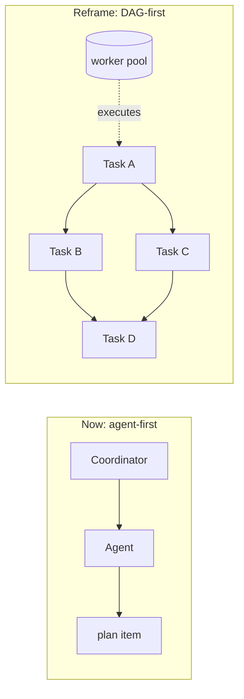
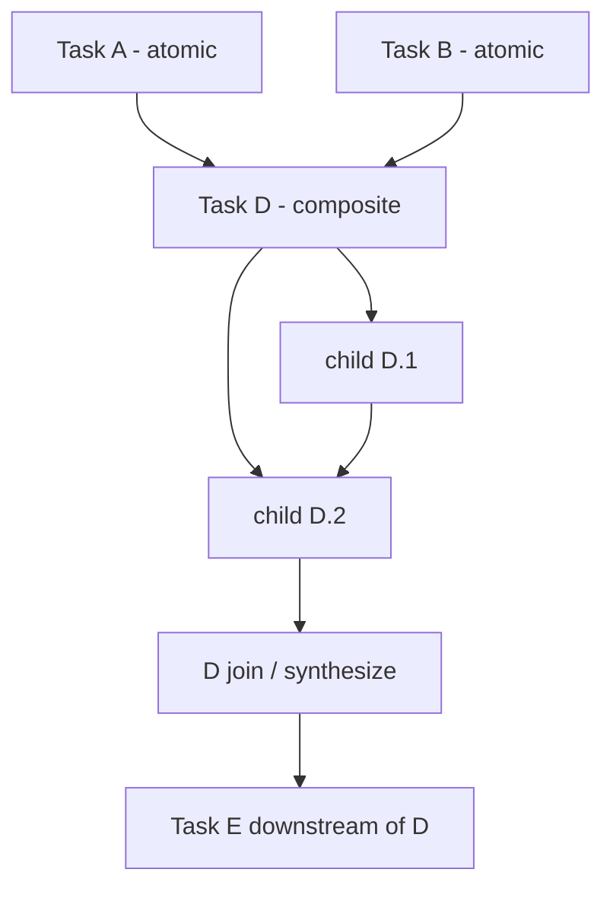
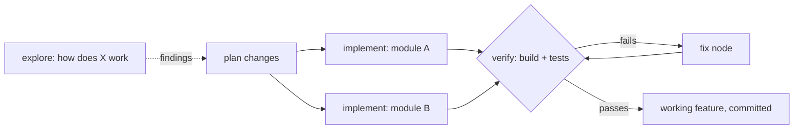
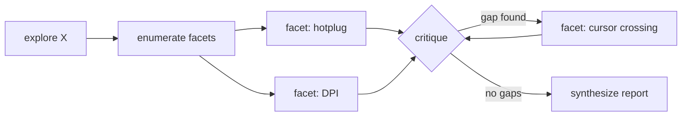
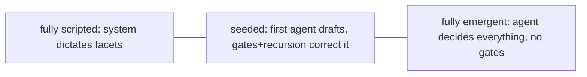
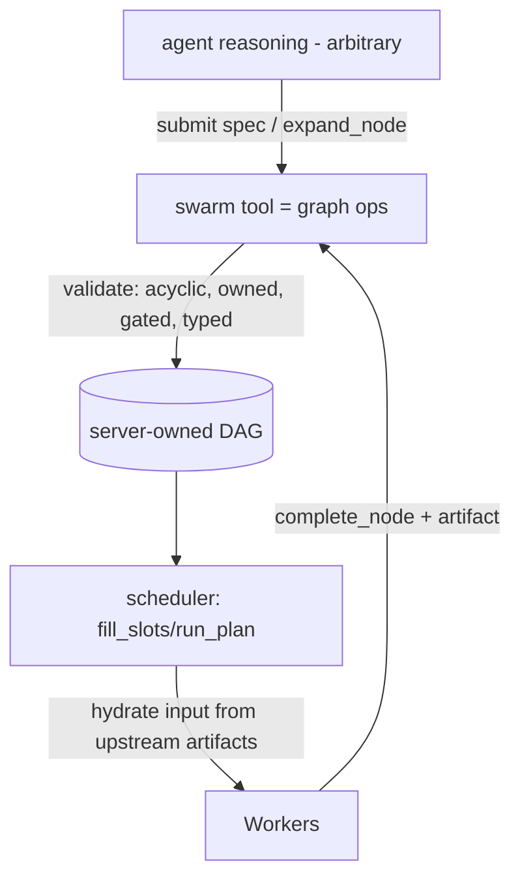
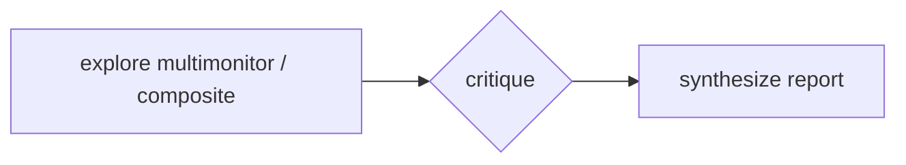
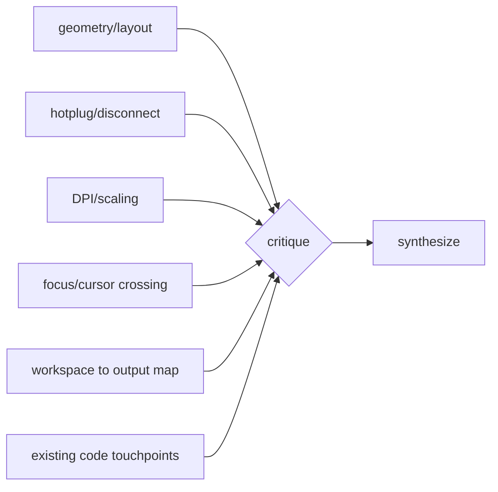
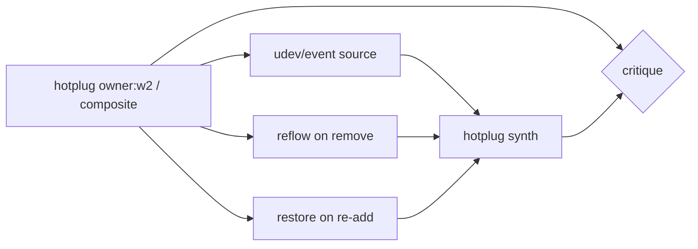
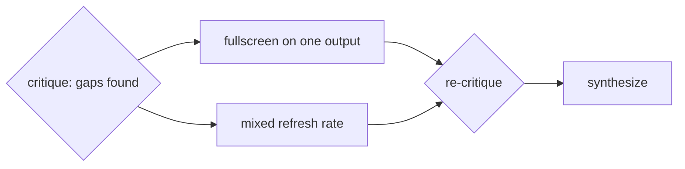

# Swarm을 태스크 DAG로 (설계)

상태: 구현 중이다(이전의 에이전트 우선 구도를 대체한다). DAG 엔진, deep/light
모드, 게이트, 성장 메커니즘, 통신 마이그레이션 1~2단계(아티팩트 데이터플로, 서브트리 범위
브로드캐스트)는 동작한다. 채널/공유 컨텍스트 폐기(3~4단계)는 아직 남아 있다.

이 문서는 swarm 모듈을 에이전트 중심 모델에서 **태스크 DAG(방향성 비순환 그래프)**로 다시 짜는
계획을 담는다. DAG가 기본 객체가 되고, 에이전트는 노드를 실행하고 분해하고 검증하는 교체 가능한
일꾼이 된다. 설계 논의를 바탕으로 아키텍처, 데이터 모델, 완료와 커버리지 보장, 편향 예산, 도구
표면을 기록한다.

---

## 1. 동기와 핵심 재구성

지금 swarm은 **에이전트 우선**이다. 에이전트를 띄우고 대화하면서 작업을 굴리고(DM, 채널, 역할),
`PlanItem`의 `VersionedPlan`은 옆에 덧붙어 있다. 의존 그래프는 이미 내부에 있다
(`PlanItem.blocked_by` 엣지, `summarize_plan_graph`, `next_runnable_item_ids`, `run_plan`/`fill_slots`).
하지만 그것은 구현 세부에 머문다. 커버리지와 철저함은 그때그때 작업을 이끄는 쪽에 맡겨진다.

재구성은 **태스크 DAG를 기본 추상으로** 삼는다.

- 의존 엣지와 노드별 명세를 가진 태스크 그래프를 선언한다.
- 스케줄러가 DAG를 순회한다. 노드는 의존이 끝나면 실행 가능해지고 일꾼에 배정되며(재사용 또는 새로
  띄우기), 완료되면 의존 노드를 자동으로 풀어 준다.
- 에이전트는 풀에서 꺼내 쓰는 일꾼이지, 하나하나 챙기는 대상이 아니다.
- 코디네이터와 워크트리 관리자 역할은 사용자에게 보이는 개념에서 **스케줄러 정책**으로 내려간다.

기존 `horon-agent-plan` 그래프 코드가 토대다. 새로 쓰는 것이 아니라 그 코드를 진화시킨다.

---

## 1a. 두 모드: deep(포괄)와 light(팬아웃)

DAG 엔진은 두 **모드** 중 하나로 돈다. 의도적으로 **엔진 하나에 프리셋 둘**이며, 별개 시스템 둘이
아니다. 두 모드 모두 같은 DAG 데이터 모델, 스케줄러, 엣지 위 데이터플로, 멤버 상한 메커니즘을 쓴다.
차이는 엄격함 장치(의무 분해 + 비평/검증 게이트 + 재귀)를 켜는지, 그리고 멤버 상한이 얼마나 큰지뿐이다.

핵심 구도는 이렇다. **light 모드는 구조적 압력을 끄고 상한을 작게 둔 deep 모드일 뿐이다.** 모드
손잡이 하나를 가진 엔진 하나로 만들고, 스케줄러나 데이터플로를 복제하지 않는다.

- **Deep 모드(포괄):** 이 문서의 전부다. 목표는 구석진 곳을 하나도 남기지 않는 것이다. 재귀로
  스스로 깊어지는 트리이고, 분해는 의무이며(기본이 복합), 어떤 노드든 닫히기 전에 비평/검증
  게이트를 거쳐야 하고, 재귀는 깊이 제한 없이 장려되며, `what_i_did_not_check`를 포함한 타입 지정
  핸드오프 스키마 전체가 강제된다. 최대 1000 에이전트 멤버 상한까지 확장한다. 비용과 지연이 크므로
  의도적으로 쓴다. 예: "scrollwm의 멀티모니터 지원 탐색", 크고 위험한 리팩터링.

- **Light 모드(팬아웃):** 속도를 위해 일을 병렬화하고 품질을 적당히 올리는, 더 싼 프리셋이다.
  극단까지 가지 않는다. 목표는 독립 단위를 병렬로 돌리는 것뿐이다. 대체로 평평하고(팬아웃 한
  단계), 분해는 선택이며(에이전트 재량), 비평/검증 게이트는 꺼져 있거나 기껏해야 마지막 확인 한
  번이고, 에이전트를 띄울 수 있는 것은 루트뿐이라 재귀 성장이 꺼진다. 핸드오프 아티팩트는 가볍고
  자유 형식이어도 된다. 일꾼 상한이 작다(예: 4~16). 비용과 지연이 낮다. 사실상 오늘의 띄우고
  팬아웃하는 동작을 싸게 유지한 것이다. 예: "독립 편집 5개를 병렬로 실행".

| 차원                 | Deep(포괄)                                 | Light(팬아웃)                    |
| -------------------- | ------------------------------------------ | -------------------------------- |
| 목표                 | 구석진 곳을 남기지 않기                    | 속도와 품질을 위한 병렬화        |
| 모양                 | 재귀로 스스로 깊어지는 트리                | 대체로 평평한, 한 단계 팬아웃    |
| 분해                 | 의무(기본이 복합)                          | 선택, 에이전트 재량              |
| 비평/검증 게이트     | 모든 노드가 닫히기 전에 필요               | 끔(또는 마지막 확인 한 번)       |
| 재귀                 | 장려, 깊이 무제한                          | 억제하거나 끔                    |
| 핸드오프 아티팩트    | 전체 타입 스키마, `what_i_did_not_check`   | 가볍게, 자유 형식 허용           |
| 멤버 상한            | 최대 1000 에이전트                         | 작게(예: 일꾼 4~16)              |
| 비용 / 지연          | 높음, 의도적                               | 낮음, 빠름                       |

두 모드가 함께 쓰는 것은 DAG 데이터 모델, 스케줄러, 엣지 위 데이터플로(타입 지정 또는 가벼운
아티팩트), 멤버 상한 메커니즘이다(상한만 다르다). 이 문서의 엄격함 절(6, 7)은 **deep 모드**를
설명한다. light 모드는 그 게이트를 끌 뿐이다.

---

## 2. 의존 그래프 위의 소유 트리

"모두가 하나의 공유 그래프를 고친다"의 함정은 공유 `VersionedPlan`이 하나뿐이라는 데 있다. 자유
형식 편집이 동시에 일어나면 일관성이 깨지고, 그래서 지금은 계획 변경이 코디네이터 하나로 제한된다.
해법은 락을 더하는 것이 아니라 **변경이 무엇인지**를 바꾸는 것이다.

**의존 그래프 위에 얹은 소유 트리**로 모델링한다. 변경 단위는 *자기가 소유한 노드를 확장하는
것*이며, 임의 노드를 고치는 일은 없다.

- 쓰기는 **소유자별로 나뉜다**. 자기 노드 아래에만 자식을 더하므로 두 소유자가 같은 영역을 쓰지
  않는다. 이렇게 하면 전역 그래프는 하나로 두면서도 락 없이 코디네이터 병목을 없앤다.
- 그래프는 여전히 **서버가 소유하고 버전을 매기는** 단일 진실 원천이다(`VersionedPlan`을
  재사용한다). 다만 변경은 마지막 쓰기가 이기는 덩어리가 아니라 **덧붙이기 방식 연산**(노드 추가,
  엣지 추가, 노드 완료)이 되고, 서버 쪽에서 비순환성과 소유권을 검증한다.
- 새 엣지는 **이미 존재하는 상류** 노드만 가리킬 수 있다. 그래서 비순환성이 구조적으로 보장된다.

---

## 3. 노드 종류: 원자와 복합

에이전트가 노드를 집었을 때 그 노드는 두 운명 중 하나를 간다. 상태는 초안 작성 시점이 아니라 실행
중에 뒤집힌다. 노드를 미리 복합으로 선언할 필요는 **없다**. 어느 깊이의 에이전트든 자기에게 배정된
노드를 확장할 수 있다.

- **원자:** 일꾼이 태스크를 직접 실행하고 핸드오프 아티팩트를 쓴다.
- **복합:** 배정받은 에이전트가 태스크가 너무 크다고 판단한다. 실행하는 대신 노드를 **분해**해 자식
  서브 DAG로 만들고, 그 서브 DAG를 이제 자기가 소유한다. 원래 노드는 **조인/종합 지점**이 된다.
  자식이 모두 끝날 때까지 진행 중으로 남고, 끝나면 소유자가 다시 깨어나 자식 아티팩트를 읽고, 이
  노드에 의존하는 쪽을 위해 종합 결과 하나를 쓴다.

복합 노드의 소유자는 **기획자 겸 통합자**일 뿐이다(맵 다음 리듀스). 소유자가 분해하고, 자식이 일을
하고, 소유자가 종합한다. 잎 작업을 직접 실행하지는 않는다. 이렇게 하면 노드마다 책임이 깔끔하게
남고 소유 경계가 또렷해진다.

**deep 모드**에서 재귀에는 고정 깊이나 노드당 팬아웃 제한이 없다. 성장은 설정 가능한 라이브 일꾼
예산과 절대 전체 멤버 상한(swarm당 1000 에이전트, 10절)으로 제한된다. light 모드는 재귀 생성을
끈다. 루트만 평평한 일꾼 팬아웃을 만들 수 있다.

---

## 4. 종료 동작에 따른 노드 종류

DAG는 태스크 유형을 가리지 않는다. 구조(분해, 게이트, 타입 지정 핸드오프)는 태스크와 무관하게
같다. 바뀌는 것은 **아티팩트 종류와 "완료" 기준**뿐이다. 실제 태스크는 대개 **탐색한 뒤 행동**이고,
그 순서는 그냥 의존 엣지 하나다. 탐색 노드가 구현 노드를 먹인다.

| 종류        | 아티팩트(출력)                          | "완료" 계약                    |
| ----------- | --------------------------------------- | ------------------------------ |
| `explore`   | 조사 결과(연구의 산출물)                | 비평 게이트를 통과             |
| `implement` | diff / 커밋 참조 + 바뀐 내용            | 검증 게이트를 통과             |
| `verify`    | 통과/실패 + 구체적 실패                 | 검사 실행 완료                 |
| `fix`       | 패치                                    | 재검증 통과                    |

- **검증과 수정**이 시스템을 서술만 하는 것이 아니라 *행동하고 스스로 고치게* 만든다. 검증이
  실패하면 수정 노드가 생기고(그래프가 더 커진다), 비평이 빈틈 노드를 만드는 것과 같다.
- 마지막 `synthesize` 노드는 **선택**이다. 순수 탐색 태스크에서는 이것이 산출물이고, 구현
  태스크에서는 병합되고 검증된 코드가 산출물이며 보고서는 출시된 것의 얇은 요약이다.

---

## 5. 데이터플로: 끝난 의존이 정보를 넘기는 방식

핵심 통찰은 **의존 엣지가 곧 데이터 채널**이라는 것이다. 지금은 완료 보고가 *띄운 쪽*으로
돌아간다(제어 흐름). DAG에서는 *의존하는 쪽*으로도 흘러야 한다(데이터 흐름).

- 완료되면 각 노드는 노드에 붙은 구조화된 **핸드오프 아티팩트**를 저장한다.
- 하류 태스크가 실행 가능해지면(의존이 모두 끝남) 스케줄러가 **입력을 조립한다**. 태스크 자체
  프롬프트에 모든 의존의 병합된 아티팩트를 더해 일꾼의 시작 컨텍스트에 넣는다. 팬아웃(의존 하나가
  여럿을 풀어 줌)과 팬인(의존 여럿이 하나를 먹임)이 자연스럽게 나온다.
- 아티팩트는 기본이 **값이 아니라 참조**다. "API를 `crates/foo/api.rs`에 만들었고 타입은 X/Y,
  커밋은 `abc123`." 저장소와 git이 공유 매체이고, 하류 에이전트는 파일을 직접 읽는다. 값으로 넣는
  것은 저장소에 없는 것(결정, 설계, 분석)뿐이다. 이렇게 하면 컨텍스트가 작게 유지되고, 그 점은
  깊이 들어갈수록 중요하다.
- 복합 노드의 핸드오프는 **분해한 뒤 종합**(맵리듀스)이다. 자식이 끝나면 소유자가 자식 아티팩트를
  들고 다시 깨어나 통합/종합 보고서 하나를 쓴다. 부모는 자식의 잡음을 이어 붙이지 않고 다음 계층을
  위한 깨끗한 요약을 만든다.

---

## 6. 완료와 커버리지: 철저함을 구조로 만들기

목표는 완료가 충분히 포괄적이어서 태스크의 구석을 놓쳤을 가능성이 아주 낮아지는 것이다. 포괄성은
프롬프트의 부탁이 아니라 **그래프의 구조적 성질**이어야 한다. 서로를 보강하는 압력 셋이 있다.

### 6.1 의무 분해(넓이)
탐색형 노드는 **기본이 복합**이다. 에이전트의 첫 일은 답하는 것이 아니라 **표면적을 열거**해 자식
노드로 나누는 것이다. 커버리지가 산문 속에 묻혀 믿어야 하는 대상이 아니라 그래프에서 보이고 감사
가능해진다(핫플러그 노드가 있었나? DPI 노드가 있었나?).

### 6.2 비평/검증 게이트(적대적 빈틈 찾기)
특정 노드에는 부모가 종합하거나 닫기 전에 자동으로 삽입된 **비평**(탐색용) 또는 **검증**(코드용)
의존이 붙는다.

- 게이트는 적대적이다. "이것이 놓친 구석은 무엇인가?" / "실제로 동작하는가?"
- 빈틈이나 실패를 찾으면 그래프에 **새 자식 노드**를 다시 넣고(재귀), 부모는 그것들이 소진되기
  전까지 닫을 수 없다.
- "무언가를 놓쳤을 가능성이 아주 낮다"가 이렇게 나온다. 열린 빈틈이나 실패한 검사가 있는 한
  그래프가 부모의 완료를 문자 그대로 허용하지 않는다.

### 6.3 "확인하지 않은 것"을 명시한 타입 지정 아티팩트(얕음을 드러내기)
핸드오프 아티팩트에는 **필수 스키마**가 있어 얕은 출력이 구조적으로 드러난다.

- `findings`
- `evidence` (파일:줄 참조 / 커밋 참조, 근거 없는 주장이 아님)
- `edge_cases_considered`
- `validation` (코드의 검증 결과)
- `open_questions`
- `confidence`
- `what_i_did_not_check`

`what_i_did_not_check`가 요령이다. 에이전트가 *탐색하지 않은* 것을 나열하게 하면 탐색하지 않은
구석이 드러나고, 비평/스케줄러가 그것을 새 노드로 바꾼다. 복잡한 태스크에서 `open_questions`와
`what_i_did_not_check`가 비어 있는 것 자체가 감사자가 확인하는 위험 신호다.

그래서 지금 포괄성은 두 가지를 뜻하고, 둘 다 게이트로 강제된다. 표면을 덮었는가(비평), 실제로
동작하는가(검증). 둘 다 빈틈과 실패를 새 노드로 바꾼다.

### 6.4 구현된 강제(2026-07: 성장 메커니즘)

위 압력은 프롬프트 부탁이 아니라 `horon-agent-plan`의 `dag` 모듈에 하드 엔진 규칙으로 구현돼 있다.

- **루트 게이트(계획 전체 감사).** deep 모드의 `seed`마다 부모 없는 게이트(`plan::gate`)가 자동으로
  삽입되고, 이 게이트는 모든 루트 수준 노드에 의존한다. 노드가 모두 원자적으로 실행되는 평평한
  seed라도 마지막 적대적 통과 없이는 종료 상태에 이를 수 없고, 그 통과는 새 최상위 노드를
  `inject_gap`할 수 있다(트리 꼭대기에서의 성장). 다시 seed하면 루트 게이트의 범위가 넓어지고, 이미
  통과했던 게이트는 다시 열린다.
- **열거 게이트 커버리지.** 통과하는 deep 게이트 아티팩트는 감사 범위의 모든 완료 노드를 id로
  다뤄야 한다(범위 = 게이트의 비게이트 `depends_on`. 복합 게이트와 루트 게이트에 같은 규칙 하나).
  열거 상한은 20이다. 상한을 넘으면 열거는 HIGH 신뢰 노드에 대해서만 완화되고, medium/low/해석 불가
  신뢰 노드는 여전히 id로 다뤄야 한다. "모두 좋고 빈틈 없음"은 구조적으로 거부된다
  (`UncoveredSiblings`). 범위가 낡은 경우를 잡는 규칙(`StaleGateScope`)은 게이트가 파견된 뒤에
  노드가 범위에 들어오면 통과를 거부한다.
- **아티팩트 없이는 턴이 끝나지 않는다.** deep 모드에는 자동 완료가 없다. 노드가 실행 중인 채로
  끝난 일꾼 턴은 그 노드를 새 일꾼에게 한 번 다시 큐에 넣고(`no_artifact_requeues`), 반복되면
  실패시킨다. deep 노드가 닫히는 길은 `expand_node`(분해)와 `complete_node`(검증된 아티팩트)뿐이다.
- **성장 회계.** 모든 노드는 출처(`seed`/`expand`/`gap`/`gate`)를 기록한다. `PlanGraphStatus`는
  `seeded_count`/`grown_count`를 담고, `plan_status`/`run_plan`은 성장 줄을 출력한다. 그래서 seed를
  한 번도 넘어서지 못한 deep 계획은 탐색 부족이 눈에 보인다.

---

## 7. 편향 예산: 무엇이 고정이고 무엇이 창발인가

핵심 긴장은 이렇다. 사전 편향이 너무 많으면 잘 부서지는 워크플로를 하드코딩한 것이고, 너무 적으면
커버리지 보장을 잃는다. 나누는 방식은 다음과 같다.

### 첫 에이전트가 정하는 것(의도적으로 작은 씨앗)
1. 루트 태스크의 구도(사용자 프롬프트에서 물려받음).
2. 1단계 분해. 처음의 측면/자식 노드와 그 엣지다.

그 첫 분해조차 **잠정적**이다. 모든 자식이 다시 분해될 수 있고, 게이트는 첫 에이전트가 상상하지
못한 형제를 넣을 수 있다. 첫 에이전트는 *씨앗*을 정하지 *모양*을 정하지 않는다.

### 시스템이 고정하는 것(첫 에이전트의 선택이 아니라 구조)
- **게이트 규율:** 모든 복합 노드는 닫히기 전에 비평/검증 의존을 얻는다. 감사를 건너뛸 선택지는
  없다.
- **핸드오프 계약:** `what_i_did_not_check`/`open_questions`를 담은 타입 지정 아티팩트를 모든
  노드에 강제한다.
- **재귀 권리:** 어떤 하위 노드든 자기 노드를 확장할 수 있다. 첫 에이전트는 자기가 그린 모양을
  "잠글" 수 없다.
- **빈틈/실패 -> 새 노드:** 비평과 검증은 원래 계획과 무관하게 놓친 것을 그래프로 바꾼다.

그래서 포괄성 보장은 첫 에이전트가 똑똑한지에 **달려 있지 않다**. 평범한 첫 분해도 여전히 걸리고
확장된다.

우리는 **B(씨앗 + 구조적 게이트)**에 있다.

- **내용 / 도메인 지식:** 거의 전부 에이전트에서 온다(첫 에이전트가 씨앗을 놓고, 하위가 다듬는다).
  시스템은 도메인(예: scrollwm)에 대해 아무것도 모른다.
- **과정 / 엄격함 / 커버리지:** 첫 에이전트가 고르는 것은 거의 없다. 구조적이고 트리 전체에
  균일하다.
- **최종 모양:** 대부분 창발이다. 첫 에이전트의 초안은 보통 최종 노드 수의 작은 일부이고, 대부분의
  노드는 재분해와 게이트가 낳은 빈틈/수정에서 태어난다.

**지켜야 할 불변식:** 도메인 가정을 구조 계층으로 흘리지 않는다. 게이트는 **도메인 중립**을
유지해야 한다. 비평은 "이 태스크가 스스로 밝힌 범위와 아티팩트를 기준으로 무엇이 탐색되지
않았나"를 묻고, 검증은 "이 태스크가 선언한 승인 검사"를 돌린다. 철저함 쪽 편향은 의도적이고, 특정
내용 쪽 편향은 거의 0이어야 한다. 같은 태스크를 다시 돌리면 비슷한 1단계 측면(안정된 씨앗)이
나오되 깊은 구조는 달라야 한다(적응적 탐색).

---

## 8. 인터페이스: 에이전트 스크립트가 아니라 강제되는 그래프 API

인터페이스 선택이 엄격함을 실제로 얼마나 강제할 수 있는지를 정한다. 검토한 선택지는 이렇다.

- **A. 재구성한 swarm 도구(그래프 연산).** 서버가 그래프를 소유하고 모든 변경에서 불변식
  (비순환성, 소유권, 의무 게이트, 타입 지정 핸드오프)을 *강제*한다. "포괄성은 구조다"를 참으로
  만드는 것은 이 선택지뿐이다.
- **B. 에이전트가 스크립트를 쓴다.** 강력해 보이지만, 처음부터 끝까지 한 번에 도는 스크립트는
  런타임 발견으로 자라는 그래프를 표현할 수 없다. 노드 결과를 기다렸다가 다시 들어와야 하고,
  결국 같은 API를 감싼 명령형 드라이버가 된다. 다만 엄격함이 검증되지 않은 에이전트 코드에 살고
  게이트는 우회 가능해진다. 편향이 부족한 실패 모드다.
- **C. 도구 기본 연산 + 선택적 선언 설탕.** 도구가 검증된 기반이고, 정적인 부분은 한 번에 내는
  명세로 허용하되 런타임 성장은 여전히 도구 호출로 간다.

**결정: A를 토대로 삼고 C의 설탕을 얹는다.** 그래프는 에이전트 쪽 스크립트가 아니라 검증된
연산으로 바뀌는 서버 쪽 객체다. 에이전트는 그래프를 *정하는* 일에서 완전한 자유를 갖고(임의
추론/도구 사용), 그것을 *집행하는* 일에서 구조적 게이트를 건너뛸 자유는 0이다.

### 제안 도구 표면(`swarm`의 진화)
- `swarm task_graph {nodes:[...], edges:[...]}` - 초기 DAG를 한 번에 seed한다(첫 에이전트의 초안).
  연산의 묶음 형태이고 같은 검증을 받는다.
- `swarm expand_node {node_id, children:[...], edges:[...]}` - 런타임 분해(재귀). 소유권과
  비순환성을 검사한다.
- `swarm complete_node {node_id, artifact:{findings, evidence, validation,
  edge_cases_considered, open_questions, confidence, what_i_did_not_check}}` - 게이트가 검사하는
  타입 지정 핸드오프.
- `swarm run` - 스케줄러로 넘긴다.
- `spawn` / `dm` / `channel`은 저수준 탈출구로 남는다.

에이전트가 실제로 원하는 "더 많은 제어"는 노드별 프롬프트, 계산된 팬아웃, 조건부 확장이다. 그것은
(a) 에이전트가 원하는 방식으로 노드 목록을 계산한 *뒤* 검증된 명세로 내는 것과 (b) 런타임
`expand_node` 호출로 제공된다. 강제를 우회하는 스크립팅 언어로 제공되지 않는다.

---

## 8a. 통신 개편: 데이터플로 먼저, 채팅은 다음

지금 swarm 도구는 에이전트에게 풍부한 사람용 채팅 표면을 준다. DM, swarm 전체 브로드캐스트, 주제
채널(구독/멤버), 공유 키-값 컨텍스트 저장소, 전달 모드(`notify`/`interrupt`/`wake`),
`await_members`다. 사람 협업 은유를 에이전트에 볼트로 붙인 셈이다. DAG 모델에는 너무 많고 모양도
틀렸다. 개편은 **더하기가 아니라 빼기**다.

### 현재 모델이 맞지 않는 이유
1. **채팅이지 데이터플로가 아니다.** 기존 채널은 모두 *에이전트 사이*의 푸시 알림 메시징이다.
   DAG에서 기본 정보 전달은 **엣지 위 아티팩트를 통한 노드 -> 의존**인데, 그것은 아직 통신 기본
   연산으로 존재하지 않는다. 새 모델에서 가장 중요한 "통신"이 현재 도구로 표현할 수 없는 것이므로,
   에이전트는 서로 DM을 보내 데이터플로를 흉내 내야 한다. 우리가 대체하려는 그 손실 있는 조정
   말이다.
2. **겹치는 기본 연산이 너무 많다.** DM, 브로드캐스트, 채널, 공유 컨텍스트 팬아웃은 다른
   에이전트에게 텍스트를 밀어 넣는 네 가지 방법이고, `message`는 이미 그중 셋 사이를 자동
   라우팅한다. 코드베이스에는 모델이 동사를 계속 새로 만든 탓에 동작 동의어 정규화 계층까지 있다.
   표면이 너무 크다는 냄새다. 동작이 많을수록 모델 오류가 는다.
3. **브로드캐스트가 멤버 상한까지 확장되면 안 된다.** 1000 멤버 상한(10절)에서 swarm 전체 팬아웃은
   보낼 때마다 1000방향 알림 폭풍이 된다. 그래서 브로드캐스트형 전송은 서브트리 범위다(마이그레이션
   2단계, `handle_comm_message`/`handle_comm_share`에 구현됨). 보내는 쪽은 자기가 띄운 서브트리에만
   닿고, swarm 전체 도달은 코디네이터만 유지한다.

### 목표는 2계층 모델
두 계층을 남기고 가운데를 버린다.

- **1계층 - 구조적 데이터플로(새것, 기본).** 엣지 위 핸드오프 아티팩트다. 완료되면 노드의 타입
  지정 아티팩트가 스케줄러를 통해 의존 노드로 자동으로 흐르고, 스케줄러는 새로 실행 가능해진
  노드의 입력을 상류 아티팩트로 채운다. 오늘 DM이 쓰이는 대부분("내가 찾은 것은 이렇고, 이제 네가
  가라")을 대체한다. 보내고 잊는 DM과 달리 타입이 있고, 내구적이고, 참조 방식이며, 다시 불러와도
  살아남는다.
- **2계층 - 예외 채널(유지, 얇게).** 그래프가 모델링할 수 없는 진짜 비구조적 경우에만
  에이전트끼리 직접 접촉한다. 충돌 해소("우리 둘 다 `foo.rs`를 고치고 있다")와 소유 트리 위쪽으로
  올리는 확인 질문이다. 그것이 **DM + 서브트리 범위 브로드캐스트**이고, 그 이상은 없다.

### 내려가거나 잘리는 것
- **공유 컨텍스트 키-값 저장소:** 저장소(진짜 공유 매체)와 타입 지정 아티팩트에 크게 중복된다.
  저장소 밖 공유 상태가 구체적으로 필요할 때만 남기고, 아니면 두 번째 진실 원천이므로 없앤다.
- **swarm 전체 브로드캐스트:** 에이전트가 소유한 하위에만 닿는 **서브트리 범위 브로드캐스트**로
  대체한다. 그래야 멤버 상한만 한 폭풍이 되지 않는다. swarm 전체 브로드캐스트는 드문 코디네이터
  전용 동작이 된다.
- **일반 주제 채널:** 데이터플로가 구조가 되면 필요 없다. 채널은 *사람*이 임시 협업을 조직하는
  방식이다. 에이전트는 자유 형식 방이 아니라 그래프 엣지로 협업해야 한다.

### DAG 모델과의 정렬
의존 엣지가 주 통신 채널(타입 지정 아티팩트)이 되고, 에이전트 간 메시징은 작은 예외 경로(DM +
서브트리 브로드캐스트)로 줄어든다. 이렇게 하면 통신이 DAG와 정렬되고, 멤버 상한에서 브로드캐스트
폭풍 위험이 사라지고, 오류가 잦은 도구 표면이 줄어든다.

### 단계적 마이그레이션(앞에서 걷어내지 않는다)
채널/공유 컨텍스트를 자르는 것은 기존 swarm 흐름에 실제 동작 변경이다. 단계를 나눈다.
1. **완료.** 아티팩트 데이터플로. 완료 아티팩트가 의존으로 흐르고 그 입력을 채운다.
2. **완료.** 보내는 쪽이 띄운 서브트리로 범위를 좁힌 브로드캐스트(구독자 없는 채널 대체와 공유
   컨텍스트 알림 포함). swarm 전체 브로드캐스트는 코디네이터 탈출구로만 남는다.
3. 기존 흐름을 채널/공유 컨텍스트에서 옮긴다(도구 스키마가 이제 그쪽을 권하지 않는다).
4. 흐름이 옮겨진 뒤 중복 채팅 기본 연산을 폐기하고 제거한다.

---

## 9. 예제: 시간에 따른 그래프 변화

태스크: "scrollwm의 멀티모니터 지원 탐색". 상태 범례: 대기, 실행 중, 복합(분해 중/자식 대기),
비평, 완료.

### T0 - 첫 에이전트가 최상위 뼈대를 그린다
루트 에이전트는 답하지 않는다. 씨앗을 놓는다. explore, gate, synthesize.

### T1 - 루트가 explore를 측면으로 확장한다(복합 -> 자식)

### T2 - 스케줄러가 준비된 측면을 파견한다(팬아웃, 병렬 일꾼)

### T3 - 한 측면이 스스로 분해된다(재귀)
`w2`는 핫플러그가 깊다고 보고 자기 노드를 확장한다. 이제 서브 DAG를 소유한다.

### T4 - 원자 측면이 끝난다. 이제 엣지가 아티팩트를 나른다
`F1,F3,F4,F6`이 타입 지정 아티팩트와 함께 완료된다. 비평은 `F2`에서 막혀 있다.

### T5 - 핫플러그 자식이 끝난다. 소유자가 종합하려고 다시 깨어난다(리듀스)
`w2`가 H1/H2/H3을 읽고 깨끗한 핫플러그 보고서 하나를 쓴다. 복합 노드가 닫힌다.

### T6 - 비평이 빈틈을 찾아 새 그래프를 낳는다
감사자가 모든 측면의 `what_i_did_not_check`를 읽는다. 한 출력에서의 전체 화면이나 혼합 주사율을
아무도 덮지 않았다. 감사자가 새 노드와 재비평을 넣고, synthesize는 계속 막힌다.

### T7 - 빈틈 노드가 끝나고, 재비평이 통과하고, synthesize가 돈다
Synthesize가 모든 상류 아티팩트를 (참조로) 모아 최종 보고서를 만든다.

예제가 보여 주는 것: 넓이(측면으로 드러나는 커버리지), 재귀(핫플러그가 스스로 분해), 엣지 위
데이터플로(아티팩트가 의존 입력을 채움), 복합마다 맵리듀스(소유자가 종합), 게이트로서의
포괄성(비평이 놓친 것을 그래프로 바꾸고, 부모는 열린 빈틈을 안고 닫을 수 없음). 그래프는 한 번
그려지고 끝나지 않는다. 깊이나 빈틈이 발견되는 곳마다 자라고, 서브트리가 종합 아티팩트로 접히면서
주의가 줄어든다.

---

## 10. 데이터 모델 변경(`horon-agent-plan` 기준)

`VersionedPlan` / `PlanItem`을 재사용한다(이미 `blocked_by` 엣지, `summarize_plan_graph`,
`next_runnable_item_ids`, `newly_ready_item_ids`, `run_plan`/`fill_slots`가 있다). 다음을 더한다.

- `PlanItem`: `owner_session`, `kind: atomic | composite`(그리고 종료 동작 종류:
  `explore | implement | verify | fix`), `parent_node`,
  `output: Option<HandoffArtifact>`.
- `HandoffArtifact`: 6.3절의 타입 스키마.
- 새 연산 기반 변경: `expand_node(node_id, children, edges)`와 `complete_node(node_id, artifact)`.
  소유권 검사, 비순환성 검사, 버전을 적용한다. `task_graph`는 묶음 seed 형태다.
- 스케줄러: 파견할 때 상류 `output`으로 일꾼 입력을 채운다. 복합 조인에서는 소유자를 다시 깨워
  종합하게 한다. 게이트 규율에 따라 비평/검증 의존을 자동 삽입한다.
- 역할(코디네이터 / 워크트리 관리자)은 사용자에게 보이는 개체가 아니라 스케줄러 정책이 된다.

### 폭주 방지: 전체 멤버 상한 하나
폭주 방지는 제한 행렬이 아니라 상한 하나다. swarm은 최대 **`MAX_SWARM_MEMBERS` = 1000** 라이브
멤버(에이전트)를 가질 수 있다. 의도적으로 **깊이 상한도, 노드당 넓이/팬아웃 상한도 없다**. spawn
트리는 swarm이 1000 멤버에 이를 때까지 자유롭게 중첩하고 팬아웃할 수 있고, 그 지점에서 추가
spawn은 명확한 오류로 거부된다. 이는 `ensure_spawn_coordinator_swarm`(`server/comm_session.rs`)에서
swarm의 라이브 멤버를 세고 상한에 닿으면 spawn을 거부하는 방식으로 구현돼 있다. 예전
`MAX_SWARM_SPAWN_DEPTH` 깊이 제한은 제거됐다.

### 솔직한 트레이드오프와 한계
- 멤버 상한 하나가 유일한 조절기다. 전체 동시성과 비용을 묶지만, 한쪽으로 치우친 트리(예: 탐욕스러운
  노드 하나가 예산을 많이 먹는 경우)는 막지 못한다. 그 판단은 에이전트와 게이트 규율에 맡긴다.
- 그래프는 일을 **순서 짓지만** 상호 배제를 하지는 않는다. 두 서브트리가 같은 파일을 고치는 것은
  여전히 "락 없이 DM으로 이야기하기" 경우이고, 오늘과 같다.
- 도메인 편향은 구조/게이트 계층에서 빼야 한다(7절 불변식).

---

## 11. 권장 구현 순서

1. `horon-agent-plan`에 타입 지정 `HandoffArtifact` 스키마와 `PlanItem` 필드 추가를 착지시킨다.
2. 검증된 `expand_node` / `complete_node` / `task_graph` 연산을 더한다(소유권 + 비순환성 + 게이트
   자동 삽입).
3. 스케줄러를 확장해 하류 입력을 상류 아티팩트로 채우고, 복합 소유자를 종합하려고 다시 깨운다.
4. 텍스트 기반 시뮬레이터를 만들어 그래프가 변하는 모습(9절 같은)을 보고, 라이브 swarm에 연결하기
   전에 스케줄러/비평/검증 메커니즘을 확인한다.
5. 도구 표면(`task_graph`/`expand_node`/`complete_node`/`run`)을 그래프 우선 뷰로 재구성한다(headless
   전환 이전에는 TUI도 같은 뷰로 바꾸는 항목이었다). `spawn`/`dm`은 탈출구로 남긴다.
