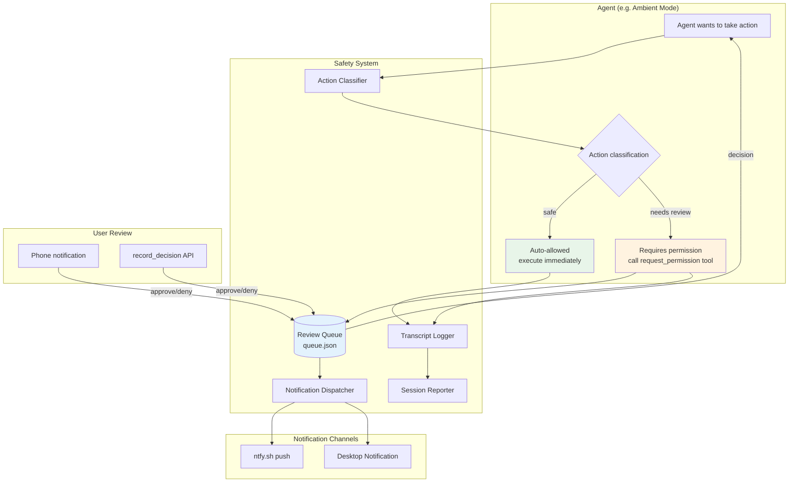
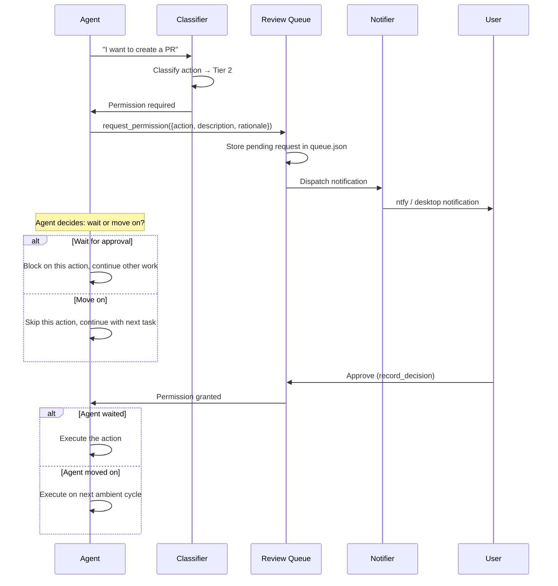
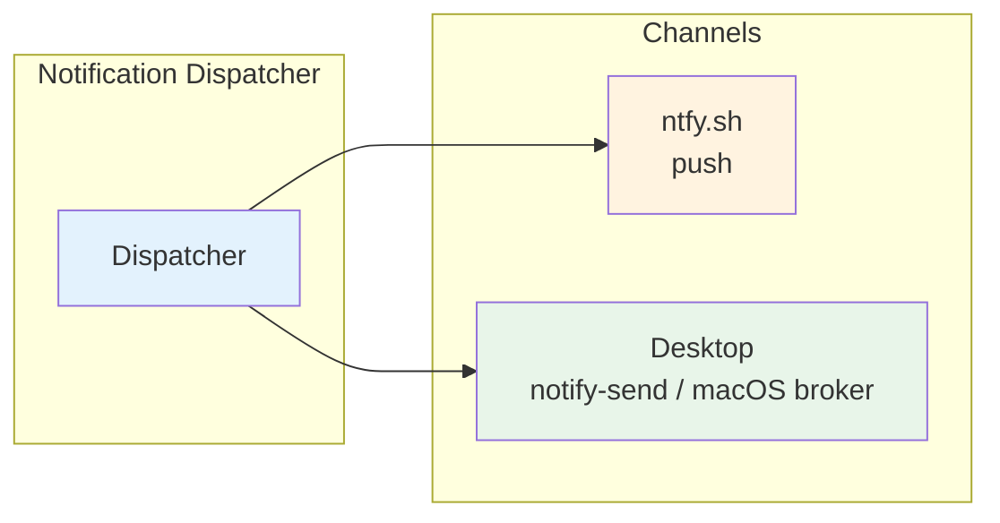

# 안전과 승인

안전 시스템과, 화면 앞에 사람이 없을 때의 승인 대기·자동 전환을 다룬다.

## 안전 시스템

> **상태:** 설계 기록
> **갱신:** 2026-02-08
> **읽는 법:** 이 문서는 2026-02-08에 작성한 설계 기록이며 현재 구현 상태가 아니다. 아래 본문 가운데 코드에 있는 것은 `file:line`을 붙였고, 설계만 있고 트리에 없는 것은 그 사실을 적었다. 지금 동작을 확인하려면 `crates/base/src/safety.rs`와 `crates/app-core/src/tool/ambient.rs`를 읽는다.

감시 없이 돌아가는 에이전트 동작을 위한 사람 개입형 안전 계층이다. horon agent의 어떤 기능이든 붙일 수 있는 독립 하위 시스템으로 설계했다. 지금은 ambient 모드만 이 시스템을 쓰지만, 나중 기능에서 다시 쓸 수 있도록 일부러 분리해 두었다.

### 개요

에이전트가 사용자의 직접 감시 없이 동작할 때(예: ambient 모드) 다음을 할 방법이 필요하다.
1. **무엇이 허용되는지 묻지 않고 알기**
2. 사람 승인이 필요한 동작에 대해 **권한 요청하기**
3. 요청이 대기 중임을 사용자에게 **알리기**
4. 사용자가 검토하는 동안 **기다리거나 다음으로 넘어가기**
5. 세션이 끝난 뒤 **한 일을 보고하기**

안전 시스템이 이 모두를 제공한다. 단계는 두 개뿐이다. 자동 허용과 권한 필요다. "항상 거부" 단계는 없다. 사용자가 명시적으로 승인하면 에이전트는 그 일을 할 수 있다. 핵심 원칙은 **다른 사람과 통신하거나 로컬 샌드박스 밖에 흔적을 남기는 모든 일에는 권한이 필요하다**는 것이다.

---

### 구조



검토 화면은 이 빌드에 없다. TUI 검토 패널은 TUI 크레이트와 함께 삭제됐고(`AGENTS.md`의 삭제 목록), `horon-agent safety review` 같은 CLI 하위 명령도 없다. 사용자는 알림에 답하거나 `SafetySystem::record_decision`을 부르는 경로로 결정을 낸다(`crates/base/src/safety.rs:597`).

---

### 동작 분류

에이전트가 하려는 모든 동작은 두 단계 중 하나로 분류한다. "always denied" 단계는 없다. 사용자가 승인하면 에이전트는 그 일을 할 수 있다. 안전 시스템의 일은 사용자에게 묻는 것을 보장하는 것이지 동작을 아예 막는 것이 아니다.

분류는 이름 기반이다. `classify`가 소문자로 바꾼 동작 이름을 자동 허용 목록과 비교하고, 목록에 없으면 권한 필요로 본다(`crates/base/src/safety.rs:364-374`). 자동 허용 목록은 `read`, `glob`, `grep`, `ls`, `memory`, `todo`, `todowrite`, `todoread`, `conversation_search`, `session_search`, `codesearch` 열한 개다(`crates/base/src/safety.rs:306-317`).

#### 1단계: 자동 허용 (권한 불필요)

로컬에서 일어나고 되돌릴 수 있으며 프로젝트 샌드박스 밖에 영향을 주지 않는 동작이다.

| 동작 | 이유 |
|--------|-----------|
| 프로젝트 안 파일 읽기 | 읽기 전용이라 부작용이 없다 |
| git 이력과 상태 읽기 | 읽기 전용이다 |
| 테스트 실행(읽기 전용) | 검증만 하고 상태를 바꾸지 않는다 |
| 메모리 조작(주기당 상한 안에서) | 로컬 데이터라 되돌릴 수 있다 |
| 로컬 브랜치와 git 워크트리 만들기 | 로컬에만 생기고 지우기 쉽다 |
| ambient 자체 로그와 상태 파일에 쓰기 | 내부 기록이다 |
| 임베딩과 유사도 검색 | 계산만 한다 |
| 추출을 위해 세션 분석하기 | 읽기 전용 분석이다 |

#### 2단계: 권한 필요 (사용자에게 묻기)

로컬 샌드박스 밖에 흔적을 남기거나 공유 상태에 영향을 주거나 쉽게 되돌릴 수 없는 동작이다. **일반 규칙은 이렇다. 다른 사람과 직접 통신하는 일에는 예외 없이 항상 권한이 필요하다.**

| 동작 | 이유 |
|--------|-----------|
| **사람과의 통신(항상 2단계)** | |
| 이메일 보내기 | 되돌릴 수 없고 다른 사람이 본다 |
| 과제 제출 | 학업상 결과가 따른다 |
| Slack, Discord, 채팅에 게시 | 다른 사람이 본다 |
| GitHub 이슈와 PR 댓글 만들기 | 공개적으로 보인다 |
| 어떤 형태든 사람과의 직접 통신 | 보낸 뒤 취소할 수 없다 |
| **코드 수정** | |
| 저장소 코드 수정(워크트리와 PR을 거쳐야 한다) | 병합 전 검토가 필요하다 |
| 원격에 푸시 | 협업자에게 보인다 |
| 풀 리퀘스트 만들기 | 협업자에게 보인다 |
| CI/CD 파이프라인 수정 | 공유 인프라에 영향을 준다 |
| **시스템 변경** | |
| 시스템 패키지 설치 | 시스템 상태를 바꾼다 |
| 닷파일과 시스템 설정 수정 | 다른 도구에 영향을 준다 |
| 네트워크 서비스 시작과 포트 열기 | 보안에 영향을 준다 |
| **배포** | |
| 어떤 환경이든 배포 | 사용자와 서비스에 영향을 준다 |
| **데이터** | |
| 프로젝트 샌드박스 밖 파일 삭제 | 복구할 수 없을 수 있다 |
| 데이터베이스 삭제와 큰 캐시 비우기 | 데이터를 잃을 위험이 있다 |
| **금전과 계정** | |
| 구매와 결제 변경 | 금전적 결과가 따른다 |
| 비밀번호, API 키, 인증 변경 | 보안상 결과가 따른다 |
| 토큰 폐기와 권한 수정 | 접근 권한에 결과가 따른다 |

#### 사용자 지정 규칙

이 빌드에는 동작을 승격하거나 강등하는 규칙 테이블이 없다. `[safety.rules]`나 `[safety.notifications]` 같은 하위 표도 없다. `SafetyConfig`의 필드는 모두 `[safety]` 아래 평평하게 놓여 있고(`crates/config-types/src/lib.rs:2030-2041`), 승인 대기 정책은 `[ambient]`에 있다(`:1557-1595`).

```toml
[safety]
desktop_notifications = true
# ntfy_topic = "horon-agent-ambient-your-secret-topic"
# ntfy_server = "https://ntfy.sh"

[ambient]
# approval_timeout_secs = 1800
# approval_default_on_timeout = "deny"
# approval_for_clientless_runs = false
```

`approval_timeout_secs`의 기본값은 1800초다(`crates/config-types/src/lib.rs:1584`, `:1598-1600`). 시간이 지나면 `approval_default_on_timeout`이 적용되고 기본값은 `"deny"`다(`:1589`, `:1602-1604`). 승인 대기 중인 요청이 만료되면 기록이 남고, 감사할 수 없는 이력은 승인을 거부 쪽으로 닫는다(`crates/base/src/safety.rs:340-360`).

---

### 권한 요청 흐름



#### `request_permission` 도구

이 도구는 코어 15도구에 들어 있지 않다. ambient 실행기가 등록하고, 세션의 도구 허용 목록이 통과시켜야 호출된다. 클라이언트가 붙지 않은 무인 실행을 위해 `[ambient] approval_for_clientless_runs`를 켜면 그때만 허용 목록에 합쳐진다(`crates/base/src/config.rs:752-757`, `:1153-1170`). 기본값은 꺼짐이고, 코어 집합은 15개 그대로다(`crates/base/src/config.rs:779-799`, 테스트는 `crates/base/src/config_tool_tiers_tests.rs:26-40`).

ambient 세션이 아닌 곳에서 부르면 "request_permission is only available to ambient sessions" 오류로 거절한다(`crates/app-core/src/tool/ambient.rs:105`).

```rust
// Tool: request_permission
{
    "action": "create_pull_request",
    "description": "Create PR for ambient/fix-auth-tests branch with 3 test fixes",
    "rationale": "Found 3 failing tests in auth module. Fixed them on a worktree branch.",
    "urgency": "low",           // "low" | "normal" | "high"
    "wait": false,              // should the agent block until approved?
    "context": {                // optional reviewer context
        "summary": "...",
        "why_permission_needed": "...",
        "files": ["src/auth.rs"],
        "risks": ["..."],
        "rollback_plan": "..."
    }
}
```

스키마의 필수 항목은 `action`, `description`, `rationale`이고 나머지는 선택이다(`crates/app-core/src/tool/ambient.rs:542-600`). 실행은 요청을 대기열에 넣고 디스크에 대기 기록을 만든 뒤 알림을 보낸다(`:689-800`). 알림은 기록이 만들어진 뒤에만 나간다. 답하는 사람이 알림이 가리키는 기록을 바로 찾을 수 있어야 하기 때문이다.

**응답:**
```rust
// If wait=true and user responds:
{ "approved": true, "message": "looks good" }

// If wait=true and timeout:
{ "approved": false, "reason": "timeout", "timeout_minutes": 30 }

// If wait=false:
{ "queued": true, "request_id": "req_abc123" }
```

#### 대기 중 에이전트 동작

에이전트가 `wait: true`로 권한을 요청하면 다음과 같이 동작한다.
- 주기 전체를 막지 않는다. 다른 ambient 작업으로 넘어간다.
- 사용자가 승인하면 그 동작은 다음 주기에 예약된다. 현재 주기가 아직 돌고 있으면 현재 주기에 들어간다.
- `approval_timeout_secs` 안에 응답하지 않으면 요청은 만료되고 `approval_default_on_timeout`에 따라 처리된다.

에이전트가 `wait: false`로 권한을 요청하면 다음과 같다.
- 요청은 사용자 검토를 위해 대기열에 들어간다.
- 에이전트는 그 동작 없이 계속 진행한다.
- 나중에 승인되면 다음 ambient 주기에서 처리된다.

---

### 알림 시스템

#### 채널



발송은 실패해도 흐름을 막지 않는다. 오류는 로그에 남기고 계속 진행한다(`crates/app-core/src/notifications.rs:1-7`).

**알림 내용:**
- 에이전트가 하려는 일(동작과 설명)
- 그 일을 하려는 이유(근거)
- 승인하거나 거부하는 방법(회신 안내)
- 긴급도

#### 설정

```toml
[safety]
# 데스크톱 알림 켜기(기본값: true)
desktop_notifications = true

# ntfy.sh 푸시
# ntfy_topic = "horon-agent-ambient-your-secret-topic"
# ntfy_server = "https://ntfy.sh"
```

이 빌드의 알림 채널은 ntfy.sh와 데스크톱 알림 두 가지다. 이메일, 메신저 봇, 클라우드 릴레이 채널은 제거되어 `SafetyConfig`에 해당 키가 없다(`crates/config-types/src/lib.rs:2030-2041`). 옛 설정 파일에 그 키가 남아 있어도 알 수 없는 필드로 무시하고 로드된다.

묶음 간격, 조용한 시간, 최소 긴급도 같은 선호 항목도 이 빌드에 없다.

---

### 세션 기록과 요약

ambient 주기가 끝날 때마다, 또는 감시 없이 돌아간 에이전트 세션이 끝날 때마다 안전 시스템이 보고서를 만든다.

#### 기록

실행한 모든 동작을 맥락과 함께 남긴 전체 기록이다.

```json
{
    "session_id": "ambient-2026-02-08-143022",
    "started_at": "2026-02-08T14:30:22Z",
    "ended_at": "2026-02-08T14:35:18Z",
    "provider": "openai",
    "model": "5.2-codex-xhigh",
    "token_usage": { "input": 12400, "output": 3200 },
    "actions": [
        {
            "type": "memory_consolidation",
            "description": "Merged 2 duplicate memories about dark mode preference",
            "tier": "auto_allowed",
            "details": { "merged": ["mem_abc", "mem_def"], "into": "mem_ghi" }
        },
        {
            "type": "permission_request",
            "description": "Create PR for 3 auth test fixes",
            "tier": "requires_permission",
            "status": "pending",
            "request_id": "req_abc123"
        }
    ],
    "pending_permissions": 1,
    "scheduled_next": "2026-02-08T15:05:00Z"
}
```

기록 타입은 `AmbientTranscript`와 `ActionLog`다(`crates/base/src/safety.rs:265-300`). 저장은 `save_transcript`가 맡는다(`:678`).

#### 요약

설정한 알림 채널로 보내는 사람이 읽을 수 있는 요약이다. `generate_summary`가 문자열을 만든다(`crates/base/src/safety.rs:634`).

```
Ambient cycle completed (4m 56s)

Done:
- Merged 2 duplicate memories (dark mode preference)
- Pruned 1 stale memory (confidence: 0.02)

Needs your review:
- [Approve/Deny] Create PR for auth test fixes (3 files changed)

Next cycle: ~35 minutes
```

#### 전달

- **항상:** 대기열과 이력 파일을 남긴다.
- **알림 켠 경우:** ntfy.sh와 데스크톱 알림으로 요약과 승인 요청을 보낸다. 발송 실패는 로그에만 남기고 주기를 막지 않는다.
- **회신:** 이 빌드에는 알림 회신으로 결정을 남기는 경로가 없다. 결정은 `record_decision`이나 `record_permission_via_file`로 기록한다.

---

### 검토 대기열

#### 저장 위치

```
~/.horon-agent/safety/
├── queue.json              # Pending permission requests
└── history.json            # Past decisions
```

경로는 `queue_path`와 `history_path`가 정한다(`crates/base/src/safety.rs:698-704`).

#### 검토 인터페이스

**1. 파일 기반 결정 기록**

외부 도구가 결정을 남길 때는 `record_permission_via_file`을 쓴다(`crates/base/src/safety.rs:907`). 만료 정리는 `expire_stale_permissions_via_file`이 맡는다(`:929`).

**2. 라이브러리 호출**

`SafetySystem::record_decision`은 프로세스 안에서 결정을 기록하고 대기 중인 호출자를 깨운다(`crates/base/src/safety.rs:597`).

이 빌드에는 TUI 검토 패널도, `horon-agent safety review` 계열 CLI도 없다.

#### 결정 이력

지난 결정을 저장해 감사할 수 있게 한다.

```json
{
    "request_id": "req_abc123",
    "action": "create_pull_request",
    "decision": "approved",
    "decided_at": "2026-02-08T14:42:00Z",
    "decided_via": "cli",
    "response_time_seconds": 420
}
```

이력이 깨져 읽히지 않으면 승인은 거부로 닫힌다. 감사할 수 없는 상태에서 승인을 통과시키지 않기 위해서다(`crates/base/src/safety.rs:340-360`, `:504`).

---

### 파일시스템 경로 정책

이 절의 경로 정책과 아래 `ask` 계약은 같은 변경에서 함께 들어왔다. 둘 다 권한 요청과 별개로 도구 호출 자체를 거른다.

#### 거부 우선 훅

세션은 `read`, `write`, `edit`, `replace`, `apply_patch`, `ls`, `agentgrep`이 경로를 만질 때 참조할 술어 하나를 등록할 수 있다(`crates/app-core/src/tool/path_policy.rs:1-6`). 술어는 거부만 할 수 있다. 허용으로 뒤집는 경로는 없다. 아무것도 등록하지 않은 세션은 이 훅이 없던 때와 똑같이 동작한다.

```rust
pub type PathDenyPredicate = Arc<dyn Fn(&Path) -> Option<String> + Send + Sync>;
```

`Some(reason)`을 돌려주면 호출이 거부되고 그 이유가 호출자에게 보인다. `None`이면 도구 자체의 검사로 넘어간다. 도구가 원래 거부할 경로를 술어가 허용할 방법은 없고, 이것이 "거부 우선"의 뜻이다(`crates/app-core/src/tool/path_policy.rs:23-28`). 등록은 `register_session_path_policy`가 하고(`:63`), 등록 토큰이 드롭되면 그 세션의 정책이 사라진다(`:43-60`).

한계는 문서에 그대로 적혀 있다. `bash`는 셸을 거쳐 모든 경로에 닿으므로 이 훅 밖이고, 심볼릭 링크는 허용된 경로를 가리키면서 거부된 경로로 풀릴 수 있다. 이 장치는 실수를 막는 가드이지 샌드박스가 아니다(`crates/app-core/src/tool/path_policy.rs:9-11`).

---

### 질문 도구 `ask`의 계약

`ask`는 사용자에게 선택지를 내미는 도구다. 이 빌드에서 그 도구는 **답할 수 있는 클라이언트가 세션에 붙어 있을 때만 기다린다. 그 대기는 300초에서 끊긴다.**

데몬은 headless이다. 붙어 있는 클라이언트 화면을 보장할 수 없다. 그래서 `ask`는 먼저 세션에 답변 채널이 등록돼 있는지 확인한다(`crates/app-core/src/tool/ask.rs:357`). 채널은 세션에 붙은 연결이 `supports_ask_requests`를 광고할 때 설치되고 연결이 끊기거나 다른 세션으로 다시 붙으면 걷힌다(`crates/app-core/src/server/client_lifecycle.rs:2045-2053`, `crates/app-core/src/tool/ask_bridge.rs:72-88`). 채널의 존재 자체가 "이 연결은 질문을 보여주고 답할 수 있다"는 신호다(`crates/app-core/src/tool/ask_bridge.rs:6-13`). 광고는 하네스 API `Hello`의 `supports_ask_requests`로 협상한다(`crates/harness-api/src/requests.rs:42-45`).

- 채널이 없으면: 요청을 검증한 뒤 `[tools] ask_policy`로 답을 정해 즉시 돌려준다. 기다리지 않는다(`crates/app-core/src/tool/ask.rs:372-377`).
- 채널이 있으면: `ask_requested`를 내보내고 `ask_response`를 기다린다(`crates/app-core/src/server/client_ask.rs:80`, `crates/app-core/src/tool/ask.rs:386-408`). 상한은 `CLIENT_ANSWER_TIMEOUT` 300초다(`crates/app-core/src/tool/ask.rs:31`). 그래서 클라이언트가 붙어 있는 세션은 최악의 경우 턴이 5분 늦어진다.
- 답이 오지 않으면(시간 초과, 연결 끊김, 쓸 수 있는 선택지가 없는 응답) 정책으로 되돌아간다. 도구 텍스트에 그 이유를 적는다(`crates/app-core/src/tool/ask.rs:216-236`, `:361-369`). `ask_policy = "error"`면 이때 호출이 오류로 끝난다(`:362-367`).

클라이언트가 보낸 선택지도 그대로 믿지 않는다. 질문의 선택지에 없는 라벨은 버린다. 쓸 수 있는 라벨이 하나도 없는 질문은 추천으로 채운 뒤 자동 선택이라고 표시한다(`crates/app-core/src/tool/ask.rs:238-280`).

#### 정책 두 가지

정책은 클라이언트가 답하지 못했을 때의 처리다. `AskPolicy`는 변형이 둘이다(`crates/tool-types/src/lib.rs:110-116`).

```rust
pub enum AskPolicy {
    /// Answer every question with its recommended option, or the first one.
    #[default]
    Recommended,
    /// Refuse the call with an explanatory tool error.
    Error,
}
```

- `recommended`(기본값): 질문마다 모델이 낸 추천으로 답한다. 모델이 추천을 내지 않았으면 첫 선택지를 쓴다. 자동으로 골랐다는 사실을 도구 텍스트에 적어 모델이 그 사실을 알게 한다(`crates/app-core/src/tool/ask.rs:203-214`).
- `error`: 답할 수 있는 클라이언트가 없거나 답이 오지 않았으면 호출을 설명과 함께 거부한다. 모델은 스스로 판단해 계속한다(`crates/app-core/src/tool/ask.rs:362-367`, `:374-376`).

설정 필드의 주석도 같은 구분을 적고 있다. `recommended`는 모델의 추천을 고르고 그 사실을 알린다. `error`는 호출을 거부한다. 주석은 클라이언트가 붙은 경우도 함께 적는다. `supports_ask_requests`를 광고한 클라이언트에게 먼저 묻고 최대 300초를 기다린 뒤 정책으로 넘어간다(`crates/base/src/config.rs:1034-1036`). 필드는 `pub ask_policy: AskPolicy`이고(`:1037`), 기본값은 `AskPolicy::Recommended`다(`:1119`). 타입은 `crates/tool-types`에서 정의하고 `crates/base/src/config.rs:17`에서 다시 내보낸다.

#### 요청의 한도

한 번에 질문 네 개까지 받고, 질문마다 선택지는 두 개에서 다섯 개다(`crates/app-core/src/tool/ask.rs:33-35`). 이 한도를 벗어난 요청은 검증 단계에서 거절한다. 질문 수 초과는 `:100-105`에서, 선택지 수 위반은 `:118-120`에서 걸린다.

#### 언제 쓸 수 있는가

`ask`는 코어 15도구 가운데 하나다(`crates/base/src/config.rs:779-796`). 그래서 기본 headless `serve`와 `run`에서도 늘 닿는다. 기본 `core` 세션은 `ask`의 스키마를 요청에 싣지 않고 시스템 프롬프트 색인에 이름만 올리며, 모델은 `toolbox`로 부른다. 권한이 필요한 동작을 물을 때 쓰는 `request_permission`과는 다르다. `request_permission`은 ambient 세션 전용이고 클라이언트가 없는 무인 실행에서만 허용 목록에 합쳐지지만, `ask`는 도구 표면에 상시 닿는다. 그래서 무인 실행에서 `ask`가 하는 일은 승인을 받아내는 것이 아니라, 답이 없는 상태에서도 턴을 멈추지 않고 다음 판단으로 넘어가는 것이다.

---

### 통합 API

안전 시스템은 horon agent의 어떤 기능이든 쓸 수 있도록 단순한 API를 제공한다. 아래는 트리에 있는 시그니처다(`crates/base/src/safety.rs`).

```rust
pub struct SafetySystem {
    queue: Mutex<Vec<PermissionRequest>>,
    history: Mutex<Vec<Decision>>,
    actions: Mutex<Vec<ActionLog>>,
    // ...
}

impl SafetySystem {
    /// 동작 이름을 두 단계 가운데 하나로 분류한다.
    pub fn classify(&self, action: &str) -> ActionTier;

    /// 요청을 대기열에 넣고 디스크에 남긴다. 알림은 보내지 않는다.
    pub fn request_permission(&self, request: PermissionRequest) -> PermissionResult;

    /// 대기 창을 직접 지정해 요청을 넣는다.
    pub fn request_permission_with_timeout(
        &self,
        request: PermissionRequest,
        timeout: Duration,
    ) -> PermissionResult;

    /// 결정을 기록하고 대기 중인 호출자를 깨운다.
    pub fn record_decision(&self, /* ... */) -> RecordDecisionOutcome;

    /// 대기 중인 요청 목록.
    pub fn pending_requests(&self) -> Vec<PermissionRequest>;

    /// 사람이 읽을 요약.
    pub fn generate_summary(&self) -> String;

    /// 주기 기록을 저장한다.
    pub fn save_transcript(&self, transcript: &AmbientTranscript) -> Result<()>;
}

pub enum PermissionResult {
    Approved { message: Option<String> },
    Denied { reason: Option<String> },
    Queued { request_id: String },
    Timeout,
}

pub enum Urgency {
    Low,
    Normal,
    High,
}
```

알림은 별도 함수가 맡는다. `dispatch_permission_notification`이 채널로 내보내고(`crates/base/src/safety.rs:71`), `register_permission_notifier`와 `register_decision_notifier`가 콜백을 붙인다(`:56`, `:86`).

---

### 구현 단계

이 절은 설계 당시의 계획이다. 지금 트리에 있는 것과 없는 것을 나눠 적는다.

#### 1단계: 기반
- [x] 동작 분류기(자동 허용 목록과 권한 필요 두 단계, `crates/base/src/safety.rs:306-374`)
- [x] 검토 대기열(영속 저장, `crates/base/src/safety.rs:698-708`)
- [x] 에이전트용 `request_permission` 도구(`crates/app-core/src/tool/ambient.rs:535-620`)
- [x] 기록 로거와 세션 요약(`crates/base/src/safety.rs:627-690`)

#### 2단계: 알림 채널
- [x] 데스크톱 알림(`crates/app-core/src/notifications.rs:1-7`)
- [x] ntfy.sh 푸시
- [ ] 웹훅 지원
- [ ] 알림 묶음과 조용한 시간
- [ ] SMS(Twilio 등)

#### 3단계: 검토 인터페이스
- [ ] 데스크톱 검토 패널
- [ ] CLI 명령(`horon-agent safety review/list/approve/deny/log`)

#### 4단계: 설정
- [x] `[safety]` 설정 구역(`crates/base/src/config/default_file.rs:817`)
- [x] `[ambient]` 승인 정책(`crates/config-types/src/lib.rs:1580-1595`)
- [ ] 사용자 지정 분류 규칙(동작 승격·강등)
- [ ] 프로젝트별 재정의

#### 5단계: 지능
- [x] 결정 이력 추적(`crates/base/src/safety.rs:702-704`)
- [ ] 패턴 감지(승격 자동 제안)
- [ ] 맥락에서 긴급도 추론

## 무인 승인과 자동 전환

> **상태:** 구현 완료 (남은 한계는 [한계](#한계)에 적었습니다)
> **갱신:** 2026-10-18
>
> 두 기능 모두 기본값이 꺼짐입니다. 승인 대기는 `[ambient] approval_for_clientless_runs = true`로,
> 자동 전환은 `[provider] autonomous_failover = true`로 켭니다. 답이 없는 승인은 1800초 뒤
> 기본값(거부)으로 정리되고, 전환은 실행 체인마다 3회까지입니다. 화면 앞에서 쓰는 세션은
> 두 값이 모두 꺼져 있어 지금과 똑같이 동작합니다.

이 문서는 앰비언트 모드 위에서 도는 두 가지, 승인 대기와 자동 전환만 다룹니다.

### 승인 흐름

1. **요청.** 모델이 `request_permission` 도구를 부릅니다. 구현은
   `crates/app-core/src/tool/ambient.rs`의 `execute_request_permission`입니다. 진입 게이트는
   `ensure_ambient_session`이며, 앰비언트 세션으로 등록됐거나 `approval_for_clientless_runs`가 켜져 있어야
   통과합니다. 요청은 safety 큐에 들어가고 `expires_at`은 지금에 `approval_timeout_secs`를 더한 값입니다.
   이 단계는 큐에 넣기만 하고 알림을 보내지 않습니다.
2. **대기 레코드.** 이어서 `BlockedApprovalStore::add`가 이 요청의 대기 레코드를 디스크에 씁니다.
   승인자가 알림을 받는 순간 풀어야 할 대상이 바로 이 레코드이므로, 알림보다 먼저 있어야 합니다.
3. **알림.** 레코드가 쓰인 뒤에만 `safety::dispatch_permission_notification`이 등록된 디스패처로 요청을
   내보냅니다. 레코드가 쓰이지 않았으면 알림은 나가지 않으므로, 알림을 받은 승인자가 "그런 요청이 없다"는
   답을 받는 일은 없습니다. 이어서 `wait = true`인 턴은 세션 이벤트
   `ApprovalPending { request_id, action, expires_at }`을 세션 sink로 방출하고 대기로 넘어갑니다.
4. **대기.** `wait = true`면 `wait_for_decision`이 `SafetySystem::await_decision`을 `approval_timeout_secs`만큼
   기다립니다. 기다리는 동안 30초마다 대기자 리스를 갱신하고, 리스가 다른 프로세스로 넘어가면 이 턴은
   `Superseded`로 끝나며 상위 턴이 중단됩니다. `wait = false`면 `Queued`를 돌려주고 대기자 없는 레코드만
   남기므로, 나중에 러너가 이어받습니다.
5. **결정 또는 시간 초과.** 결정은 프로세스 안 알림과 `history.json` 재읽기 두 경로로 관찰하므로,
   CLI나 채널처럼 다른 프로세스가 파일에 쓴 결정도 반영됩니다. 시간이 다 되면 `apply_timeout_default`가
   요청의 기본값을 `record_decision`으로 기록하고 `via = "timeout_default"`를 남깁니다. `history.json`이
   손상된 상태라면 기본값과 무관하게 거부로 기록됩니다(`corrupt_history_deny`).
6. **재개 1회.** 앰비언트 러너의 `resume_blocked_approvals`가 `classify_blocked_approval`로 레코드마다
   판정하고, 승인이면 `run_blocked_resume`이 세션을 이어서 한 턴 실행합니다. 거부는 재개 0회로 닫힙니다.

정확히 한 번을 만드는 것은 세션의 이벤트 로그입니다. `Session::append_resume_key`는 `resume_key`를 담은
`MetadataChanged` 이벤트를 append하고, 그 append가 fsync까지 끝난 뒤에 반환합니다. 같은 키로 다시
불리면 아무것도 추가하지 않습니다. 다만 키와 턴은 한 번의 ACK로 함께 내구화되지 않습니다. 키가 먼저
내구화되고 턴은 그 뒤에 만들어지므로 "키는 있는데 턴이 없는" 상태가 실제로 생길 수 있고, 그 상태는
exec claim 경로가 정확히 한 번 회수해 실행합니다(원자성이 아니라 그 경로가 덮습니다. 자세한 내용과
남는 창은 [한계](#한계)에 적었습니다). 시도 횟수는 두 종류의 claim 파일이 제한합니다. `~/.horon-agent/approvals/resume-claims/<request_id>.json`은
턴 생성 시도를 2회로, `resume-exec-claims/<request_id>.json`은 이미 만들어진 턴의 실행 시도를 2회로
묶습니다(실행 리스 기본 30분). 상한을 다 써도 끝나지 않으면 레코드는 `needs-human`으로 닫히고,
`RunNeedsHumanResume` 이벤트와 `dispatch_needs_human_resume` 알림이 한 번 나갑니다. 조용히 버리지 않습니다.

### 전환 흐름

1. **프로바이더 거부.** 프로바이더가 거부하면 타입이 있는 `ProviderFailoverPrompt`가 오류에 실려 옵니다.
   턴 루프는 오류를 문자열로 바꾸기 전에 `failover_required_from_error`로 이 프롬프트를 꺼냅니다.
2. **무인 판정.** `[provider] autonomous_failover`가 켜져 있고 `session_has_attached_client`가 false일 때만
   자동 전환이 적용됩니다. 클라이언트가 붙어 있으면 `NotApplicable`로 빠져 원래 프로바이더 오류가
   그대로 턴에 돌아가고, 전환 여부는 클라이언트가 정합니다.
3. **예산.** `crates/app-core/src/agent/failover_budget.rs`가
   `~/.horon-agent/failover-budget/<safe-session-id>.json`에 시도 횟수를 적습니다. 예산의 단위는
   `chain_id`이고, 시도는 라우트를 바꾸기 **전에** 소비합니다. 전환이 거부돼도 시도가 남지 않게 하려는
   선택이며, 그 대신 대상이 모두 자격 밖인 세션은 전환 없이 예산만 씁니다.
4. **라우트 변경.** `crates/app-core/src/server/provider_control.rs`의
   `apply_autonomous_failover`가 프롬프트의 `target_route`를 실제 라우트로 해석합니다. 살아 있는 라우트
   카탈로그에서 먼저 찾고, 없으면 스펙을 파싱해 되돌렸을 때 같은 문자열이 되는 경우만 받습니다. 그 뒤
   자동 전환 풀 자격을 확인하고 라우트를 적용합니다.
5. **재전송.** 전환이 적용되면 턴 루프는 `ProviderErrorAction::Resend`로 같은 턴을 다시 보냅니다.
   `FailoverSwitched { chain_id, from, to, reason, attempt, max }`는 세션 sink로 보내기 전에
   `~/.horon-agent/failover-events.json`에 먼저 기록됩니다.

새 사용자 프롬프트는 `begin_failover_chain_for_prompt`로 새 체인을 엽니다. 한 턴 안의 재시도는 그 체인을
그대로 쓰므로, 상한은 프로세스가 아니라 프롬프트 하나가 여는 실행 체인에 걸립니다.

### 설정

| 키 | 섹션 | 기본값 | 동작 |
| --- | --- | --- | --- |
| `approval_timeout_secs` | `[ambient]` | `1800` | `wait = true`가 결정을 기다리는 시간(초). 지나면 아래 기본값이 적용됩니다. |
| `approval_default_on_timeout` | `[ambient]` | `"deny"` | 시간 초과 시 적용할 결과로, `"approve"`와 `"allow"`는 대소문자와 앞뒤 공백을 무시하고 승인으로 읽으며 그 밖의 값은 오타까지 거부로 처리하고 `"deny"`가 기본값이자 실패 방향입니다. |
| `approval_for_clientless_runs` | `[ambient]` | `false` | 앰비언트로 등록되지 않은 세션(클라이언트 없는 무인 실행)에서도 `request_permission`을 허용합니다. |
| `autonomous_failover` | `[provider]` | `false` | 클라이언트가 없을 때 프로바이더 거부에 대해 스스로 라우트를 바꿉니다. |
| `autonomous_failover_max_attempts` | `[provider]` | `3` | 실행 체인당 자동 전환 횟수 상한. `0`이면 `autonomous_failover`를 켜 둔 채 전환만 끕니다. |

다섯 키 모두 기본값이 꺼짐 또는 거부입니다. 그래서 설정을 바꾸지 않은 세션, 특히 화면 앞에서 쓰는
세션은 이번 변경 전과 같은 경로를 탑니다. 승인 대기 쪽 세 키는 `AmbientConfig`, 전환 쪽 두 키는
`ProviderConfig`에 있습니다(`crates/config-types/src/lib.rs`).

- **`config.toml`은 직접 만들어야 합니다.** 바이너리는 `~/.horon-agent/config.toml`(또는
  `$HORON_AGENT_HOME/config.toml`)을 대신 만들어 주지 않습니다. `crates/base/src/config/default_file.rs`의
  주석 템플릿이 아래 키들을 설명하지만, 그 템플릿을 디스크에 쓰는 명령은 없습니다(`create_default_config_file`은
  테스트에서만 호출됩니다). 그래서 템플릿은 참고 자료이고 `serve`가 만드는 파일이 아닙니다. 설정 파일을 새로
  만드는 명령도 없으므로 파일을 손으로 쓰고, 승인 관련 세 키는 `[ambient]`에, `retry_backoff_cap_secs`는
  `[provider]`에 넣습니다. 키를 빼면 기본값이 적용되며, `approval_for_clientless_runs`는 `false`,
  `approval_timeout_secs`는 `1800`, `retry_backoff_cap_secs`는 `30`입니다.

### 한계

- **옛 프롬프트는 자동 적용이 안 됩니다.** `target_route`가 없는 `ProviderFailoverPrompt`는 라우트를
  지목하지 않으므로 `apply_autonomous_failover`가 거부합니다. 이 경우 사람이 라우트를 골라야 합니다.
- **예산은 전역 상한이 아닙니다.** 단위가 실행 체인이라 새 프롬프트는 새 체인을 열고 0부터 셉니다.
  세션 전체나 프로세스 전체의 전환 총량을 제한하지 않습니다.
- **클라이언트가 붙은 세션은 서버가 스스로 바꾸지 않습니다.** 서버는 `cross_provider_failover` 값을
  전환을 허용할지 정하는 모드 게이트로만 읽고(`crates/app-core/src/server/provider_control.rs`),
  클라이언트가 붙어 있으면 원래 프로바이더 오류를 그대로 턴에 돌려줍니다. 3초 카운트다운을 띄우고
  취소를 받는 일은 클라이언트 몫인데, 이 headless 빌드에는 그 화면을 그리는 클라이언트가 없습니다
  (TUI는 headless 전환 때 빠졌습니다). 붙은 클라이언트가 전환을 원하면 `Request::SetRoute`로 직접 요청해야
  합니다. 서버가 스스로 전환하는 것은 무인 실행에서만입니다.
- **`FailoverSwitched`는 ack 전까지 남습니다.** `failover-events.json`에 최대 100개를 두고, 재시작이나
  재연결 때 다시 방출합니다. 재방출은 같은 키로 중복될 수 있으니 소비자는 `(session_id, chain_id, from, to, attempt)`로
  무시해야 합니다. 100개를 넘으면 가장 오래된 항목부터 버리므로 그 알림은 다시 나가지 않습니다.
  지우는 경로는 클라이언트 ack입니다. `Request::FailoverAck { chain_id, from, to, attempt }`를 보내면
  서버가 `try_clear_acked_failover_event`로 그 키와 정확히 맞는 항목만 지우고 `Ack`로 답합니다. 키가
  하나라도 다르면 아무것도 지우지 않으며, 락을 잡지 못해 지우기가 실패하면 `Ack` 대신 `Error`로
  답합니다. harness API는 같은 ack을 `failover_ack` 프레임으로 중계합니다. 다만 이 빌드에는 ack을
  보내는 클라이언트가 아직 없으므로, 소비자가 ack을 보내기 전까지는 ack이 없는 것과 똑같이
  동작합니다. ack 태그를 모르는 옛 데몬은 그 요청을 알 수 없는 타입으로 거부합니다.
- **`ApprovalResolved`도 ack으로만 지웁니다.** 이벤트는 `pending_event`로 레코드에 먼저 적히고 방출되며
  재시작 때 다시 방출됩니다. 클라이언트가 `Request::ApprovalAck { request_id }`를 보내면 서버가 그
  레코드의 `pending_event`만 지우고 `Ack`로 답합니다. 레코드가 이미 없으면 성공으로 처리합니다(러너가
  먼저 지운 뒤 ack이 늦게 도착할 수 있습니다). 레코드가 `resumed`나 `needs-human`으로 닫혀도 ack 전에는
  필드가 남으므로, ack을 보내지 않는 소비자는 재시작할 때마다 그 세션의 미확인 이벤트를 다시 받습니다.
  소비자는 승인 이벤트를 `request_id`로, 전환 이벤트를 `(session_id, chain_id, from, to, attempt)`로
  중복 제거해야 합니다. 이 빌드에는 ack을 자동으로 보내는 클라이언트가 없다는 점은 전환 ack과
  같습니다. `approval_ack` 태그를 모르는 옛 데몬은 그 요청을 `Invalid request` 오류로 답합니다.
- **claim 파일은 `Done` 뒤에도 남습니다.** `~/.horon-agent/approvals/resume-claims/<request_id>.json`과
  `~/.horon-agent/approvals/resume-exec-claims/<request_id>.json`은 재개를 정확히 한 번으로 묶고 시도
  횟수를 세는 기록이라, 지우면 멱등성과 `RESUME_ATTEMPT_CAP` 판정이 함께 풀립니다. 그래서 러너는
  `Done`으로 상태만 바꾸고 파일은 지우지 않으며, 재개한 승인 하나당 한 쌍씩 쌓입니다. 다시 보지 않을
  요청이라면 운영자가 직접 지워도 되지만, 지운 요청은 시도 횟수가 0부터 다시 세어집니다.
- **429는 파싱된 값만 존중합니다.** `Retry-After`는 런타임이 `StreamError::retry_after_secs`로 파싱해
  넘긴 값이며, 턴 루프가 원시 헤더를 읽지는 않습니다. 대기는 `retry_backoff_cap_secs`까지만 하고,
  헤더가 그보다 길고 자동 전환이 켜져 있으면 기다리지 않고 전환합니다. 전환할 프롬프트가 없으면
  상한만큼만 기다립니다.
- **믿을 수 없는 예산은 리셋이 아니라 차단입니다.** 레코드가 손상됐거나, 기본 파일은 없는데 백업이
  남아 있거나, 백업 자리에 끊긴 심볼릭 링크가 있으면 모두 UNTRUSTED로 봅니다. 이때 전환은 멈추고
  마지막 오류에 사유를 남깁니다. 시도 횟수를 0으로 되돌리지 않습니다.
- **알려진 경계 하나.** 레코드가 정확히 한 번만 쓰인 뒤 기본 파일이 삭제되면 백업이 없어 첫 실행과
  구분되지 않습니다. 코드 주석도 이 경우를 한계로 적고 있습니다.
- **끝나지 않은 도구 호출은 unknown입니다.** 결과 블록이 없는 `ToolUse` 블록은 재개 프롬프트에서
  "부수 효과가 일어났는지 모른다"로 나열되고, 자동으로 다시 실행하지 않습니다. 읽기 전용 호출만
  재실행이 허용되고, 확인이 안 되면 `[resume-unverifiable]` 한 줄로 턴을 끝내고 사람 판정을 기다립니다.
- **충돌 행 P16은 구현되지 않았습니다.** 계획의 P16은 `ToolStarted`만 남고
  `ToolFinished`가 기록되지 않은 상태를 전제하지만, 이 브랜치의 세션 저장소 이벤트 어휘에는 그런
  이름의 종류가 없습니다. 그 어휘는 `session-event-compaction-sync` 계획 소관이라 이 계획의
  Must-NOT대로 추가하지 않았고, P16이 기다리는 `ToolResolved` 판정 이벤트도 트리에 없습니다. 러너는
  이벤트 로그의 도구 호출을 재생해 이어가지 않고 `resume_session_with_message`로 세션에 메시지를 보내
  이어가므로, P16이 금지하는 자동 재실행을 할 경로 자체가 없습니다. 같은 보호는 트랜스크립트에서
  계산합니다. `unresolved_tool_calls`가 결과 없는 호출을 모아 재개 프롬프트에 다시 실행하지 말라고
  적고, 확인이 안 되면 `needs-human`으로 올립니다. 호출별 판정 기제(P18)는 실제로 있습니다.
  `BlockedApproval.tool_verdicts`가 비어 있지 않으면 `classify_blocked_approval`이
  `Resume { origin: HumanVerdict }`를 돌려주고, 판정이 없는 `needs-human` 레코드는 `Idle`로 남습니다
  (`crates/app-core/src/ambient/resume.rs`).
- **`wait = false`는 대기를 만들지 않습니다.** 요청을 큐와 레코드에 남기고 바로 `Queued`를 돌려주므로,
  이어가기는 러너 몫입니다.
- **재개 마커는 세션 이벤트 로그에 있습니다.** "이 요청은 이미 재개 턴을 만들었다"는 기록은
  저널 항목이 아니라 `MetadataChanged` 이벤트입니다. 페이로드는 그 시점 헤드가 이미 투영하던
  세션 메타데이터를 그대로 복사하고 `resume_key` 하나를 선택 필드로 더합니다(`#[serde(default)]`).
  따라서 이 이벤트를 아는 리더는 없고, 모르는 리더는 메타데이터만 다시 읽습니다. 키를 담는 자리가
  `MessageAppended`가 아닌 이유는 마커가 트랜스크립트 항목이 아니기 때문입니다. 그쪽을 쓰면 보이지
  않는 메시지를 하나 지어내야 하고, 로그를 재생하는 모든 리더(프로바이더 트랜스크립트 포함)가
  그것을 보게 됩니다. 구현은 `crates/base/src/session/resume_marker.rs`입니다. 재개 여부는
  이제 이벤트 로그만 읽어 판정하며, 체크포인트가 갈아치울 수 있는 두 번째 파일은 없습니다.
- **키의 append와 턴 생성은 한 번의 ACK가 아닙니다.** 마커는 턴보다 먼저 내구화됩니다(`crates/app-core/src/ambient/resume.rs:370`의
  `append_resume_key`, 그 뒤 `crates/app-core/src/ambient/resume.rs:427` `resume_session_with_message`). 그래서 계획이 요구한 "턴 생성과
  키 기록이 한 번의 ACK로 함께 내구화"는 이 구현으로 충족되지 않습니다. 대신 보장하는 것은 두 가지입니다.
  첫째, 키는 어떤 턴이 생기기 전에 이미 디스크에 있습니다(`writer.append` → fsync). 둘째, 키만 있고 턴이
  없는 상태는 exec claim 경로가 정확히 한 번 회수해 실행합니다(`crates/app-core/src/ambient/resume.rs:381-411`,
  `crash_after_the_key_is_durable_recovers_with_one_turn`이 고정). 남는 창은 마커의 ACK와 턴 생성
  사이이며, 그 구간은 원자성이 아니라 exec claim이 덮습니다.
- **마커 이벤트는 세션의 `updated_at`을 움직이지 않습니다.** 재개 판정은 `session.updated_at >
  recorded_at`으로 "턴이 만들어지고 실제로 돌았다"와 "턴만 있고 돌지 않았다"를 가릅니다. 마커가
  시각을 올리면 두 경우가 구분되지 않습니다. 같은 이유로 같은 키를 두 번 append해도 기록 시각은
  처음 그대로입니다.
- **바쁜 저장소는 재개를 실패시키지 않고 기다립니다.** 옛 저널 락은 체크포인트나 동시 append가
  끝나기를 기다렸습니다. 이벤트 저장소는 세션당 배타 락을 잡으므로, `append_resume_key`는 락이
  잡혀 있으면 30초까지 25ms 간격으로 재시도합니다. 즉시 실패시키면 스스로 풀릴 조건 때문에
  `RESUME_ATTEMPT_CAP`의 시도 하나를 쓰게 됩니다.
- **이벤트 저장소 이전에 만들어진 세션은 마커를 갖지 않습니다.** 옛 빌드는 키를 저널에 적었고 그
  저널은 런타임에 읽히지 않습니다. 그 시점에 재개가 끝나지 않은 요청은 마커가 없는 상태로 남으므로,
  한 번 더 재개를 시도할 수 있습니다. 레거시 저널을 마커 소스로 다시 읽는 경로는 만들지 않았습니다.
  체크포인트가 저널을 갈아치우는 문제를 되살리지 않기 위해서입니다.
- **옮겨온 세션 설치는 레거시 저널 락을 무조건 지웁니다.** `cloud move`의 설치 경로는 저널과 그
  락 사이드카를 함께 지웁니다. 이 빌드에는 저널 작성자가 없으므로 그 락을 잡고 있는 프로세스도 없고,
  그래서 확인 없이 지우는 것이 이 빌드에서는 맞습니다. 다만 저널 작성자가 남아 있는 옛 빌드가 같은
  홈에서 돌고 있는 혼용 구간에는 그 프로세스가 락을 잡고 있을 수 있습니다. 그때 파일을 지우면 세 번째
  프로세스가 새 락 파일을 만들어 같은 락을 잡았다고 믿게 됩니다. 창이 좁고(이전 중 옛 프로세스가 도는
  동안) 결과도 락을 둘이 소유한다고 믿는 정도지만, 이 빌드만 도는 환경이 아니면 생길 수 있는 일입니다.
- **예산 가드의 기준선은 2026-11-05 트리입니다.** `check_code_size.py`, `check_test_size.py`,
  `check_panics.py`, `check_swallowed_errors.py`의 기준 파일(`scripts/ci/*_budget.json`)은 공개
  저장소로 옮기면서 그날 트리로 `--update`했습니다. 이 기능이 만든 큰 파일(`agent/failover_budget.rs`,
  `ambient/persistence.rs`, `notifications.rs`, `server/state.rs`, `tool/ambient.rs`)도 그때 기준선에
  들어갔습니다. 그래서 가드 일곱 개가 모두 `dev`에서 통과하고, 이후 변경은 이 기준선보다 커지면
  실패합니다. 기준선을 다시 올리는 `--update`는 의도한 정리 뒤에만 씁니다.
- **루트에서 돌린 clippy는 멤버 크레이트의 테스트 타깃을 검사하지 않습니다.** 루트 `Cargo.toml`이
  `[package]`와 `[workspace]`를 겸하고 `default-members`가 없습니다. 그래서 루트에서
  `cargo clippy --locked --all-targets --all-features -- -D warnings`를 돌리면 멤버 크레이트의
  라이브러리 코드는 린트하지만 멤버 크레이트의 테스트·예제 타깃은 린트하지 않습니다. 워크스페이스
  전체를 검사하는 명령은 `cargo clippy --locked --workspace --all-targets --all-features -- -D warnings`이고,
  2026-11-05 `dev`에서 exit 0으로 통과합니다.
- **CI는 아직 루트 형태를 돌립니다.** `.github/workflows/ci.yml`의 `Run clippy with warnings denied`
  단계와 `scripts/ci/check_all.sh`는 `--workspace` 없이 돌립니다. 멤버 크레이트 테스트 코드의
  린트 회귀는 CI에서 잡히지 않으므로, 그 코드를 바꿨다면 위 `--workspace` 명령을 로컬에서 돌립니다.

### 먼저 읽을 파일

변경을 검토한다면 아래 네 파일이 결정 경로의 전부입니다.

- `crates/app-core/src/agent/failover_budget.rs`: 체인 단위 예산, 신뢰 판정, 차단 규칙
- `crates/app-core/src/agent/turn_failover.rs`: 거부 판정, 예산 소비, 라우트 변경, 재전송 결정
- `crates/app-core/src/ambient/resume.rs`: 재개 판정, 마커 ACK, claim, `needs-human` 승격
- `crates/app-core/src/tool/ambient.rs`: 요청 생성, 대기, 시간 초과 기본값, 리스 갱신
